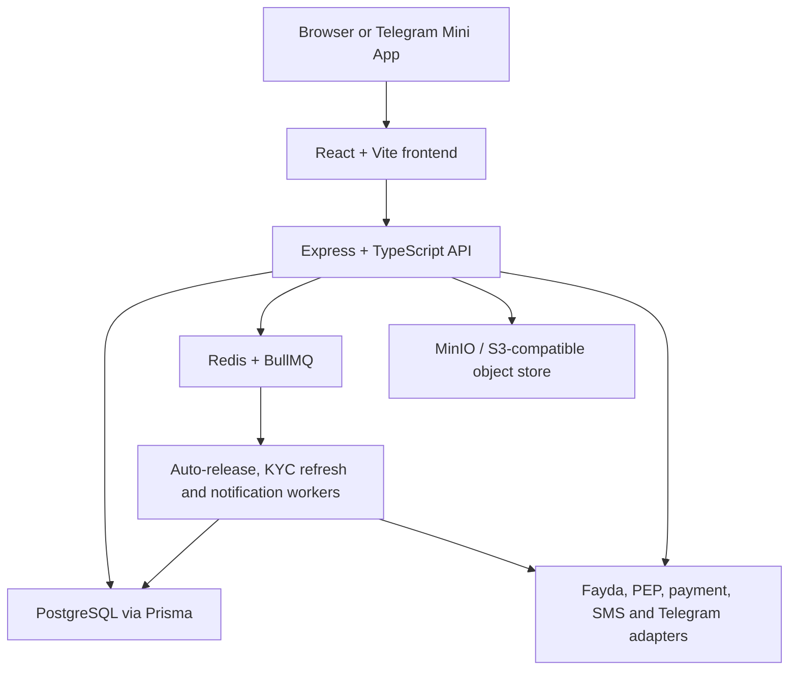

# Architecture

Last updated: 2026-08-09

## System Overview



The API is the authority for roles, KYC gates, contract signatures, state transitions, fees, tax, wallet mutations, dispute outcomes, and audit events. The frontend presents commands and current server state; it does not calculate or authorize financial outcomes.

## Repository Boundaries

| Path | Responsibility |
|---|---|
| `apps/frontend/src` | Browser/Telegram UI, API client, role-aware workspaces |
| `apps/backend/src/app.ts` | Middleware order and route registration |
| `apps/backend/src/modules` | Domain routes, services, provider adapters |
| `apps/backend/src/queue` | BullMQ queues and workers |
| `apps/backend/src/lib` | Prisma, Redis, object store, audit, logging |
| `apps/backend/prisma` | Schema and ordered migrations |
| `packages/schemas` | Shared Zod schemas and TypeScript contracts |
| `infra/postgres` | pgaudit image and database initialization |

## API Request Lifecycle

```text
request
  -> Helmet and CORS
  -> raw webhook router (provider routes only)
  -> JSON body parser
  -> structured request logging
  -> API rate limiter
  -> route authentication and role/KYC/party guards
  -> Zod validation
  -> domain service
  -> Prisma transaction and/or BullMQ job
  -> audit and notification side effects
  -> JSON response
```

Webhook routes are deliberately mounted before `express.json()` so HMAC validation uses the exact raw bytes sent by the provider.

## Domain Modules

| Module | Main responsibility |
|---|---|
| `auth` | Registration, login, JWTs (role + staffRole in payload), Telegram init-data verification |
| `kyc` | Document upload, Fayda/PEP boundary, tier transitions, staff review |
| `jobs` | Job search/creation, proposals, atomic proposal decisions |
| `contracts` | Contract creation, PDF storage, party access, signatures |
| `escrow` | Funding, webhook handling, submission, release, wallet, top-ups |
| `disputes` | Party cases, evidence, escalation, staff resolution |
| `tms` | AML flags, review queue, STR record, dismissal |
| `notifications` | In-app notification ledger and read state |
| `chat` | Guest/authenticated support conversations, auto staff assignment (load-balanced), file attachments, staff-scoped access control |

The secured `disputes/dispute.routes.ts` router is the mounted dispute implementation. The older `disputes.routes.ts` file is not mounted and should be treated as legacy until removed.

## Core State Machines

### KYC

```text
PENDING -> UNDER_REVIEW -> VERIFIED | REJECTED
TIER_1 VERIFIED -> Tier 2 request -> UNDER_REVIEW -> TIER_2 VERIFIED | REJECTED
```

The daily worker marks overdue records with `periodicReviewPending`. It does not change `VERIFIED` to `UNDER_REVIEW`, avoiding accidental loss of active access.

### Job And Proposal

```text
Job: OPEN -> IN_PROGRESS -> COMPLETED
Job: OPEN -> CANCELLED

Proposal: SUBMITTED -> SHORTLISTED -> ACCEPTED | REJECTED
Proposal: SUBMITTED | SHORTLISTED -> WITHDRAWN
```

Accepting a proposal runs in a serializable transaction. It confirms the job is still open, accepts one proposal, rejects competitors, moves the job to `IN_PROGRESS`, and creates one contract.

### Escrow

```text
PAYMENT_PENDING -> ESCROW_HELD -> SUBMITTED_FOR_REVIEW
SUBMITTED_FOR_REVIEW -> RELEASED
SUBMITTED_FOR_REVIEW -> DISPUTED
DISPUTED -> RELEASED | REFUNDED | PARTIAL_REFUND
```

Submitting a milestone schedules a warning at 24 hours before the deadline and a release at `AUTO_RELEASE_WINDOW_DAYS`. Explicit client acceptance cancels those jobs. Conditional database updates make release/refund paths idempotent under retries or concurrent requests.

### Dispute

```text
STAGE_1_NEGOTIATION -> STAGE_2_EVIDENCE -> STAGE_3_MEDIATION
STAGE_3_MEDIATION -> RESOLVED
STAGE_3_MEDIATION -> STAGE_4_ARBITRATION -> RESOLVED
```

Each dispute has a unique `milestoneId`. Resolution can release to the freelancer, refund the client, or split the milestone amount; a split cannot exceed that amount.

## Financial Integrity Controls

- The server derives milestone value, fees, and withholding; clients cannot submit authoritative totals.
- `contractId` and `milestoneId` are checked together when funding.
- A partial unique database index prevents multiple pending payment attempts for one milestone.
- Provider transaction IDs are unique and webhook transitions are idempotent.
- Release, refund, and split use transactions and guarded state updates to prevent double credit.
- Wallet mismatch is blocking: the API returns `202 HELD_FOR_REVIEW`, creates a TMS flag, and leaves balance unchanged.
- Structuring, velocity, and pass-through checks create review flags without silently changing the financial result.

## Background Processing

| Queue/worker | Trigger | Behavior |
|---|---|---|
| Auto-release | Milestone submission | Warns before deadline and conditionally releases eligible escrow |
| KYC refresh | Daily schedule | Marks periodic reviews due without revoking verified access |
| Notifications | Domain events | Persists in-app notices and attempts configured SMS/Telegram delivery |

Workers start with the backend server and depend on Redis. Retried work must remain idempotent because delivery is at least once.

## Object Storage

KYC documents, top-up receipts, and generated contract PDFs are stored as objects; PostgreSQL stores their paths. The object-store helper creates a missing development bucket automatically. Production must add encryption, versioning, object lock/retention, access logging, backup, and Ethiopian residency controls.

## Security And Compliance

- JWT authentication and fresh database role checks for authorization-sensitive job actions.
- Party checks prevent unrelated users from reading or changing contracts, milestones, and disputes.
- Staff middleware protects KYC, top-up, mediation, and TMS queues.
- Helmet, CORS, body limits, upload limits, and separate webhook rate limiting are enabled.
- `AuditLog` is append-only by application convention and supported by database grants/pgaudit initialization.
- Secrets are environment validated and must not be committed.

## External Boundaries

| Boundary | Local behavior | Production requirement |
|---|---|---|
| Fayda | Mock verification | Formal integration and credentials |
| PEP | Stub screening | Approved sanctions/PEP source |
| Payment collection | Adapter + signed webhook | Sandbox/live mapping and reconciliation |
| Payout | Wallet debit/audit only | Real disbursement and failure/reversal workflow |
| SMS/Telegram | Worker clients | Credentials, templates, account linking, monitoring |
| STR | Records a human filing | External human/regulatory process |

## Local Topology

| Service | Address |
|---|---|
| Frontend | `http://127.0.0.1:5173` |
| API | `http://127.0.0.1:4000` |
| PostgreSQL | `localhost:5433` -> container `5432` |
| Redis | `localhost:6379` |
| MinIO API | `http://localhost:9000` |
| MinIO console | `http://localhost:9001` |

See `SETUP.md` for exact commands.
