# Yekis Platform — Canonical System Design Documentation

> **Status:** Authoritative System Design Document  
> **Source Code Basis:** Derived directly from `apps/backend/src/`, `apps/frontend/src/`, `apps/backend/prisma/schema.prisma`, and `packages/schemas/`  
> **Last Verified:** 2026-08-16  

---

## Table of Contents

1. [System Overview](#1-system-overview)
2. [Data Model](#2-data-model)
3. [Per-Module Deep Dive (Backend)](#3-per-module-deep-dive)
4. [Cross-Cutting Concerns](#4-cross-cutting-concerns)
5. [The End-to-End Trust Loop](#5-the-end-to-end-trust-loop)
6. [Master Relationship & Dependency Diagram](#6-master-relationship--dependency-diagram)
7. [Known Inconsistencies, Stubs & Gaps](#7-known-inconsistencies-stubs--gaps)
8. [Frontend Architecture](#8-frontend-architecture)
9. [Platform Section-by-Section Functional Reference](#9-platform-section-by-section-functional-reference)
10. [Glossary](#10-glossary)

---

## 1. System Overview

**Yekis** is an Ethiopian freelance marketplace platform engineered to facilitate legally binding, escrow-protected digital service contracts between clients and freelancers. Its core trust proposition is an end-to-end guarantee that work is backed by pre-funded escrow locked in an in-platform ledger, governed by digital service agreements generated as immutable PDFs, guarded by tiered Know Your Customer (KYC) identity verification (with biometric deduplication), monitored by automated Anti-Money Laundering / Transaction Monitoring Systems (AML/TMS), and supported by a structured four-stage dispute resolution framework compliant with Ethiopian legal and tax requirements.

### 1.1 High-Level Architecture

```mermaid
flowchart TD
    subgraph Clients["Client Layer"]
        Web["React + Vite Web SPA (Browser)"]
        MiniApp["Telegram Mini App (TMA)"]
        TgBot["Grammy Telegram Bot"]
    end

    subgraph Gateway["API & Middleware Layer (Express + TypeScript)"]
        Router["Express Router /api/v1"]
        AuthMid["JWT Auth & Hard-Block Middleware"]
        StaffMid["Staff Role RBAC Middleware"]
        KycGate["Tiered KYC Enforcement Gate"]
        CircMid["Anti-Circumvention Filter Middleware"]
        RawBody["Raw-Body Webhook Parser"]
    end

    subgraph DomainModules["Core Domain Modules (apps/backend/src/modules/)"]
        AuthMod["Auth & Telegram Module"]
        KycMod["Tiered KYC Module"]
        JobMod["Jobs & Proposals Module"]
        ContractMod["Contracts & PDF Module"]
        EscrowMod["Escrow & Wallet Module"]
        TopUpMod["Manual Top-Up Module"]
        DisputeMod["Dispute Resolution Module"]
        TmsMod["TMS / Compliance Module"]
        ChatMod["Support & Direct Chat Module"]
        ProfileMod["Profiles, Skills & Reviews"]
        BotMod["Bot Handlers & Scenes Module"]
    end

    subgraph AsyncProcessing["Asynchronous Processing Layer (BullMQ)"]
        Q_Auto["auto-release Queue & Worker"]
        Q_Kyc["kyc-refresh Queue & Worker"]
        Q_Notif["notifications Queue & Worker"]
        Q_Rev["review-reveal Queue & Worker"]
        Q_Feat["featured-refresh Queue & Worker"]
    end

    subgraph DataStorage["Data & State Persistence"]
        PG[("PostgreSQL\n(Prisma ORM)")]
        RedisDB[("Redis\n(BullMQ & Token Cache)")]
        ObjectStore[("MinIO / S3 WORM\n(Encrypted Private Bucket)")]
    end

    subgraph ExternalServices["External & Integration Adapters"]
        TelebirrGW["Telebirr Payment Gateway\n(RSA-PSS C2B Checkout)"]
        CbeGW["CBE Birr Adapter\n[STUBBED]"]
        ChapaGW["Chapa Aggregator\n[STUBBED]"]
        SmsEth["SMSEthiopia Gateway\n(HTTP REST)"]
        TgApi["Telegram Bot API\n(Grammy Engine)"]
        FaydaAPI["Fayda National ID API\n[STUBBED]"]
        PepAPI["PEP Watchlist Engine\n[STUBBED]"]
    end

    %% Client to API
    Web -->|HTTP / JSON REST| Router
    MiniApp -->|HTTP + Telegram initData| Router
    TgBot -->|Telegram Webhooks / Updates| Router

    %% Router through Middleware
    Router --> AuthMid
    AuthMid --> KycGate
    KycGate --> StaffMid
    Router --> RawBody
    Router --> CircMid

    %% Middleware to Domain Modules
    AuthMid --> AuthMod
    KycGate --> KycMod
    KycGate --> JobMod
    KycGate --> ContractMod
    KycGate --> EscrowMod
    KycGate --> TopUpMod
    KycGate --> DisputeMod
    StaffMid --> TmsMod
    CircMid --> ChatMod
    Router --> ProfileMod
    RawBody --> EscrowMod
    Router --> BotMod

    %% Modules to Storage
    DomainModules -->|Queries & Transactions| PG
    DomainModules -->|Enqueues Delayed/Async Jobs| RedisDB
    DomainModules -->|Presigned Put/Get Object Streams| ObjectStore

    %% Workers
    RedisDB --> Q_Auto
    RedisDB --> Q_Kyc
    RedisDB --> Q_Notif
    RedisDB --> Q_Rev
    RedisDB --> Q_Feat

    Q_Auto -->|Atomic Escrow Release| PG
    Q_Kyc -->|Periodic Review Flags| PG
    Q_Notif -->|Fan-Out Dispatch| DomainModules
    Q_Rev -->|Blind Review Reveal| PG
    Q_Feat -->|Carousel Cache Refresh| PG

    %% Module / Worker Outbound Adapters
    EscrowMod -->|HTTPS + RSA-PSS| TelebirrGW
    EscrowMod -->|HTTPS HMAC| CbeGW
    EscrowMod -->|HTTPS HMAC| ChapaGW
    Q_Notif -->|SMS Dispatch| SmsEth
    Q_Notif -->|Bot Push Messages| TgApi
    KycMod -->|Biometric Verification| FaydaAPI
    KycMod -->|Sanctions Screening| PepAPI
    BotMod -->|Bot Interactions| TgApi
```

---

## 2. Data Model

The data model is implemented in PostgreSQL via Prisma (`apps/backend/prisma/schema.prisma`). It enforces strict relational integrity, WORM-style append-only compliance logging, and monetary storage using non-negative 32-bit integer minor units (ETB cents) to eliminate floating-point rounding errors.

### 2.1 Entity Relationship Diagram

```mermaid
erDiagram
    User ||--o| KycRecord : "has identity profile"
    User ||--o| Wallet : "owns in-platform ledger"
    User ||--o{ ConsentRecord : "grants compliance consents"
    User ||--o{ Job : "posts as Client"
    User ||--o{ Proposal : "submits as Freelancer"
    User ||--o{ Contract : "engages as Client"
    User ||--o{ Contract : "engages as Freelancer"
    User ||--o{ WalletTopUp : "submits manual top-ups"
    User ||--o{ Notification : "receives"
    User ||--o{ AuditLog : "acts in"
    User ||--o{ TransactionFlag : "flagged in AML"
    User ||--o{ UserSkill : "possesses"
    User ||--o{ PortfolioItem : "showcases"
    User ||--o{ Review : "authors (ReviewAuthor)"
    User ||--o{ Review : "receives (ReviewTarget)"
    User ||--o{ FeaturedLog : "featured in"
    User ||--o{ ProfileReport : "reported by / for"
    User ||--o{ Conversation : "creates as support user"
    User ||--o{ Conversation : "assigned as staff"
    User ||--o{ ConversationParticipant : "participates in"
    User ||--o{ ChatMessage : "sends in support"
    User ||--o{ DirectMessage : "sends in direct chat"
    User ||--o{ DirectThread : "client in thread"
    User ||--o{ DirectThread : "freelancer in thread"

    KycRecord ||--o{ KycDocument : "contains WORM attachments"
    KycRecord ||--o{ KycReviewEvent : "audit history of decisions"

    Job ||--o{ Proposal : "receives bids"
    Job ||--o| Contract : "transitions into"
    Job ||--o{ DirectThread : "scoped messaging"

    Proposal ||--o| CounterOffer : "negotiated via"

    Contract ||--o{ Milestone : "divided into"
    Contract ||--o| Dispute : "subject to"
    Contract ||--o| Review : "yields mutual review"

    Milestone ||--o{ PaymentTransaction : "funded via"

    Wallet ||--o{ WalletTopUp : "credited by approved top-up"

    Dispute ||--o{ DisputeEvidence : "supported by"

    Conversation ||--o{ ConversationParticipant : "has participants"
    Conversation ||--o{ ChatMessage : "contains messages"

    DirectThread ||--o{ DirectMessage : "contains messages"

    Skill ||--o{ UserSkill : "mapped to users"
    Skill ||--o{ User : "primary skill reference"

    User {
        string id PK
        string ucid UK "Unique Customer ID"
        string email UK
        string phone UK
        string passwordHash
        enum role "CLIENT | FREELANCER | BOTH"
        string languagePreference
        string timezone
        datetime dateOfBirth
        string faydaBiometricId UK
        boolean isSuspended
        enum staffRole "COMPLIANCE_OFFICER | ADMIN"
        enum cachedKycTier "TIER_1 | TIER_2 | TIER_3"
        enum cachedKycStatus "PENDING | UNDER_REVIEW | VERIFIED | REJECTED"
        int totalEarnedNetMinor
        int totalSpentGrossMinor
        string firstName
        string lastName
        string displayName
        string bio
        string avatarUrl
        json avatarCdnUrls
        string primarySkillId FK
        boolean isAvailableForWork
        enum profileVisibility "PUBLIC | PROPOSERS | PRIVATE"
        int profileCompleteness
        int totalJobsCompleted
        int totalJobsPosted
        float ratingAverage
        int ratingCount
        float ratingBayesianScore
        datetime lastFeaturedAt
        int profileViewCount
        bigint telegramUserId UK
        string telegramChatId
        datetime createdAt
        datetime updatedAt
    }

    KycRecord {
        string id PK
        string userId FK,UK
        enum tier "TIER_1 | TIER_2 | TIER_3"
        enum status "PENDING | UNDER_REVIEW | VERIFIED | REJECTED"
        enum highestVerifiedTier "TIER_1 | TIER_2 | TIER_3"
        string fullName
        string documentNumber
        string tin
        string businessRegNumber
        boolean isPepMatch
        datetime pepScreenedAt
        boolean faydaVerificationAttempted
        boolean faydaVerificationSucceeded
        string reviewedByStaffId
        string rejectionReason
        datetime lastVerifiedAt
        datetime nextReviewDueAt
        datetime createdAt
        datetime updatedAt
    }

    KycDocument {
        string id PK
        string kycRecordId FK
        enum documentType "NATIONAL_ID | PASSPORT | DRIVERS_LICENSE | SELFIE_LIVENESS | TIN_CERTIFICATE | BUSINESS_REGISTRATION"
        string storagePath "Object Store WORM key"
        datetime uploadedAt
    }

    KycReviewEvent {
        string id PK
        string kycRecordId FK
        string staffUserId
        enum decision "VERIFIED | REJECTED"
        enum tierAtDecision "TIER_1 | TIER_2 | TIER_3"
        string reason
        datetime createdAt
    }

    Job {
        string id PK
        string clientId FK
        string title
        enum category "WEB_APP_DEVELOPMENT | GRAPHIC_DESIGN | DIGITAL_MARKETING | CONTENT_WRITING | TRANSLATION | DATA_ENTRY"
        string description
        int budgetMinMinor
        int budgetMaxMinor
        datetime deadline
        enum status "OPEN | IN_PROGRESS | COMPLETED | CANCELLED"
        json proposedMilestones
        json screeningQuestions
        datetime createdAt
    }

    Proposal {
        string id PK
        string jobId FK
        string freelancerId FK
        string coverLetter
        int quotedAmountMinor
        int estimatedDays
        json milestoneBreakdown
        json screeningAnswers
        string_array attachmentPaths
        enum status "SUBMITTED | SHORTLISTED | ACCEPTED | REJECTED | WITHDRAWN | COUNTER_OFFERED"
        datetime createdAt
    }

    CounterOffer {
        string id PK
        string proposalId FK,UK
        string proposedByClientId
        int revisedAmountMinor
        int revisedEstimatedDays
        json revisedMilestones
        string message
        string status "PENDING | ACCEPTED | DECLINED"
        datetime createdAt
    }

    Contract {
        string id PK
        string jobId FK,UK
        string clientId FK
        string freelancerId FK
        string templateVersion
        string documentStoragePath
        enum status "ACTIVE | COMPLETED | TERMINATED"
        datetime clientAcceptedAt
        datetime freelancerAcceptedAt
        datetime createdAt
    }

    Milestone {
        string id PK
        string contractId FK
        string title
        int amountMinor
        datetime dueDate
        enum escrowState "PAYMENT_PENDING | ESCROW_HELD | WORK_IN_PROGRESS | SUBMITTED_FOR_REVIEW | ACCEPTED | RELEASED | DISPUTED | REFUNDED | PARTIAL_REFUND"
        datetime submittedAt
        string deliverableUrl
        datetime autoReleaseAt
        datetime releasedAt
        datetime createdAt
    }

    PaymentTransaction {
        string id PK
        string milestoneId FK
        enum provider "TELEBIRR | CHAPA | CBE_BIRR"
        string providerTransactionId UK
        int amountMinor
        string status "PENDING | SUCCESS | FAILED"
        int withholdingTaxMinor
        json rawWebhookPayload
        datetime createdAt
    }

    Wallet {
        string id PK
        string userId FK,UK
        int balanceMinor
        datetime updatedAt
    }

    WalletTopUp {
        string id PK
        string userId FK
        string walletId FK
        enum provider "TELEBIRR | CHAPA | CBE_BIRR"
        int amountMinor
        string referenceNumber
        string receiptImagePath
        enum status "PENDING | APPROVED | REJECTED | FLAGGED"
        string reviewedByStaffId
        string rejectionReason
        datetime reviewedAt
        datetime createdAt
    }

    Dispute {
        string id PK
        string contractId FK,UK
        string milestoneId
        enum category "NON_DELIVERY | LATE_DELIVERY | QUALITY_ISSUE | SCOPE_CREEP | NON_PAYMENT | COMMUNICATION_BREAKDOWN"
        enum stage "NONE | STAGE_1_NEGOTIATION | STAGE_2_EVIDENCE | STAGE_3_MEDIATION | STAGE_4_ARBITRATION | RESOLVED"
        string raisedByUserId
        string description
        datetime negotiationDeadlineAt
        datetime mediationDeadlineAt
        string evidenceBundlePath
        string mediatorRecommendation
        string resolvedByStaffId
        enum resolutionOutcome "RELEASE_TO_FREELANCER | REFUND_TO_CLIENT | PARTIAL_SPLIT"
        int freelancerShareMinor
        datetime resolvedAt
        datetime createdAt
        datetime updatedAt
    }

    DisputeEvidence {
        string id PK
        string disputeId FK
        string submittedByUserId
        string statement
        datetime createdAt
    }

    TransactionFlag {
        string id PK
        string userId FK
        enum type "STRUCTURING | VELOCITY | PASS_THROUGH | WALLET_MISMATCH | STAFF_FLAGGED"
        enum status "PENDING_REVIEW | STR_FILED | DISMISSED"
        json details
        string relatedEntityId
        string reviewedByStaffId
        string reviewNotes
        datetime strFiledAt
        string strReferenceNumber
        datetime createdAt
        datetime updatedAt
    }

    Notification {
        string id PK
        string userId FK
        string type
        string message
        json metadata
        boolean isRead
        datetime smsSentAt
        datetime createdAt
    }

    AuditLog {
        string id PK
        string userId FK
        string eventType
        string entityType
        string entityId
        json metadata
        datetime createdAt
    }

    Conversation {
        string id PK
        string creatorId FK
        string assignedStaffId FK
        string subject
        string status "OPEN | CLOSED"
        datetime createdAt
        datetime updatedAt
    }

    ConversationParticipant {
        string id PK
        string conversationId FK
        string userId FK
        datetime lastReadAt
    }

    ChatMessage {
        string id PK
        string conversationId FK
        string senderId FK
        string body
        string attachmentUrl
        datetime createdAt
    }

    Skill {
        string id PK
        string nameEn
        string nameAm
        enum category "DEVELOPMENT | DESIGN | MARKETING | WRITING | TRANSLATION | DATA_ENTRY | VIDEO_AUDIO | BUSINESS | ENGINEERING | OTHER"
        boolean isActive
        int displayOrder
    }

    UserSkill {
        string id PK
        string userId FK
        string skillId FK
        datetime createdAt
    }

    Review {
        string id PK
        string contractId FK,UK
        string authorId FK
        string targetUserId FK
        int rating
        string comment
        boolean isBlind
        datetime revealedAt
        string response
        datetime respondedAt
        boolean isDisputed
        string disputeReason
        datetime disputeResolvedAt
        enum disputeResolution "REVIEW_REMOVED | REVIEW_EDITED | NO_ACTION"
        string disputedByStaffId
        boolean isEligible
        datetime createdAt
        datetime updatedAt
    }

    PortfolioItem {
        string id PK
        string userId FK
        string title
        string description
        string thumbnailUrl
        string projectUrl
        boolean isActive
        int displayOrder
        datetime createdAt
        datetime updatedAt
    }

    FeaturedLog {
        string id PK
        string userId FK
        datetime featuredAt
        enum reason "TOP_RATED | RECENTLY_VERIFIED | STAFF_PINNED | CATEGORY_BALANCING | COLD_START"
        enum category "DEVELOPMENT | DESIGN | MARKETING | WRITING | TRANSLATION | DATA_ENTRY | VIDEO_AUDIO | BUSINESS | ENGINEERING | OTHER"
        string pinnedByStaffId
        string notes
    }

    ProfileReport {
        string id PK
        string reporterId
        string reportedUserId FK
        enum reason "FAKE_IDENTITY | OFFENSIVE_CONTENT | OFF_PLATFORM_CONTACT | MISLEADING_SKILLS | SPAM | OTHER"
        string details
        enum status "PENDING | UNDER_REVIEW | RESOLVED_NO_ACTION | RESOLVED_PROFILE_HIDDEN | RESOLVED_PROFILE_BANNED"
        string reviewedByStaffId
        string staffNotes
        datetime resolvedAt
        datetime createdAt
        datetime updatedAt
    }

    ProfileView {
        string id PK
        string viewerId
        string targetUserId
        datetime viewedAt
        string source
    }

    DirectThread {
        string id PK
        string jobId FK
        string clientId FK
        string freelancerId FK
        datetime createdAt
        datetime updatedAt
    }

    DirectMessage {
        string id PK
        string threadId FK
        string senderId FK
        string body
        boolean isRead
        datetime createdAt
    }
```

### 2.2 Model Group Descriptions

1. **Identity & Consents (`User`, `ConsentRecord`):** Manages user accounts, unique customer IDs (`ucid`), login credentials, cached KYC states, cumulative spend/earnings, profile presentation, and mandatory KYC data processing consents.
2. **KYC & Due Diligence (`KycRecord`, `KycDocument`, `KycReviewEvent`):** Encodes the tiered verification system. Documents are stored in an encrypted object store with WORM compliance, while manual staff decisions write immutable `KycReviewEvent` records.
3. **Jobs, Proposals & Direct Negotiation (`Job`, `Proposal`, `CounterOffer`, `DirectThread`, `DirectMessage`):** Handles the marketplace procurement phase. Includes proposal bidding, counter-offers, and contextual client-freelancer thread messaging passed through an anti-circumvention filter.
4. **Contracts & Execution (`Contract`, `Milestone`):** Represents signed legal agreements. When both parties digitally sign, a immutable PDF service agreement is stored, and the associated milestones transition through escrow funding.
5. **Escrow, Payments & Manual Top-Ups (`Wallet`, `WalletTopUp`, `PaymentTransaction`):** Manages financial state. Holds in-platform wallet balances, manual receipt uploads awaiting staff approval, and external payment transaction logs.
6. **Dispute Resolution (`Dispute`, `DisputeEvidence`):** Enforces a four-stage dispute workflow (Negotiation -> Evidence -> Mediation -> Arbitration) for contested milestones, allowing full release, full refund, or partial split.
7. **Compliance & AML (`TransactionFlag`, `AuditLog`):** Transaction monitoring system (TMS) rule flags (structuring, velocity, pass-through, wallet mismatch) and the tamper-resistant system-wide audit trail.
8. **Support & Notifications (`Conversation`, `ConversationParticipant`, `ChatMessage`, `Notification`):** In-app customer support ticketing and asynchronous notification dispatch (in-app, SMS, Telegram).
9. **Talent Discovery, Reviews & Portfolio (`Skill`, `UserSkill`, `Review`, `PortfolioItem`, `FeaturedLog`, `ProfileReport`, `ProfileView`):** Skill taxonomies, portfolio showcases, double-blind reviews with Bayesian scoring, cold-start carousel rotation, and user moderation.

---

## 3. Per-Module Deep Dive

---

### 3.1 Module: Identity & Authentication (`apps/backend/src/modules/auth/`)

* **Purpose:** Handles user registration, age gating (18+ requirement), credential authentication, JWT token issuance (access/refresh), password hashing (Argon2), consent capture, and Telegram Mini App session verification.
* **Owns Models:** `User`, `ConsentRecord`.

#### State Machine
Auth does not have a multi-step entity state machine, but enforces an active session gate:
`UNAUTHENTICATED` $\rightarrow$ (Valid Credentials / Verified Telegram initData) $\rightarrow$ `AUTHENTICATED_ACTIVE` $\rightarrow$ (`isSuspended: true`) $\rightarrow$ `FORBIDDEN_SUSPENDED`.

#### Key Flows

##### Flow 1: User Registration with Age Gate & Mandatory Consent
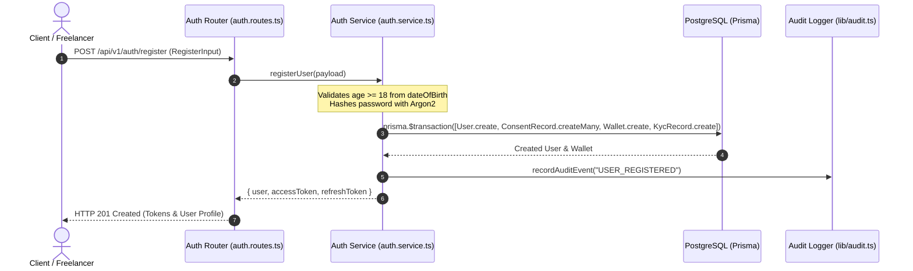

##### Flow 2: Telegram Mini App Authentication
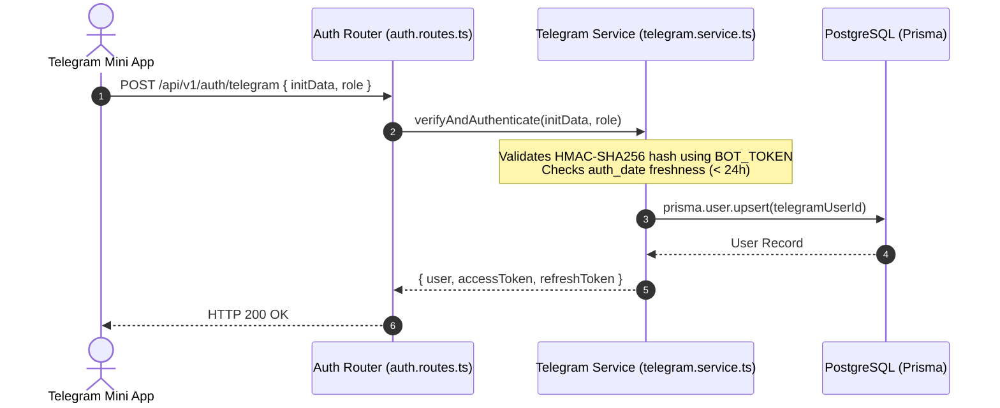

#### API Surface
| Method | Path | Auth / Permission | Purpose |
|---|---|---|---|
| `POST` | `/api/v1/auth/register` | Public | Register account, validate age $\ge 18$, record consents, create wallet & KYC record |
| `POST` | `/api/v1/auth/login` | Public | Authenticate via email/password, return access & refresh JWTs |
| `POST` | `/api/v1/auth/refresh` | Public (Refresh Token) | Rotate expired access token using valid refresh token |
| `POST` | `/api/v1/auth/telegram` | Public (`initData`) | Validate Telegram WebApp hash and issue JWT session |
| `GET` | `/api/v1/auth/me` | Authenticated | Return authenticated user's record and current KYC status |

* **Depends on:** `apps/backend/src/lib/prisma.ts`, `apps/backend/src/lib/audit.ts`, `apps/backend/src/config/env.ts`.
* **Depended on by:** `apps/backend/src/middleware/auth.ts`, `apps/backend/src/modules/bot/bot.service.ts`.

---

### 3.2 Module: Tiered KYC (`apps/backend/src/modules/kyc/`)

* **Purpose:** Implements tiered compliance verification. Tier 1 gates browsing and proposal bidding; Tier 2 (TIN / Business Reg) gates withdrawal capabilities; Tier 3 handles PEP / high-volume enhanced due diligence.
* **Owns Models:** `KycRecord`, `KycDocument`, `KycReviewEvent`.

#### State Machine (`KycStatus` & `KycTier`)

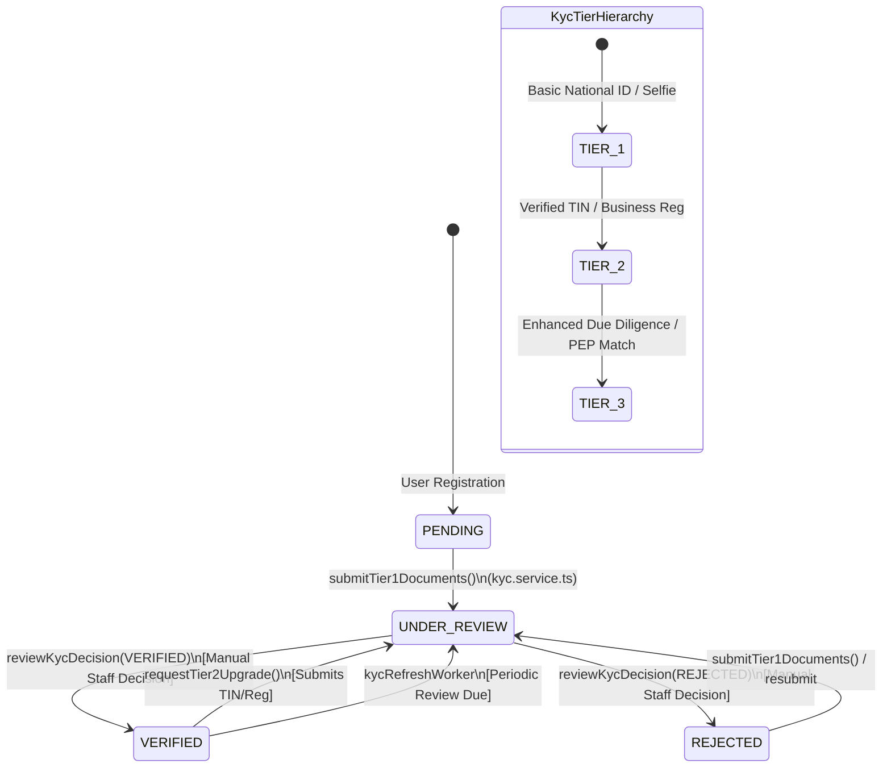

#### Key Flows

##### Flow 1: Document Upload & Verification Submission
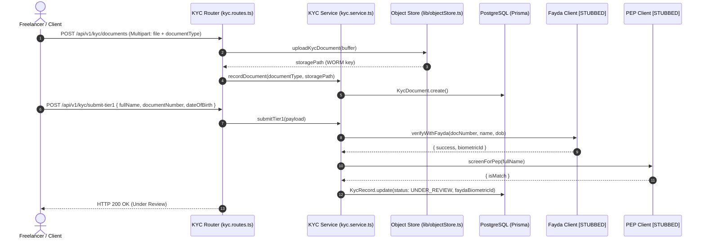

#### API Surface
| Method | Path | Auth / Permission | Purpose |
|---|---|---|---|
| `GET` | `/api/v1/kyc/status` | Authenticated | Get current user's KYC tier, status, and missing requirements |
| `POST` | `/api/v1/kyc/documents` | Authenticated | Multipart upload of KYC document image/PDF to encrypted WORM storage |
| `POST` | `/api/v1/kyc/submit-tier1` | Authenticated | Submit personal details for Tier 1 automated and manual review |
| `POST` | `/api/v1/kyc/upgrade-tier2` | Authenticated (Tier 1 Verified) | Submit TIN / Business Registration number for Tier 2 withdrawal rights |
| `GET` | `/api/v1/kyc/admin/queue` | Staff (`COMPLIANCE_OFFICER` / `ADMIN`) | List pending KYC submissions requiring human verification |
| `POST` | `/api/v1/kyc/admin/review/:id` | Staff (`COMPLIANCE_OFFICER` / `ADMIN`) | Submit formal KYC decision (`VERIFIED` / `REJECTED`) with audit logging |
| `GET` | `/api/v1/kyc/admin/document-url/:docId`| Staff (`COMPLIANCE_OFFICER` / `ADMIN`) | Generate temporary signed URL to inspect encrypted KYC document |

* **Depends on:** `apps/backend/src/lib/prisma.ts`, `apps/backend/src/lib/objectStore.ts`, `apps/backend/src/lib/audit.ts`, `apps/backend/src/modules/kyc/fayda.client.ts`, `apps/backend/src/modules/kyc/pep.client.ts`.
* **Depended on by:** `apps/backend/src/middleware/hardBlock.ts`, `apps/backend/src/middleware/requireKycVerified.ts`, `apps/backend/src/queue/kycRefresh.worker.ts`.

---

### 3.3 Module: Jobs, Proposals & Direct Messaging (`apps/backend/src/modules/jobs/`)

* **Purpose:** Handles job posting, search/filtering, freelancer proposal submissions, counter-offers, proposal acceptance, and contextual direct messaging between clients and proposers.
* **Owns Models:** `Job`, `Proposal`, `CounterOffer`, `DirectThread`, `DirectMessage`.

#### State Machines

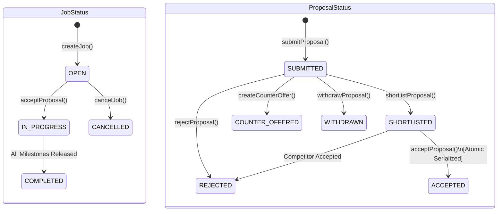

#### Key Flows

##### Flow 1: Proposal Submission with Anti-Self-Bidding Guard
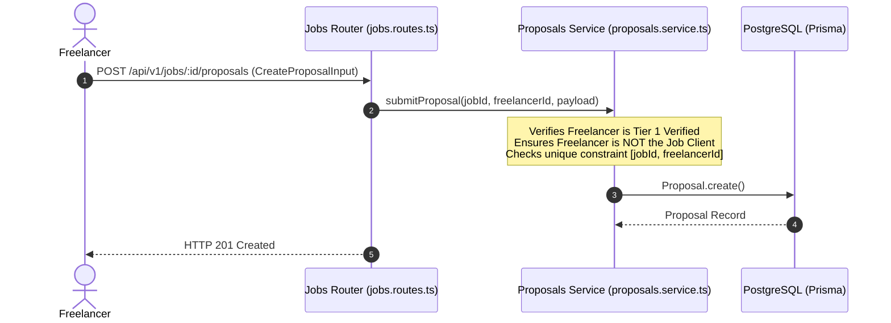

##### Flow 2: Atomic Proposal Acceptance & Contract Creation
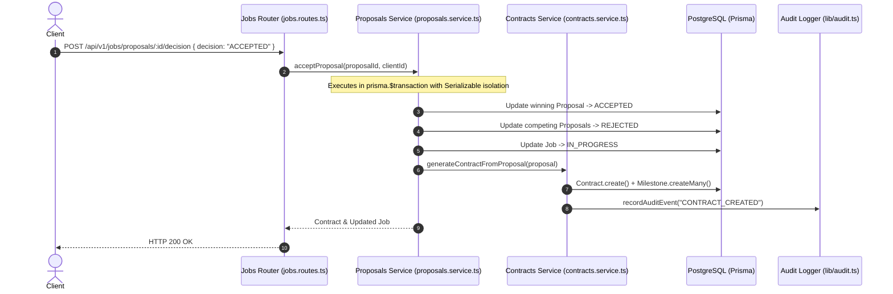

#### API Surface
| Method | Path | Auth / Permission | Purpose |
|---|---|---|---|
| `GET` | `/api/v1/jobs` | Public / Authed | Search and list open jobs with category, budget, and pagination filters |
| `GET` | `/api/v1/jobs/my` | Authenticated (Client) | List all jobs posted by the authenticated client |
| `POST` | `/api/v1/jobs` | Authenticated (`CLIENT` / `BOTH`, Tier 1) | Create and publish a new job brief with proposed milestones |
| `GET` | `/api/v1/jobs/:id` | Authenticated | Retrieve full job details, screening questions, and proposal counts |
| `POST` | `/api/v1/jobs/:id/proposals` | Authenticated (`FREELANCER`, Tier 1) | Submit a bid proposal with quoted price and milestone breakdown |
| `GET` | `/api/v1/jobs/:id/proposals` | Authenticated (Job Client Only) | List all proposals submitted to a specific job |
| `GET` | `/api/v1/jobs/proposals/my` | Authenticated (Freelancer) | List all proposals submitted by the current freelancer |
| `POST` | `/api/v1/jobs/proposals/:id/decision` | Authenticated (Job Client Only) | Shortlist, reject, or atomically accept a proposal |
| `POST` | `/api/v1/jobs/proposals/:id/counter` | Authenticated (Job Client Only) | Propose modified milestone amounts or timelines to freelancer |
| `GET` | `/api/v1/jobs/:id/threads` | Authenticated (Party to Job) | List or retrieve direct messaging thread for a specific job |
| `POST` | `/api/v1/jobs/:id/messages` | Authenticated (Party to Job) | Send in-thread message (sanitized for anti-circumvention) |

* **Depends on:** `apps/backend/src/lib/prisma.ts`, `apps/backend/src/lib/audit.ts`, `apps/backend/src/modules/contracts/contracts.service.ts`, `apps/backend/src/middleware/circumvention.middleware.ts`.
* **Depended on by:** `apps/backend/src/modules/contracts/contracts.service.ts`.

---

### 3.4 Module: Contracts & Service Agreements (`apps/backend/src/modules/contracts/`)

* **Purpose:** Manages the legal contract lifecycle between client and freelancer. Compiles dynamic PDF Service Agreements (using `pdf-lib`), collects independent digital signature timestamps, and automatically triggers escrow locking upon mutual execution.
* **Owns Models:** `Contract`.

#### State Machine (`ContractStatus`)

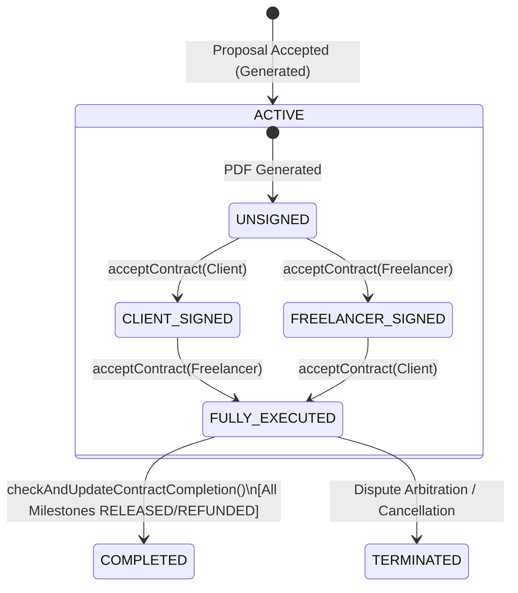

#### Key Flows

##### Flow 1: Dual Digital Contract Signing & Auto-Escrow Trigger
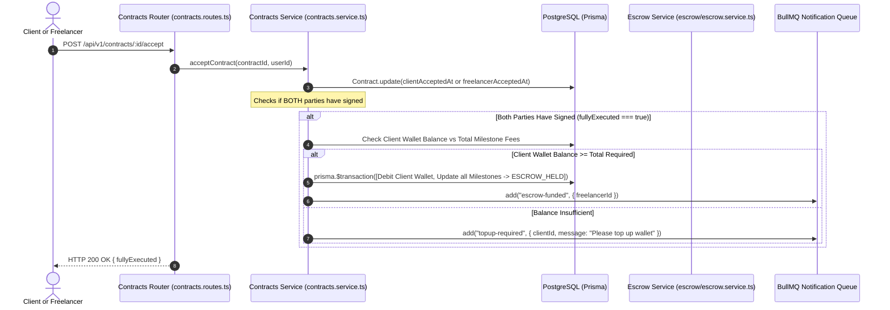

#### API Surface
| Method | Path | Auth / Permission | Purpose |
|---|---|---|---|
| `GET` | `/api/v1/contracts` | Authenticated (Party) | List all contracts associated with the authenticated user |
| `GET` | `/api/v1/contracts/:id` | Authenticated (Contract Party) | Get contract status, milestone details, and party signatures |
| `GET` | `/api/v1/contracts/:id/document` | Authenticated (Contract Party) | Generate temporary signed URL to download legal Service Agreement PDF |
| `POST` | `/api/v1/contracts/:id/accept` | Authenticated (Contract Party) | Record digital agreement signature timestamp |

* **Depends on:** `apps/backend/src/lib/prisma.ts`, `apps/backend/src/lib/audit.ts`, `apps/backend/src/modules/contracts/serviceAgreement.template.ts`, `apps/backend/src/modules/contracts/contractStorage.ts`, `apps/backend/src/modules/escrow/fees.ts`, `apps/backend/src/queue/queues.ts`.
* **Depended on by:** `apps/backend/src/modules/jobs/proposals.service.ts`, `apps/backend/src/modules/escrow/escrow.service.ts`.

---

### 3.5 Module: Escrow & Wallet (`apps/backend/src/modules/escrow/`)

* **Purpose:** The core financial ledger engine. Manages milestone escrow states, wallet-first escrow funding, delivery submissions, client approvals, auto-release timers, fee and withholding tax splits, provider checkout initiation (Telebirr, Chapa, CBE Birr), and Tier 2-gated freelancer withdrawals.
* **Owns Models:** `Milestone`, `PaymentTransaction`, `Wallet`.

#### Escrow Funds Flow (Plain-English Narrative)

Funds move through six sequential phases. All amounts are stored and computed as **integer minor units (ETB cents)** — never floating-point — to prevent rounding errors.

**Phase 1 — Client Wallet Top-Up (Before Any Work)**
The client must first load their in-platform wallet with real ETB. They transfer funds via Telebirr, Chapa, or CBE Birr, then submit a top-up request (`POST /api/v1/topups`) with a receipt image and the sender reference. A staff member reviews the receipt in the admin panel and either approves or rejects it. On approval, the client's `wallet.balanceMinor` is credited atomically in a Prisma transaction. No funds move automatically — this step is always human-gated.

**Phase 2 — Contract Signing (Trust Lock)**
Both the client and freelancer must digitally accept the contract (`POST /api/v1/contracts/:id/accept`) before any escrow can be funded. The service enforces this: `fundMilestone` and `fundMilestoneFromWallet` both throw `ContractNotFullyExecutedError` if either `clientAcceptedAt` or `freelancerAcceptedAt` is missing. The moment the **second signature** is recorded, the contracts service automatically attempts to fund all `PAYMENT_PENDING` milestones from the client's wallet in a single atomic transaction (wallet debit + all milestone state updates in one `prisma.$transaction`). If the client wallet has insufficient balance, a `"topup-required"` notification is sent instead and the client must fund manually.

**Phase 3 — Escrow Holding (Funds Locked)**
When a milestone is funded — either automatically on contract signing, or manually via `POST /api/v1/escrow/fund-from-wallet` — the client is charged `gross + platform fee from client` (currently **gross × 1.05**). This full charge is atomically deducted from their wallet, and the milestone transitions to `ESCROW_HELD`. The freelancer receives a `"escrow-funded"` push notification signalling they can begin work. A TMS structuring check (`runPostFundingChecks`) runs non-blockingly after the state transition to flag any suspicious funding patterns.

**Phase 4 — Work Delivery & Review Window**
The freelancer submits work via `POST /api/v1/escrow/milestones/:id/submit`. The milestone moves to `SUBMITTED_FOR_REVIEW` and two BullMQ jobs are scheduled with deterministic job IDs:
- A **warn job** fires 24 hours before the auto-release deadline (notifying the client their review window is almost up).
- A **release job** fires at the deadline (`AUTO_RELEASE_WINDOW_DAYS` from submission) and calls `releaseMilestoneFunds()` automatically.

The client can act in one of two ways before the timer fires: **accept** the work (releases funds immediately) or **raise a dispute** (freezes escrow and cancels both BullMQ jobs).

**Phase 5 — Release & Fee Split**
Whether triggered by the client's explicit acceptance or the auto-release timer, `releaseMilestoneFunds()` executes an atomic three-way transaction:
1. Milestone → `RELEASED` with `releasedAt` timestamp.
2. Freelancer's `wallet.balanceMinor` incremented by `freelancerNetMinor`.
3. Freelancer's lifetime `user.totalEarnedNetMinor` counter incremented (this drives the public profile "total earned" figure independently of the spendable wallet balance).

The **freelancer's net amount** is: `gross − platform fee from freelancer (5%) − withholding tax`. Withholding tax only applies when the gross milestone amount meets or exceeds `WITHHOLDING_THRESHOLD_MINOR` (ETB 10,000), with a lower rate (3%) for freelancers who have a TIN on file and a higher rate (30%) for those without — per Ethiopian tax law. After release, `checkAndUpdateContractCompletion()` checks whether every milestone on the contract has reached a terminal state (`RELEASED`, `REFUNDED`, or `PARTIAL_REFUND`) and marks the contract `COMPLETED` if so.

**Phase 5b — Dispute Path**
If either party calls `POST /api/v1/disputes` while the milestone is in `ESCROW_HELD`, `WORK_IN_PROGRESS`, or `SUBMITTED_FOR_REVIEW`, the milestone transitions to `DISPUTED` and both BullMQ jobs are cancelled immediately. Funds remain frozen in the escrow ledger (no wallet entries are written) while a three-stage mediation process runs (Negotiation → Admin Review → Mediation). A staff mediator resolves the dispute with one of three outcomes: `RELEASE_TO_FREELANCER` (calls `releaseMilestoneFunds`), `REFUND_TO_CLIENT` (calls `refundMilestoneToClient`, crediting the client's wallet), or `PARTIAL_SPLIT` (calls both with split amounts, milestone → `PARTIAL_REFUND`).

**Phase 6 — Freelancer Withdrawal**
Once funds are in the freelancer's wallet, they can request a payout via `POST /api/v1/escrow/wallet/withdraw`. This endpoint requires **Tier 2 KYC** (full identity verification). Three additional guards apply:
- If the user is a `CLIENT`, any active contract milestone or open dispute blocks the withdrawal entirely (`ActiveContractWithdrawalBlockedError`).
- **Wallet-mismatch check (hard block):** If the payout destination account does not match the identity on the KYC record, the withdrawal is held for compliance review and returns HTTP 202 (`HELD_FOR_REVIEW`). Funds are not moved.
- **Pass-through check (soft flag):** If the withdrawal looks like an immediate pass-through (funds in → funds out with no real activity), a `TransactionFlag` is created for staff review but the withdrawal is not blocked.

On a clean pass, the wallet balance is optimistically debited. Note: the actual **provider payout API** (sending real ETB to the freelancer's Telebirr/CBE account) is not yet wired to live SDKs — the balance is debited internally but no external transfer is executed in the current build.

#### State Machine (`EscrowState`)

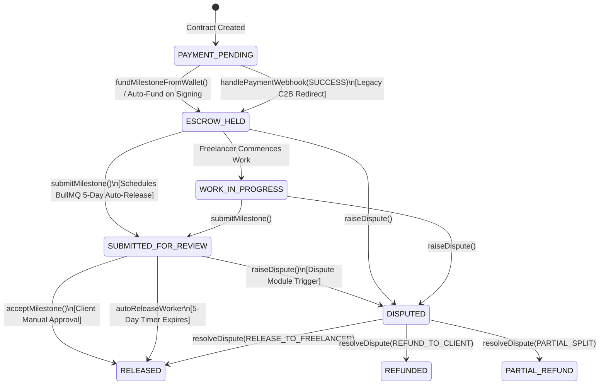

#### Financial Split Logic (`calculateFees` in `fees.ts`)
* **Gross Milestone Amount:** $M$
* **Client Total Charge:** $M \times (1 + \text{Client Fee Rate})$, where Client Fee Rate = 5% (`PLATFORM_FEE_RATE_CLIENT = 0.05`).
* **Platform Fee from Freelancer:** $M \times \text{Freelancer Fee Rate}$, where Freelancer Fee Rate = 5% (`PLATFORM_FEE_RATE_FREELANCER = 0.05`).
* **Withholding Tax:** If $M \ge \text{ETB 10,000}$ (`WITHHOLDING_THRESHOLD_MINOR = 1000000`):
  * Freelancer with TIN: $M \times 3\%$ (`WITHHOLDING_TAX_RATE_WITH_TIN = 0.03`).
  * Freelancer without TIN: $M \times 30\%$ (`WITHHOLDING_TAX_RATE_WITHOUT_TIN = 0.30`).
* **Net Credited to Freelancer Wallet:** $M - \text{Freelancer Platform Fee} - \text{Withholding Tax}$.

#### Key Flows

##### Flow 1: Wallet-First Escrow Funding
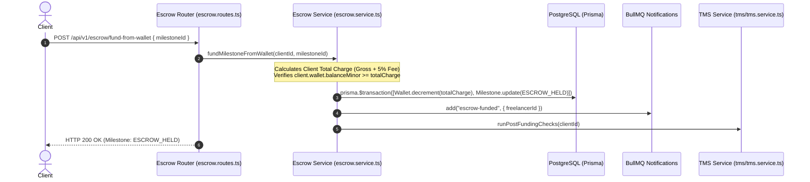

##### Flow 2: Milestone Delivery, Auto-Release Timer & Acceptance
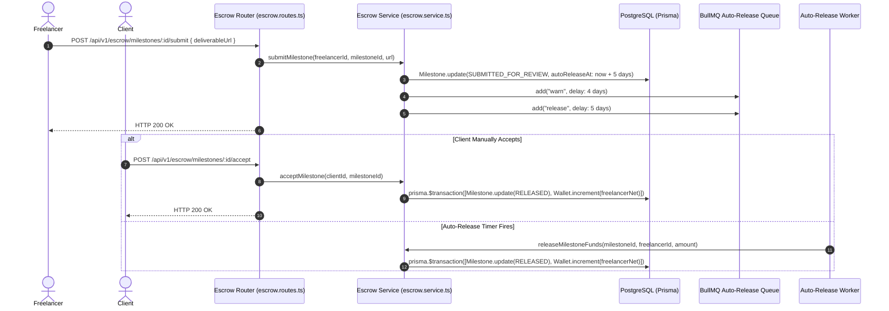

##### Flow 3: Tier 2 Freelancer Withdrawal with TMS Wallet Mismatch Guard
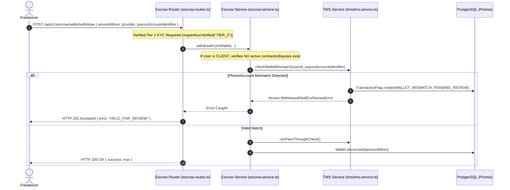

#### API Surface
| Method | Path | Auth / Permission | Purpose |
|---|---|---|---|
| `POST` | `/api/v1/escrow/fund-from-wallet` | Authenticated (Client, Tier 1) | Atomically deduct milestone charge from client wallet and set `ESCROW_HELD` |
| `POST` | `/api/v1/escrow/fund` | Authenticated (Client, Tier 1) | (Deprecated C2B) Initiate external provider redirect payment |
| `GET` | `/api/v1/escrow/wallet` | Authenticated | Return authenticated user's current wallet `balanceMinor` |
| `GET` | `/api/v1/escrow/milestones` | Authenticated | List all milestones across user's contracts |
| `POST` | `/api/v1/escrow/milestones/:id/submit` | Authenticated (Contract Freelancer) | Submit milestone deliverable, schedule 5-day BullMQ auto-release |
| `POST` | `/api/v1/escrow/milestones/:id/accept` | Authenticated (Contract Client) | Manually approve deliverable and release funds net of fees/tax |
| `POST` | `/api/v1/escrow/wallet/withdraw` | Authenticated (Tier 2 Verified) | Request payout to Telebirr/CBE; runs TMS checks and active-contract blocks |
| `POST` | `/api/v1/webhooks/telebirr` | Public (Raw Body, RSA-PSS Sign) | Ingest Telebirr payment webhooks, verify RSA-PSS body signature, update escrow |
| `POST` | `/api/v1/webhooks/chapa` | Public (Raw Body, HMAC Header) | Ingest Chapa payment webhooks, verify HMAC signature [STUBBED] |
| `POST` | `/api/v1/webhooks/cbe` | Public (Raw Body, HMAC Header) | Ingest CBE payment webhooks [STUBBED] |

* **Depends on:** `apps/backend/src/lib/prisma.ts`, `apps/backend/src/lib/audit.ts`, `apps/backend/src/queue/queues.ts`, `apps/backend/src/modules/tms/tms.service.ts`, `apps/backend/src/modules/escrow/fees.ts`, `apps/backend/src/modules/escrow/providers/telebirr.client.ts`.
* **Depended on by:** `apps/backend/src/queue/autoRelease.worker.ts`, `apps/backend/src/modules/contracts/contracts.service.ts`, `apps/backend/src/modules/disputes/dispute.service.ts`.

---

### 3.6 Module: Manual Wallet Top-Ups (`apps/backend/src/modules/topups/`)

* **Purpose:** Provides a manual bank receipt upload flow for funding in-platform wallets. Clients deposit directly into the platform's Telebirr or CBE corporate bank accounts, upload receipt screenshots with reference numbers, which staff review and verify before crediting `Wallet.balanceMinor`.
* **Owns Models:** `WalletTopUp`.

#### State Machine (`TopUpStatus`)

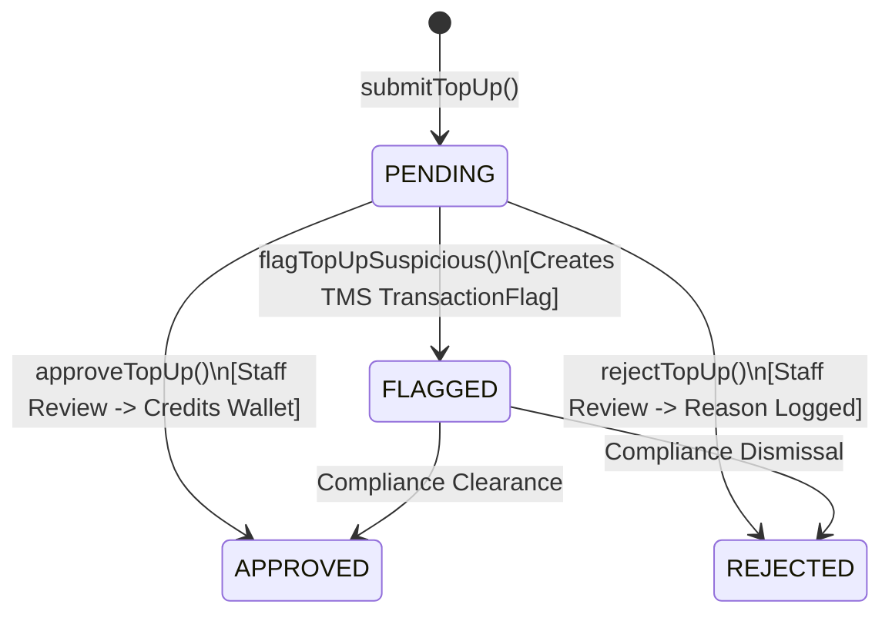

#### API Surface
| Method | Path | Auth / Permission | Purpose |
|---|---|---|---|
| `GET` | `/api/v1/wallet/topups` | Authenticated | List all top-up requests submitted by the authenticated user |
| `POST` | `/api/v1/wallet/topups` | Authenticated (Multipart) | Submit receipt image, provider (`TELEBIRR` / `CBE_BIRR`), reference, and amount |
| `GET` | `/api/v1/wallet/topups/admin/queue` | Staff (`COMPLIANCE_OFFICER` / `ADMIN`) | View pending top-up review queue with user details |
| `POST` | `/api/v1/wallet/topups/admin/:id/decision`| Staff (`COMPLIANCE_OFFICER` / `ADMIN`) | Approve (credits wallet atomically) or reject top-up |
| `POST` | `/api/v1/wallet/topups/admin/:id/flag` | Staff (`COMPLIANCE_OFFICER` / `ADMIN`) | Mark top-up as suspicious and generate TMS AML flag |
| `GET` | `/api/v1/wallet/topups/admin/:id/receipt-url`| Staff (`COMPLIANCE_OFFICER` / `ADMIN`) | Generate short-lived presigned URL to view receipt image |

* **Depends on:** `apps/backend/src/lib/prisma.ts`, `apps/backend/src/lib/objectStore.ts`, `apps/backend/src/lib/audit.ts`, `apps/backend/src/modules/tms/tms.service.ts`.
* **Depended on by:** Mounted at `/api/v1/wallet/topups`.

---

### 3.7 Module: Dispute Resolution (`apps/backend/src/modules/disputes/`)

* **Purpose:** Implements a structured four-stage escalation procedure for contested milestones. Allows direct negotiation, evidence submission bundles, staff mediation, and AACCSA-aligned arbitration.
* **Owns Models:** `Dispute`, `DisputeEvidence`.

#### State Machine (`DisputeStage`)

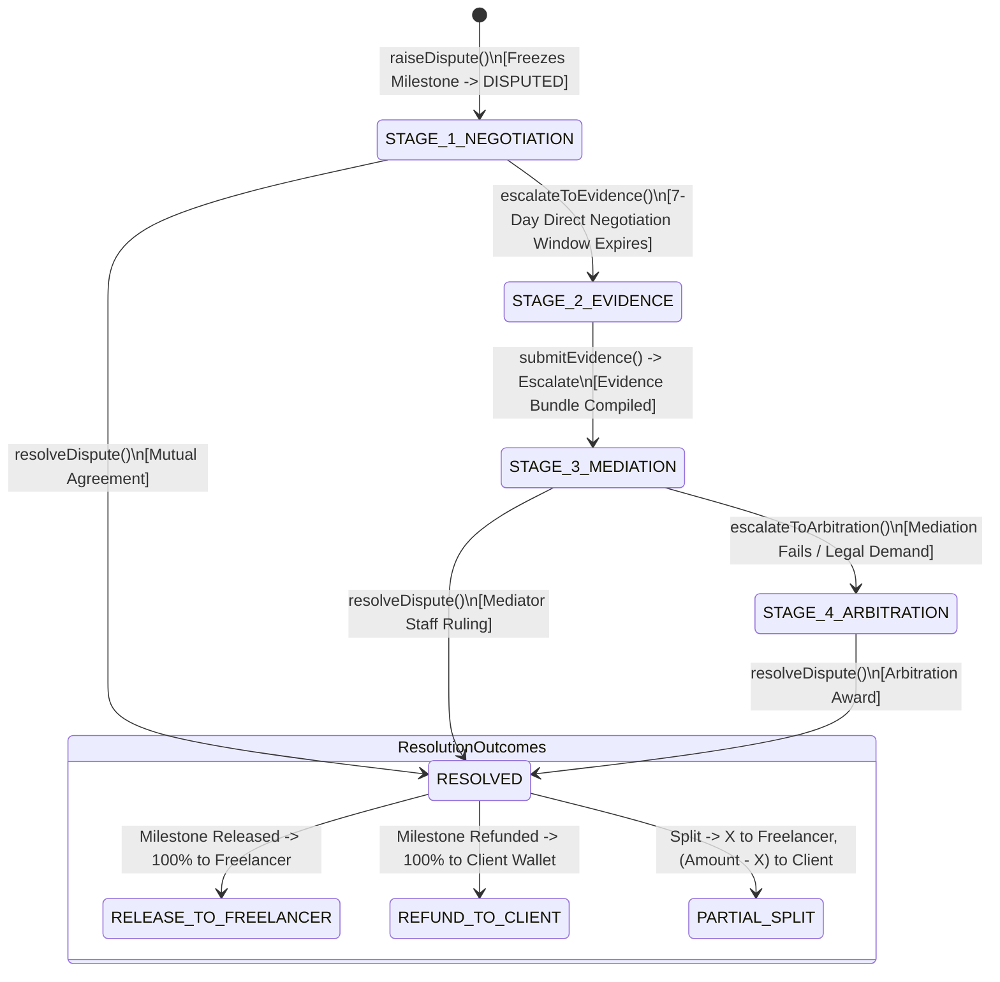

#### Key Flows

##### Flow 1: Raising a Dispute & Freezing Escrow
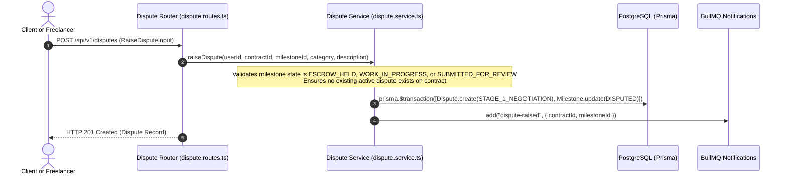

#### API Surface
| Method | Path | Auth / Permission | Purpose |
|---|---|---|---|
| `GET` | `/api/v1/disputes` | Authenticated | List all disputes involving the authenticated user |
| `GET` | `/api/v1/disputes/:id` | Authenticated (Dispute Party / Staff) | Get dispute timeline, evidence, and mediator recommendations |
| `POST` | `/api/v1/disputes` | Authenticated (Contract Party) | Raise dispute on a funded milestone (freezes escrow) |
| `POST` | `/api/v1/disputes/:id/evidence` | Authenticated (Dispute Party) | Submit statement/evidence during Stage 2 |
| `POST` | `/api/v1/disputes/:id/escalate` | Authenticated (Dispute Party) | Escalate from Negotiation $\rightarrow$ Evidence or Evidence $\rightarrow$ Mediation |
| `GET` | `/api/v1/disputes/admin/queue` | Staff (`COMPLIANCE_OFFICER` / `ADMIN`) | List disputes in Stage 3 Mediation requiring staff resolution |
| `POST` | `/api/v1/disputes/admin/:id/resolve`| Staff (`COMPLIANCE_OFFICER` / `ADMIN`) | Execute binding outcome (`RELEASE_TO_FREELANCER`, `REFUND_TO_CLIENT`, `PARTIAL_SPLIT`) |
| `POST` | `/api/v1/disputes/admin/:id/arbitrate`| Staff (`COMPLIANCE_OFFICER` / `ADMIN`) | Escalate complex legal claim to Stage 4 AACCSA arbitration |

* **Depends on:** `apps/backend/src/lib/prisma.ts`, `apps/backend/src/lib/audit.ts`, `apps/backend/src/queue/queues.ts`, `apps/backend/src/modules/escrow/escrow.service.ts`.
* **Depended on by:** Mounted at `/api/v1/disputes`.

---

### 3.8 Module: Transaction Monitoring / TMS (`apps/backend/src/modules/tms/`)

* **Purpose:** Implements automated Anti-Money Laundering (AML) heuristics. Detects payment structuring, velocity spikes, pass-through withdrawals, and wallet mismatches. Provides staff queue for human investigation and recording Suspicious Transaction Report (STR) filings with the Financial Intelligence Center (FIC).
* **Owns Models:** `TransactionFlag`.

#### AML Rule Matrix
| Rule Type | Evaluated At | Heuristic / Threshold | Action |
|---|---|---|---|
| `STRUCTURING` | Escrow Funding (`runStructuringCheck`) | $\ge 3$ payments within 72h (`TMS_STRUCTURING_WINDOW_HOURS = 72`) each between ETB 9,000 and ETB 9,999.99 (just below the ETB 10,000 withholding threshold). | **Flags** user for review (Non-blocking). |
| `VELOCITY` | Escrow Release (`runVelocityCheck`) | $\ge 20$ completed milestones (`TMS_VELOCITY_MILESTONE_THRESHOLD = 20`) within 48h (`TMS_VELOCITY_WINDOW_HOURS = 48`). | **Flags** freelancer for review (Non-blocking). |
| `PASS_THROUGH`| Withdrawal (`runPassThroughCheck`) | Withdrawal amount $\ge 90\%$ of recent milestone release within 24h (`TMS_PASS_THROUGH_WINDOW_HOURS = 24`) with 0 other active contracts. | **Flags** user for review (Non-blocking). |
| `WALLET_MISMATCH`| Withdrawal (`checkWalletMismatch`) | Payout phone or bank account number does not match user's registered/verified phone number. | **BLOCKS** withdrawal (`WithdrawalHeldForReviewError`, HTTP 202) & creates flag. |
| `STAFF_FLAGGED`| Manual Top-Up Review | Staff manually identifies fraudulent/suspicious deposit receipt. | **Flags** top-up and user (Manual). |

#### API Surface
| Method | Path | Auth / Permission | Purpose |
|---|---|---|---|
| `GET` | `/api/v1/tms/flags` | Staff (`COMPLIANCE_OFFICER` / `ADMIN`) | Query AML flag queue with status, type, and search filters |
| `GET` | `/api/v1/tms/activity-feed` | Staff (`COMPLIANCE_OFFICER` / `ADMIN`) | Get real-time audit feed of compliance actions |
| `POST` | `/api/v1/tms/flags/:id/file-str` | Staff (`COMPLIANCE_OFFICER` / `ADMIN`) | Record manual STR regulatory filing with FIC reference number |
| `POST` | `/api/v1/tms/flags/:id/dismiss` | Staff (`COMPLIANCE_OFFICER` / `ADMIN`) | Dismiss flag after human investigation with mandatory notes |

* **Depends on:** `apps/backend/src/lib/prisma.ts`, `apps/backend/src/lib/audit.ts`, `apps/backend/src/config/env.ts`.
* **Depended on by:** `apps/backend/src/modules/escrow/escrow.service.ts`, `apps/backend/src/modules/topups/topup.service.ts`.

---

### 3.9 Module: Notifications (`apps/backend/src/modules/notifications/`)

* **Purpose:** Multi-channel notification fan-out engine. Dispatches in-app notifications, SMS alerts via SMSEthiopia for critical financial/legal events, and push notifications via Telegram Bot.
* **Owns Models:** `Notification`.

#### Critical Notification Types Matrix (Triggering SMS)
Defined in `notification.service.ts:CRITICAL_NOTIFICATION_TYPES`:
* `escrow-funded`
* `escrow-released`
* `dispute-raised`
* `dispute-resolved`
* `kyc-rejected`
* `withdrawal-held`

#### API Surface
| Method | Path | Auth / Permission | Purpose |
|---|---|---|---|
| `GET` | `/api/v1/notifications` | Authenticated | List notifications for authenticated user |
| `POST` | `/api/v1/notifications/:id/read`| Authenticated | Mark notification as read |
| `POST` | `/api/v1/notifications/read-all`| Authenticated | Mark all notifications as read |

* **Depends on:** `apps/backend/src/lib/prisma.ts`, `apps/backend/src/modules/notifications/sms.client.ts`, `apps/backend/src/modules/notifications/telegram.client.ts`.
* **Depended on by:** `apps/backend/src/queue/notification.worker.ts`.

---

### 3.10 Module: Support Chat & Direct Messaging (`apps/backend/src/modules/chat/`)

* **Purpose:** Provides authenticated and guest customer support ticketing with staff auto-assignment, as well as direct messaging threads protected by regex anti-circumvention filters (blocking off-platform phone numbers, Telegram handles, and external payment prompts).
* **Owns Models:** `Conversation`, `ConversationParticipant`, `ChatMessage`.

#### API Surface
| Method | Path | Auth / Permission | Purpose |
|---|---|---|---|
| `GET` | `/api/v1/chat/conversations` | Authenticated | List all support conversations user participates in |
| `POST` | `/api/v1/chat/conversations` | Authenticated | Open new support ticket |
| `GET` | `/api/v1/chat/conversations/:id/messages` | Authenticated (Participant/Staff) | Get messages in support thread |
| `POST` | `/api/v1/chat/conversations/:id/messages` | Authenticated (Participant/Staff) | Send message in support thread |
| `GET` | `/api/v1/chat/admin/conversations` | Staff (`COMPLIANCE_OFFICER` / `ADMIN`) | List all support conversations with load-balancing views |
| `PATCH` | `/api/v1/chat/admin/conversations/:id/status` | Staff (`COMPLIANCE_OFFICER` / `ADMIN`) | Close or reopen support ticket |
| `POST` | `/api/v1/chat/guest/conversations` | Public (Guest Session) | Allow unauthenticated users to open support tickets |

* **Depends on:** `apps/backend/src/lib/prisma.ts`, `apps/backend/src/lib/objectStore.ts`, `apps/backend/src/middleware/circumvention.middleware.ts`.
* **Depended on by:** Mounted at `/api/v1/chat`.

---

### 3.11 Module: Profiles, Skills, Reviews, Portfolio & Featured Talent

* **Purpose:** Manages user discovery and reputation:
  * **Skills (`apps/backend/src/modules/skills/`):** Amharic/English localized skills taxonomy.
  * **Profiles (`apps/backend/src/modules/profiles/`):** Profile completeness scores, privacy visibility (`PUBLIC`, `PROPOSERS`, `PRIVATE`), and moderation reporting.
  * **Reviews (`apps/backend/src/modules/reviews/`):** Mutual double-blind reviews revealed after 14 days or mutual submission, with Bayesian sorting (`ratingBayesianScore`).
  * **Featured Talent (`apps/backend/src/modules/featured/`):** Cold-start carousel rotation algorithm balancing top-rated, recently verified, and staff-pinned talent.
  * **Portfolio (`apps/backend/src/modules/portfolio/`):** Freelancer work showcase items.
* **Owns Models:** `Skill`, `UserSkill`, `Review`, `PortfolioItem`, `FeaturedLog`, `ProfileReport`, `ProfileView`.

#### Double-Blind Review Mechanism
1. Client and freelancer can review each other only after contract completion (`isEligible: true`).
2. Reviews are created with `isBlind: true` and are hidden from the target user.
3. When both parties submit reviews, OR when 14 days elapse (processed by `reviewReveal.worker.ts`), reviews are set to `isBlind: false` and `revealedAt = now()`.
4. Bayesian rating is updated on the `User` model:
   $$R_{\text{bayesian}} = \frac{C \times m + \sum \text{ratings}}{C + n}$$
   where $m$ is platform prior mean (4.5), $C$ is prior weight (5), and $n$ is total review count.

---

### 3.12 Module: Telegram Bot (`apps/backend/src/modules/bot/`)

* **Purpose:** Implements the official Yekis Telegram Bot via the Grammy framework. Handles `/start` deep linking, user account linking, interactive scene wizards (browse jobs, proposal bidding, wallet balance check, KYC guide), and bot webhooks.
* **Owns:** Grammy bot instance, conversation scenes (`apps/backend/src/modules/bot/scenes/index.ts`).

---

## 4. Cross-Cutting Concerns

### 4.1 Authentication & Permission Enforcement Model

The API enforces security through a tiered middleware hierarchy:

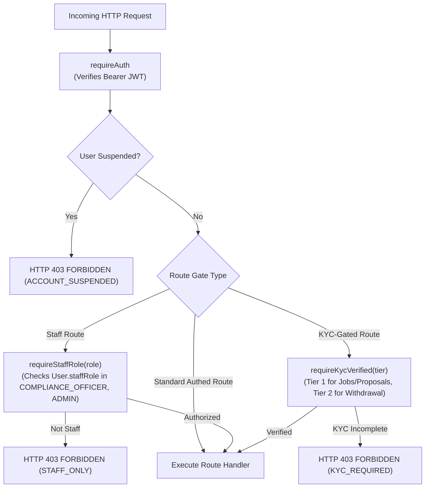

### 4.2 Audit Logging & Append-Only AML Guarantee

* **Implementation:** `apps/backend/src/lib/audit.ts` (`recordAuditEvent`).
* **Guarantee:** Application code only executes `prisma.auditLog.create()`.
* **Database-Level Enforcement:** Per `apps/backend/prisma/README.md`, PostgreSQL database roles in production environments must execute:
  ```sql
  REVOKE UPDATE, DELETE, TRUNCATE ON TABLE "AuditLog" FROM yekis_api_user;
  ```
  This guarantees that even a compromised backend process cannot alter or purge the 10-year AML audit trail.

### 4.3 Background Processing & Worker Registry

BullMQ manages five dedicated Redis queues:

| Queue Name | Worker File | Schedule / Trigger | Action | Cancellation Rule |
|---|---|---|---|---|
| `auto-release` | `autoRelease.worker.ts` | Scheduled with 4-day (warn) and 5-day (release) delay upon milestone delivery submission | Warns client at day 4; auto-releases escrow to freelancer at day 5 | Job is marked stale & skipped if milestone leaves `SUBMITTED_FOR_REVIEW` (e.g. accepted or disputed) |
| `kyc-refresh` | `kycRefresh.worker.ts` | Cron `0 3 * * *` (Daily at 03:00 UTC) | Sweeps verified KYC records where `nextReviewDueAt <= now()` and sets `periodicReviewPending = true` | N/A (Recurring idempotent sweep) |
| `notifications` | `notification.worker.ts` | Event-triggered by domain modules (`escrow-funded`, `dispute-raised`, etc.) | Dispatches in-app record, Telegram push, and SMS for critical types | N/A (Immediate execution) |
| `review-reveal` | `reviewReveal.worker.ts` | Recurring sweep / 14-day delay | Reveals blind reviews older than 14 days and recalculates Bayesian rating scores | Skipped if already revealed by mutual review submission |
| `featured-refresh` | `featuredRefresh.worker.ts` | Recurring schedule | Recalculates candidate pools and updates featured carousel rankings | N/A (Recurring sweep) |

---

## 5. The End-to-End Trust Loop

The following sequence diagram traces the complete lifecycle of a job—from user registration and tiered KYC verification through proposal acceptance, dual contract signing, wallet-first escrow locking, delivery submission, client approval, fee/withholding deduction, and Tier 2 freelancer withdrawal (including the dispute branch).

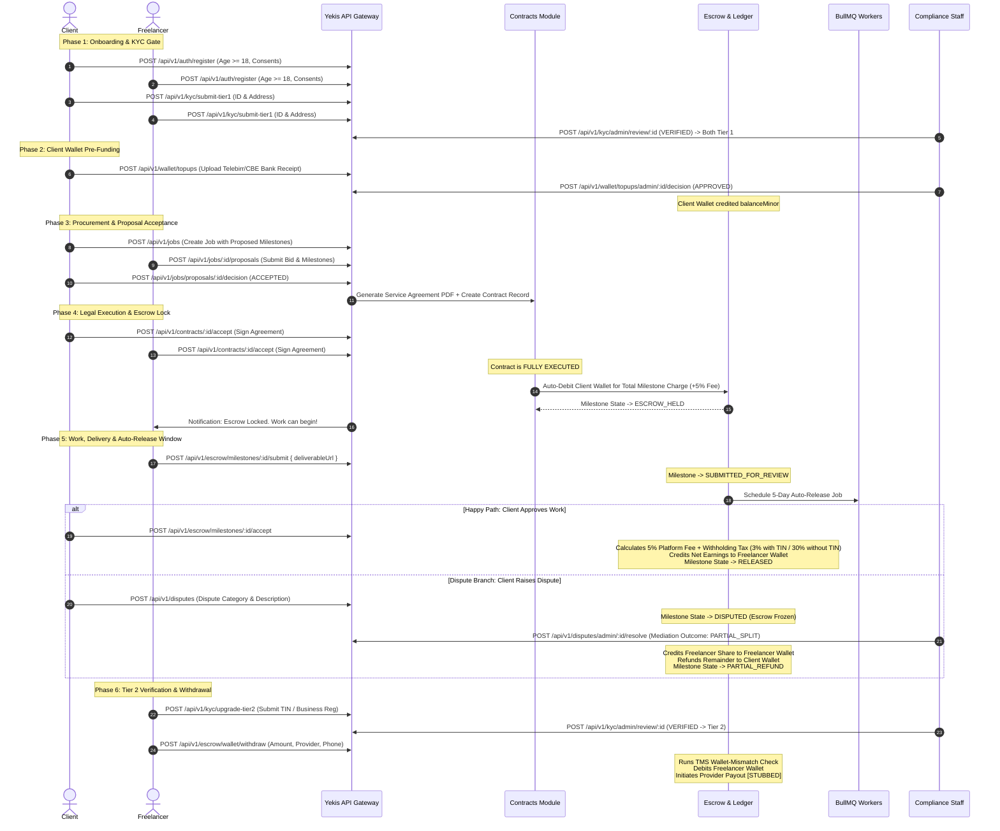

---

## 6. Master Relationship & Dependency Diagram

This directed graph illustrates the module-level import dependencies across `apps/backend/src/modules/`.

```mermaid
graph TD
    subgraph CoreLibs["Core Libraries (apps/backend/src/lib/)"]
        PrismaLib["prisma.ts"]
        AuditLib["audit.ts"]
        ObjectStoreLib["objectStore.ts"]
        RedisLib["redis.ts"]
        LoggerLib["logger.ts"]
    end

    subgraph QueuePkg["Queue & Workers (apps/backend/src/queue/)"]
        QueuesDef["queues.ts"]
        Workers["Queue Workers"]
    end

    subgraph Modules["Domain Modules (apps/backend/src/modules/)"]
        AuthM["auth/"]
        KycM["kyc/"]
        JobM["jobs/"]
        ContractM["contracts/"]
        EscrowM["escrow/"]
        TopUpM["topups/"]
        DisputeM["disputes/"]
        TmsM["tms/"]
        NotifM["notifications/"]
        ChatM["chat/"]
        ProfileM["profiles/"]
        SkillM["skills/"]
        ReviewM["reviews/"]
        FeatM["featured/"]
        PortM["portfolio/"]
        BotM["bot/"]
    end

    %% Core Lib Dependencies
    Modules --> PrismaLib
    Modules --> AuditLib
    Modules --> LoggerLib
    KycM --> ObjectStoreLib
    TopUpM --> ObjectStoreLib
    ChatM --> ObjectStoreLib
    ContractM --> ObjectStoreLib
    QueuesDef --> RedisLib
    Workers --> RedisLib

    %% Inter-Module Dependencies
    ContractM --> EscrowM
    EscrowM --> TmsM
    TopUpM --> TmsM
    DisputeM --> EscrowM
    JobM --> ContractM
    ReviewM --> ProfileM
    FeatM --> ProfileM
    NotifM --> BotM

    %% Queue Dependencies
    ContractM --> QueuesDef
    EscrowM --> QueuesDef
    DisputeM --> QueuesDef
    Workers --> EscrowM
    Workers --> NotifM
    Workers --> FeatM
    Workers --> ReviewM

    style CoreLibs fill:#f9f,stroke:#333,stroke-width:1px
    style QueuePkg fill:#bbf,stroke:#333,stroke-width:1px
```

### Analysis of Inter-Module Coupling
* **Circular Dependency Check:** The dependency graph is acyclic. `ContractM` imports fee calculation and types from `EscrowM`, but `EscrowM` relies only on `ContractM` service interfaces via loose linkage or direct checks without importing `contracts.routes.ts`.
* **Coupling Note:** `EscrowM` calls `tms.service.ts` directly for inline AML checks (`runPostFundingChecks`, `checkWalletMismatch`, `runPassThroughCheck`).

---

## 7. Known Inconsistencies, Stubs & Gaps

### 7.1 Duplicate Module Implementations

1. **Dispute Module Duplication:**
   * **Active Mounted Route:** `apps/backend/src/modules/disputes/dispute.routes.ts` & `dispute.service.ts` (Mounted in `app.ts` at `/api/v1/disputes`). Enforces authentication, Zod validation, staff RBAC, and milestone-level dispute resolution.
   * **Legacy Dead Code:** `apps/backend/src/modules/disputes/disputes.routes.ts` & `disputes.service.ts` (Plural naming). Contains unauthenticated contract-level dispute stubs. Should be deprecated and removed.
2. **Top-Up Module Duplication:**
   * **Active Mounted Route:** `apps/backend/src/modules/topups/topup.routes.ts` & `topup.service.ts` (Mounted in `app.ts` at `/api/v1/wallet/topups`). Uses `@marketplace/schemas` contracts (`SubmitTopUpInput`, `TopUpReviewDecisionInput`).
   * **Legacy Dead Code:** `apps/backend/src/modules/escrow/topup.routes.ts` & `escrow/topup.service.ts`. Contains an unmounted version with divergent payload field names (`amountEtb`, `senderName`, `senderReference`).

### 7.2 Integration Stubs Matrix

| Integration / External Dependency | Code Location | Current Implementation Status | Production Blocker / Pending Requirement |
|---|---|---|---|
| **Fayda National ID Verification** | `apps/backend/src/modules/kyc/fayda.client.ts` | `[STUBBED — pending NID API Approval]` Deterministic mock returning fake biometric IDs (`mock-biometric-<docNumber>`). | Formal application and production API contract approval with the Ethiopian National ID Program (NIDP). |
| **PEP / Sanctions Screening** | `apps/backend/src/modules/kyc/pep.client.ts` | `[STUBBED — pending Vendor Selection]` Local in-memory set matching `"test flagged person"`. | Procurement and integration of a commercial AML/PEP watchlist provider (e.g., ComplyAdvantage, World-Check). |
| **CBE Birr C2B Gateway** | `apps/backend/src/modules/escrow/providers/cbe.client.ts` | `[STUBBED — pending CBE API Publication]` Mock transaction ID generator returning `redirectUrl: null`. | Commercial agreement with Commercial Bank of Ethiopia (CBE) for API credentials or manual reconciliation protocol. |
| **Chapa Payment Aggregator** | `apps/backend/src/modules/escrow/providers/chapa.client.ts` | `[STUBBED — pending Live API Wiring]` Throws runtime error if credentials present; falls back to mock transaction IDs. | Wiring real `POST /v1/transaction/initialize` request payload to Chapa endpoints once live merchant keys are issued. |
| **Provider Payouts (B2C / Withdrawal)** | `apps/backend/src/modules/escrow/escrow.service.ts` | `[STUBBED — balance debited, no external payout API wired]` Debits internal ledger without calling Telebirr/CBE B2C disbursement APIs. | Telebirr/CBE B2C bulk payout API integration to transmit fiat funds to user phone/account. |
| **SMSEthiopia Delivery** | `apps/backend/src/modules/notifications/sms.client.ts` | Live REST client; falls back to logger warning if `SMS_ETHIOPIA_API_KEY` is omitted. | Valid SMSEthiopia gateway balance and API key. |

---

## 10. Glossary

* **AACCSA:** Addis Ababa Chamber of Commerce and Sectoral Associations. The designated arbitration authority for Stage 4 legal dispute escalation.
* **Auto-Release Window:** A configurable 5-day period (`AUTO_RELEASE_WINDOW_DAYS = 5`) starting upon freelancer deliverable submission, after which escrowed funds automatically release to the freelancer if the client takes no action.
* **Bayesian Rating Score:** A weighted rating average that incorporates platform-wide prior means ($m = 4.5, C = 5$) to prevent new accounts with a single 5-star review from outranking seasoned freelancers.
* **Double-Blind Review:** A reputation mechanism where client and freelancer feedback remains hidden until both parties have submitted reviews or until 14 days elapse.
* **FIC:** Financial Intelligence Center (Ethiopia). The national regulatory agency receiving Suspicious Transaction Reports (STRs).
* **Hard-Block Middleware:** Express middleware (`apps/backend/src/middleware/hardBlock.ts`) that strictly halts request execution if a user has not attained the required KYC tier or if their account is suspended.
* **KycTier:** The three-level progressive compliance ladder:
  * `TIER_1`: Basic identity document and address. Enables job browsing, bidding, and contract signing.
  * `TIER_2`: Verified TIN certificate or Business Registration. Enables wallet balance withdrawal.
  * `TIER_3`: Enhanced due diligence for Politically Exposed Persons (PEPs) or high-velocity/high-volume users.
* **Minor Units:** Persisting financial values as integers representing the smallest currency denomination (ETB cents, where $1.00\text{ ETB} = 100\text{ minor units}$).
* **RSA-PSS:** `SHA256withRSAandMGF1` cryptographic signing algorithm mandated by Telebirr's C2B merchant gateway for payment pre-orders and webhook payloads.
* **STR:** Suspicious Transaction Report. A mandatory AML filing submitted to the FIC by a Compliance Officer when a transaction flag is verified.
* **TMS:** Transaction Monitoring System. Automated heuristic rules detecting money laundering patterns (structuring, velocity, pass-through, and wallet mismatches).
* **UCID:** Unique Customer Identifier. A platform-wide persistent identifier assigned to each user upon registration.
* **Withholding Tax:** Statutory Ethiopian tax deducted from freelancer milestone earnings if gross milestone value $\ge \text{ETB 10,000}$ (3% for freelancers with verified TIN; 30% for freelancers without TIN).
* **WORM:** Write Once, Read Many. Storage compliance policy applied to KYC document buckets and audit log tables to prevent tampering.

---

## 8. Frontend Architecture

The frontend is a **React 18 + Vite** Single Page Application (SPA) bundled at `apps/frontend/`. It serves two completely different user experiences from a single codebase, determined at runtime by detecting the Telegram WebApp environment.

### 8.1 Entry Point & Runtime Branching (`main.tsx` → `App.tsx`)

```mermaid
flowchart TD
    Entry["main.tsx\n(createRoot, StrictMode, AppErrorBoundary)"]
    App["App.tsx\nRoot Component"]
    TMACheck{"window.Telegram\n.WebApp present?"}
    PayReturn{"pathname ==\n/payment/return?"}
    TMA["Telegram Mini App Shell\n(App.tsx JSX — mobile-first)"]
    WebApp["FullPlatformApp.tsx\n(Full browser SPA)"]
    PayReturnUI["PaymentReturn.tsx\n(Post-Telebirr redirect handler)"]

    Entry --> App
    App --> PayReturn
    PayReturn -- Yes --> PayReturnUI
    PayReturn -- No --> TMACheck
    TMACheck -- isTelegram=true --> TMA
    TMACheck -- isTelegram=false --> WebApp
```

**Key logic in `App.tsx`:**
1. All React hooks are declared unconditionally at the top (required by Rules of Hooks).
2. `useTelegramMiniApp()` is called first — it returns `{ isTelegram, initData, backButton, ... }`.
3. Two derived booleans (`isPaymentReturn`, `isNonTelegram`) determine which render path to take.
4. No hook is called conditionally; early returns only use values from already-called hooks.

---

### 8.2 Telegram Mini App Shell (`App.tsx`)

The TMA shell is a **mobile-first workspace** rendered inside the Telegram client. It is intentionally lightweight and sidebar-navigated.

#### Component Structure

```
App.tsx (root)
├── useTelegramMiniApp()          — Telegram WebApp SDK wrapper hook
├── Role Selection Screen          — First render if not authenticated
│   ├── Role picker (Client / Freelancer buttons)
│   └── Mobile fallback login form (phone + password)
└── Platform Shell (after auth)
    ├── <aside> Sidebar nav         — Desktop/tablet navigation
    ├── <main> Content pane
    │   ├── Header (topbar)
    │   └── Tab Content (conditional rendering by activeTab):
    │       ├── "home"     → Overview metrics + quick-action grid
    │       ├── "jobs"     → Open jobs list / post job form
    │       ├── "escrow"   → Milestone contract table
    │       ├── "wallet"   → Top-up form + recent top-ups list
    │       ├── "kyc"      → Fayda ID upload form + KYC status
    │       └── "disputes" → Case center (admin only)
    └── <nav> Mobile bottom navigation bar
```

#### Authentication Flow (TMA)

```mermaid
sequenceDiagram
    actor User
    participant TMA as App.tsx
    participant Hook as useTelegramMiniApp()
    participant API as api.loginWithTelegram()
    participant Backend as POST /api/v1/auth/telegram

    User->>TMA: Taps "I want to work" (FREELANCER role)
    TMA->>Hook: Reads telegram.initData
    alt initData present (inside Telegram)
        TMA->>API: loginWithTelegram(initData, role)
        API->>Backend: POST { initData, role }
        Backend-->>API: { accessToken, user }
        API-->>TMA: TelegramAuthResponse
        TMA->>TMA: api.setToken(accessToken), setTelegramAuthStatus("ready")
    else Not inside Telegram
        TMA->>TMA: setShowMobileLogin(true)
        User->>TMA: Enters phone + password
        TMA->>API: api.loginWithMobile({ phone, password })
        API-->>TMA: { accessToken }
        TMA->>TMA: api.setToken(accessToken), setTelegramAuthStatus("ready")
    end
```

#### State Managed in `App.tsx`

| State Variable | Type | Purpose |
|---|---|---|
| `telegramSession` | `TelegramAuthResponse \| null` | Full Telegram auth response after login |
| `telegramAuthStatus` | `"idle" \| "loading" \| "ready" \| "error"` | Authentication phase gate |
| `role` | `"CLIENT" \| "FREELANCER" \| "ADMIN"` | User's active platform role |
| `activeTab` | `Tab` | Which section is currently displayed |
| `walletBalance` | `number` | Wallet balance in ETB (derived from balanceMinor / 100) |
| `kycStatus` | `"NOT_SUBMITTED" \| "UNDER_REVIEW" \| "APPROVED"` | KYC verification state |
| `milestones` | `Milestone[]` | User's active milestone contracts |
| `jobs` | `Job[]` | Open marketplace jobs |
| `topUpRequests` | `TopUpRequest[]` | User's wallet top-up submissions |

---

### 8.3 Full Browser Platform (`FullPlatformApp.tsx`)

The `FullPlatformApp` is the **desktop/browser SPA** shown when a user visits the Yekis website outside Telegram. It has full routing, authentication forms, staff dashboards, and all marketing pages.

#### View & Route System

Since the app is a SPA (no React Router), navigation is controlled by the `view` state variable and `marketingPage` state. The component renders different content based on the current view:

```
FullPlatformApp.tsx
├── Marketing / Public Shell (showLanding=true OR unauthenticated)
│   ├── LandingPage.tsx           — Hero, categories, how-it-works, CTA
│   ├── FAQPage.tsx               — Frequently asked questions
│   ├── FeesPage.tsx              — Platform fee structure explanation
│   ├── PrivacyPage.tsx           — Privacy policy
│   ├── TermsPage.tsx             — Terms of service
│   ├── AboutPage.tsx             — Company background
│   ├── CaseStudiesPage.tsx       — Success stories
│   ├── ThankYouPage.tsx          — Post-registration / post-job confirmation
│   └── NotFoundPage.tsx          — 404 handler
│
├── Authentication Forms (not logged in, not on landing)
│   ├── Login form                — email + password → POST /api/v1/auth/login
│   ├── Register form             — email, phone, dob, role, password, consents
│   ├── Forgot password form      — POST /api/v1/auth/forgot-password
│   └── Reset password form       — POST /api/v1/auth/reset-password
│
└── Authenticated Platform Shell (user != null)
    ├── Sidebar navigation (role-aware nav items)
    ├── Header (user avatar, notifications bell, logout)
    ├── NotificationCenter.tsx    — Dropdown notification feed
    ├── FeaturedCarousel.tsx      — Featured freelancer cards
    └── View Content (by view state):
        ├── "overview"        → Dashboard metrics, featured talent
        ├── "jobs"            → JobsWorkspace (post + browse)
        ├── "contracts"       → ContractsWorkspace (sign, fund, milestones)
        ├── "wallet"          → BrowserWallet (top-up, history, withdraw)
        ├── "verification"    → BrowserVerification (KYC doc upload)
        ├── "chat"            → SupportChat (customer support tickets)
        ├── "cases"           → DisputesWorkspace (raise/track disputes)
        ├── "profile"         → ProfilePage (public view)
        └── "profile-edit"    → ProfileEditPage (edit bio, skills, portfolio)
```

#### Role-Based Navigation (FullPlatformApp)

| Role | Nav Items Shown |
|---|---|
| `CLIENT` | Overview, Post a Job, My Contracts, Wallet, Chat, Verification, Profile |
| `FREELANCER` | Overview, Find Work, My Work, Wallet, Chat, Verification, Profile |
| `ADMIN` / `MEDIATOR` | Overview, Escrow, Disputes, Wallet, Chat, Verification + Staff Dashboard link |

#### Staff Dashboard (`StaffDashboard.tsx`)

Accessible to users with `staffRole === "COMPLIANCE_OFFICER"` or `staffRole === "ADMIN"`. Provides:

| Tab | Component | Backend API |
|---|---|---|
| Top-Up Queue | `TopUpQueue.tsx` | `GET /api/v1/wallet/topups/admin/queue` |
| KYC Queue | `KycQueue.tsx` | `GET /api/v1/kyc/admin/queue` |
| Disputes Queue | `DisputeQueue.tsx` | `GET /api/v1/disputes/admin/queue` |
| Compliance Panel | `StaffCompliancePanel.tsx` | `GET /api/v1/tms/flags` |
| Profile Reports | `ProfileReportsQueue.tsx` | `GET /api/v1/profiles/reports/admin` |

---

### 8.4 API Client Layer (`apps/frontend/src/api/client.ts`)

All HTTP calls are centralized in a single `api` object exported from `client.ts`. It uses the native `fetch` API with a `Bearer` JWT token injected via `api.setToken(token)`.

#### Key Design Properties

- **Token Storage:** `api.setToken()` stores the token in a module-level variable (no `localStorage`) for the session lifetime.
- **Base URL:** Reads from `import.meta.env.VITE_API_BASE_URL` at build time (falls back to `http://localhost:3000`).
- **Error Handling:** Non-2xx responses throw `Error` with the JSON `message` field from the API.
- **FormData Support:** Methods like `createTopUpRequest`, `submitKycDocuments`, and `submitFreelancerFaydaSelfie` send `multipart/form-data` for file uploads.

#### Key API Methods

| Category | Method | Backend Endpoint |
|---|---|---|
| **Auth** | `loginWithTelegram(initData, role)` | `POST /api/v1/auth/telegram` |
| **Auth** | `loginWithMobile({ phone, password })` | `POST /api/v1/auth/login` |
| **Auth** | `register(payload)` | `POST /api/v1/auth/register` |
| **Auth** | `getMe()` | `GET /api/v1/auth/me` |
| **Wallet** | `getWallet()` | `GET /api/v1/escrow/wallet` |
| **Top-Up** | `createTopUpRequest(formData)` | `POST /api/v1/wallet/topups` |
| **Top-Up** | `getTopUpRequests()` | `GET /api/v1/wallet/topups` |
| **KYC** | `getKycStatus()` | `GET /api/v1/kyc/status` |
| **KYC** | `submitFreelancerFaydaSelfie(formData)` | `POST /api/v1/kyc/fayda-selfie` |
| **Jobs** | `getJobs({ status, category, page })` | `GET /api/v1/jobs` |
| **Jobs** | `createJob(payload)` | `POST /api/v1/jobs` |
| **Jobs** | `submitProposal(payload)` | `POST /api/v1/jobs/:id/proposals` |
| **Contracts** | `getContracts()` | `GET /api/v1/contracts` |
| **Contracts** | `acceptContract(id)` | `POST /api/v1/contracts/:id/accept` |
| **Escrow** | `getMilestones()` | `GET /api/v1/escrow/milestones` |
| **Escrow** | `fundMilestoneFromWallet(id)` | `POST /api/v1/escrow/fund-from-wallet` |
| **Escrow** | `acceptMilestone(id)` | `POST /api/v1/escrow/milestones/:id/accept` |
| **Disputes** | `getDisputes()` | `GET /api/v1/disputes` |
| **Disputes** | `raiseDispute(payload)` | `POST /api/v1/disputes` |
| **Notifications** | `getNotifications()` | `GET /api/v1/notifications` |
| **Profiles** | `getProfile(id)` | `GET /api/v1/profiles/:id` |
| **Reviews** | `submitReview(payload)` | `POST /api/v1/reviews` |

---

### 8.5 Telegram WebApp Hook (`useTelegramMiniApp.ts`)

Located at `apps/frontend/src/telegram/useTelegramMiniApp.ts`. Wraps the Telegram JavaScript SDK (`window.Telegram.WebApp`) with React hooks.

```typescript
// Returns:
{
  webApp: TelegramWebApp | null,  // raw Telegram WebApp object
  isReady: boolean,               // true after webApp.ready() called
  isTelegram: boolean,            // true only if initData is non-empty
  initData: string,               // raw Telegram initData string for backend verification
  unsafeUser: TelegramUser | null,// unverified user object from initDataUnsafe
  themeParams: ThemeParams,       // Telegram theme colors
  colorScheme: "dark" | "light",  // Telegram theme mode
  backButton: BackButton | null,  // Telegram native back button
}
```

**Platform detection:** `isTelegram = Boolean(webApp?.initData)`. If `initData` is empty (e.g., browser), the app renders `FullPlatformApp` instead of the TMA shell.

---

### 8.6 Payment Return Handler (`PaymentReturn.tsx`)

Handles the redirect URL after a Telebirr C2B external payment checkout completes. Detected by `window.location.pathname === "/payment/return"`. Reads query parameters from the URL to display success/failure to the user. This is part of the legacy external-provider payment flow (now superseded by wallet-first funding).

---

### 8.7 Frontend Build & Dev Configuration

| Property | Value |
|---|---|
| Framework | React 18 + Vite |
| Language | TypeScript (strict) |
| Linting | ESLint with `react-hooks/rules-of-hooks` |
| CSS | Vanilla CSS (`index.css` — 110 KB design system) |
| Icons | `lucide-react` |
| Environment Variable | `VITE_API_BASE_URL` |
| Dev Server | `npm run dev` → `http://localhost:5173` |
| Public Assets | `/public/` (SVG logo, payment provider images) |
| Internationalization | `i18n.ts` (Amharic + English string catalog) |

---

## 9. Platform Section-by-Section Functional Reference

This section provides a plain-English description of every user-facing section of the Yekis platform — what it does, how it works technically, and which parts of the codebase power it.

---

### 9.1 Landing Page & Marketing Shell

**What it does:** Public-facing marketing site showcasing the platform's value proposition, pricing, FAQs, terms, and privacy policy.

**How it works:**
- Served by `FullPlatformApp.tsx` when the user is unauthenticated and `showLanding = true`.
- `LandingPage.tsx` is a static React component with no API calls — it renders hardcoded marketing content.
- Includes a `CookieBanner.tsx` for GDPR-style consent and a `MobileCTA.tsx` encouraging mobile users to open the Telegram Mini App.
- Navigation to sub-pages (FAQ, Fees, etc.) changes `marketingPage` state without any URL routing.

**Files:** `LandingPage.tsx`, `FAQPage.tsx`, `FeesPage.tsx`, `PrivacyPage.tsx`, `TermsPage.tsx`, `AboutPage.tsx`, `CaseStudiesPage.tsx`, `CookieBanner.tsx`, `MobileCTA.tsx`

---

### 9.2 Authentication (Registration & Login)

**What it does:** Lets users create accounts (with mandatory age gate ≥ 18 and consent collection) and log in via email/password or Telegram.

**How it works:**

*Registration:*
1. User fills form: `firstName`, `lastName`, `email`, `phone`, `dateOfBirth`, `role`, `password`.
2. Frontend calls `api.register(payload)` → `POST /api/v1/auth/register`.
3. Backend validates `dateOfBirth` (must be ≥ 18 years), hashes password with Argon2, creates `User`, `Wallet`, `KycRecord`, and `ConsentRecord` records in one atomic Prisma transaction.
4. Returns `{ accessToken, refreshToken, user }`.

*Login:*
1. User enters `email` + `password` → `api.loginWithMobile()` → `POST /api/v1/auth/login`.
2. Backend verifies Argon2 hash, returns JWTs.

*Telegram Login (TMA):*
1. Telegram passes `initData` (HMAC-SHA256 signed) to the Mini App on open.
2. Frontend sends to `POST /api/v1/auth/telegram { initData, role }`.
3. Backend verifies HMAC using `BOT_TOKEN`, checks `auth_date` freshness (< 24h), upserts user by `telegramUserId`.

**Files:** `FullPlatformApp.tsx` (forms), `apps/backend/src/modules/auth/auth.routes.ts`, `auth.service.ts`, `telegram.service.ts`

---

### 9.3 KYC Verification

**What it does:** Progressive identity verification in three tiers that unlocks different platform capabilities.

**How it works:**

| Tier | Requirement | Unlocks |
|---|---|---|
| Tier 1 | Fayda National ID photo + selfie + personal details | Posting jobs, bidding on proposals, signing contracts |
| Tier 2 | TIN certificate or Business Registration | Wallet balance withdrawal |
| Tier 3 | Enhanced due diligence (PEP / high volume) | Continued operations for flagged accounts |

*Document Upload Flow:*
1. User uploads ID photo/selfie via `BrowserVerification.tsx` → `api.submitFreelancerFaydaSelfie(formData)` → `POST /api/v1/kyc/fayda-selfie` (multipart).
2. Backend stores file in **encrypted MinIO/S3 WORM bucket** via `lib/objectStore.ts`, creates `KycDocument` record with storage path.
3. Backend calls Fayda API (stubbed) for biometric deduplication and PEP client for sanctions screening.
4. `KycRecord.status` moves to `UNDER_REVIEW`.

*Staff Review:*
1. Compliance Officer sees submission in `KycQueue.tsx` → `GET /api/v1/kyc/admin/queue`.
2. Staff opens encrypted document via temporary presigned URL → `GET /api/v1/kyc/admin/document-url/:docId`.
3. Staff makes decision → `POST /api/v1/kyc/admin/review/:id { decision: "VERIFIED" | "REJECTED" }`.
4. Backend writes immutable `KycReviewEvent`, updates `User.cachedKycTier`, sends notification.

*KYC Hard-Block:*  
`apps/backend/src/middleware/hardBlock.ts` (`requireKycVerified`) is applied as route middleware. Any request to a tier-gated route without sufficient KYC returns `HTTP 403 { error: "KYC_REQUIRED" }` before the route handler executes.

**Files:** `BrowserVerification.tsx`, `KycQueue.tsx`, `apps/backend/src/modules/kyc/`

---

### 9.4 Jobs & Proposals

**What it does:** The marketplace procurement layer — clients post jobs, freelancers bid with proposals, clients accept the best bid, atomically creating a contract.

**How it works:**

*Post a Job (Client):*
1. Client fills job brief: `title`, `category`, `description`, `budgetMin`, `budgetMax`, `deadline`, `proposedMilestones`.
2. `api.createJob(payload)` → `POST /api/v1/jobs`.
3. Job created with `status: "OPEN"`. Visible in public job listings.

*Browse & Bid (Freelancer):*
1. `api.getJobs({ status: "OPEN" })` → `GET /api/v1/jobs` with optional category/budget filters.
2. Freelancer writes `coverLetter`, sets `quotedAmountMinor`, `estimatedDays`, `milestoneBreakdown`.
3. `api.submitProposal(payload)` → `POST /api/v1/jobs/:id/proposals`.
4. Backend enforces: Freelancer ≠ Job Client (anti-self-bidding), Tier 1 KYC required, one proposal per job per freelancer.

*Counter-Offer (Client):*
1. Client can propose modified amounts/timelines → `POST /api/v1/jobs/proposals/:id/counter`.
2. Freelancer sees counter-offer and can accept or decline.

*Accept Proposal (Client → Contract Creation):*
1. Client clicks Accept → `POST /api/v1/jobs/proposals/:id/decision { decision: "ACCEPTED" }`.
2. Backend executes in a **Serializable isolation Prisma transaction**:
   - Winning proposal → `ACCEPTED`
   - All other proposals → `REJECTED`
   - Job → `IN_PROGRESS`
   - `contracts.service.ts:generateContractFromProposal()` is called → creates `Contract` + `Milestone` records + generates Service Agreement PDF.

**Anti-Circumvention (Direct Messages):**  
All in-thread messages pass through `circumvention.middleware.ts` which strips or blocks content matching phone numbers (Ethiopian/international formats), Telegram handles (`@username`), and external payment keywords (M-Pesa, bank account patterns).

**Files:** `WorkflowWorkspace.tsx` (JobsWorkspace), `apps/backend/src/modules/jobs/`

---

### 9.5 Contracts & Digital Signing

**What it does:** After a proposal is accepted, both parties must digitally sign the legally binding Service Agreement PDF before any money moves.

**How it works:**

1. Contract is created with `status: "ACTIVE"` and both `clientAcceptedAt = null`, `freelancerAcceptedAt = null`.
2. PDF service agreement is generated using `pdf-lib` from `serviceAgreement.template.ts`, stored in the encrypted object store, path saved in `Contract.documentStoragePath`.
3. Each party signs independently → `POST /api/v1/contracts/:id/accept`.
4. Backend records timestamp on `clientAcceptedAt` or `freelancerAcceptedAt`.
5. **When both have signed (fully executed):**
   - Backend checks if client wallet has sufficient balance for all milestone charges + 5% fee.
   - If sufficient: atomic transaction deducts wallet balance and sets all milestones to `ESCROW_HELD`.
   - If insufficient: notification queued asking client to top up.
6. Contract is now `FULLY_EXECUTED` and work can begin.

**Contract Completion:**  
`checkAndUpdateContractCompletion()` is called after each milestone release. When all milestones are in a terminal state (`RELEASED`, `REFUNDED`, `PARTIAL_REFUND`), contract transitions to `COMPLETED`.

**Files:** `WorkflowWorkspace.tsx` (ContractsWorkspace), `apps/backend/src/modules/contracts/`

---

### 9.6 Escrow & Milestone Management

**What it does:** The core financial safety mechanism. Client funds are held in escrow until freelancer delivers work and client approves. Provides automatic release if client doesn't respond within 5 days.

**How it works:**

*Escrow States (full lifecycle):*

```
PAYMENT_PENDING → ESCROW_HELD → SUBMITTED_FOR_REVIEW → RELEASED
                                       ↓
                                   DISPUTED → RELEASED / REFUNDED / PARTIAL_REFUND
```

*Funding (Wallet-First):*
1. Client clicks "Fund" on a milestone → `api.fundMilestoneFromWallet(milestoneId)` → `POST /api/v1/escrow/fund-from-wallet`.
2. Backend atomic transaction: `Wallet.balanceMinor -= clientTotalCharge`, `Milestone.escrowState = "ESCROW_HELD"`.
3. Notification sent to freelancer: work can begin.
4. TMS `runPostFundingChecks()` runs asynchronously (structuring check).

*Delivery Submission (Freelancer):*
1. Freelancer completes work, clicks Submit → `POST /api/v1/escrow/milestones/:id/submit`.
2. Milestone → `SUBMITTED_FOR_REVIEW`, `autoReleaseAt = now + 5 days`.
3. BullMQ schedules two jobs: `warn` (fires at day 4) and `release` (fires at day 5).

*Manual Client Approval:*
1. Client reviews delivery, clicks Release → `POST /api/v1/escrow/milestones/:id/accept`.
2. Fee calculation: 5% platform fee deducted + withholding tax (3% with TIN / 30% without TIN if amount ≥ ETB 10,000).
3. Net amount credited to `Freelancer.wallet.balanceMinor`.
4. Scheduled BullMQ release jobs cancelled.

*Auto-Release:*  
If client takes no action in 5 days, `autoRelease.worker.ts` calls `releaseMilestoneFunds()` automatically, crediting the freelancer's wallet.

**Financial Formula:**

| Party | Charge |
|---|---|
| Client pays | `Milestone Amount × 1.05` (5% platform add-on) |
| Freelancer receives | `Milestone Amount − 5% platform fee − withholding tax` |
| Platform retains | 5% from client + 5% from freelancer + withholding tax |

**Files:** `WorkflowWorkspace.tsx` (ContractsWorkspace milestones tab), `apps/backend/src/modules/escrow/`

---

### 9.7 Wallet & Manual Top-Up

**What it does:** The in-platform ETB ledger. Users deposit money by paying to a Yekis corporate bank account and uploading a receipt. Staff verify and credit the wallet. Clients use wallet balance to fund milestone escrow.

**How it works:**

*Top-Up Submission (Client):*
1. Client sends money to Yekis Telebirr or CBE bank account.
2. In-app: selects provider, enters `amountEtb`, `transactionReference`, uploads receipt image.
3. `api.createTopUpRequest(formData)` → `POST /api/v1/wallet/topups` (multipart).
4. Backend stores receipt in object store, creates `WalletTopUp { status: "PENDING_REVIEW" }`.
5. Notification sent to staff.

*Staff Review:*
1. Staff opens `TopUpQueue.tsx` → `GET /api/v1/wallet/topups/admin/queue`.
2. Staff views receipt image via presigned URL.
3. Clicks Approve → `POST /api/v1/wallet/topups/admin/:id/decision { decision: "APPROVED" }`.
4. Backend atomic transaction: `Wallet.balanceMinor += amountMinor`, `WalletTopUp.status = "APPROVED"`.
5. Audit event `TOPUP_APPROVED` written.

*Suspicious Top-Up Flagging:*
1. Staff can flag suspicious receipts → `POST /api/v1/wallet/topups/admin/:id/flag`.
2. Creates `TransactionFlag { type: "STAFF_FLAGGED" }` in the TMS system.
3. Top-up status set to `FLAGGED`, pending compliance review.

*Wallet Balance:*  
`GET /api/v1/escrow/wallet` returns `{ balanceMinor }` — displayed in ETB (divided by 100) on the wallet screen.

**Files:** `BrowserWallet.tsx`, `TopUpQueue.tsx`, `apps/backend/src/modules/topups/`, `apps/backend/src/modules/escrow/escrow.routes.ts`

---

### 9.8 Dispute Resolution

**What it does:** A four-stage escalation ladder for contested milestones. Freezes escrow until resolved. Supports negotiation, evidence submission, staff mediation, and formal arbitration.

**How it works:**

*Raising a Dispute:*
1. Either party clicks "Raise Dispute" → `POST /api/v1/disputes { contractId, milestoneId, category, description }`.
2. Backend validates the party is a contract signatory.
3. Atomic transaction: all funded milestones on the contract transition to `ESCROW_HELD → DISPUTED` (freeze), `Dispute { stage: "STAGE_1_NEGOTIATION" }` created.
4. 7-day direct negotiation window begins.

*Stage Progression:*

| Stage | Who Escalates | What Happens |
|---|---|---|
| `STAGE_1_NEGOTIATION` | Either party (after 7 days) | Moves to Stage 2; evidence window opens |
| `STAGE_2_EVIDENCE` | Either party | Each party can submit statements + file attachments |
| `STAGE_3_MEDIATION` | Either party | Staff compliance officer assigned, reviews evidence bundle |
| `STAGE_4_ARBITRATION` | Staff | Legal AACCSA arbitration initiated; external process |

*Resolution Outcomes:*
- `RELEASE_TO_FREELANCER`: 100% of escrowed milestone released to freelancer wallet (net fees).
- `REFUND_TO_CLIENT`: 100% of escrowed amount refunded to client wallet.
- `PARTIAL_SPLIT`: `freelancerShareMinor` to freelancer wallet; remainder to client wallet.

*Staff Dispute Queue:*  
`DisputeQueue.tsx` → `GET /api/v1/disputes/admin/queue` shows Stage 3 cases assigned to compliance staff with full evidence timeline.

**Files:** `DisputeQueue.tsx`, `EvidenceViewer.tsx`, `apps/backend/src/modules/disputes/`

---

### 9.9 Transaction Monitoring System (TMS / Compliance)

**What it does:** Automated AML heuristics that flag suspicious transaction patterns. All flags are non-blocking (except wallet mismatch which holds withdrawals). Staff investigate and file STRs with the FIC.

**How it works:**

*Automated Rules (triggered inline, non-blocking):*

```mermaid
flowchart LR
    Fund["Escrow Funding"] --> StructCheck["runStructuringCheck()\n≥3 payments just below\nETB 10,000 in 72h"]
    Release["Milestone Release"] --> VelCheck["runVelocityCheck()\n≥20 milestones\ncompleted in 48h"]
    Withdraw["Withdrawal Request"] --> PassCheck["runPassThroughCheck()\nWithdrawal ≥90% of\nrecent release in 24h"]
    Withdraw --> MismatchCheck["checkWalletMismatch()\nPayout phone ≠\nregistered phone"]

    StructCheck -->|Flag created| TmsDB[("TransactionFlag\nPENDING_REVIEW")]
    VelCheck -->|Flag created| TmsDB
    PassCheck -->|Flag created| TmsDB
    MismatchCheck -->|BLOCKS + Flag| TmsDB
```

*Wallet Mismatch (Blocking):*
- Only AML rule that actively blocks a user action.
- Returns `HTTP 202 { error: "HELD_FOR_REVIEW" }` instead of processing the withdrawal.
- Creates `TransactionFlag { type: "WALLET_MISMATCH" }`.

*Staff Compliance Panel:*
1. `StaffCompliancePanel.tsx` → `GET /api/v1/tms/flags?status=PENDING_REVIEW`.
2. Staff reviews each flag's `details` JSON and user context.
3. Options:
   - **File STR** → `POST /api/v1/tms/flags/:id/file-str { strReferenceNumber }` — records regulatory filing with FIC.
   - **Dismiss** → `POST /api/v1/tms/flags/:id/dismiss { notes }` — closes flag after investigation.

**Files:** `StaffCompliancePanel.tsx`, `apps/backend/src/modules/tms/`

---

### 9.10 Notifications

**What it does:** Multi-channel notification delivery for critical platform events. Dispatches in-app records, Telegram bot messages, and SMS for financial/legal events.

**How it works:**

1. Domain modules (Escrow, Disputes, KYC, Top-Up) call `notificationQueue.add("event-type", { userId, message })`.
2. `notification.worker.ts` processes the BullMQ job:
   - Always creates `Notification` DB record (for in-app bell icon).
   - For **critical event types** (`escrow-funded`, `escrow-released`, `dispute-raised`, `dispute-resolved`, `kyc-rejected`, `withdrawal-held`): additionally calls `sms.client.ts` (SMSEthiopia API) AND `telegram.client.ts` (bot push message).
3. User reads notifications via `NotificationCenter.tsx` → `GET /api/v1/notifications`.
4. Mark read: `POST /api/v1/notifications/:id/read` or `POST /api/v1/notifications/read-all`.

**Files:** `NotificationCenter.tsx`, `apps/backend/src/modules/notifications/`, `apps/backend/src/queue/notification.worker.ts`

---

### 9.11 Support Chat

**What it does:** In-app customer support ticketing system. Users open support conversations which are load-balanced to available staff agents.

**How it works:**

1. User clicks "Chat" → `SupportChat.tsx` → `POST /api/v1/chat/conversations { subject }`.
2. Backend creates `Conversation { status: "OPEN" }`, auto-assigns to a staff agent (load-balancing by least-open-conversations).
3. Messages sent via `POST /api/v1/chat/conversations/:id/messages { body }`.
4. All messages pass through `circumvention.middleware.ts` (same anti-circumvention filter as direct job messaging).
5. Staff views all open tickets via `GET /api/v1/chat/admin/conversations`.
6. Staff can close ticket → `PATCH /api/v1/chat/admin/conversations/:id/status { status: "CLOSED" }`.
7. Unauthenticated users (pre-login) can open guest conversations via `POST /api/v1/chat/guest/conversations`.

**Files:** `SupportChat.tsx`, `apps/backend/src/modules/chat/`

---

### 9.12 Profiles, Skills & Reviews

**What it does:** User discovery, reputation, and portfolio showcase. Freelancers build profiles; clients and freelancers leave double-blind mutual reviews after contract completion.

**How it works:**

*Profile:*
- `ProfilePage.tsx` renders public profile: avatar, bio, skills, portfolio items, completed jobs count, Bayesian rating.
- Visibility controlled by `User.profileVisibility` (`PUBLIC`, `PROPOSERS`, `PRIVATE`).
- `ProfileEditPage.tsx` → `PATCH /api/v1/profiles/me` — updates bio, skills, availability.
- `ProfileView` records are written each time a profile is viewed (analytics).

*Skills Taxonomy:*
- Skills are pre-seeded into the `Skill` table (Amharic + English names, categorized).
- `GET /api/v1/skills` returns the full taxonomy for selection UI.

*Double-Blind Reviews:*
1. After contract completion, both parties can submit reviews via `POST /api/v1/reviews { contractId, rating, comment }`.
2. Review created with `isBlind: true` — hidden from the target user.
3. Reveal triggers:
   - **Both parties submit**: `isBlind → false` immediately.
   - **14-day timeout**: `reviewReveal.worker.ts` reveals all blind reviews older than 14 days.
4. On reveal, Bayesian rating recalculated: $R = \frac{5 \times 4.5 + \sum \text{ratings}}{5 + n}$ (prior: $m=4.5, C=5$).
5. `User.ratingBayesianScore` and `User.ratingAverage` updated.

*Featured Talent Carousel:*
- `FeaturedCarousel.tsx` → `GET /api/v1/featured` returns a curated list of freelancers.
- `featuredRefresh.worker.ts` periodically recalculates the featured pool using algorithm:
  - Top-rated (Bayesian score)
  - Recently verified (new to the platform — cold-start boost)
  - Staff-pinned (manually curated by admin)
  - Category balancing (ensures diversity across skill categories)

*Profile Reports:*
- Users can report profiles via `POST /api/v1/profiles/:id/report { reason, details }`.
- `ProfileReportsQueue.tsx` shows reports to staff for moderation actions (hide / ban profile).

**Files:** `ProfilePage.tsx`, `ProfileEditPage.tsx`, `FeaturedCarousel.tsx`, `apps/backend/src/modules/profiles/`, `reviews/`, `skills/`, `featured/`, `portfolio/`

---

### 9.13 Telegram Bot

**What it does:** Official Yekis bot (`@YekisBot`) implemented with Grammy framework. Provides bot-native job browsing, wallet checks, and KYC guidance via interactive conversational wizards.

**How it works:**

1. Bot connects to Telegram Bot API via webhook or long-polling (configured by `BOT_WEBHOOK_URL` env var).
2. Grammy router handles commands: `/start`, `/wallet`, `/jobs`, `/kyc`, `/help`.
3. **Deep linking:** `/start ref_<jobId>` opens the bot directly to a specific job detail.
4. **Account linking:** If a Telegram user has an existing platform account with the same `telegramUserId`, the bot authenticates them automatically.
5. **Interactive scenes** (Grammy conversations): multi-step wizards for browsing jobs, submitting proposals, and checking KYC status — all driven by inline keyboard buttons.
6. **Notification delivery:** `notification.worker.ts` calls `telegram.client.ts` to push messages to `User.telegramChatId` for critical financial events.

**Files:** `apps/backend/src/modules/bot/`, `apps/backend/src/modules/notifications/telegram.client.ts`

---

### 9.14 Background Workers

All asynchronous processing runs via **BullMQ** queues backed by **Redis**. Workers are started in `server.ts` as side-effect imports and run in the same Node.js process as the API (recommended to split into separate process/container in production).

| Worker | File | What It Does |
|---|---|---|
| `autoRelease.worker.ts` | `queue/` | Listens on `auto-release` queue. Fires a client warning notification at day 4 after milestone submission; auto-releases escrowed funds to freelancer at day 5 if client hasn't acted. Stale-checks milestone state before executing — skips if milestone already left `SUBMITTED_FOR_REVIEW`. |
| `kycRefresh.worker.ts` | `queue/` | Runs daily at 03:00 UTC (cron). Sweeps all `VERIFIED` KYC records where `nextReviewDueAt <= now()` and marks them `periodicReviewPending = true`, which triggers re-verification. |
| `notification.worker.ts` | `queue/` | Processes notification events from all domain modules. Writes in-app `Notification` record, optionally fires Telegram push and SMSEthiopia API for critical event types. |
| `reviewReveal.worker.ts` | `queue/` | Recurring sweep. Sets `isBlind = false` on reviews older than 14 days. Recalculates Bayesian ratings for affected users. |
| `featuredRefresh.worker.ts` | `queue/` | Recurring sweep. Recalculates featured freelancer carousel rankings using Bayesian score, verification recency, staff pins, and category balance algorithm. |

---
