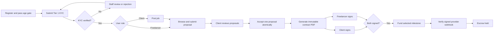
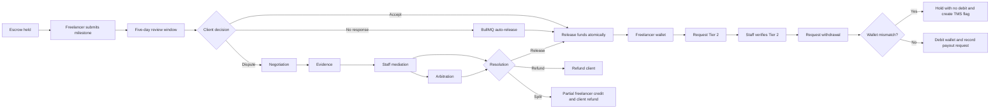

# Yekis Jobs Functional Walkthrough

Last validated: 2026-08-15

> **Design spacing update (2026-08-21):** Fully unified Yekis landing and marketing page space utilization to match AFRO-TECH's full-bleed layout. Implemented 6% horizontal gutters across the fixed horizontal navigation bar, left-aligned hero section, content containers (`.marketing-container`), and footer. Configured responsive fluid gutters (6% desktop -> 5% tablet -> 4% mobile) with clean component layouts.
> **Payment flow update (2026-08-15):** Escrow is now funded directly from the client's in-platform wallet. The old external-provider (Telebirr/CBE direct) Fund button has been replaced with a "Fund from wallet" button. When both parties sign a contract, the platform automatically debits the client wallet and locks funds in escrow. See [`docs/FLOW.md`](docs/FLOW.md) for the full canonical payment lifecycle.

This document is the fastest way to understand the product as a whole. It translates the supplied Ethiopian Freelance Marketplace linkage map and journey images into the workflow currently exposed by the frontend and API.

## Actors

| Actor | Main capabilities |
|---|---|
| Client | Verify identity, post jobs, review proposals, sign contracts, fund milestones, accept work, raise disputes |
| Freelancer | Verify identity, browse jobs, bid, sign contracts, submit milestones, raise disputes, withdraw earnings |
| Compliance Officer | Review KYC and top-ups, mediate disputes, review TMS flags, record STR filings |
| Admin | Same operational access as compliance staff, with room for broader administration |
| Workers | Send notifications, warn before auto-release, release eligible escrow, flag periodic KYC reviews |

## Journey Part 1: Registration to Funded Contract



Important controls:

- Registration captures age, role, language, and purpose-specific consent.
- Tier 1 must be `VERIFIED` before posting a job, bidding, or funding.
- Users cannot bid on their own jobs, and one freelancer can submit only one proposal per job.
- Proposal acceptance runs in a serializable transaction so only one proposal wins under concurrent requests.
- The generated PDF is stored in MinIO/S3-compatible object storage and exposed to contract parties through a temporary signed URL.
- Funding requires the `contractId` and a milestone that actually belongs to that contract.
- Only one pending funding transaction can exist for a milestone.
- Webhooks use the raw request body, provider-specific HMAC verification, and idempotent state transitions.
- A structuring TMS check runs when funds enter escrow.

## Journey Part 2: Delivery to Payout



Important controls:

- Submitting work schedules a 24-hour warning and final release job (unless the contract is still within its 7-day cooling-off window, which takes precedence).
- Explicit acceptance cancels delayed release jobs.
- Client can cancel the contract during the 7-day cooling-off window if no escrow is funded or work started yet.
- Release and refund paths use guarded database updates to prevent duplicate wallet credits.
- Fees and withholding are calculated on the server. Platform fees are credited to the `PlatformOperatingAccount` and monitored against the VAT alert threshold.
- Disputes are attached to individual milestones, so a multi-milestone contract can have separate cases.
- Disputes can be mutually withdrawn if both parties propose the same outcome and split.
- Submitting dispute evidence automatically compiles a JSON bundle containing contract terms and the direct message log.
- Partial-split amounts cannot exceed the milestone value, and guarantee contract completion once applied.
- Tier 2 is required for withdrawal.
- A payout identifier that does not match the verified phone is held for review with HTTP `202`; no wallet debit occurs.
- Pass-through checks are flag-only. Staff can dismiss a flag or record an externally filed STR.
- Live provider payout is not implemented yet. A successful local withdrawal currently records and debits the wallet but does not transmit money.

## Frontend Surfaces

| Surface | What is wired |
|---|---|
| Authentication | Email registration/login and Telegram Mini App authentication |
| Verification | Tier 1 document upload/status and Tier 2 request |
| Jobs workspace | Search, post, view own jobs, bid, review/decide proposals, withdraw proposals |
| Contracts workspace | List party contracts, open signed PDF URL, sign, fund, submit, accept |
| Disputes workspace | List, raise, inspect, escalate, add evidence, request arbitration |
| Wallet | Balance, manual top-up, top-up history, Tier 2 withdrawal |
| Notifications | List unread/all notifications and mark read |
| Support chat | Guest or authenticated conversations and messages |
| Staff dashboard | KYC/top-up queues, dispute resolution, TMS filing and dismissal |

## Featured Talent and Moderation

Staff have additional controls over user presence:
- **Featured Talent Carousel**: Admins can pin exceptional, fully-verified freelancers to the homepage carousel for increased visibility. This history is tracked via a featured log.
- **Profile Reports**: Users can flag inappropriate profiles. Staff review these reports in a dedicated queue and can take moderation actions, such as clearing offensive content or suspending the user.

## Backend State Machines

Milestone escrow:

```text
PAYMENT_PENDING -> ESCROW_HELD -> SUBMITTED_FOR_REVIEW
SUBMITTED_FOR_REVIEW -> RELEASED
SUBMITTED_FOR_REVIEW -> DISPUTED
DISPUTED -> RELEASED | REFUNDED | PARTIAL_REFUND
```

Dispute:

```text
STAGE_1_NEGOTIATION -> STAGE_2_EVIDENCE -> STAGE_3_MEDIATION
STAGE_3_MEDIATION -> RESOLVED
STAGE_3_MEDIATION -> STAGE_4_ARBITRATION -> RESOLVED
```

KYC:

```text
PENDING -> UNDER_REVIEW -> VERIFIED | REJECTED
TIER_1 VERIFIED -> Tier 2 request -> UNDER_REVIEW -> TIER_2 VERIFIED | REJECTED
```

A periodic review sets `periodicReviewPending` without revoking a previously verified user's active access.

## Verified Local Scenarios

The following were run end to end against Docker-backed PostgreSQL, Redis, and MinIO:

- Register/login, Tier 1 verification, job creation, proposal submission, proposal acceptance, PDF generation, both signatures, funding initiation, signed webhook, delivery, acceptance, and wallet release.
- Tier 2 request and staff review followed by wallet withdrawal.
- Dispute negotiation, evidence, mediation, and partial-split resolution.
- Wallet mismatch returning a review hold without debiting funds, followed by staff TMS dismissal.
- Backend TypeScript build, frontend production build, and frontend-to-API linkage tests.

## Production Boundaries

| Boundary | Current implementation | Needed for production |
|---|---|---|
| Fayda | Deterministic development mock | Approved API access, credentials, payload mapping, error/retry policy |
| PEP/sanctions | Stubbed no-match behavior | Licensed/approved data source and review policy |
| Telebirr/Chapa/CBE collection | Shared adapters and signed webhook flow | Real sandbox credentials, verified request/response mappings, reconciliation |
| Payout | Local wallet debit and audit only | Provider disbursement API, pending/failed/reversal states, reconciliation |
| SMS/Telegram | Worker and clients exist; credentials/account linking control delivery | Production credentials, templates, opt-out and delivery monitoring |
| STR filing | Staff records external filing reference | Human regulatory process; no FIC API is assumed |
| Data residency | Local deployment design | Ethiopian production hosting, backups, retention, access review |
| Object immutability | Object-store paths and WORM design | Production bucket versioning/object lock and retention policy |

## Source Of Truth

- Route behavior: `apps/backend/src/app.ts` and each module's `*.routes.ts`/service.
- Request and response shapes: `packages/schemas` plus route-local Zod schemas.
- Persistent state: `apps/backend/prisma/schema.prisma` and migrations.
- User-facing linkage: `apps/frontend/src/api/client.ts` and workspace components.
- Change history: `CHANGELOG.md`.
- Playbooks: `docs/NGROK_PLAYBOOK.md` (e.g. for testing webhooks and Telegram Mini App integration).

When implementation changes, update this walkthrough if the user journey, state machines, roles, or production boundaries change.

## Staff Live Chat Inbox Journey (added 2026-08-07)

1. A staff account (`staffRole = COMPLIANCE_OFFICER | ADMIN`) logs in via the normal login form.
2. `FullPlatformApp` detects `user.staffRole` and immediately renders `StaffDashboard`.
3. On load, all four queues are fetched in parallel: support conversations, KYC queue, top-up queue, dispute queue.
4. Auto-polling fires every 8 seconds — new user messages surface without a manual refresh.
5. Unread conversations show a lime dot in the conversation list and a red badge count on the metric card.
6. Staff select a conversation → messages load, thread is marked read, auto-scroll puts staff at the latest message.
7. Staff type a reply and press Enter or Send → message delivered, list refreshes silently.
8. Staff press **Close** → `PATCH /api/v1/chat/admin/conversations/:id/status` sets status to `CLOSED`; reply box locks.
9. Closed conversations remain visible under the **All** filter and can be **Reopened** at any time.
10. See `ADMIN_ACCESS.md` for instructions on creating a staff account.

## Evidence Viewer (added 2026-08-08)

1. The backend implements full integration for the "Evidence Viewer".
2. Contains secure streaming of user KYC identity evidence and receipt image uploads from the internal Object Store to authenticated staff.
3. Added the `WalletTopUp` and `KycReviewEvent` models to accurately log and securely verify top-up requests and compliance audits.
4. Top-ups can now be reviewed manually, unlocking real funds into the wallet upon `APPROVED` status.

## KycQueue Redesign

1. The KYC identity review interface is now a two-pane layout, embedding the `EvidenceViewer` inline.
2. Compliance officers can now review resubmissions alongside full historical logs, automated Fayda/PEP checks, and visually cross-check the submitted Full Name and Document Number.
3. Automated SLA timers and granular rejection reasons (e.g., "Request clearer photo") improve staff efficiency.

## TopUpQueue Redesign (added 2026-08-09)

1. The receipt approval interface (`TopUpQueue`) is now a two-pane side-by-side layout, embedding the `EvidenceViewer` inline.
2. Staff can visually cross-check the user-submitted amount and reference number directly against the receipt image.
3. The expected destination platform account is explicitly shown to ensure funds are verified against the correct company account.
4. User top-up history (prior approvals and rejections) is shown inline to provide context on trusted vs. risky transactions.
5. Suspicious transactions (e.g. forged receipts) can now be explicitly "Flagged," routing them to the TransactionFlag/TMS compliance queue instead of just being silently rejected.
6. Approval actions include a strict confirmation modal before irrevocably crediting a user's wallet.

## Staff Dashboard Redesign (added 2026-08-09)

1. **Clickable Metric Cards & SLAs**: The top metric cards for Support, Receipts, Identity, and Disputes are now clickable, jumping directly to their respective queues. SLA aging timers (e.g., "< 1h", "24h") are displayed on each card, turning amber or red if queues become stagnant.
2. **Queue Scoping**: A "My Queue" vs "All Queues" filter has been added. As items are currently unassigned globally in the backend schema, the "My Queue" toggle behaves as a UI mock to showcase personal views pending future backend assignment logic.

## DisputeQueue Redesign (added 2026-08-09)

1. The DisputeQueue interface is now a two-pane layout, providing full inline context for mediators.
2. Mediators can view the original contract scope alongside the submitted deliverable (with inline viewer for URL-based deliveries).
3. Added \deliverableUrl\ to the \Milestone\ schema to track and present the submitted work during disputes.
4. Stage 2 Evidence statements from both client and freelancer are rendered inline as a chat flow.
5. Resolving a dispute provides a live, calculated preview of exact ETB amounts allocated to the freelancer and refunded to the client, factoring in the platform fee (5%) and estimated withholding tax.


## StaffCompliancePanel Redesign (added 2026-08-09)

1. Redesigned the TMS AML queue to feature dedicated visual blocks for STRUCTURING, VELOCITY, PASS_THROUGH, and WALLET_MISMATCH flags.
2. Compliance actions now strictly enforce a 10-character minimum for review notes, and demand a valid FIC reference number when filing an STR.
3. Replaced generic timestamp details with a critical 24-hour SLA countdown, aggressively flagging breached filing deadlines.
4. Integrated a new 'User Compliance History' sidebar, directly fetching past flags, current KYC Tier, and Wallet balance for holistic risk assessment during manual reviews.



## Updates
- 2026-08-10: Fixed Telegram bot webhook deletion issues in development mode, added a 'Open Yekis Jobs' persistent Web App Menu Button, and updated welcome translations to guide users to the app.

- 2026-08-10: Fixed malformed translation JSON causing 'errors_generic' bug in Telegram bot, and added Wallet tab to frontend Mini App navigation.

- 2026-08-10: Configured Telegram bot API properties (setMyCommands, setMyDescription, setMyShortDescription) and redesigned the /help command to provide an excellent 'BotFather-style' onboarding UX.

- 2026-08-10: Fixed root cause of 'errors_generic' bug — session initial function was incorrectly calling createRedisSessionStorage().read() asynchronously; replaced with synchronous createInitialSessionData(). Fixed ESLint errors: no-explicit-any in client.ts (added PaginatedResponse<T> generic type) and react-hooks/purity in StaffDashboard.tsx (pre-computed Date.now()). Added HTTPS guard on setChatMenuButton to skip Web App button in local dev.

- 2026-08-10: Fixed cascading TypeScript errors caused by the PaginatedResponse generic type change. Reverted component-specific endpoint return types back to 'any' to satisfy rigid prop expectations in KycQueue, TopUpQueue, and StaffCompliancePanel.

- 2026-08-10: Completely rewrote the Telegram Bot's i18n translation middleware. The @grammyjs/i18n plugin strictly required Fluent (.ftl) files and was crashing/ignoring the existing JSON locales. I built a custom middleware that synchronously loads the JSON locales, injects ctx.t correctly, and safely falls back without throwing TypeError: t is not a function.

- 2026-08-10: Stripped all emojis from bot language JSON files (en.json, am.json). Replaced the text 'Y' logo in the Mini App's welcome and crash screens with the official Yekis SVG logo.

- 2026-08-12: Merged Profile Feature Phase 1 fixes. Added cached KYC tier/status, lifetime net earnings, and gross spend to the `User` schema. Upgraded the contract lifecycle to rely on a synchronous `ContractStatus` determined by all milestones reaching a terminal state.
