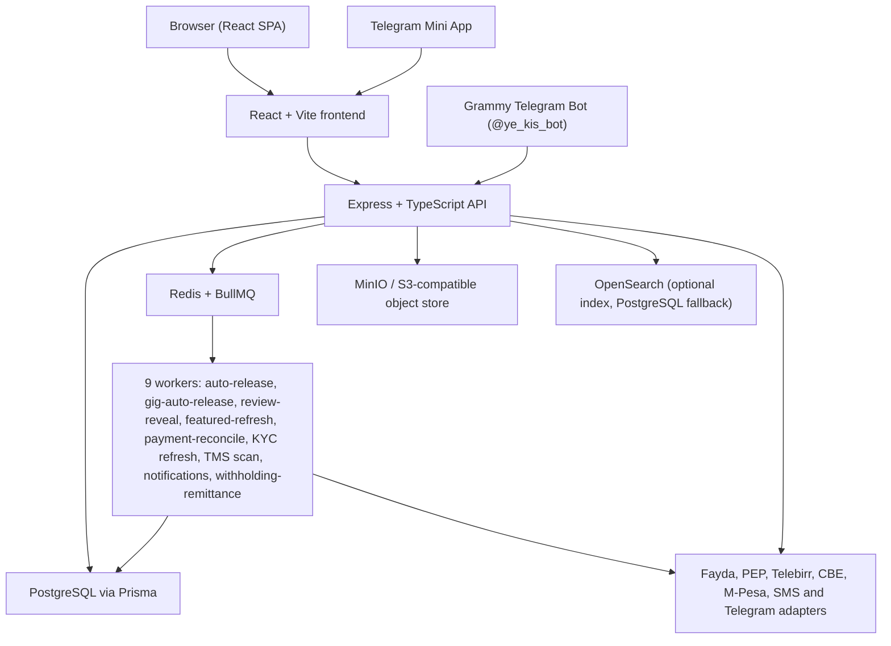
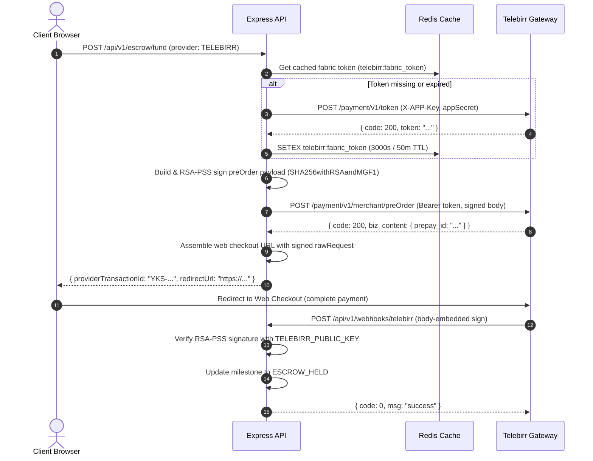

# Architecture

Last updated: 2026-11-12

> **2026-11-09 alignment pass.** Every count, constant, queue name, port, and enum in this document was re-verified against the running codebase. Changes: ops console 19 → **23** page components; frontend i18n 314 → **569** keys (40 nested objects, exact 4-language parity); background processing 6 → **9** queues; added `PaymentProvider` enum vs. live-rail table; added `Continuous Integration` section; added verified-compliance-gap table; added the financial-constants table; documented the unarmed `Contract.cancellableUntil` cooling-off gap; added OpenSearch and `server.fs.deny` to the local topology. See `docs/DOCUMENT_UNIFICATION_2026-11-09.md` and `docs/ROADMAP_ALIGNMENT.md`.

> **2026-11-12 pass.** Counts re-verified against the running codebase after the code-only compliance pass and the onboarding-guide removal: frontend i18n **569** keys (40 nested objects — the `onboarding` namespace was removed with the tour); background processing **9 → 10** queues (the `audit-purge` retention worker was added); the freelancer's net payout is **92.5%**, not 93% (the 0.5% provider fee is collected at release); withdrawals require an **SMS approval code**; the `Contract.cancellableUntil` cooling-off gap is **closed**; and `AuditLog` now carries a **10-year retention stamp** with a daily purge. The deep-dive detail lives in `docs/SYSTEM_DESIGN.md`.

## System Overview



The API is the authority for roles, KYC gates, contract signatures, state transitions, fees, tax, wallet mutations, dispute outcomes, and audit events. The frontend presents commands and current server state; it does not calculate or authorize financial outcomes.

## Repository Boundaries

| Path | Responsibility |
|---|---|
| `apps/frontend/src` | Browser/Telegram UI, API client, role-aware workspaces |
| `apps/frontend/src/pages/ops/` | Operations Console v2 — single staff console (23 page components, command palette, RBAC-driven nav) |
| `apps/backend/src/app.ts` | Middleware order and route registration |
| `apps/backend/src/modules` | Domain routes, services, provider adapters |
| `apps/backend/src/queue` | BullMQ queues and workers |
| `apps/backend/src/lib` | Prisma, Redis, object store, audit, logging |
| `apps/backend/prisma` | Schema and ordered migrations |
| `packages/schemas` | Shared Zod schemas and TypeScript contracts |
| `infra/postgres` | pgaudit image and database initialization |

## API Request Lifecycle

```text
request
  -> Helmet and CORS
  -> raw webhook router (provider routes only, before express.json())
  -> Telegram bot router (raw body for secret-token verification)
  -> JSON body parser
  -> Cache-Control: no-store header
  -> API rate limiter (2,000 req/15m prod, 10,000 dev)
  -> route authentication and role/KYC/party guards
  -> Zod validation
  -> domain service
  -> Prisma transaction and/or BullMQ job
  -> audit and notification side effects
  -> JSON response
```

Webhook routes are deliberately mounted before `express.json()` so raw request bytes are preserved for header-based HMAC and body-embedded RSA-PSS signature verification.

## Domain Modules

| Module | Mount path | Main responsibility |
|---|---|---|
| `auth` | `/api/v1/auth` | Registration, login, JWTs, Google/Apple/Facebook/Telegram OAuth, password reset, session refresh, Telegram Mini App & Widget verification |
| `kyc` | `/api/v1/kyc` | Document upload, Fayda eSignet OIDC/PAR, PEP screening, tier transitions, staff review queue |
| `jobs` | `/api/v1/jobs` | Job search/creation, proposals, atomic serializable proposal decisions |
| `contracts` | `/api/v1/contracts` | Contract creation, PDF storage, party access, independent signatures, 7-day cooling-off cancellation |
| `escrow` | `/api/v1/escrow` | Wallet-first milestone funding, delivery submission, client acceptance, auto-release, wallet balance |
| `topups` | `/api/v1/wallet/topups` | Manual top-up submission & receipt attachment, automated checkout (Telebirr live; CBE/M-Pesa stubbed), staff approval queue |
| `webhooks` | `/api/v1/webhooks` | Signed Telebirr and CBE provider callback ingestion (RSA-PSS + HMAC-SHA256) |
| `disputes` | `/api/v1/disputes` | 5-stage dispute lifecycle (negotiation → evidence → mediation → arbitration → resolved), evidence bundles, staff resolution |
| `gigs` | `/api/v1/gigs` | Fiverr-style gig creation (packages/tiers), ordering, funding, delivery, revision loop, acceptance, reviews, gig disputes |
| `tms` | `/api/v1/tms` | AML flags (structuring, velocity, round-amounts), review queue, STR recording, hold lift |
| `notifications` | `/api/v1/notifications` | In-app notification ledger, read state |
| `chat` | `/api/v1/chat` | Guest/authenticated support conversations, direct 2-party negotiation threads, auto staff assignment, file attachments, Mini-Me AI co-pilot |
| `profiles` | `/api/v1/users` | Public profiles, bio/skills/portfolio, visibility gates, completeness score, profile reporting, PDPP data-subject export and erasure |
| `privacy` | N/A (Internal service) | PDPP data-subject rights: full personal-data export, and erasure that destroys personal content while retaining the AML and financial records the law requires (`modules/privacy/privacy.service.ts`) |
| `skills` | `/api/v1/skills` | Standardized skill taxonomy |
| `reviews` | `/api/v1/reviews` | Double-blind contract review system, Bayesian rating averages, public responses |
| `featured` | `/api/v1/featured` | Talent carousel (staff-pinned, top-rated, recently verified algorithm) |
| `portfolio` | `/api/v1/portfolio` | Freelancer portfolio items |
| `finance` | `/api/v1/finance` | Finance reconciliation read models, platform fee credit ledger, monthly withholding tax remittance reports |
| `admin` | `/api/v1/admin` | Phase 1 RBAC permission matrix, users/contracts/payments/escrow/payouts/ledger/reconciliation/reports/risk/monitoring staff surfaces |
| `staffProfile` | `/api/v1/staff` | Profile report management (list, resolve) |
| `search` | N/A (Internal service) | OpenSearch cluster integration (`searchIndex.service.ts`), indexing gigs & jobs, resilient fallback to PostgreSQL |
| `bot` | `/api/v1/telegram` | Grammy Telegram bot webhook handler (4-language support: en/am/om/ti, 243 i18n keys, push notifications) |

The secured `disputes/dispute.routes.ts` router is the mounted dispute implementation. The older `disputes.routes.ts` file is not mounted and should be treated as legacy until removed.

## Core State Machines

### KYC

```text
PENDING -> UNDER_REVIEW -> VERIFIED | REJECTED
TIER_1 VERIFIED -> Tier 2 request -> UNDER_REVIEW -> TIER_2 VERIFIED | REJECTED
```

The daily worker marks overdue records with `periodicReviewPending`. It does not change `VERIFIED` to `UNDER_REVIEW`, avoiding accidental loss of active access.

**MVP scope (2026-11-09):** the three-tier model exists in the schema (`KycTier` = `TIER_1` / `TIER_2` / `TIER_3`) and in the KYC module, but the MVP launches **simplified single-tier**: Tier 1 (National ID / Fayda) unlocks every core action, and the withdrawal gate resolves to `requireKycVerified(env.TIN_FEATURE_ENABLED ? "TIER_2" : "TIER_1")` (`src/modules/escrow/escrow.routes.ts:351`). With `TIN_FEATURE_ENABLED=false` (the default), Tier 2/TIN is deferred to Phase 4. See `docs/DECISIONS.md` → *Holding TIN Requirement for MVP*.

### Job And Proposal

```text
Job: OPEN -> IN_PROGRESS -> COMPLETED
Job: OPEN -> CANCELLED

Proposal: SUBMITTED -> SHORTLISTED -> ACCEPTED | REJECTED
Proposal: SUBMITTED | SHORTLISTED -> WITHDRAWN
Proposal: SUBMITTED | SHORTLISTED -> COUNTER_OFFERED
```

Accepting a proposal runs in a serializable transaction. It confirms the job is still open, accepts one proposal, rejects competitors, moves the job to `IN_PROGRESS`, and creates one contract.

### Contract

```text
ACTIVE -> COMPLETED  (all milestones reach terminal escrow state)
ACTIVE -> TERMINATED (staff action)
ACTIVE -> CANCELLED  (client exercises 7-day cooling-off right per ECA Proclamation 1205/2020,
                      only while all milestones remain PAYMENT_PENDING)
```

### Escrow

Funding **source** changes where the money comes from. It never changes the lifecycle.

```text
PAYMENT_PENDING -> ESCROW_HELD -> WORK_IN_PROGRESS -> SUBMITTED_FOR_REVIEW
SUBMITTED_FOR_REVIEW -> RELEASED        (client acceptance or auto-release after 7 days)
SUBMITTED_FOR_REVIEW -> DISPUTED
DISPUTED -> RELEASED | REFUNDED | PARTIAL_REFUND
```

Both funding paths land in the same state:

| Path | Endpoint | Money comes from | Milestone ends in |
|---|---|---|---|
| External payment | `POST /api/v1/escrow/fund` (Telebirr C2B) | the provider, on the signed webhook | `ESCROW_HELD` |
| Wallet funding | `POST /api/v1/escrow/fund-from-wallet` | the client's in-platform wallet | `ESCROW_HELD` |

Both go through one shared helper, `placeEscrowHold()` (`apps/backend/src/modules/escrow/escrow.service.ts`), which performs the three writes that must be identical regardless of source: the conditional claim `PAYMENT_PENDING -> ESCROW_HELD` (guarded on `contract.status = ACTIVE`), the client's lifetime gross-spend increment, and — for the wallet path — the double-entry funding journal (`client wallet -> escrow pool`).

The freelancer is credited **only** by `releaseMilestoneFunds()`, which claims from `SUBMITTED_FOR_REVIEW` (client acceptance or 7-day auto-release) or `DISPUTED` (staff resolution / arbitration award). `ESCROW_HELD` and `WORK_IN_PROGRESS` are deliberately **not** legal entry states: releasing from them would pay out without a delivery and without a client acceptance, bypassing the escrow guarantee on the delivery step itself.

Submitting a milestone schedules a warning at 24 hours before the deadline and a release at `AUTO_RELEASE_WINDOW_DAYS` (7 calendar days, matching Service Agreement Clause 2.2(b)). Explicit client acceptance cancels those jobs. Conditional database updates make release/refund paths idempotent under retries or concurrent requests. A separate 7-day statutory cooling-off guard (`Contract.cancellableUntil`, ECA Proclamation 1205/2020) additionally blocks auto-release while still in force — cooling-off currently wins over deemed acceptance, pending legal validation (ESC-002).

> **ESC-003 — resolved 2026-11-09.** Commit `a03259a` had made the wallet-funding path debit the client and credit the freelancer inside the funding transaction, claiming the milestone straight to `RELEASED`. That bypassed the delivery step, the client acceptance step, the 24-hour warning, the 7-day auto-release timer, and dispute (which accepts only `ESCROW_HELD | WORK_IN_PROGRESS | SUBMITTED_FOR_REVIEW`). The fix restored escrow semantics on the wallet path and narrowed `releaseMilestoneFunds()` back to `SUBMITTED_FOR_REVIEW | DISPUTED`; the gig funding path (`fundGigOrderFromWallet`) had the same bypass and was fixed the same way. **Legal text unchanged** — the code was brought back into line with Master Design §3A.13.6 and Service Agreement Clause 2.2. Covered by `apps/backend/tests/escrow-wallet-funding-semantics.test.ts`.

> **ESC-002 — resolved 2026-11-10.** The cooling-off guard had **never been armed by the production contract-creation path**. `Contract.cancellableUntil` was documented in `schema.prisma` as "set to createdAt + 7 days by `createContractFromProposal()`", but `createContractFromProposal()` never wrote the field and no other code path assigned it. `cancelDuringCoolingOff()` therefore always rejected with `CoolingOffExpiredError` ("The 7-day cooling-off window for this contract has expired.") because the field was `null`, and `autoRelease.handler.ts` never skipped a release for cooling-off because the timestamp was always `null`. The 7-day statutory cancellation right was effectively **not available** to clients. It is now written as `createdAt + COOLING_OFF_DAYS` (env, default 7), and the unused `COOLING_OFF_HOURS` (default `24`) has been **deleted** — two variables for one concept, one of them unused, is exactly how the gap survived. Covered by `apps/backend/tests/cooling-off.test.ts`.

### Dispute

```text
STAGE_1_NEGOTIATION -> STAGE_2_EVIDENCE -> STAGE_3_MEDIATION
STAGE_3_MEDIATION -> RESOLVED
STAGE_3_MEDIATION -> STAGE_4_ARBITRATION -> RESOLVED
```

Each dispute has a unique `milestoneId` (or `gigOrderId` for gig order disputes — polymorphic since migration `20260829233000_gig_disputes_polymorphic`). Resolution can release to the freelancer, refund the client, or split the milestone amount; a split cannot exceed that amount.

### Payout

```text
PENDING -> PROCESSING -> CONFIRMED
PENDING -> PROCESSING -> FAILED   (wallet balance automatically rolled back)
CONFIRMED -> REVERSED
```

Telebirr B2C disbursement is live; deterministic sandbox simulation is used when production credentials are absent. Double-entry ledger entries are posted on CONFIRMED; wallet is re-credited on FAILED.

## Financial Integrity Controls

- The server derives milestone value, fees, and withholding; clients cannot submit authoritative totals.
- Fee and tax constants live in `apps/backend/src/config/env.ts` and are applied in `apps/backend/src/modules/escrow/fees.ts`:

  | Constant | Value | Note |
  |---|---|---|
  | `PLATFORM_FEE_RATE_FREELANCER` | `0.07` | Deducted from the freelancer's gross on release (7% general platform fee) |
  | `PLATFORM_FEE_RATE_CLIENT` | `0` | No client deposit surcharge (unified 7% rule, 2026-11-09) |
  | `WITHHOLDING_THRESHOLD_MINOR` | `1_000_000` (10,000 ETB) | Withholding only applies at/above this gross |
  | `WITHHOLDING_RATE_WITH_TIN` | `0.03` | Requires `TIN_FEATURE_ENABLED=true` |
  | `WITHHOLDING_RATE_WITHOUT_TIN` | `0.30` | Requires `TIN_FEATURE_ENABLED=true` |
  | `TIN_FEATURE_ENABLED` | `false` (default) | **Withholding is 0 at launch**; the freelancer keeps 93% of gross |
  | `AUTO_RELEASE_WINDOW_DAYS` | `7` | Matches Master Design Clause 2.2(b) — the Roadmap's "5 days" is stale |
  | `VAT_THRESHOLD_MINOR` | `45_000_000` (450,000 ETB) | Finance alert threshold; the Playbook's "ETB 1,000,000" is stale |
  | `VAT_RATE` | `0.15` | `VAT_REGISTERED` defaults to `false` |
  | `MINIMUM_CONTRACTING_AGE` | `18` | Enforced at registration (`auth.service.ts:76`) |
  | `COOLING_OFF_DAYS` | `7` | Statutory cooling-off window written to `Contract.cancellableUntil` (Electronic Transactions Proclamation No. 1205/2020) |
  | `AUDIT_RETENTION_YEARS` | `10` | Years an audit row is retained before the purge worker may remove it (also floored at 10 years in SQL) |
  | `JWT_ACCESS_TTL` / `JWT_REFRESH_TTL` | `1h` / `30d` | The Playbook's "24h access / 7d refresh" is stale |
  | `PAYMENT_RECONCILE_CRON` | `*/10 * * * *` | Payment-side reconciliation sweep every 10 minutes |

- `contractId` and `milestoneId` are checked together when funding.
- A partial unique database index prevents multiple pending payment attempts for one milestone.
- Provider transaction IDs are unique and webhook transitions are idempotent.
- Release, refund, and split use transactions and guarded state updates to prevent double credit.
- Wallet mismatch is blocking: the API returns `202 HELD_FOR_REVIEW`, creates a TMS flag, and leaves balance unchanged.
- Structuring, round-amounts, velocity, and pass-through checks create review flags without silently changing the financial result.
- TMS rules mirror Master Design §11.4 (2026-08-26 alignment): structuring = deposits totaling >500k ETB within 7 days; velocity = release rate >300% of the user's 90-day baseline (with an absolute floor so new accounts cannot evade review); round amounts = repeated exact 10k-ETB-multiple payments within 7 days. Geographic-risk screening is deferred until any cross-border rail exists.
- A periodic TMS scan (`tms-scan` queue, every 15 minutes) re-runs all windowed rules across users with recent activity and sweeps flags whose 24-hour STR filing SLA has been breached (`TransactionFlag.strDeadlineAt`), raising a one-time `STR_SLA_BREACH` audit event + staff alert per flag.
- Filing an STR optionally suspends the account (`suspendAccount` on `POST /tms/:flagId/file-str`) per Master Design §11.4 — suspension blocks login and all authenticated actions via the per-request middleware check; escrow funds resolve through the dispute path.
- Double-entry general ledger (`LedgerAccount`, `LedgerJournal`, `LedgerEntry`) enforces zero-sum invariant per journal. Escrow release automatically credits `PlatformOperatingAccount` and logs `PlatformFeeCredit`. VAT threshold alerts (`VAT_THRESHOLD_MINOR`) are emitted to Finance on release.

## Telebirr Payment Integration

The platform integrates Telebirr C2B Web Checkout as the primary payment rail for funding milestone escrow.



### Technical Components

1. **C2B Web Checkout Flow (`telebirr.client.ts`)**:
   - `POST /api/v1/escrow/fund` validates contract parties and milestone eligibility.
   - Monetary amounts are converted from integer minor units (ETB cents) to formatted decimal strings (`total_amount: "500.00"`).
   - Generates a unique merchant order ID formatted as `YKS-<timestamp>-<6char_random>`, stored as `PaymentTransaction.providerTransactionId`.
   - Sends a `payment.preorder` request to Telebirr, receives a `prepay_id`, and constructs the full web checkout redirect URL with signed query parameters.
   - The frontend redirects the client to Telebirr Web Checkout; upon payment, Telebirr redirects back to `PaymentReturn.tsx` while sending an asynchronous server-to-server webhook.

2. **Cryptographic RSA-PSS Signing (`telebirr.signing.ts`)**:
   - Implemented using native Node.js `crypto` with zero third-party dependencies (eliminating `jsrsasign`).
   - Algorithm: `SHA256withRSAandMGF1` with PKCS#1 PSS padding and 32-byte salt length (`RSA_PSS_SALTLEN_DIGEST`).
   - Canonical string generation: extracts root fields and flattens `biz_content` (excluding `sign`, `sign_type`, `header`, `refund_info`, `openType`, `raw_request`, `biz_content`), sorts keys in ASCII alphabetical order, and joins as `key=value&key=value`.
   - Signs outbound requests with `TELEBIRR_PRIVATE_KEY` (PKCS#8 PEM) and verifies inbound webhook payloads against `TELEBIRR_PUBLIC_KEY`.

3. **Fabric Token Management & Redis Caching (`telebirr.token.ts`)**:
   - Authenticated Telebirr API calls require a Fabric access token (`POST /payment/v1/token`), which has a 1-hour validity period.
   - `getFabricToken()` caches the token in Redis under `telebirr:fabric_token` with a 50-minute (3000s) TTL to ensure seamless renewals before expiry.
   - Gracefully falls back to direct API fetching if Redis is temporarily unreachable.
   - `invalidateFabricToken()` purges the Redis cache upon receiving HTTP 401 responses to immediately recover from invalid or expired tokens.

4. **Webhook Processing & Verification (`webhooks.routes.ts`)**:
   - Uses dedicated `handleTelebirrWebhook` mounted before `express.json()` to parse raw body bytes.
   - Verifies the body-embedded RSA-PSS `sign` field rather than HTTP headers.
   - Extracts `merch_order_id`, `trade_status`, and `total_amount`, mapping `trade_status` (`Completed`/`Success` -> `SUCCESS`, `Fail`/`Closed`/`Cancelled` -> `FAILED`).
   - Transitions milestone escrow state to `ESCROW_HELD` in a database transaction and responds with `{ code: 0, msg: "success" }`.

5. **Mock Mode Fallback**:
   - When required credentials (`TELEBIRR_FABRIC_APP_ID`, `TELEBIRR_APP_SECRET`, `TELEBIRR_MERCHANT_APP_ID`, `TELEBIRR_MERCHANT_CODE`, `TELEBIRR_PRIVATE_KEY`) are unset, `telebirrClient` falls back to mock mode.
   - Generates a mock transaction ID (`mock-telebirr-<uuid>`) and returns `redirectUrl: null`, allowing full development and testing workflows without live Telebirr credentials.

## Background Processing

| Queue/worker | Trigger | Behavior |
|---|---|---|
| `auto-release` | Milestone submission | Schedules 24h warning before deadline and conditionally releases eligible escrow after 7 days |
| `gig-auto-release` | Gig order delivery submission | Same 7-day auto-release logic for gig orders; gig dispute cancels the job |
| `review-reveal` | Scheduled sweep | Reveals double-blind contract reviews older than 14 days by setting `revealedAt` |
| `featured-refresh` | Scheduled sweep / manual trigger from the ops console | Recomputes the featured talent carousel (staff-pinned, top-rated, recently verified) |
| `payment-reconcile` | Scheduled sweep (default `PAYMENT_RECONCILE_STALE_MINUTES` threshold) | Webhook safety net: re-queries the provider transaction-status API for escrow funding transactions still `PENDING` past the stale threshold and feeds the result through the idempotent `handlePaymentWebhook` path. Telebirr only — CBE is skipped until its client implements `queryPaymentStatus` |
| `kyc-refresh` | Daily schedule | Marks periodic reviews due (`periodicReviewPending = true`) without revoking verified access |
| `notifications` | Domain events | Persists in-app notices and attempts configured SMS/Telegram delivery |
| `tms-scan` | Every 15 minutes (`TMS_SCAN_CRON`, default `*/15 * * * *`) | Re-runs structuring/velocity/round-amounts rules; sweeps flags with expired 24h STR SLA clock; raises `STR_SLA_BREACH` audit events |
| `withholding-remittance` | Monthly schedule (BullMQ cron) | Generates monthly withholding tax remittance reports (`WithholdingRemittanceReport`) |
| `audit-purge` | Daily at 05:00 UTC (BullMQ cron) | Deletes audit rows past their retention stamp **and** past the hard ten-year floor, through a `SECURITY DEFINER` function the application role may execute but cannot delete past; audits the purge itself |

All ten queues are declared in `apps/backend/src/queue/queues.ts` (nine) and `apps/backend/src/queue/withholdingRemittance.worker.ts` (one). Workers start with the backend server and depend on Redis. Retried work must remain idempotent because delivery is at least once.

## Multilingual System

The platform supports four languages natively:

| Code | Language | Script |
|---|---|---|
| `en` | English | Latin |
| `am` | Amharic | Fidel (Ge'ez) |
| `om` | Afaan Oromoo | Latin |
| `ti` | Tigrigna | Fidel (Ge'ez) |

**Frontend (569 keys, 40 nested objects):** `apps/frontend/src/i18n.ts` — typed `LanguageProvider` / `useI18n()` hook with `localStorage` persistence, `<html lang>` synchronization, and real-time reactive re-rendering. All four languages (`en`, `am`, `om`, `ti`) carry an **identical 569-key leaf set** with 40 nested objects each (verified 2026-11-12 by evaluating the exported `translations` object). `Yekis_translations.csv` is the offline parity ledger.

> **Orphaned strings (2026-11-09):** `marketing.stats` (8 keys per language) still exists in `i18n.ts`, but the `StatsSection` component was removed from `LandingPageV2.tsx` — the keys and their `.v2-stats*` CSS (`landing-v2.css:441-653`) are dead. They are retained so the marketing copy is not lost, but they render nothing today.

**Telegram Bot (243 keys):** Locale files at `apps/backend/src/modules/bot/locales/{en,am,om,ti}.json`. All 4 languages have exact 100% key parity. `getBotTranslation()` drives outbound push notifications so users receive localized alerts.

Anti-circumvention: a multi-script engine strips Amharic Fidel numerals, spelled words, obfuscation, and leetspeak from chat messages before rule evaluation.

## Object Storage

KYC documents, top-up receipts, and generated contract PDFs are stored as objects; PostgreSQL stores their paths. The object-store helper creates a missing development bucket automatically. Production must add encryption, versioning, object lock/retention, access logging, backup, and Ethiopian residency controls.

## Security And Compliance

- JWT authentication and fresh database role checks for authorization-sensitive job actions.
- Party checks prevent unrelated users from reading or changing contracts, milestones, and disputes.
- Staff middleware protects KYC, top-up, mediation, and TMS queues.
- Phase 1 RBAC permission matrix (`/admin/permissions/matrix`) drives granular `requirePermission(key)` checks for all admin surfaces. Nav visibility is derived from this matrix at render time.
- WebSocket channel authorization: client-requested subscriptions and typing/read broadcasts verified against conversation membership before they take effect.
- Helmet, CORS, body limits, upload limits, and separate webhook rate limiting are enabled.
- `AuditLog` is append-only by application convention and supported by database grants/pgaudit initialization.
- Secrets are environment validated and must not be committed. Server refuses to boot in production with a mocked PEP provider.

### Verified compliance gaps (2026-11-10)

These are **not** implemented today. They are recorded here so the architecture document does not imply a control the code does not have.

| Control required by the documents | Actual code state |
|---|---|
| 10-year immutable retention of audit, transaction, dispute, and STR records | **The audit retention is now implemented.** `AuditLog.retentionUntil` is NOT NULL and stamped at write time as `createdAt + AUDIT_RETENTION_YEARS` (default 10); a daily `audit-purge` worker calls the `SECURITY DEFINER` function `purge_expired_audit_logs()`, which deletes a row only when both its stamp has expired and it is at least ten years old. The application role holds no `DELETE` privilege on the table — it is granted `EXECUTE` on the function only. **Still open:** there is no WORM module and no append-only partition enforcement in application code, and pgaudit's grants are not verified after deployment |
| PDPP data-subject rights (access, portability, erasure) | **Implemented.** `GET /api/v1/users/me/export` returns the complete archive; `POST /api/v1/users/me/erasure` destroys the personal content (including the chat attachment bytes in the object store and its local-disk fallback), revokes marketing and analytics consent without deleting the consent history, closes the account, and retains the identity, financial and AML records the law requires — stating in the response exactly what was kept. **Still open:** the exact retained-field list has not been reviewed by counsel |
| 72-hour ECA breach notification workflow | **The response chain is implemented.** Opening an incident contains it (revoking every affected user's sessions), notifies staff in-app/SMS/Telegram with the deadline, notifies each affected user, records the incident in the audit log, starts the 72-hour clock, and prepares an ECA filing template with the PDPP-required fields filled in. **Still open:** the ECA has no API, so the filing itself is a human step; detection is staff-confirmed rather than automated; and no DPO is appointed to be the named contact |
| KYC hard-block coverage | Only 7 routes are gated by `requireKycVerified` (`src/middleware/hardBlock.ts`): job create (`jobs.routes.ts:77`), proposal create (`jobs.routes.ts:219`), gig create/update/order/order-fund (`gig.routes.ts:128,154,255,285`), and withdrawal (`escrow.routes.ts:351`). **Profile editing is deliberately not gated** (`src/modules/profiles/profile.routes.ts:59`). The dead duplicate at `src/middleware/requireKycVerified.ts` has been deleted; the live guard is `hardBlock.ts` |
| Static withholding tax | `calculateFees` (`src/modules/escrow/fees.ts`) gates withholding on `env.TIN_FEATURE_ENABLED`, which defaults to `false`. **Withholding is therefore 0% at launch**, and the 3% (with TIN) / 30% (without TIN) rates at/above `WITHHOLDING_THRESHOLD_MINOR = 1_000_000` (10,000 ETB) only apply once the flag is flipped. The block is commented out rather than gated, so the reactivation is a one-line change |

## External Boundaries

| Boundary | Local behavior | Production requirement |
|---|---|---|
| Fayda | Mock verification (eSignet OIDC/PAR stub) | Formal integration and approved credentials |
| PEP/Sanctions | Stub screening | Approved sanctions/PEP source; server refuses production boot with mock |
| Payment collection (C2B) | **Telebirr C2B Web Checkout (RSA-PSS) only.** `cbe.client.ts` and `mpesa.client.ts` always throw `PaymentProviderUnavailableError` | Sandbox/live mapping and reconciliation; CBE webhook scheme confirmation (PAY-004); M-Pesa integration path undecided |
| Payout (B2C) | Telebirr B2C live with deterministic sandbox simulation; automatic wallet rollback on provider refusal | Production credentials, monitoring, reconciliation |
| SMS | Worker client | Credentials, templates, delivery monitoring |
| Telegram | Grammy bot + Mini App init-data verification | Production push verification, account linking |
| STR | Records a human filing; does not submit to FIC | External human/regulatory process; confirm FIC operating procedure |

### Payment Provider Enum vs. Live Rails

The Prisma `PaymentProvider` enum (`apps/backend/prisma/schema.prisma:96-101`) still contains four values — `TELEBIRR`, `CHAPA`, `CBE_BIRR`, `M_PESA` — but only **one** is a live rail:

| Enum value | App-layer status | Evidence |
|---|---|---|
| `TELEBIRR` | **Live** | `src/modules/escrow/providers/telebirr.client.ts` implements initiate/verify/query + B2C payout |
| `CBE_BIRR` | Stub | `src/modules/escrow/providers/cbe.client.ts` always throws `PaymentProviderUnavailableError` |
| `M_PESA` | Stub | `src/modules/escrow/providers/mpesa.client.ts` always throws `PaymentProviderUnavailableError`; gated by `MPESA_CHECKOUT_ENABLED` (`env.ts:98`) |
| `CHAPA` | **Rejected** | No client adapter exists. The app-layer union `PaymentProvider` (`src/schemas.ts:59`) and the escrow route enum (`src/modules/escrow/escrow.routes.ts:153`) list only `TELEBIRR`, `CBE_BIRR`, `M_PESA`, so a `CHAPA` request is a validation error. The enum value is retained in PostgreSQL as an inert row until a PG17+ host can run `DROP VALUE` (see `docs/DATABASE.md`) |

This is a deliberate split: the **database enum is historical residue** from the 2026-08-26 PAY-002 removal, while the **application surface is the authoritative list**. Master Design Decision Log `PAY-003` marks *M-Pesa = REMOVED*; the codebase still ships an M-Pesa client stub, the enum value, the `schemas.ts` union member, and top-up route support. That divergence is recorded in `docs/DOCUMENT_UNIFICATION_2026-11-09.md` and needs a product decision (remove vs. finish).

## Local Topology

| Service | Address | Source of truth |
|---|---|---|
| Frontend (Vite dev server) | `http://127.0.0.1:3000` | `apps/frontend/vite.config.ts` (`server.port = 3000`) and root `package.json` (`dev` script passes `--port=3000`). **Not 5173.** `vite preview` serves `4173` |
| API | `http://127.0.0.1:4000` | `apps/backend/src/server.ts`; the Vite dev server proxies `/api` (HTTP + WebSocket) to it |
| PostgreSQL | `localhost:5433` -> container `5432` | `docker-compose.yml` |
| Redis | `localhost:6379` | `docker-compose.yml` |
| MinIO API | `http://localhost:9000` | `docker-compose.yml` |
| MinIO console | `http://localhost:9001` | `docker-compose.yml` |
| OpenSearch | `http://localhost:9200` | `docker-compose.yml`; optional — `searchIndex.service.ts` falls back to PostgreSQL when unreachable |

The dev server binds `127.0.0.1` by default (`VITE_DEV_HOST` overrides) and enforces an explicit `Host` header allowlist (`ALLOWED_HOSTS` in `apps/frontend/vite.config.ts`) for both `server` and `preview`. File serving uses an **allowlist**: `server.fs.allow` is limited to `index.html`, `src/`, and `public/`, so `/@fs/` cannot reach repository files outside the frontend root. A `server.fs.deny` list (`.env`, private-key extensions, `backups/**`, `*.dump`, `*.sql`, `uploads/**`, `docs/security/**`, plus repository metadata such as `README.md`, `package.json`, `pnpm-lock.yaml`, `.github/**`, `security/**`, `docs/**`, and `apps/backend/**`) remains as defence in depth.

The dev server must not be exposed to a public network. The tunnel helpers require `ALLOW_DEV_TUNNEL=1` before they will start and always target `http://127.0.0.1:<port>`. For a long-lived public deployment, serve the production build (`pnpm --filter frontend build`) from a static host.

The production CSP is injected into `index.html` as a `<meta>` tag by `productionCspPlugin`. Browsers ignore `frame-ancestors` in a `<meta>` policy, so the production host must **also** send the CSP as an HTTP response header for framing protection to apply. That header must use the `frame-ancestors` value defined in `apps/frontend/vite.config.ts` (`'self'`, Telegram, AI Studio, Google, `*.run.app`) rather than `frame-ancestors 'self'`: the app is framed by the Telegram Mini App webview and by AI Studio previews, and `frame-ancestors` is the only directive that can name trusted embedders (`X-Frame-Options: DENY` would refuse to render the app in those contexts, and `X-Frame-Options` has no allowlist form that modern browsers honour).

See `SETUP.md` for exact commands.

## Continuous Integration

Two GitHub Actions workflows exist at `.github/workflows/`:

| Workflow | What it actually does |
|---|---|
| `ci.yml` | Doc-parity check (`node scripts/check-doc-parity.mjs`), secret scan, backend type-check, route-audit baseline gate (`pnpm --filter backend route-audit:check`), backend `pnpm test`, fresh-database check, and a frontend job that runs the production build. The frontend job runs **build only** — there is no frontend test runner, so the CI log explicitly notes that no frontend tests execute |
| `deploy.yml` | **Placeholder only.** The workflow file exists but its deployment steps are a comment ("Deploy steps would go here"). No image is built, pushed, or deployed |

> The `deploy.yml` placeholder is the reason the roadmap's Phase 0 DoD "auto-run tests on every PR" is now satisfied for **tests** but the release pipeline is still unbuilt. Documented in `docs/ROADMAP_ALIGNMENT.md`.

