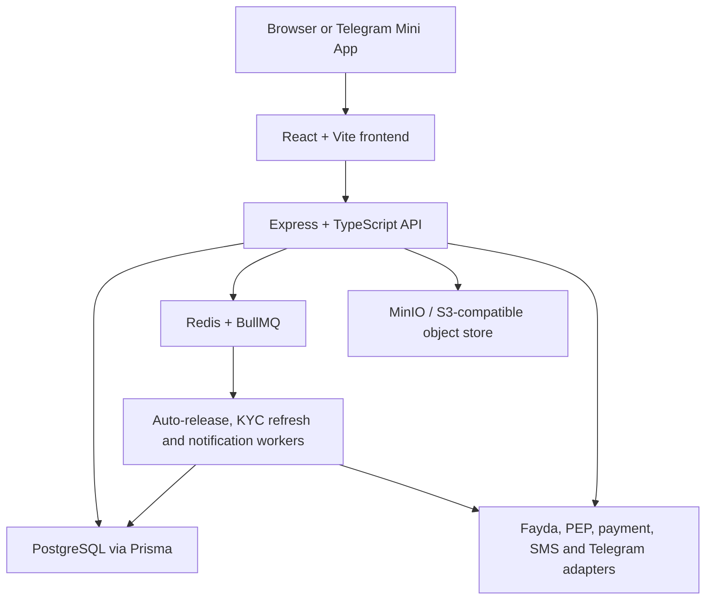
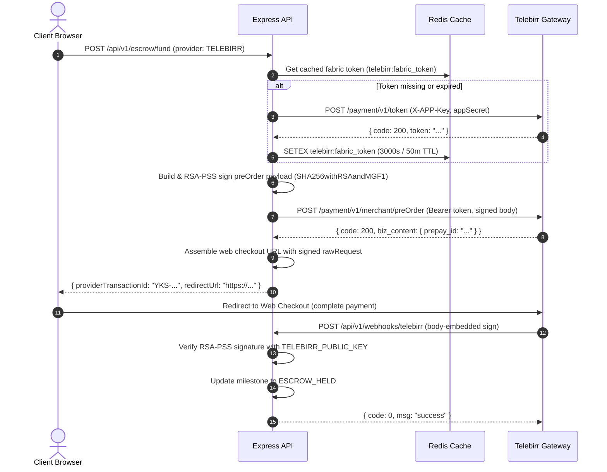

# Architecture

Last updated: 2026-08-15

## System Overview



The API is the authority for roles, KYC gates, contract signatures, state transitions, fees, tax, wallet mutations, dispute outcomes, and audit events. The frontend presents commands and current server state; it does not calculate or authorize financial outcomes.

## Repository Boundaries

| Path | Responsibility |
|---|---|
| `apps/frontend/src` | Browser/Telegram UI, API client, role-aware workspaces |
| `apps/backend/src/app.ts` | Middleware order and route registration |
| `apps/backend/src/modules` | Domain routes, services, provider adapters |
| `apps/backend/src/queue` | BullMQ queues and workers |
| `apps/backend/src/lib` | Prisma, Redis, object store, audit, logging |
| `apps/backend/prisma` | Schema and ordered migrations |
| `packages/schemas` | Shared Zod schemas and TypeScript contracts |
| `infra/postgres` | pgaudit image and database initialization |

## API Request Lifecycle

```text
request
  -> Helmet and CORS
  -> raw webhook router (provider routes only)
  -> JSON body parser
  -> structured request logging
  -> API rate limiter
  -> route authentication and role/KYC/party guards
  -> Zod validation
  -> domain service
  -> Prisma transaction and/or BullMQ job
  -> audit and notification side effects
  -> JSON response
```

Webhook routes are deliberately mounted before `express.json()` so raw request bytes are preserved for header-based HMAC and body-embedded RSA-PSS signature verification.

## Domain Modules

| Module | Main responsibility |
|---|---|
| `auth` | Registration, login, JWTs (role + staffRole in payload), Telegram init-data verification |
| `kyc` | Document upload, Fayda/PEP boundary, tier transitions, staff review |
| `jobs` | Job search/creation, proposals, atomic proposal decisions |
| `contracts` | Contract creation, PDF storage, party access, signatures |
| `escrow` | Funding, webhook handling, submission, release, wallet, top-ups |
| `disputes` | Party cases, evidence, escalation, staff resolution |
| `tms` | AML flags, review queue, STR record, dismissal |
| `notifications` | In-app notification ledger and read state |
| `chat` | Guest/authenticated support conversations, auto staff assignment (load-balanced), file attachments, staff-scoped access control |

The secured `disputes/dispute.routes.ts` router is the mounted dispute implementation. The older `disputes.routes.ts` file is not mounted and should be treated as legacy until removed.

## Core State Machines

### KYC

```text
PENDING -> UNDER_REVIEW -> VERIFIED | REJECTED
TIER_1 VERIFIED -> Tier 2 request -> UNDER_REVIEW -> TIER_2 VERIFIED | REJECTED
```

The daily worker marks overdue records with `periodicReviewPending`. It does not change `VERIFIED` to `UNDER_REVIEW`, avoiding accidental loss of active access.

### Job And Proposal

```text
Job: OPEN -> IN_PROGRESS -> COMPLETED
Job: OPEN -> CANCELLED

Proposal: SUBMITTED -> SHORTLISTED -> ACCEPTED | REJECTED
Proposal: SUBMITTED | SHORTLISTED -> WITHDRAWN
```

Accepting a proposal runs in a serializable transaction. It confirms the job is still open, accepts one proposal, rejects competitors, moves the job to `IN_PROGRESS`, and creates one contract.

### Escrow

```text
PAYMENT_PENDING -> ESCROW_HELD -> SUBMITTED_FOR_REVIEW
SUBMITTED_FOR_REVIEW -> RELEASED
SUBMITTED_FOR_REVIEW -> DISPUTED
DISPUTED -> RELEASED | REFUNDED | PARTIAL_REFUND
```

Submitting a milestone schedules a warning at 24 hours before the deadline and a release at `AUTO_RELEASE_WINDOW_DAYS` (7 calendar days, matching Service Agreement Clause 2.2(b)). Explicit client acceptance cancels those jobs. Conditional database updates make release/refund paths idempotent under retries or concurrent requests. A separate 7-day statutory cooling-off guard (`Contract.cancellableUntil`, ECA Proclamation 1205/2020) additionally blocks auto-release while still in force — cooling-off currently wins over deemed acceptance, pending legal validation (ESC-002).

### Dispute

```text
STAGE_1_NEGOTIATION -> STAGE_2_EVIDENCE -> STAGE_3_MEDIATION
STAGE_3_MEDIATION -> RESOLVED
STAGE_3_MEDIATION -> STAGE_4_ARBITRATION -> RESOLVED
```

Each dispute has a unique `milestoneId`. Resolution can release to the freelancer, refund the client, or split the milestone amount; a split cannot exceed that amount.

## Financial Integrity Controls

- The server derives milestone value, fees, and withholding; clients cannot submit authoritative totals.
- `contractId` and `milestoneId` are checked together when funding.
- A partial unique database index prevents multiple pending payment attempts for one milestone.
- Provider transaction IDs are unique and webhook transitions are idempotent.
- Release, refund, and split use transactions and guarded state updates to prevent double credit.
- Wallet mismatch is blocking: the API returns `202 HELD_FOR_REVIEW`, creates a TMS flag, and leaves balance unchanged.
- Structuring, round-amounts, velocity, and pass-through checks create review flags without silently changing the financial result.
- TMS rules mirror Master Design §11.4 (2026-08-26 alignment): structuring = deposits totaling >500k ETB within 7 days; velocity = release rate >300% of the user's 90-day baseline (with an absolute floor so new accounts cannot evade review); round amounts = repeated exact 10k-ETB-multiple payments within 7 days. Geographic-risk screening is deferred until any cross-border rail exists.
- A periodic TMS scan (`tms-scan` queue, every 15 minutes) re-runs all windowed rules across users with recent activity and sweeps flags whose 24-hour STR filing SLA has been breached (`TransactionFlag.strDeadlineAt`), raising a one-time `STR_SLA_BREACH` audit event + staff alert per flag.
- Filing an STR optionally suspends the account (`suspendAccount` on `POST /tms/:flagId/file-str`) per Master Design §11.4 — suspension blocks login and all authenticated actions via the per-request middleware check; escrow funds resolve through the dispute path.

## Telebirr Payment Integration

The platform integrates Telebirr C2B Web Checkout as the primary payment rail for funding milestone escrow.



### Technical Components

1. **C2B Web Checkout Flow (`telebirr.client.ts`)**:
   - `POST /api/v1/escrow/fund` validates contract parties and milestone eligibility.
   - Monetary amounts are converted from integer minor units (ETB cents) to formatted decimal strings (`total_amount: "500.00"`).
   - Generates a unique merchant order ID formatted as `YKS-<timestamp>-<6char_random>`, stored as `PaymentTransaction.providerTransactionId`.
   - Sends a `payment.preorder` request to Telebirr, receives a `prepay_id`, and constructs the full web checkout redirect URL with signed query parameters.
   - The frontend redirects the client to Telebirr Web Checkout; upon payment, Telebirr redirects back to `PaymentReturn.tsx` while sending an asynchronous server-to-server webhook.

2. **Cryptographic RSA-PSS Signing (`telebirr.signing.ts`)**:
   - Implemented using native Node.js `crypto` with zero third-party dependencies (eliminating `jsrsasign`).
   - Algorithm: `SHA256withRSAandMGF1` with PKCS#1 PSS padding and 32-byte salt length (`RSA_PSS_SALTLEN_DIGEST`).
   - Canonical string generation: extracts root fields and flattens `biz_content` (excluding `sign`, `sign_type`, `header`, `refund_info`, `openType`, `raw_request`, `biz_content`), sorts keys in ASCII alphabetical order, and joins as `key=value&key=value`.
   - Signs outbound requests with `TELEBIRR_PRIVATE_KEY` (PKCS#8 PEM) and verifies inbound webhook payloads against `TELEBIRR_PUBLIC_KEY`.

3. **Fabric Token Management & Redis Caching (`telebirr.token.ts`)**:
   - Authenticated Telebirr API calls require a Fabric access token (`POST /payment/v1/token`), which has a 1-hour validity period.
   - `getFabricToken()` caches the token in Redis under `telebirr:fabric_token` with a 50-minute (3000s) TTL to ensure seamless renewals before expiry.
   - Gracefully falls back to direct API fetching if Redis is temporarily unreachable.
   - `invalidateFabricToken()` purges the Redis cache upon receiving HTTP 401 responses to immediately recover from invalid or expired tokens.

4. **Webhook Processing & Verification (`webhooks.routes.ts`)**:
   - Uses dedicated `handleTelebirrWebhook` mounted before `express.json()` to parse raw body bytes.
   - Verifies the body-embedded RSA-PSS `sign` field rather than HTTP headers.
   - Extracts `merch_order_id`, `trade_status`, and `total_amount`, mapping `trade_status` (`Completed`/`Success` -> `SUCCESS`, `Fail`/`Closed`/`Cancelled` -> `FAILED`).
   - Transitions milestone escrow state to `ESCROW_HELD` in a database transaction and responds with `{ code: 0, msg: "success" }`.

5. **Mock Mode Fallback**:
   - When required credentials (`TELEBIRR_FABRIC_APP_ID`, `TELEBIRR_APP_SECRET`, `TELEBIRR_MERCHANT_APP_ID`, `TELEBIRR_MERCHANT_CODE`, `TELEBIRR_PRIVATE_KEY`) are unset, `telebirrClient` falls back to mock mode.
   - Generates a mock transaction ID (`mock-telebirr-<uuid>`) and returns `redirectUrl: null`, allowing full development and testing workflows without live Telebirr credentials.

## Background Processing

| Queue/worker | Trigger | Behavior |
|---|---|---|
| Auto-release | Milestone submission | Warns before deadline and conditionally releases eligible escrow |
| KYC refresh | Daily schedule | Marks periodic reviews due without revoking verified access |
| Notifications | Domain events | Persists in-app notices and attempts configured SMS/Telegram delivery |

Workers start with the backend server and depend on Redis. Retried work must remain idempotent because delivery is at least once.

## Object Storage

KYC documents, top-up receipts, and generated contract PDFs are stored as objects; PostgreSQL stores their paths. The object-store helper creates a missing development bucket automatically. Production must add encryption, versioning, object lock/retention, access logging, backup, and Ethiopian residency controls.

## Security And Compliance

- JWT authentication and fresh database role checks for authorization-sensitive job actions.
- Party checks prevent unrelated users from reading or changing contracts, milestones, and disputes.
- Staff middleware protects KYC, top-up, mediation, and TMS queues.
- Helmet, CORS, body limits, upload limits, and separate webhook rate limiting are enabled.
- `AuditLog` is append-only by application convention and supported by database grants/pgaudit initialization.
- Secrets are environment validated and must not be committed.

## External Boundaries

| Boundary | Local behavior | Production requirement |
|---|---|---|
| Fayda | Mock verification | Formal integration and credentials |
| PEP | Stub screening | Approved sanctions/PEP source |
| Payment collection | Telebirr C2B Web Checkout (RSA-PSS) + CBE adapter (PAY-002: Chapa removed) | Sandbox/live mapping and reconciliation; CBE webhook scheme confirmation (PAY-004) |
| Payout | Wallet debit/audit only | Real disbursement and failure/reversal workflow |
| SMS/Telegram | Worker clients | Credentials, templates, account linking, monitoring |
| STR | Records a human filing | External human/regulatory process |

## Local Topology

| Service | Address |
|---|---|
| Frontend | `http://127.0.0.1:5173` |
| API | `http://127.0.0.1:4000` |
| PostgreSQL | `localhost:5433` -> container `5432` |
| Redis | `localhost:6379` |
| MinIO API | `http://localhost:9000` |
| MinIO console | `http://localhost:9001` |

See `SETUP.md` for exact commands.
