# Yekis Platform — Canonical System Design Documentation

> **Status:** Authoritative System Design Document  
> **Source Code Basis:** Derived directly from `apps/backend/src/`, `apps/frontend/src/`, `apps/backend/prisma/schema.prisma`, and `packages/schemas/`  
> **Last Verified:** 2026-11-13

---

## Table of Contents

1. [System Overview](#1-system-overview)
2. [Data Model](#2-data-model)
3. [Per-Module Deep Dive (Backend)](#3-per-module-deep-dive)
   - 3.1 [Module: Identity & Authentication](#31-module-identity--authentication-appsbackendsrcmodulesauth)
   - 3.2 [Module: Tiered KYC](#32-module-tiered-kyc-appsbackendsrcmoduleskyc)
   - 3.3 [Module: Jobs, Proposals & Direct Messaging](#33-module-jobs-proposals--direct-messaging-appsbackendsrcmodulesjobs)
   - 3.4 [Module: Contracts & Service Agreements](#34-module-contracts--service-agreements-appsbackendsrcmodulescontracts)
   - 3.5 [Module: Escrow & Wallet](#35-module-escrow--wallet-appsbackendsrcmodulesescrow)
   - 3.6 [Module: Manual Wallet Top-Ups](#36-module-manual-wallet-top-ups-appsbackendsrcmodulestopups)
   - 3.7 [Module: Dispute Resolution](#37-module-dispute-resolution-appsbackendsrcmodulesdisputes)
   - 3.8 [Module: Transaction Monitoring / TMS](#38-module-transaction-monitoring--tms-appsbackendsrcmodulestms)
   - 3.9 [Module: Notifications](#39-module-notifications-appsbackendsrcmodulesnotifications)
   - 3.10 [Module: Support Chat & Direct Messaging](#310-module-support-chat--direct-messaging-appsbackendsrcmoduleschat)
   - 3.11 [Module: Profiles, Skills, Reviews, Portfolio & Featured Talent](#311-module-profiles-skills-reviews-portfolio--featured-talent)
   - 3.12 [Module: Telegram Bot](#312-module-telegram-bot-appsbackendsrcmodulesbot)
   - 3.13 [Module: Gigs & Service Packages](#313-module-gigs--service-packages-appsbackendsrcmodulesgigs)
   - 3.14 [Module: Finance — Ledger, Chart of Accounts & Reconciliation](#314-module-finance--ledger-chart-of-accounts--reconciliation-appsbackendsrcmodulesfinance)
   - 3.15 [Module: Payment Providers & Webhook Ingestion](#315-module-payment-providers--webhook-ingestion)
   - 3.16 [Module: Admin, RBAC & the Ops Console](#316-module-admin-rbac--the-ops-console-appsbackendsrcmodulesadmin)
   - 3.17 [Module: Privacy & Data-Subject Rights](#317-module-privacy--data-subject-rights-appsbackendsrcmodulesprivacy)
   - 3.18 [Module: Search & OpenSearch Integration](#318-module-search--opensearch-integration-appsbackendsrcmodulessearch)
4. [Cross-Cutting Concerns](#4-cross-cutting-concerns)
   - 4.1 [Authentication & Permission Enforcement Model](#41-authentication--permission-enforcement-model)
   - 4.2 [Audit Logging & Append-Only AML Guarantee](#42-audit-logging--append-only-aml-guarantee)
   - 4.3 [Background Processing & Worker Registry](#43-background-processing--worker-registry)
5. [The End-to-End Trust Loop](#5-the-end-to-end-trust-loop)
6. [Master Relationship & Dependency Diagram](#6-master-relationship--dependency-diagram)
7. [Known Inconsistencies, Stubs & Gaps](#7-known-inconsistencies-stubs--gaps)
8. [Frontend Architecture](#8-frontend-architecture)
   - 8.1 [Entry Point & Runtime Branching](#81-entry-point--runtime-branching-maintsx--apptsx)
   - 8.2 [Telegram Mini App Shell](#82-telegram-mini-app-shell-apptsx)
   - 8.3 [Full Browser Platform](#83-full-browser-platform-fullplatformapptsx)
   - 8.4 [API Client Layer](#84-api-client-layer-appsfrontendsrcapiclientts)
   - 8.5 [Telegram WebApp Hook](#85-telegram-webapp-hook-usetelegramminiappts)
   - 8.6 [Payment Return Handler](#86-payment-return-handler-paymentreturntsx)
   - 8.7 [Frontend Build & Dev Configuration](#87-frontend-build--dev-configuration)
   - 8.8 [The Operations Console](#88-the-operations-console-appsfrontendsrcpagesops)
   - 8.9 [Multilingual Translation Framework](#89-multilingual-translation-framework)
   - 8.10 [Real-Time WebSocket Infrastructure](#810-real-time-websocket-infrastructure)
9. [Platform Section-by-Section Functional Reference](#9-platform-section-by-section-functional-reference)
   - 9.15 [Gig Marketplace](#915-gig-marketplace)
   - 9.16 [Operations Console](#916-operations-console)
   - 9.17 [Multilingual & Localization Workflow](#917-multilingual--localization-workflow)
   - 9.18 [Telebirr B2C Automated Disbursement & Ledger Rollback](#918-telebirr-b2c-automated-disbursement--ledger-rollback)
10. [Glossary](#10-glossary)

---

## 1. System Overview

**Yekis** is an Ethiopian freelance marketplace platform engineered to facilitate legally binding, escrow-protected digital service contracts between clients and freelancers. Its core trust proposition is an end-to-end guarantee that work is backed by pre-funded escrow locked in an in-platform ledger, governed by digital service agreements generated as immutable PDFs, guarded by tiered Know Your Customer (KYC) identity verification (with biometric deduplication), monitored by automated Anti-Money Laundering / Transaction Monitoring Systems (AML/TMS), and supported by a structured four-stage dispute resolution framework compliant with Ethiopian legal and tax requirements.

### 1.1 High-Level Architecture

```mermaid
flowchart TD
    subgraph Clients["Client Layer"]
        Web["React + Vite Web SPA (Browser)"]
        MiniApp["Telegram Mini App (TMA)"]
        TgBot["Grammy Telegram Bot"]
    end

    subgraph Gateway["API & Middleware Layer (Express + TypeScript)"]
        Router["Express Router /api/v1"]
        AuthMid["JWT Auth & Hard-Block Middleware"]
        StaffMid["Staff Role RBAC Middleware"]
        KycGate["Tiered KYC Enforcement Gate"]
        CircMid["Anti-Circumvention Filter Middleware"]
        RawBody["Raw-Body Webhook Parser"]
    end

    subgraph DomainModules["Core Domain Modules (apps/backend/src/modules/)"]
        AuthMod["Auth & Telegram Module"]
        KycMod["Tiered KYC Module"]
        JobMod["Jobs & Proposals Module"]
        ContractMod["Contracts & PDF Module"]
        EscrowMod["Escrow & Wallet Module"]
        TopUpMod["Manual Top-Up Module"]
        DisputeMod["Dispute Resolution Module"]
        TmsMod["TMS / Compliance Module"]
        ChatMod["Support & Direct Chat Module"]
        ProfileMod["Profiles, Skills & Reviews"]
        BotMod["Bot Handlers & Scenes Module"]
        GigMod["Gig Marketplace Module"]
        FinanceMod["Finance & Ledger Module"]
        AdminMod["Admin & RBAC Module"]
        SearchMod["Search & OpenSearch Module"]
    end

    subgraph AsyncProcessing["Asynchronous Processing Layer (BullMQ)"]
        Q_Auto["auto-release Queue & Worker"]
        Q_GigAuto["gig-auto-release Queue & Worker"]
        Q_Kyc["kyc-refresh Queue & Worker"]
        Q_Notif["notifications Queue & Worker"]
        Q_Tms["tms-scan Queue & Worker"]
        Q_Withholding["withholding-report Queue & Worker"]
        Q_Rev["review-reveal Queue & Worker"]
        Q_Feat["featured-refresh Queue & Worker"]
    end

    subgraph DataStorage["Data & State Persistence"]
        PG[("PostgreSQL\n(Prisma ORM)")]
        RedisDB[("Redis\n(BullMQ & Token Cache)")]
        ObjectStore[("MinIO / S3 WORM\n(Encrypted Private Bucket)")]
        OpenSearchDB[("OpenSearch\n(Faceted Gig & Job Search)")]
    end

    subgraph ExternalServices["External & Integration Adapters"]
        TelebirrGW["Telebirr Gateway\n(C2B Checkout + B2C Disbursement)"]
        CbeGW["CBE Birr Adapter\n(Merchant API & Webhook)"]
        MpesaGW["Safaricom M-Pesa\n(B2C Disbursement & Checkout)"]
        SmsEth["SMSEthiopia Gateway\n(HTTP REST)"]
        TgApi["Telegram Bot API\n(Grammy 4-Language Engine)"]
        FaydaAPI["Fayda National ID / eSignet\n(OIDC/PAR Integration)"]
        PepAPI["PEP Watchlist Engine\n(Sanctions Screening)"]
    end

    %% Client to API
    Web -->|HTTP / JSON REST| Router
    MiniApp -->|HTTP + Telegram initData| Router
    TgBot -->|Telegram Webhooks / Updates| Router

    %% Router through Middleware
    Router --> AuthMid
    AuthMid --> KycGate
    KycGate --> StaffMid
    Router --> RawBody
    Router --> CircMid

    %% Middleware to Domain Modules
    AuthMid --> AuthMod
    KycGate --> KycMod
    KycGate --> JobMod
    KycGate --> ContractMod
    KycGate --> EscrowMod
    KycGate --> TopUpMod
    KycGate --> DisputeMod
    StaffMid --> TmsMod
    CircMid --> ChatMod
    Router --> ProfileMod
    RawBody --> EscrowMod
    Router --> BotMod

    %% Modules to Storage
    DomainModules -->|Queries & Transactions| PG
    DomainModules -->|Enqueues Delayed/Async Jobs| RedisDB
    DomainModules -->|Presigned Put/Get Object Streams| ObjectStore

    %% Workers
    RedisDB --> Q_Auto
    RedisDB --> Q_Kyc
    RedisDB --> Q_Notif
    RedisDB --> Q_Rev
    RedisDB --> Q_Feat

    Q_Auto -->|Atomic Escrow Release| PG
    Q_Kyc -->|Periodic Review Flags| PG
    Q_Notif -->|Fan-Out Dispatch| DomainModules
    Q_Rev -->|Blind Review Reveal| PG
    Q_Feat -->|Carousel Cache Refresh| PG

    %% Module / Worker Outbound Adapters
    EscrowMod -->|HTTPS + RSA-PSS| TelebirrGW
    EscrowMod -->|HTTPS HMAC| CbeGW
    Q_Notif -->|SMS Dispatch| SmsEth
    Q_Notif -->|Bot Push Messages| TgApi
    KycMod -->|Biometric Verification| FaydaAPI
    KycMod -->|Sanctions Screening| PepAPI
    BotMod -->|Bot Interactions| TgApi
```

---

## 2. Data Model

The data model is implemented in PostgreSQL via Prisma (`apps/backend/prisma/schema.prisma`). It enforces strict relational integrity, WORM-style append-only compliance logging, and monetary storage using non-negative 32-bit integer minor units (ETB cents) to eliminate floating-point rounding errors.

### 2.1 Entity Relationship Diagram

```mermaid
erDiagram
    User ||--o| KycRecord : "has identity profile"
    User ||--o| Wallet : "owns in-platform ledger"
    User ||--o{ ConsentRecord : "grants compliance consents"
    User ||--o{ Job : "posts as Client"
    User ||--o{ Proposal : "submits as Freelancer"
    User ||--o{ Contract : "engages as Client"
    User ||--o{ Contract : "engages as Freelancer"
    User ||--o{ WalletTopUp : "submits manual top-ups"
    User ||--o{ Notification : "receives"
    User ||--o{ AuditLog : "acts in"
    User ||--o{ TransactionFlag : "flagged in AML"
    User ||--o{ UserSkill : "possesses"
    User ||--o{ PortfolioItem : "showcases"
    User ||--o{ Review : "authors (ReviewAuthor)"
    User ||--o{ Review : "receives (ReviewTarget)"
    User ||--o{ FeaturedLog : "featured in"
    User ||--o{ ProfileReport : "reported by / for"
    User ||--o{ Conversation : "creates as support user"
    User ||--o{ Conversation : "assigned as staff"
    User ||--o{ ConversationParticipant : "participates in"
    User ||--o{ ChatMessage : "sends in support"
    User ||--o{ DirectMessage : "sends in direct chat"
    User ||--o{ DirectThread : "client in thread"
    User ||--o{ DirectThread : "freelancer in thread"

    KycRecord ||--o{ KycDocument : "contains WORM attachments"
    KycRecord ||--o{ KycReviewEvent : "audit history of decisions"

    Job ||--o{ Proposal : "receives bids"
    Job ||--o| Contract : "transitions into"
    Job ||--o{ DirectThread : "scoped messaging"

    Proposal ||--o| CounterOffer : "negotiated via"

    Contract ||--o{ Milestone : "divided into"
    Contract ||--o| Dispute : "subject to"
    Contract ||--o| Review : "yields mutual review"

    Milestone ||--o{ PaymentTransaction : "funded via"

    Wallet ||--o{ WalletTopUp : "credited by approved top-up"

    Dispute ||--o{ DisputeEvidence : "supported by"

    Conversation ||--o{ ConversationParticipant : "has participants"
    Conversation ||--o{ ChatMessage : "contains messages"

    DirectThread ||--o{ DirectMessage : "contains messages"

    Skill ||--o{ UserSkill : "mapped to users"
    Skill ||--o{ User : "primary skill reference"

    User {
        string id PK
        string ucid UK "Unique Customer ID"
        string email UK
        string phone UK
        string passwordHash
        enum role "CLIENT | FREELANCER | BOTH"
        string languagePreference
        string timezone
        datetime dateOfBirth
        string faydaBiometricId UK
        boolean isSuspended
        enum staffRole "COMPLIANCE_OFFICER | ADMIN"
        enum cachedKycTier "TIER_1 | TIER_2 | TIER_3"
        enum cachedKycStatus "PENDING | UNDER_REVIEW | VERIFIED | REJECTED"
        int totalEarnedNetMinor
        int totalSpentGrossMinor
        string firstName
        string lastName
        string displayName
        string bio
        string avatarUrl
        json avatarCdnUrls
        string primarySkillId FK
        boolean isAvailableForWork
        enum profileVisibility "PUBLIC | PROPOSERS | PRIVATE"
        int profileCompleteness
        int totalJobsCompleted
        int totalJobsPosted
        float ratingAverage
        int ratingCount
        float ratingBayesianScore
        datetime lastFeaturedAt
        int profileViewCount
        bigint telegramUserId UK
        string telegramChatId
        datetime createdAt
        datetime updatedAt
    }

    KycRecord {
        string id PK
        string userId FK,UK
        enum tier "TIER_1 | TIER_2 | TIER_3"
        enum status "PENDING | UNDER_REVIEW | VERIFIED | REJECTED"
        enum highestVerifiedTier "TIER_1 | TIER_2 | TIER_3"
        string fullName
        string documentNumber
        string tin
        string businessRegNumber
        boolean isPepMatch
        datetime pepScreenedAt
        boolean faydaVerificationAttempted
        boolean faydaVerificationSucceeded
        string reviewedByStaffId
        string rejectionReason
        datetime lastVerifiedAt
        datetime nextReviewDueAt
        datetime createdAt
        datetime updatedAt
    }

    KycDocument {
        string id PK
        string kycRecordId FK
        enum documentType "NATIONAL_ID | PASSPORT | DRIVERS_LICENSE | SELFIE_LIVENESS | TIN_CERTIFICATE | BUSINESS_REGISTRATION"
        string storagePath "Object Store WORM key"
        datetime uploadedAt
    }

    KycReviewEvent {
        string id PK
        string kycRecordId FK
        string staffUserId
        enum decision "VERIFIED | REJECTED"
        enum tierAtDecision "TIER_1 | TIER_2 | TIER_3"
        string reason
        datetime createdAt
    }

    Job {
        string id PK
        string clientId FK
        string title
        enum category "WEB_APP_DEVELOPMENT | GRAPHIC_DESIGN | DIGITAL_MARKETING | CONTENT_WRITING | TRANSLATION | DATA_ENTRY"
        string description
        int budgetMinMinor
        int budgetMaxMinor
        datetime deadline
        enum status "OPEN | IN_PROGRESS | COMPLETED | CANCELLED"
        json proposedMilestones
        json screeningQuestions
        datetime createdAt
    }

    Proposal {
        string id PK
        string jobId FK
        string freelancerId FK
        string coverLetter
        int quotedAmountMinor
        int estimatedDays
        json milestoneBreakdown
        json screeningAnswers
        string_array attachmentPaths
        enum status "SUBMITTED | SHORTLISTED | ACCEPTED | REJECTED | WITHDRAWN | COUNTER_OFFERED"
        datetime createdAt
    }

    CounterOffer {
        string id PK
        string proposalId FK,UK
        string proposedByClientId
        int revisedAmountMinor
        int revisedEstimatedDays
        json revisedMilestones
        string message
        string status "PENDING | ACCEPTED | DECLINED"
        datetime createdAt
    }

    Contract {
        string id PK
        string jobId FK,UK
        string clientId FK
        string freelancerId FK
        string templateVersion
        string documentStoragePath
        enum status "ACTIVE | COMPLETED | TERMINATED"
        datetime clientAcceptedAt
        datetime freelancerAcceptedAt
        datetime createdAt
    }

    Milestone {
        string id PK
        string contractId FK
        string title
        int amountMinor
        datetime dueDate
        enum escrowState "PAYMENT_PENDING | ESCROW_HELD | WORK_IN_PROGRESS | SUBMITTED_FOR_REVIEW | ACCEPTED | RELEASED | DISPUTED | REFUNDED | PARTIAL_REFUND"
        datetime submittedAt
        string deliverableUrl
        datetime autoReleaseAt
        datetime releasedAt
        datetime createdAt
    }

    PaymentTransaction {
        string id PK
        string milestoneId FK
        enum provider "TELEBIRR | CHAPA | CBE_BIRR | M_PESA"
        string providerTransactionId UK
        int amountMinor
        string status "PENDING | SUCCESS | FAILED"
        int withholdingTaxMinor
        json rawWebhookPayload
        datetime createdAt
    }

    Wallet {
        string id PK
        string userId FK,UK
        int balanceMinor
        datetime updatedAt
    }

    WalletTopUp {
        string id PK
        string userId FK
        string walletId FK
        enum provider "TELEBIRR | CHAPA | CBE_BIRR | M_PESA"
        int amountMinor
        string referenceNumber
        string receiptImagePath
        enum status "PENDING | APPROVED | REJECTED | FLAGGED"
        string reviewedByStaffId
        string rejectionReason
        datetime reviewedAt
        datetime createdAt
    }

    Dispute {
        string id PK
        string contractId FK,UK
        string milestoneId
        enum category "NON_DELIVERY | LATE_DELIVERY | QUALITY_ISSUE | SCOPE_CREEP | NON_PAYMENT | COMMUNICATION_BREAKDOWN"
        enum stage "NONE | STAGE_1_NEGOTIATION | STAGE_2_EVIDENCE | STAGE_3_MEDIATION | STAGE_4_ARBITRATION | RESOLVED"
        string raisedByUserId
        string description
        datetime negotiationDeadlineAt
        datetime mediationDeadlineAt
        string evidenceBundlePath
        string mediatorRecommendation
        string resolvedByStaffId
        enum resolutionOutcome "RELEASE_TO_FREELANCER | REFUND_TO_CLIENT | PARTIAL_SPLIT"
        int freelancerShareMinor
        datetime resolvedAt
        datetime createdAt
        datetime updatedAt
    }

    DisputeEvidence {
        string id PK
        string disputeId FK
        string submittedByUserId
        string statement
        datetime createdAt
    }

    TransactionFlag {
        string id PK
        string userId FK
        enum type "STRUCTURING | VELOCITY | PASS_THROUGH | WALLET_MISMATCH | STAFF_FLAGGED"
        enum status "PENDING_REVIEW | STR_FILED | DISMISSED"
        json details
        string relatedEntityId
        string reviewedByStaffId
        string reviewNotes
        datetime strFiledAt
        string strReferenceNumber
        datetime createdAt
        datetime updatedAt
    }

    Notification {
        string id PK
        string userId FK
        string type
        string message
        json metadata
        boolean isRead
        datetime smsSentAt
        datetime createdAt
    }

    AuditLog {
        string id PK
        string userId FK
        string eventType
        string entityType
        string entityId
        json metadata
        datetime createdAt
    }

    Conversation {
        string id PK
        string creatorId FK
        string assignedStaffId FK
        string subject
        string status "OPEN | CLOSED"
        datetime createdAt
        datetime updatedAt
    }

    ConversationParticipant {
        string id PK
        string conversationId FK
        string userId FK
        datetime lastReadAt
    }

    ChatMessage {
        string id PK
        string conversationId FK
        string senderId FK
        string body
        string attachmentUrl
        datetime createdAt
    }

    Skill {
        string id PK
        string nameEn
        string nameAm
        enum category "DEVELOPMENT | DESIGN | MARKETING | WRITING | TRANSLATION | DATA_ENTRY | VIDEO_AUDIO | BUSINESS | ENGINEERING | OTHER"
        boolean isActive
        int displayOrder
    }

    UserSkill {
        string id PK
        string userId FK
        string skillId FK
        datetime createdAt
    }

    Review {
        string id PK
        string contractId FK,UK
        string authorId FK
        string targetUserId FK
        int rating
        string comment
        boolean isBlind
        datetime revealedAt
        string response
        datetime respondedAt
        boolean isDisputed
        string disputeReason
        datetime disputeResolvedAt
        enum disputeResolution "REVIEW_REMOVED | REVIEW_EDITED | NO_ACTION"
        string disputedByStaffId
        boolean isEligible
        datetime createdAt
        datetime updatedAt
    }

    PortfolioItem {
        string id PK
        string userId FK
        string title
        string description
        string thumbnailUrl
        string projectUrl
        boolean isActive
        int displayOrder
        datetime createdAt
        datetime updatedAt
    }

    FeaturedLog {
        string id PK
        string userId FK
        datetime featuredAt
        enum reason "TOP_RATED | RECENTLY_VERIFIED | STAFF_PINNED | CATEGORY_BALANCING | COLD_START"
        enum category "DEVELOPMENT | DESIGN | MARKETING | WRITING | TRANSLATION | DATA_ENTRY | VIDEO_AUDIO | BUSINESS | ENGINEERING | OTHER"
        string pinnedByStaffId
        string notes
    }

    ProfileReport {
        string id PK
        string reporterId
        string reportedUserId FK
        enum reason "FAKE_IDENTITY | OFFENSIVE_CONTENT | OFF_PLATFORM_CONTACT | MISLEADING_SKILLS | SPAM | OTHER"
        string details
        enum status "PENDING | UNDER_REVIEW | RESOLVED_NO_ACTION | RESOLVED_PROFILE_HIDDEN | RESOLVED_PROFILE_BANNED"
        string reviewedByStaffId
        string staffNotes
        datetime resolvedAt
        datetime createdAt
        datetime updatedAt
    }

    ProfileView {
        string id PK
        string viewerId
        string targetUserId
        datetime viewedAt
        string source
    }

    DirectThread {
        string id PK
        string jobId FK
        string clientId FK
        string freelancerId FK
        datetime createdAt
        datetime updatedAt
    }

    DirectMessage {
        string id PK
        string threadId FK
        string senderId FK
        string body
        boolean isRead
        datetime createdAt
    }
```

> **Note on the `PaymentProvider` enum.** The ERD above shows the enum exactly as it
> exists in `schema.prisma`, which is `TELEBIRR | CHAPA | CBE_BIRR | M_PESA`.
> **`CHAPA` and `M_PESA` are inert members.** Chapa was removed from the approved
> payment architecture (PAY-002) and has no adapter, no webhook route and no
> client; M-Pesa is likewise unimplemented. The enum members were left in place
> deliberately — dropping a Postgres enum member requires recreating the type
> and every column that uses it, and the rows that referenced them were
> migrated away already. **Only Telebirr is live.** CBE Birr and M-Pesa clients
> exist but throw `PaymentProviderUnavailableError`.

### 2.2 Model Group Descriptions

1. **Identity & Consents (`User`, `ConsentRecord`):** Manages user accounts, unique customer IDs (`ucid`), login credentials, cached KYC states, cumulative spend/earnings, profile presentation, and mandatory KYC data processing consents.
2. **KYC & Due Diligence (`KycRecord`, `KycDocument`, `KycReviewEvent`):** Encodes the tiered verification system. Documents are stored in an encrypted object store with WORM compliance, while manual staff decisions write immutable `KycReviewEvent` records.
3. **Jobs, Proposals & Direct Negotiation (`Job`, `Proposal`, `CounterOffer`, `DirectThread`, `DirectMessage`):** Handles the marketplace procurement phase. Includes proposal bidding, counter-offers, and contextual client-freelancer thread messaging passed through an anti-circumvention filter.
4. **Contracts & Execution (`Contract`, `Milestone`):** Represents signed legal agreements. When both parties digitally sign, a immutable PDF service agreement is stored, and the associated milestones transition through escrow funding.
5. **Escrow, Payments & Manual Top-Ups (`Wallet`, `WalletTopUp`, `PaymentTransaction`):** Manages financial state. Holds in-platform wallet balances, manual receipt uploads awaiting staff approval, and external payment transaction logs.
6. **Dispute Resolution (`Dispute`, `DisputeEvidence`):** Enforces a four-stage dispute workflow (Negotiation -> Evidence -> Mediation -> Arbitration) for contested milestones, allowing full release, full refund, or partial split.
7. **Compliance & AML (`TransactionFlag`, `AuditLog`):** Transaction monitoring system (TMS) rule flags (structuring, velocity, pass-through, wallet mismatch) and the tamper-resistant system-wide audit trail.
8. **Support & Notifications (`Conversation`, `ConversationParticipant`, `ChatMessage`, `Notification`):** In-app customer support ticketing and asynchronous notification dispatch (in-app, SMS, Telegram).
9. **Talent Discovery, Reviews & Portfolio (`Skill`, `UserSkill`, `Review`, `PortfolioItem`, `FeaturedLog`, `ProfileReport`, `ProfileView`):** Skill taxonomies, portfolio showcases, double-blind reviews with Bayesian scoring, cold-start carousel rotation, and user moderation.

---

## 3. Per-Module Deep Dive

---

### 3.1 Module: Identity & Authentication (`apps/backend/src/modules/auth/`)

* **Purpose:** Handles user registration, age gating (18+ requirement), credential authentication, JWT token issuance (access/refresh), password hashing (Argon2), consent capture, and Telegram Mini App session verification.
* **Owns Models:** `User`, `ConsentRecord`.

#### State Machine
Auth does not have a multi-step entity state machine, but enforces an active session gate:
`UNAUTHENTICATED` $\rightarrow$ (Valid Credentials / Verified Telegram initData) $\rightarrow$ `AUTHENTICATED_ACTIVE` $\rightarrow$ (`isSuspended: true`) $\rightarrow$ `FORBIDDEN_SUSPENDED`.

#### Key Flows

##### Flow 1: User Registration with Age Gate & Mandatory Consent
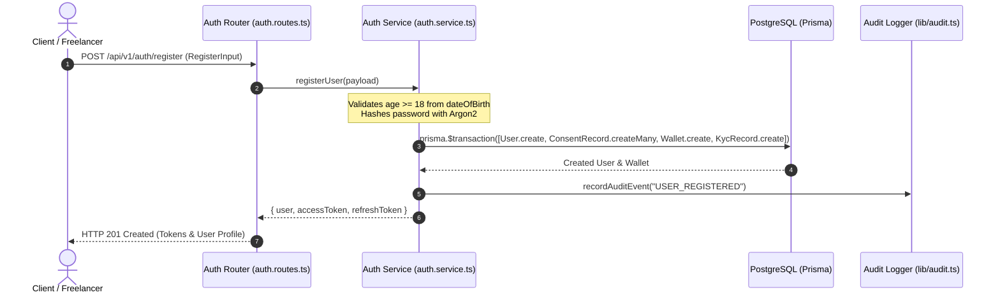

##### Flow 2: Telegram Mini App Authentication
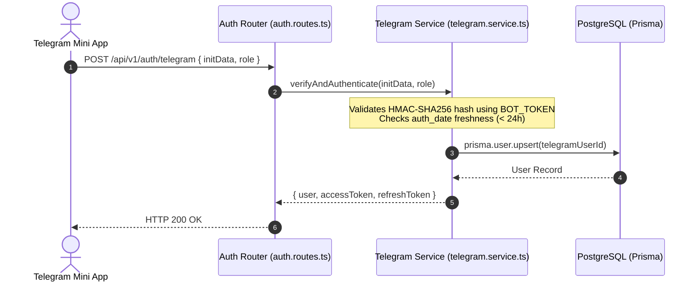

#### API Surface
| Method | Path | Auth / Permission | Purpose |
|---|---|---|---|
| `POST` | `/api/v1/auth/register` | Public | Register account, validate age $\ge 18$, record consents, create wallet & KYC record |
| `POST` | `/api/v1/auth/login` | Public | Authenticate via email/password, return access & refresh JWTs |
| `POST` | `/api/v1/auth/refresh` | Public (Refresh Token) | Rotate expired access token using valid refresh token |
| `POST` | `/api/v1/auth/telegram` | Public (`initData`) | Validate Telegram WebApp hash and issue JWT session |
| `GET` | `/api/v1/auth/me` | Authenticated | Return authenticated user's record and current KYC status |

* **Depends on:** `apps/backend/src/lib/prisma.ts`, `apps/backend/src/lib/audit.ts`, `apps/backend/src/config/env.ts`.
* **Depended on by:** `apps/backend/src/middleware/auth.ts`, `apps/backend/src/modules/bot/bot.service.ts`.

---

### 3.2 Module: Tiered KYC (`apps/backend/src/modules/kyc/`)

* **Purpose:** Implements tiered compliance verification. Tier 1 gates browsing, proposal bidding AND withdrawals; Tier 2 (TIN / Business Reg) is the Phase 4 upgrade that also cuts withholding from 30% to 3%; Tier 3 handles PEP / high-volume enhanced due diligence.
* **Owns Models:** `KycRecord`, `KycDocument`, `KycReviewEvent`.

#### State Machine (`KycStatus` & `KycTier`)

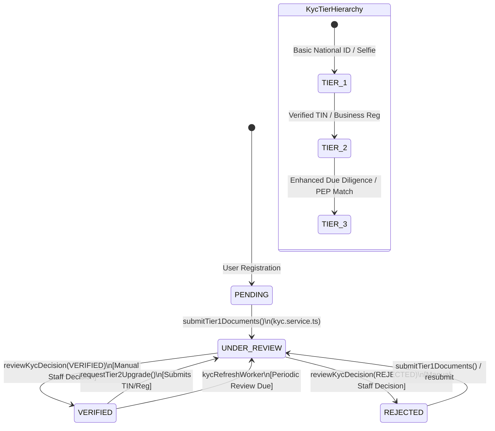

#### Key Flows

##### Flow 1: Document Upload & Verification Submission
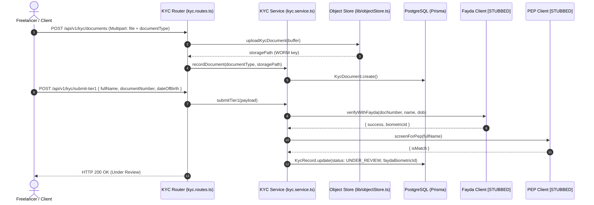

#### API Surface
| Method | Path | Auth / Permission | Purpose |
|---|---|---|---|
| `GET` | `/api/v1/kyc/status` | Authenticated | Get current user's KYC tier, status, and missing requirements |
| `POST` | `/api/v1/kyc/documents` | Authenticated | Multipart upload of KYC document image/PDF to encrypted WORM storage |
| `POST` | `/api/v1/kyc/submit-tier1` | Authenticated | Submit personal details for Tier 1 automated and manual review |
| `POST` | `/api/v1/kyc/upgrade-tier2` | Authenticated (Tier 1 Verified) | Submit TIN / Business Registration number for Tier 2 (Phase 4 — reduces withholding, not a withdrawal prerequisite) |
| `GET` | `/api/v1/kyc/admin/queue` | Staff (`COMPLIANCE_OFFICER` / `ADMIN`) | List pending KYC submissions requiring human verification |
| `POST` | `/api/v1/kyc/admin/review/:id` | Staff (`COMPLIANCE_OFFICER` / `ADMIN`) | Submit formal KYC decision (`VERIFIED` / `REJECTED`) with audit logging |
| `GET` | `/api/v1/kyc/admin/document-url/:docId`| Staff (`COMPLIANCE_OFFICER` / `ADMIN`) | Generate temporary signed URL to inspect encrypted KYC document |

* **Depends on:** `apps/backend/src/lib/prisma.ts`, `apps/backend/src/lib/objectStore.ts`, `apps/backend/src/lib/audit.ts`, `apps/backend/src/modules/kyc/fayda.client.ts`, `apps/backend/src/modules/kyc/pep.client.ts`.
* **Depended on by:** `apps/backend/src/middleware/hardBlock.ts`, `apps/backend/src/middleware/requireKycVerified.ts`, `apps/backend/src/queue/kycRefresh.worker.ts`.

---

### 3.3 Module: Jobs, Proposals & Direct Messaging (`apps/backend/src/modules/jobs/`)

* **Purpose:** Handles job posting, search/filtering, freelancer proposal submissions, counter-offers, proposal acceptance, and contextual direct messaging between clients and proposers.
* **Owns Models:** `Job`, `Proposal`, `CounterOffer`, `DirectThread`, `DirectMessage`.

#### State Machines

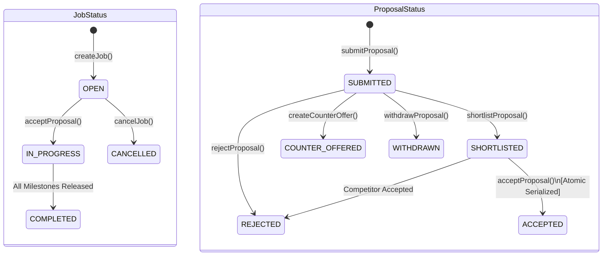

#### Key Flows

##### Flow 1: Proposal Submission with Anti-Self-Bidding Guard
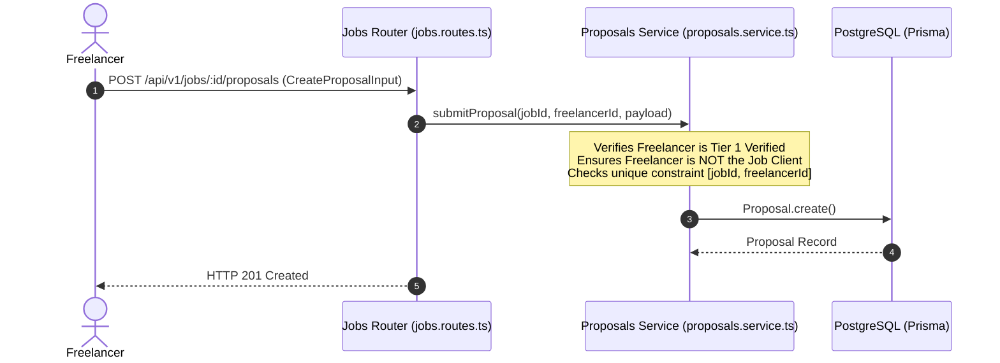

##### Flow 2: Atomic Proposal Acceptance & Contract Creation
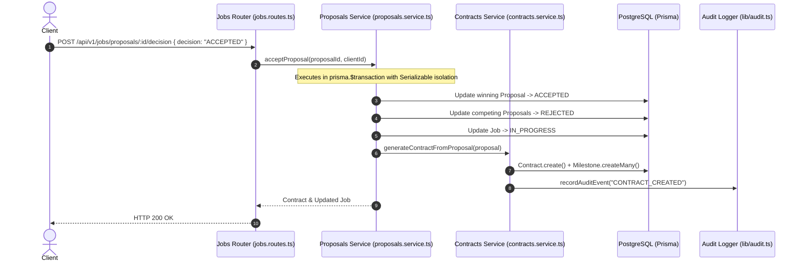

#### API Surface
| Method | Path | Auth / Permission | Purpose |
|---|---|---|---|
| `GET` | `/api/v1/jobs` | Public / Authed | Search and list open jobs with category, budget, and pagination filters |
| `GET` | `/api/v1/jobs/my` | Authenticated (Client) | List all jobs posted by the authenticated client |
| `POST` | `/api/v1/jobs` | Authenticated (`CLIENT` / `BOTH`, Tier 1) | Create and publish a new job brief with proposed milestones |
| `GET` | `/api/v1/jobs/:id` | Authenticated | Retrieve full job details, screening questions, and proposal counts |
| `POST` | `/api/v1/jobs/:id/proposals` | Authenticated (`FREELANCER`, Tier 1) | Submit a bid proposal with quoted price and milestone breakdown |
| `GET` | `/api/v1/jobs/:id/proposals` | Authenticated (Job Client Only) | List all proposals submitted to a specific job |
| `GET` | `/api/v1/jobs/proposals/my` | Authenticated (Freelancer) | List all proposals submitted by the current freelancer |
| `POST` | `/api/v1/jobs/proposals/:id/decision` | Authenticated (Job Client Only) | Shortlist, reject, or atomically accept a proposal |
| `POST` | `/api/v1/jobs/proposals/:id/counter` | Authenticated (Job Client Only) | Propose modified milestone amounts or timelines to freelancer |
| `GET` | `/api/v1/jobs/:id/threads` | Authenticated (Party to Job) | List or retrieve direct messaging thread for a specific job |
| `POST` | `/api/v1/jobs/:id/messages` | Authenticated (Party to Job) | Send in-thread message (sanitized for anti-circumvention) |

* **Depends on:** `apps/backend/src/lib/prisma.ts`, `apps/backend/src/lib/audit.ts`, `apps/backend/src/modules/contracts/contracts.service.ts`, `apps/backend/src/middleware/circumvention.middleware.ts`.
* **Depended on by:** `apps/backend/src/modules/contracts/contracts.service.ts`.

---

### 3.4 Module: Contracts & Service Agreements (`apps/backend/src/modules/contracts/`)

* **Purpose:** Manages the legal contract lifecycle between client and freelancer. Compiles dynamic PDF Service Agreements (using `pdf-lib`), collects independent digital signature timestamps, and automatically triggers escrow locking upon mutual execution.
* **Owns Models:** `Contract`.

#### State Machine (`ContractStatus`)

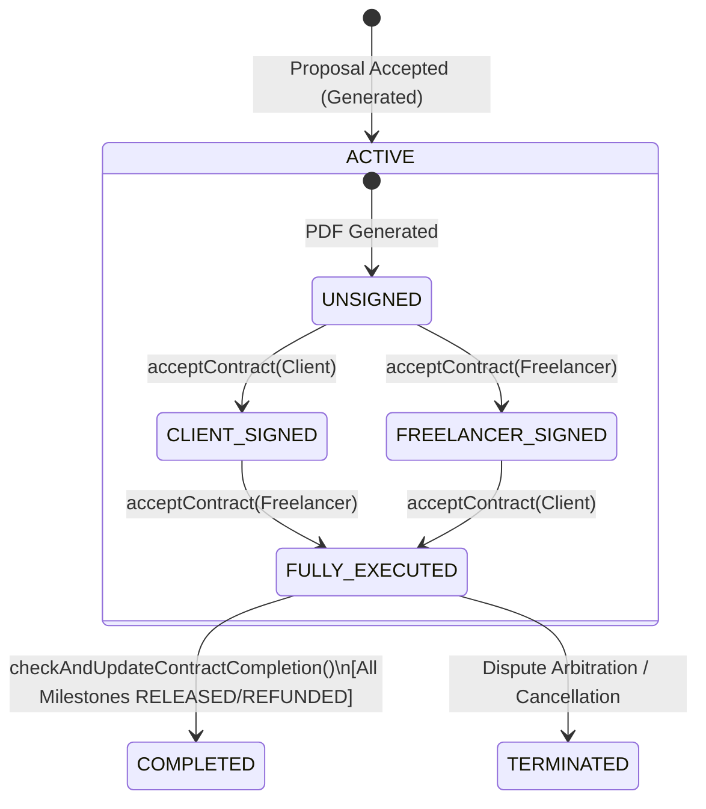

#### Key Flows

##### Flow 1: Dual Digital Contract Signing & Auto-Escrow Trigger
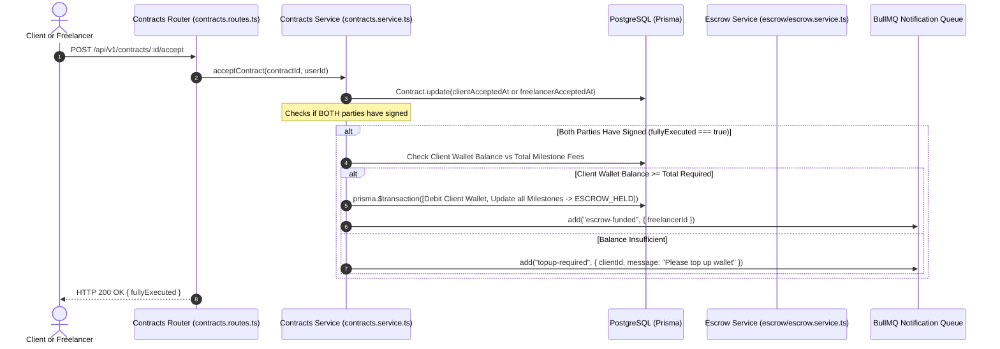

#### API Surface
| Method | Path | Auth / Permission | Purpose |
|---|---|---|---|
| `GET` | `/api/v1/contracts` | Authenticated (Party) | List all contracts associated with the authenticated user |
| `GET` | `/api/v1/contracts/:id` | Authenticated (Contract Party) | Get contract status, milestone details, and party signatures |
| `GET` | `/api/v1/contracts/:id/document` | Authenticated (Contract Party) | Generate temporary signed URL to download legal Service Agreement PDF |
| `POST` | `/api/v1/contracts/:id/accept` | Authenticated (Contract Party) | Record digital agreement signature timestamp |

* **Depends on:** `apps/backend/src/lib/prisma.ts`, `apps/backend/src/lib/audit.ts`, `apps/backend/src/modules/contracts/serviceAgreement.template.ts`, `apps/backend/src/modules/contracts/contractStorage.ts`, `apps/backend/src/modules/escrow/fees.ts`, `apps/backend/src/queue/queues.ts`.
* **Depended on by:** `apps/backend/src/modules/jobs/proposals.service.ts`, `apps/backend/src/modules/escrow/escrow.service.ts`.

---

### 3.5 Module: Escrow & Wallet (`apps/backend/src/modules/escrow/`)

* **Purpose:** The core financial ledger engine. Manages milestone escrow states, wallet-first escrow funding, delivery submissions, client approvals, auto-release timers, fee and withholding tax splits, provider checkout initiation (Telebirr; CBE Birr and M-Pesa are throwing stubs), and freelancer withdrawals gated on Tier 1 KYC.
* **Owns Models:** `Milestone`, `PaymentTransaction`, `Wallet`.

#### Escrow Funds Flow (Plain-English Narrative)

Funds move through six sequential phases. All amounts are stored and computed as **integer minor units (ETB cents)** — never floating-point — to prevent rounding errors.

**Phase 1 — Client Wallet Top-Up (Before Any Work)**
The client must first load their in-platform wallet with real ETB. They transfer funds via Telebirr, then submit a top-up request (`POST /api/v1/topups`) with a receipt image and the sender reference. A staff member reviews the receipt in the admin panel and either approves or rejects it. On approval, the client's `wallet.balanceMinor` is credited atomically in a Prisma transaction. No funds move automatically — this step is always human-gated.

**Phase 2 — Contract Signing (Trust Lock)**
Both the client and freelancer must digitally accept the contract (`POST /api/v1/contracts/:id/accept`) before any escrow can be funded. The service enforces this: `fundMilestone` and `fundMilestoneFromWallet` both throw `ContractNotFullyExecutedError` if either `clientAcceptedAt` or `freelancerAcceptedAt` is missing. The moment the **second signature** is recorded, the contracts service automatically attempts to fund all `PAYMENT_PENDING` milestones from the client's wallet in a single atomic transaction (wallet debit + all milestone state updates in one `prisma.$transaction`). If the client wallet has insufficient balance, a `"topup-required"` notification is sent instead and the client must fund manually.

**Phase 3 — Escrow Holding (Funds Locked)**
When a milestone is funded — either automatically on contract signing, or manually via `POST /api/v1/escrow/fund-from-wallet` — the client deposits the gross milestone amount (zero deposit surcharge, `PLATFORM_FEE_RATE_CLIENT = 0`). This charge is atomically deducted from their wallet, and the milestone transitions to `ESCROW_HELD`. The freelancer receives a `"escrow-funded"` push notification signalling they can begin work. A TMS structuring check (`runPostFundingChecks`) runs non-blockingly after the state transition to flag any suspicious funding patterns.

**Phase 4 — Work Delivery & Review Window**
The freelancer submits work via `POST /api/v1/escrow/milestones/:id/submit`. The milestone moves to `SUBMITTED_FOR_REVIEW` and two BullMQ jobs are scheduled with deterministic job IDs:
- A **warn job** fires 24 hours before the auto-release deadline (notifying the client their review window is almost up).
- A **release job** fires at the deadline (`AUTO_RELEASE_WINDOW_DAYS` from submission) and calls `releaseMilestoneFunds()` automatically.

The client can act in one of two ways before the timer fires: **accept** the work (releases funds immediately) or **raise a dispute** (freezes escrow and cancels both BullMQ jobs).

**Phase 5 — Release & Fee Split**
Whether triggered by the client's explicit acceptance or the auto-release timer, `releaseMilestoneFunds()` executes an atomic three-way transaction:
1. Milestone → `RELEASED` with `releasedAt` timestamp.
2. Freelancer's `wallet.balanceMinor` incremented by `freelancerNetMinor`.
3. Freelancer's lifetime `user.totalEarnedNetMinor` counter incremented (this drives the public profile "total earned" figure independently of the spendable wallet balance).

The **freelancer's net amount** is: `gross − platform fee (7%) − provider fee (0.5%)` = **92.5% of gross**. The provider fee is the cost of moving the money through Telebirr and is collected once, on the transaction gross, at release time — so the platform's overall take is a single 7.5% rather than 7% here plus a surprise deduction at cash-out. Under the MVP launch policy, statutory withholding tax is held at 0% pending formal tax remittance procedures, so there is no withholding deduction. After release, `checkAndUpdateContractCompletion()` checks whether every milestone on the contract has reached a terminal state (`RELEASED`, `REFUNDED`, or `PARTIAL_REFUND`) and marks the contract `COMPLETED` if so.

**Phase 5b — Dispute Path**
If either party calls `POST /api/v1/disputes` while the milestone is in `ESCROW_HELD`, `WORK_IN_PROGRESS`, or `SUBMITTED_FOR_REVIEW`, the milestone transitions to `DISPUTED` and both BullMQ jobs are cancelled immediately. Funds remain frozen in the escrow ledger (no wallet entries are written) while a three-stage mediation process runs (Negotiation → Admin Review → Mediation). A staff mediator resolves the dispute with one of three outcomes: `RELEASE_TO_FREELANCER` (calls `releaseMilestoneFunds`), `REFUND_TO_CLIENT` (calls `refundMilestoneToClient`, crediting the client's wallet), or `PARTIAL_SPLIT` (calls both with split amounts, milestone → `PARTIAL_REFUND`).

**Phase 6 — Freelancer Withdrawal**
Once funds are in the freelancer's wallet, they can request a payout via `POST /api/v1/escrow/wallet/withdraw`. This endpoint requires **verified KYC** — Tier 1 under the MVP launch policy (`TIN_FEATURE_ENABLED = false`, so the gate resolves to `requireKycVerified("TIER_1")`; Tier 2 is the Phase 4 upgrade). Four additional guards apply:
- **Two-factor approval of the payout.** `POST /api/v1/escrow/wallet/withdraw/otp` sends an SMS code to the number on the account, and the withdrawal requires it as `otpCode`. The code approves one payout, is verified inside the service immediately before the wallet is debited, and is consumed when the payout completes. A phone-*verification* code cannot approve a payout — `PhoneVerificationCode.purpose` keeps the two separate.
- If the user is the paying party on an active contract milestone or an open dispute, the withdrawal is blocked entirely (`ActiveContractWithdrawalBlockedError`).
- **Wallet-mismatch check (hard block):** If the payout destination account does not match the identity on the KYC record, the withdrawal is held for compliance review and returns HTTP 202 (`HELD_FOR_REVIEW`). Funds are not moved.
- **Pass-through check (soft flag):** If the withdrawal looks like an immediate pass-through (funds in → funds out with no real activity), a `TransactionFlag` is created for staff review but the withdrawal is not blocked.

On a clean pass the wallet is debited, a `PayoutTransaction` is created, and the platform calls the provider's disbursement API: **Telebirr B2C `initiateDisbursement()`** (`apps/backend/src/modules/escrow/providers/telebirr.client.ts:449`) is implemented and is what the withdrawal path actually calls. A confirmed disbursement posts the balanced double-entry journal in the same transaction as the payout confirmation; an immediate provider refusal rolls the wallet debit back and marks the payout `FAILED`.

#### State Machine (`EscrowState`)

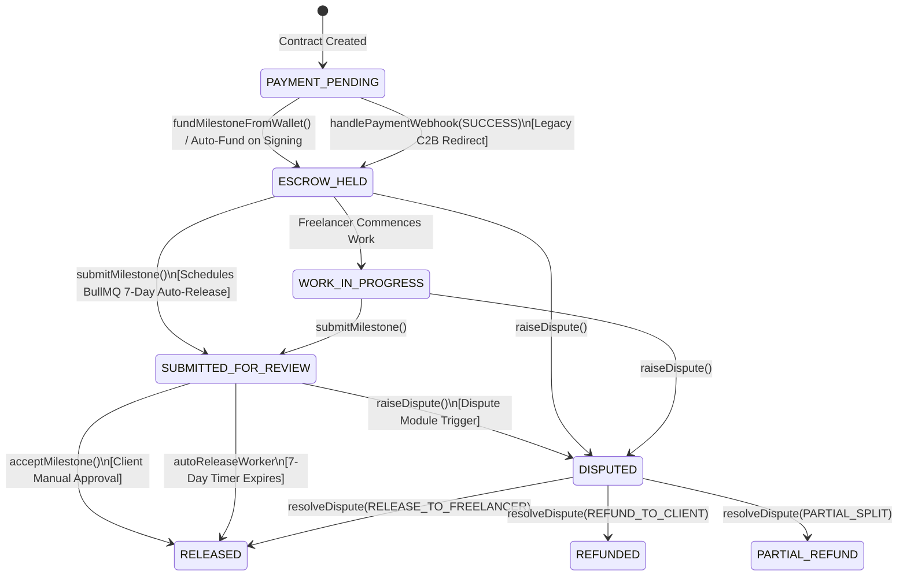

#### Financial Split Logic (`calculateFees` in `fees.ts`)
* **Gross Milestone Amount:** $M$
* **Client Total Charge:** $M$ (zero client surcharge; `PLATFORM_FEE_RATE_CLIENT = 0`).
* **Platform Fee from Freelancer:** $M \times 7\%$ (`PLATFORM_FEE_RATE_FREELANCER = 0.07`).
* **Provider (disbursement) Fee:** $M \times 0.5\%$ (`PAYMENT_PROVIDER_FEE_RATE = 0.005`) — the cost of moving the money through Telebirr, collected once on the transaction gross at release and credited to `REVENUE-DISBURSEMENT-FEES`.
* **Withholding Tax:** Held at 0% for MVP launch (`TIN_FEATURE_ENABLED = false`).
* **Net Credited to Freelancer Wallet:** $M - \text{Platform Fee} - \text{Provider Fee} = M \times 92.5\%$.
* **Platform's overall take:** $7.5\%$ of the gross ($7\%$ commission + $0.5\%$ provider fee) — a single number, not a surprise at cash-out.

#### Key Flows

##### Flow 1: Wallet-First Escrow Funding
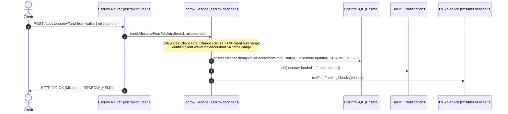

##### Flow 2: Milestone Delivery, Auto-Release Timer & Acceptance
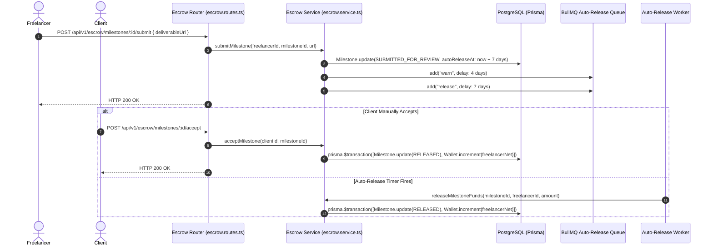

##### Flow 3: Freelancer Withdrawal with TMS Wallet Mismatch Guard
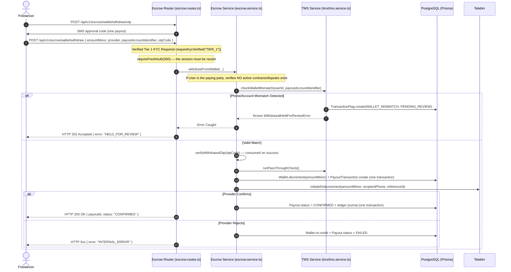

#### API Surface
| Method | Path | Auth / Permission | Purpose |
|---|---|---|---|
| `POST` | `/api/v1/escrow/fund-from-wallet` | Authenticated (Client, Tier 1) | Atomically deduct milestone charge from client wallet and set `ESCROW_HELD` |
| `POST` | `/api/v1/escrow/fund` | Authenticated (Client, Tier 1) | (Deprecated C2B) Initiate external provider redirect payment |
| `GET` | `/api/v1/escrow/wallet` | Authenticated | Return authenticated user's current wallet `balanceMinor` |
| `GET` | `/api/v1/escrow/milestones` | Authenticated | List all milestones across user's contracts |
| `POST` | `/api/v1/escrow/milestones/:id/submit` | Authenticated (Contract Freelancer) | Submit milestone deliverable, schedule 7-day BullMQ auto-release |
| `POST` | `/api/v1/escrow/milestones/:id/accept` | Authenticated (Contract Client) | Manually approve deliverable and release funds net of fees/tax |
| `POST` | `/api/v1/escrow/wallet/withdraw/otp` | Authenticated (Tier 1 Verified) | Send the SMS code that approves one payout |
| `POST` | `/api/v1/escrow/wallet/withdraw` | Authenticated (Tier 1 Verified, fresh auth) | Request payout to Telebirr; requires `otpCode`; runs TMS checks and active-contract blocks |
| `POST` | `/api/v1/webhooks/telebirr` | Public (Raw Body, RSA-PSS Sign) | Ingest Telebirr payment webhooks, verify RSA-PSS body signature, update escrow |
| `POST` | `/api/v1/webhooks/cbe` | Public (Raw Body, HMAC Header) | Ingest CBE payment webhooks [STUBBED] |

* **Depends on:** `apps/backend/src/lib/prisma.ts`, `apps/backend/src/lib/audit.ts`, `apps/backend/src/queue/queues.ts`, `apps/backend/src/modules/tms/tms.service.ts`, `apps/backend/src/modules/escrow/fees.ts`, `apps/backend/src/modules/escrow/providers/telebirr.client.ts`.
* **Depended on by:** `apps/backend/src/queue/autoRelease.worker.ts`, `apps/backend/src/modules/contracts/contracts.service.ts`, `apps/backend/src/modules/disputes/dispute.service.ts`.

---

### 3.6 Module: Manual Wallet Top-Ups (`apps/backend/src/modules/topups/`)

* **Purpose:** Provides a manual bank receipt upload flow for funding in-platform wallets. Clients deposit directly into the platform's Telebirr or CBE corporate bank accounts, upload receipt screenshots with reference numbers, which staff review and verify before crediting `Wallet.balanceMinor`.
* **Owns Models:** `WalletTopUp`.

#### State Machine (`TopUpStatus`)

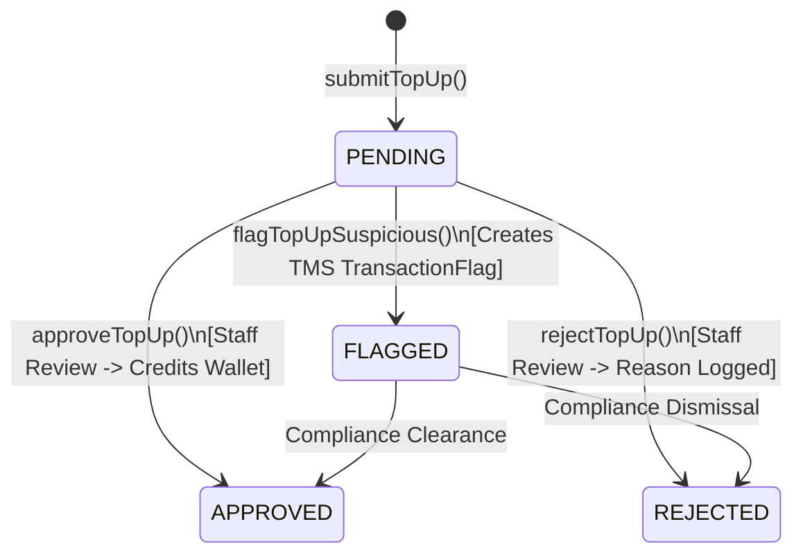

#### API Surface
| Method | Path | Auth / Permission | Purpose |
|---|---|---|---|
| `GET` | `/api/v1/wallet/topups` | Authenticated | List all top-up requests submitted by the authenticated user |
| `POST` | `/api/v1/wallet/topups` | Authenticated (Multipart) | Submit receipt image, provider (`TELEBIRR` / `CBE_BIRR`), reference, and amount |
| `GET` | `/api/v1/wallet/topups/admin/queue` | Staff (`COMPLIANCE_OFFICER` / `ADMIN`) | View pending top-up review queue with user details |
| `POST` | `/api/v1/wallet/topups/admin/:id/decision`| Staff (`COMPLIANCE_OFFICER` / `ADMIN`) | Approve (credits wallet atomically) or reject top-up |
| `POST` | `/api/v1/wallet/topups/admin/:id/flag` | Staff (`COMPLIANCE_OFFICER` / `ADMIN`) | Mark top-up as suspicious and generate TMS AML flag |
| `GET` | `/api/v1/wallet/topups/admin/:id/receipt-url`| Staff (`COMPLIANCE_OFFICER` / `ADMIN`) | Generate short-lived presigned URL to view receipt image |

* **Depends on:** `apps/backend/src/lib/prisma.ts`, `apps/backend/src/lib/objectStore.ts`, `apps/backend/src/lib/audit.ts`, `apps/backend/src/modules/tms/tms.service.ts`.
* **Depended on by:** Mounted at `/api/v1/wallet/topups`.

---

### 3.7 Module: Dispute Resolution (`apps/backend/src/modules/disputes/`)

* **Purpose:** Implements a structured four-stage escalation procedure for contested milestones. Allows direct negotiation, evidence submission bundles, staff mediation, and AACCSA-aligned arbitration.
* **Owns Models:** `Dispute`, `DisputeEvidence`.

#### State Machine (`DisputeStage`)

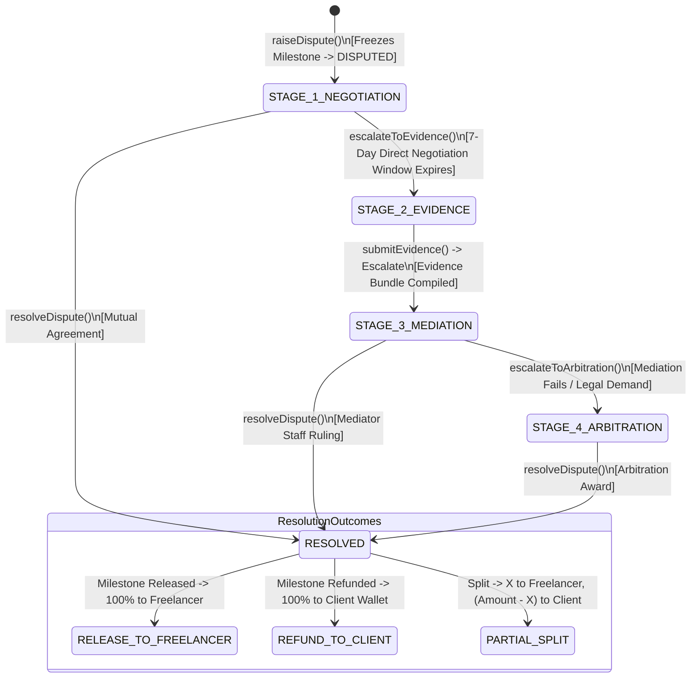

#### Key Flows

##### Flow 1: Raising a Dispute & Freezing Escrow
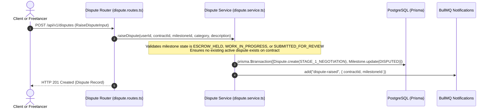

#### API Surface
| Method | Path | Auth / Permission | Purpose |
|---|---|---|---|
| `GET` | `/api/v1/disputes` | Authenticated | List all disputes involving the authenticated user |
| `GET` | `/api/v1/disputes/:id` | Authenticated (Dispute Party / Staff) | Get dispute timeline, evidence, and mediator recommendations |
| `POST` | `/api/v1/disputes` | Authenticated (Contract Party) | Raise dispute on a funded milestone (freezes escrow) |
| `POST` | `/api/v1/disputes/:id/evidence` | Authenticated (Dispute Party) | Submit statement/evidence during Stage 2 |
| `POST` | `/api/v1/disputes/:id/escalate` | Authenticated (Dispute Party) | Escalate from Negotiation $\rightarrow$ Evidence or Evidence $\rightarrow$ Mediation |
| `GET` | `/api/v1/disputes/admin/queue` | Staff (`COMPLIANCE_OFFICER` / `ADMIN`) | List disputes in Stage 3 Mediation requiring staff resolution |
| `POST` | `/api/v1/disputes/admin/:id/resolve`| Staff (`COMPLIANCE_OFFICER` / `ADMIN`) | Execute binding outcome (`RELEASE_TO_FREELANCER`, `REFUND_TO_CLIENT`, `PARTIAL_SPLIT`) |
| `POST` | `/api/v1/disputes/admin/:id/arbitrate`| Staff (`COMPLIANCE_OFFICER` / `ADMIN`) | Escalate complex legal claim to Stage 4 AACCSA arbitration |

* **Depends on:** `apps/backend/src/lib/prisma.ts`, `apps/backend/src/lib/audit.ts`, `apps/backend/src/queue/queues.ts`, `apps/backend/src/modules/escrow/escrow.service.ts`.
* **Depended on by:** Mounted at `/api/v1/disputes`.

---

### 3.8 Module: Transaction Monitoring / TMS (`apps/backend/src/modules/tms/`)

* **Purpose:** Implements automated Anti-Money Laundering (AML) heuristics. Detects payment structuring, velocity spikes, pass-through withdrawals, and wallet mismatches. Provides staff queue for human investigation and recording Suspicious Transaction Report (STR) filings with the Financial Intelligence Center (FIC).
* **Owns Models:** `TransactionFlag`.

#### AML Rule Matrix
| Rule Type | Evaluated At | Heuristic / Threshold | Action |
|---|---|---|---|
| `STRUCTURING` | Escrow Funding (`runStructuringCheck`) | $\ge 3$ payments within 72h (`TMS_STRUCTURING_WINDOW_HOURS = 72`) each between ETB 9,000 and ETB 9,999.99 (just below the ETB 10,000 withholding threshold). | **Flags** user for review (Non-blocking). |
| `VELOCITY` | Escrow Release (`runVelocityCheck`) | $\ge 20$ completed milestones (`TMS_VELOCITY_MILESTONE_THRESHOLD = 20`) within 48h (`TMS_VELOCITY_WINDOW_HOURS = 48`). | **Flags** freelancer for review (Non-blocking). |
| `PASS_THROUGH`| Withdrawal (`runPassThroughCheck`) | Withdrawal amount $\ge 90\%$ of recent milestone release within 24h (`TMS_PASS_THROUGH_WINDOW_HOURS = 24`) with 0 other active contracts. | **Flags** user for review (Non-blocking). |
| `WALLET_MISMATCH`| Withdrawal (`checkWalletMismatch`) | Payout phone or bank account number does not match user's registered/verified phone number. | **BLOCKS** withdrawal (`WithdrawalHeldForReviewError`, HTTP 202) & creates flag. |
| `STAFF_FLAGGED`| Manual Top-Up Review | Staff manually identifies fraudulent/suspicious deposit receipt. | **Flags** top-up and user (Manual). |

#### API Surface
| Method | Path | Auth / Permission | Purpose |
|---|---|---|---|
| `GET` | `/api/v1/tms/flags` | Staff (`COMPLIANCE_OFFICER` / `ADMIN`) | Query AML flag queue with status, type, and search filters |
| `GET` | `/api/v1/tms/activity-feed` | Staff (`COMPLIANCE_OFFICER` / `ADMIN`) | Get real-time audit feed of compliance actions |
| `POST` | `/api/v1/tms/flags/:id/file-str` | Staff (`COMPLIANCE_OFFICER` / `ADMIN`) | Record manual STR regulatory filing with FIC reference number |
| `POST` | `/api/v1/tms/flags/:id/dismiss` | Staff (`COMPLIANCE_OFFICER` / `ADMIN`) | Dismiss flag after human investigation with mandatory notes |

* **Depends on:** `apps/backend/src/lib/prisma.ts`, `apps/backend/src/lib/audit.ts`, `apps/backend/src/config/env.ts`.
* **Depended on by:** `apps/backend/src/modules/escrow/escrow.service.ts`, `apps/backend/src/modules/topups/topup.service.ts`.

---

### 3.9 Module: Notifications (`apps/backend/src/modules/notifications/`)

* **Purpose:** Multi-channel notification fan-out engine. Dispatches in-app notifications, SMS alerts via SMSEthiopia for critical financial/legal events, and push notifications via Telegram Bot.
* **Owns Models:** `Notification`.

#### Critical Notification Types Matrix (Triggering SMS)
Defined in `notification.service.ts:CRITICAL_NOTIFICATION_TYPES`:
* `escrow-funded`
* `escrow-released`
* `dispute-raised`
* `dispute-resolved`
* `kyc-rejected`
* `withdrawal-held`

#### API Surface
| Method | Path | Auth / Permission | Purpose |
|---|---|---|---|
| `GET` | `/api/v1/notifications` | Authenticated | List notifications for authenticated user |
| `POST` | `/api/v1/notifications/:id/read`| Authenticated | Mark notification as read |
| `POST` | `/api/v1/notifications/read-all`| Authenticated | Mark all notifications as read |

* **Depends on:** `apps/backend/src/lib/prisma.ts`, `apps/backend/src/modules/notifications/sms.client.ts`, `apps/backend/src/modules/notifications/telegram.client.ts`.
* **Depended on by:** `apps/backend/src/queue/notification.worker.ts`.

---

### 3.10 Module: Support Chat & Direct Messaging (`apps/backend/src/modules/chat/`)

* **Purpose:** Provides authenticated and guest customer support ticketing with staff auto-assignment, as well as direct messaging threads protected by regex anti-circumvention filters (blocking off-platform phone numbers, Telegram handles, and external payment prompts).
* **Owns Models:** `Conversation`, `ConversationParticipant`, `ChatMessage`.

#### API Surface
| Method | Path | Auth / Permission | Purpose |
|---|---|---|---|
| `GET` | `/api/v1/chat/conversations` | Authenticated | List all support conversations user participates in |
| `POST` | `/api/v1/chat/conversations` | Authenticated | Open new support ticket |
| `GET` | `/api/v1/chat/conversations/:id/messages` | Authenticated (Participant/Staff) | Get messages in support thread |
| `POST` | `/api/v1/chat/conversations/:id/messages` | Authenticated (Participant/Staff) | Send message in support thread |
| `GET` | `/api/v1/chat/admin/conversations` | Staff (`COMPLIANCE_OFFICER` / `ADMIN`) | List all support conversations with load-balancing views |
| `PATCH` | `/api/v1/chat/admin/conversations/:id/status` | Staff (`COMPLIANCE_OFFICER` / `ADMIN`) | Close or reopen support ticket |
| `POST` | `/api/v1/chat/guest/conversations` | Public (Guest Session) | Allow unauthenticated users to open support tickets |

* **Depends on:** `apps/backend/src/lib/prisma.ts`, `apps/backend/src/lib/objectStore.ts`, `apps/backend/src/middleware/circumvention.middleware.ts`.
* **Depended on by:** Mounted at `/api/v1/chat`.

---

### 3.11 Module: Profiles, Skills, Reviews, Portfolio & Featured Talent

* **Purpose:** Manages user discovery and reputation:
  * **Skills (`apps/backend/src/modules/skills/`):** Amharic/English localized skills taxonomy.
  * **Profiles (`apps/backend/src/modules/profiles/`):** Profile completeness scores, privacy visibility (`PUBLIC`, `PROPOSERS`, `PRIVATE`), and moderation reporting.
  * **Reviews (`apps/backend/src/modules/reviews/`):** Mutual double-blind reviews revealed after 14 days or mutual submission, with Bayesian sorting (`ratingBayesianScore`).
  * **Featured Talent (`apps/backend/src/modules/featured/`):** Cold-start carousel rotation algorithm balancing top-rated, recently verified, and staff-pinned talent.
  * **Portfolio (`apps/backend/src/modules/portfolio/`):** Freelancer work showcase items.
* **Owns Models:** `Skill`, `UserSkill`, `Review`, `PortfolioItem`, `FeaturedLog`, `ProfileReport`, `ProfileView`.

#### Double-Blind Review Mechanism
1. Client and freelancer can review each other only after contract completion (`isEligible: true`).
2. Reviews are created with `isBlind: true` and are hidden from the target user.
3. When both parties submit reviews, OR when 14 days elapse (processed by `reviewReveal.worker.ts`), reviews are set to `isBlind: false` and `revealedAt = now()`.
4. Bayesian rating is updated on the `User` model:
   $$R_{\text{bayesian}} = \frac{C \times m + \sum \text{ratings}}{C + n}$$
   where $m$ is platform prior mean (4.5), $C$ is prior weight (5), and $n$ is total review count.

---

### 3.12 Module: Telegram Bot (`apps/backend/src/modules/bot/`)

* **Purpose:** Implements the official Yekis Telegram Bot via the Grammy framework. Handles `/start` deep linking, user account linking, interactive scene wizards (browse jobs, proposal bidding, wallet balance check, KYC guide), and bot webhooks.
* **Owns:** Grammy bot instance, conversation scenes (`apps/backend/src/modules/bot/scenes/index.ts`).

---

### 3.13 Module: Gigs & Service Packages (`apps/backend/src/modules/gigs/`)

* **Purpose:** A second, Fiverr-shaped route to market: a freelancer publishes a **gig** with one to three **packages** (Basic / Standard / Premium), a client orders one, funds it from their wallet into escrow, receives a deliverable, may request revisions, and accepts.
* **Owns Models:** `Gig`, `GigPackage`, `GigOrder`, `GigReview` (plus `gigDispute.service.ts` for the dispute path).
* **Files:** `gig.service.ts`, `gig.routes.ts`, `gigDispute.service.ts`; auto-release lives in `apps/backend/src/queue/gigAutoRelease.worker.ts`.

#### Gig Lifecycle

| From | To | Actor | Code |
|---|---|---|---|
| (new) | `DRAFT` | Freelancer or BOTH | `createGig()` — `gig.service.ts:82` |
| any | `ACTIVE` | Staff holding `gigs.moderate` | `moderateGigStatus()` — `gig.service.ts:208` |
| any | `REJECTED` | Staff holding `gigs.moderate` (reason ≥ 10 chars) | same |
| any | `PAUSED` / `ARCHIVED` | The gig's owner | `setGigStatus()` — `gig.service.ts:327` |
| any | `PAUSED` / `REJECTED` / `ARCHIVED` | Staff via the admin route | `admin.routes.ts:131` |

There is **no transition graph** — these are *permission* rules, not state-machine rules. `setGigStatus()` re-checks the owner allow-list (`OWNER_SETTABLE_STATUS = ["PAUSED", "ARCHIVED"]`, `gig.service.ts:242`) in the service as well as the route, so the route's 400 cannot be bypassed by calling the service directly.

**Publication is a staff decision.** A gig is created `DRAFT` and only a staff member with `gigs.moderate` can make it `ACTIVE`. Search hard-codes `status: "ACTIVE"` on both the OpenSearch and the Postgres branch (`gig.service.ts:137-139`, `:158-160`), and `GigSearchQuery` has no `status` field — a draft gig is not reachable by id either: `getGigById()` returns 404 (not 403) for a non-ACTIVE gig to anyone who is not the owner or staff, because "confirming that a draft id exists is itself a disclosure" (`gig.service.ts:244-249`).

#### Packages

`GigPackageTier` is `BASIC | STANDARD | PREMIUM`. The tier is a **label** — no backend code branches on it. A gig carries **1 to 3** packages (`packages: z.array(GigPackageInput).min(1).max(3)`), at most one per tier (`@@unique([gigId, tier])`). Prices are `priceMinor` — integer ETB cents, never floats.

Packages are **immutable after creation** (`UpdateGigInput` omits `packages`), and `package.revisionsIncluded` / `deliveryDays` / `addOns` are written but never read. The revision cap actually enforced is the **gig-level** `Gig.maxRevisions`, read from the live row (`gig.service.ts:551`) — so lowering a gig's cap immediately affects orders already placed against it.

#### Order Lifecycle

`PENDING_PAYMENT` → `ESCROW_HELD` → (`WORK_IN_PROGRESS`) → `SUBMITTED_FOR_REVIEW` → `COMPLETED`, with `DISPUTED` as an alternative branch and `CANCELLED` on refund.

| Transition | Trigger | Notes |
|---|---|---|
| `PENDING_PAYMENT` | `createGigOrder()` — `gig.service.ts:358` | The gig must be `ACTIVE` and the client must not be the gig's owner |
| `ESCROW_HELD` | `fundGigOrderFromWallet()` — `gig.service.ts:394` | Wallet debit uses a conditional `updateMany` with a `gte` guard, so the database arbitrates a concurrent double-funding |
| `SUBMITTED_FOR_REVIEW` | `submitGigDelivery()` — `gig.service.ts:480` | Schedules the `gig-auto-release` BullMQ job at `now + AUTO_RELEASE_WINDOW_DAYS` (7) |
| `WORK_IN_PROGRESS` | `requestGigRevision()` — `gig.service.ts:537` | Cancels the auto-release job and increments `revisionsUsed` |
| `COMPLETED` | `acceptGigOrder()` — `gig.service.ts:587` | Conditional claim on `escrowState: "SUBMITTED_FOR_REVIEW"`; a loser of the race credits nobody |
| `COMPLETED` | `gigAutoRelease.worker.ts` — the timeout path | Same conditional-claim pattern |
| `DISPUTED` | `raiseGigDispute()` — `gigDispute.service.ts` | Cancels the auto-release job so a disputed order cannot auto-release |
| `COMPLETED` → review | `createGigReview()` — `gig.service.ts:646` | One review per order (`GigReview.orderId @unique`), created blind |

#### How Gigs Differ From Milestone Contracts — the important part

A gig order **reuses the escrow module's fee engine** (`calculateFees` from
`apps/backend/src/modules/escrow/fees.ts`) but **reimplements escrow handling
inline**. It does **not** call `placeEscrowHold()` — that helper is private to
the escrow module — and it does **not** call `releaseMilestoneFunds()`.

| Concern | Milestone contract | Gig order |
|---|---|---|
| Escrow hold | `placeEscrowHold()` — a conditional `updateMany` claim plus `totalSpentGrossMinor` accounting | An inline `tx.gigOrder.update` — **no conditional claim, no spend accounting** (`gig.service.ts:453-460`) |
| Release | `releaseMilestoneFunds()` — claims from `SUBMITTED_FOR_REVIEW \| DISPUTED`, refuses when an admin `EscrowHold` is active | Three separate implementations (`acceptGigOrder`, the auto-release worker, `resolveGigDispute`), each with its own conditional claim |
| Admin escrow hold | `EscrowHold` model + `escrow.freeze` permission | **None** — gigs have no `EscrowHold` |
| **Double-entry ledger** | `recordEscrowFundingLedger` / `recordMilestoneReleaseLedger` | **Never posted** — a gig order moves money without a journal |
| Platform earnings | `recordPlatformEarnings()` inside the release transaction | `recordGigPlatformEarnings()` **outside** it (`gig.service.ts:625`) |

The missing gig journal is the same class of defect as the known
partial-split finding (`docs/hardening/AUDIT_ADMIN_RBAC_GIGS_DISPUTES.md`,
finding **H3**). `PlatformFeeCredit` already carries a `gigOrderId` column, so
the schema anticipated it.

#### Gig Disputes

`Dispute` is polymorphic: exactly one of `contractId` or `gigOrderId` is set,
enforced by the DB constraint `Dispute_subject_check`. A gig dispute uses the
order's `clientId` and the **gig's** `freelancerId` as its parties, flips the
order to `DISPUTED`, and cancels the auto-release job.

Only stages 1 and 2 are reachable from the gig path — negotiation and
evidence. Mediation and arbitration are **not implemented for gigs**;
`resolveGigDispute()` jumps straight to `RESOLVED`. Settlement outcomes are
the shared `RELEASE_TO_FREELANCER | REFUND_TO_CLIENT | PARTIAL_SPLIT`, and the
client is refunded the **full** charge including the client fee.

#### Known Gaps (stated, not hidden)

- **No duplicate-order protection.** `createGigOrder()` has no idempotency key, no check for an existing open order on the same package, and no DB uniqueness on `GigOrder`. The same client can open unlimited orders for one package and fund each independently.
- **The gig dispute settlement is not transactional.** `resolveGigDispute()` commits the escrow claim before the wallet credit, unlike `acceptGigOrder()` which wraps both (finding **H2**).
- **Gig reviews are never revealed.** `reviewReveal.worker.ts` queries `prisma.review` only, never `prisma.gigReview`, so `GigReview.revealedAt` is never written and `Gig.ratingAverage` / `ratingCount` stay at 0 — while `ratingAverage` is the primary sort key of `searchGigs`.
- `Gig.viewCount`, `Gig.autoAcceptOrders`, `GigOrder.deliverableHash` are stored and never read.
- Two tiers of gig dispute (`STAGE_3`, `STAGE_4`) and the `GET /gigs/orders/mine` route exist in the plan but not in the code.
- **No client-side gig dispute UI** — the endpoints exist, nothing calls them.

---

### 3.14 Module: Finance — Ledger, Chart of Accounts & Reconciliation (`apps/backend/src/modules/finance/`)

* **Purpose:** The double-entry accounting spine. Every movement of real money posts a balanced journal; a staff read-model reconciles provider state against internal state; monthly withholding reports are computed for ERA remittance.
* **Owns Models:** `LedgerAccount`, `LedgerJournal`, `LedgerEntry`.
* **Files:** `ledger.service.ts` (the engine), `finance.service.ts` (read models), `finance.routes.ts` (4 staff routes).

#### The Chart of Accounts

`CHART_OF_ACCOUNTS` (`ledger.service.ts:7-46`) — seven accounts, plus one generated account per user:

| Code | Name | Type |
|---|---|---|
| `1000-ASSET-TELEBIRR` | Telebirr Gateway Settlement Account | ASSET |
| `1010-ASSET-CBE` | Commercial Bank of Ethiopia Settlement Account | ASSET |
| `2000-LIABILITY-ESCROW` | Customer Milestone Escrow Pool | LIABILITY |
| `2050-LIABILITY-WITHHOLDING-ERA` | Withholding Tax Payable to ERA | LIABILITY |
| `2060-LIABILITY-VAT-PAYABLE` | Value Added Tax Payable | LIABILITY |
| `4000-REVENUE-PLATFORM-FEES` | Platform Marketplace Commission Revenue | REVENUE |
| `4010-REVENUE-DISBURSEMENT-FEES` | Withdrawal & Disbursement Fee Revenue | REVENUE |
| `2100-USER-{userId}` | User Wallet (generated per user) | LIABILITY |

`2060-LIABILITY-VAT-PAYABLE` is **declared and never used** — VAT is not accrued anywhere, and `PlatformOperatingAccount.accumulatedVatMinor`, `env.VAT_RATE` and `env.VAT_REGISTERED` are likewise never written or read.

`resolveSettlementAssetAccount(provider)` (`ledger.service.ts:62-66`) returns the CBE account **only** when `provider === "CBE_BIRR"`; the comment explains that an earlier version compared against the literal `"CBE"`, which the `PaymentProvider` enum never contains, so every CBE movement was collapsing into the Telebirr line.

#### The three pools

The Master Design's "three pool" model is a **read model** over three things, not three ledger accounts:

| Pool | Where it lives |
|---|---|
| **Escrow pool** | Ledger account `2000-LIABILITY-ESCROW`, and a derived figure computed from `Milestone.escrowState` (`finance.service.ts:33-41`) |
| **User wallet pool** | One `2100-USER-{userId}` ledger account per user, alongside `Wallet.balanceMinor` — two balances that can and do drift |
| **Platform operating pool** | The `PlatformOperatingAccount` singleton (`id = "singleton"`) plus the append-only `PlatformFeeCredit` log |

`PlatformOperatingAccount` and `PlatformFeeCredit` are **not** ledger accounts. They are a separate accumulator that runs in parallel to the double-entry ledger, so platform revenue exists in **two** ledgers at once: the `4000`/`4010` REVENUE accounts and the singleton accumulator. The fee-credit log is deliberately not FK-linked — `milestoneId` **or** `gigOrderId`, exactly one set — so it covers both release paths.

#### The zero-sum invariant

**In application code** (`postJournalEntry`, `ledger.service.ts:131-255`):

1. Idempotency short-circuit — an existing journal with the same `idempotencyKey` is returned, not re-posted.
2. Per-line validation — no negative amounts, no line with both a debit and a credit.
3. Journal balance — `totalDebits !== totalCredits` throws `UnbalancedJournalError`.
4. Zero-amount journals are rejected.
5. Sign convention from the **stored account type**: ASSET/EXPENSE use `debit − credit`; LIABILITY/EQUITY/REVENUE use `credit − debit`.
6. **One statement.** The lines are buffered and written with a single `tx.ledgerEntry.createMany()`.

**In the database** (two migrations):

- `20261009120000_ledger_and_payout_invariants` — row-local checks: `LedgerEntry_amounts_check` (no negatives, not both, not neither) and `LedgerAccount_balance_check`. The balance check is **deliberately not** a blanket `balanceMinor >= 0`: every real escrow liability is negative by design (81 of 272 accounts were negative in the dev database), so the constraint is scoped to the debit-normal types (`ASSET`, `EXPENSE`) where an overdraft is a bug.
- `20261013120000_ledger_journal_balance_guard` — the journal-level guard.

**Why a statement-level trigger, and not a row trigger** — two measured reasons, both in the migration header:

1. A non-deferred `FOR EACH ROW` trigger validates the running total after every line, so a correct posting (`debit 50`, `credit 50`) looks unbalanced after the first line and is rejected.
2. A `DEFERRABLE INITIALLY DEFERRED` constraint trigger fires correctly under `psql` and under `prisma.$transaction([...])`, but **never fires inside `prisma.$transaction(async tx => ...)`** — the interactive-transaction form the ledger actually uses — because the deferred check is never reached before COMMIT. A trigger that can be bypassed by choosing a different Prisma call style is not a guarantee.

Hence three `FOR EACH STATEMENT` triggers with transition relations (`NEW TABLE AS new_rows` / `OLD TABLE AS old_rows`), sharing one validator. **Caller-visible consequence:** the lines for one journal must be written in **one** statement. A correcting line appended in a second statement is rejected; corrections are new compensating journals.

#### The five journal-posting functions

| Function | `referenceType` | Idempotency key | Debit | Credit |
|---|---|---|---|---|
| `recordWalletTopUpLedger` | `WALLET_TOPUP` | `topup-{topUpId}` | `1000`/`1010` asset | `2100-USER-{userId}` |
| `recordEscrowFundingLedger` | `ESCROW_FUND` | `escrow-fund-{milestoneId}` | `2100-USER-{clientId}` | `2000` escrow pool (+ `4000` for a client add-on) |
| `recordMilestoneReleaseLedger` | `MILESTONE_RELEASE` | `escrow-release-{milestoneId}` | `2000` escrow pool | `2100-USER-{freelancerId}` (+ `4000`, `4010`, and `2050` when withholding is non-zero) |
| `recordDisputeRefundLedger` | `DISPUTE_REFUND` | `dispute-refund-{milestoneId}` | `2000` escrow pool | `2100-USER-{clientId}` |
| `recordWithdrawalDisbursementLedger` | `WITHDRAWAL_PAYOUT` | `payout-{payoutId}` | `2100-USER-{userId}` | `1000`/`1010` asset (+ `4010` for a fee) |

`2050-LIABILITY-WITHHOLDING-ERA` is the only account the release function can post to, and in practice it never does: statutory withholding is **hard-zero** at the fee engine (the 3%/30% block is commented out pending accountant sign-off), so the ERA report aggregates 0.

**Not every money movement has a journal.** The provider-webhook escrow-funding path posts none (only the wallet-funding path does), `settlePayout` FAILED re-credits the wallet with **no reversal journal**, and gig orders post none at all.

#### Reconciliation — three different things

| What | Where | What it does |
|---|---|---|
| `listReconciliation` | `admin/operational.service.ts:14-88` | Derives `MATCHED` / `MISMATCH` / `PENDING` / `FAILED` per provider transaction by comparing the provider's status against the milestone's escrow state. `GET /api/v1/admin/reconciliation` |
| `getFinanceReconciliation` | `finance.service.ts:23-70` | A read model over `escrowHeldMinor`, `totalReleasedMinor`, `platformFeeAccumulatedMinor`, `withholdingAccumulatedMinor`. `GET /api/v1/finance/reconciliation` |
| `paymentReconcile.worker.ts` | `queue/` | A BullMQ sweep that polls the provider's status API for stuck `PENDING` transactions and replays them through the **same idempotent webhook handler** |

There is **no** worker that reconciles the double-entry ledger against provider balances.

#### Withholding remittance

`generateWithholdingRemittanceReport()` (`queue/withholdingRemittance.worker.ts:84`) aggregates `PlatformFeeCredit` for the prior EAT month — using an explicit 3-hour offset rather than the host timezone, because a UTC host silently produced UTC months while the comments all claimed EAT. It runs at 23:00 UTC on the 1st (02:00 EAT on the 2nd).

**The worker never files anything.** It computes what is owed to ERA; a human submits it and records the reference via `POST /api/v1/finance/withholding/:reportId/file`, which sets `filedAt`, `filedByStaffId` and `eraReferenceNumber`. ERA has no machine-readable API.

#### VAT threshold monitoring

`checkVatThresholdAfterRelease()` (`escrow/escrow.service.ts:699`) raises a `TransactionFlag` of type `VAT_THRESHOLD_REACHED` when cumulative platform fee revenue crosses `VAT_THRESHOLD_MINOR` (450,000 ETB), and notifies staff.

Two caveats worth stating: the alert fires **at most once, ever** (the dedupe is a global `findFirst` with no unique constraint), and it runs only on the non-composed release path — **the dispute-resolution release path never evaluates it**.

#### `auditLedgerIntegrity()`

`ledger.service.ts:528` compares total debits to total credits across the whole ledger and returns `{ isBalanced, totalEntries, totalDebitsMinor, totalCreditsMinor, discrepancyMinor }`. It is surfaced under `integrity` in `GET /api/v1/admin/ledger`.

**What it does not check**, despite its name: it does not group by journal, does not compare each account's cached `balanceMinor` against its own entries, does not compare `Wallet.balanceMinor` totals against the `2100-USER-*` balances, and — the important one — **a completely missing flow is invisible to it**, because a missing journal is perfectly balanced. Both `topups/topup.service.ts:642` and `admin/payoutAdmin.service.ts:58` say this in terms: a payout could be CONFIRMED with no ledger entry and `auditLedgerIntegrity` would not notice.

#### Finance Routes

| Method | Path | Guard |
|---|---|---|
| `GET` | `/api/v1/finance/reconciliation` | `requireAuth` + `requireStaffRole("ADMIN", "COMPLIANCE_OFFICER")` |
| `GET` | `/api/v1/finance/ledger/fees` | same |
| `GET` | `/api/v1/finance/withholding` | same |
| `POST` | `/api/v1/finance/withholding/:reportId/file` | same + Zod body |

Ledger-reading also happens outside this module: `GET /api/v1/admin/ledger`, `/admin/ledger/journals`, `/admin/reconciliation`, `/admin/reports/summary`, `/admin/monitoring/health` (permission-gated), and `GET /api/v1/escrow/wallet/transactions` (the user's own movements).

---

### 3.15 Module: Payment Providers & Webhook Ingestion

* **Purpose:** The adapter layer between Yekis and the payment rails, plus the inbound webhook ingestion that turns a provider callback into a state change.
* **Files:** `providers/paymentProvider.interface.ts` (the contract every client implements), `providers/telebirr.client.ts`, `providers/cbe.client.ts`, `providers/mpesa.client.ts`, `providers/chapa.client.ts` (**deleted** — PAY-002), and `webhooks.routes.ts`.

#### Provider Status

| Provider | Status | Collection | Disbursement |
|---|---|---|---|
| **Telebirr** | **Live** | C2B Web Checkout with native Node RSA-PSS signing | B2C `initiateDisbursement()` — implemented and called by the withdrawal path (`telebirr.client.ts:449`) |
| **CBE Birr** | Stub | `cbe.client.ts` throws `PaymentProviderUnavailableError` | — |
| **M-Pesa** | Stub | `mpesa.client.ts` throws `PaymentProviderUnavailableError` | — |
| ~~Chapa~~ | **Removed** | No adapter, no webhook route. The `PaymentProvider` enum keeps `CHAPA` as an inert member — dropping a Postgres enum member means recreating the type and every column that uses it | — |

#### The Telebirr client

Four operations, all following the same pattern — obtain a **fabric token** (cached in Redis by `telebirr.token.ts`), POST with `Authorization: Bearer <token>`, and sign the request body with `SHA256WithRSA`:

| Operation | Purpose |
|---|---|
| `initiatePayment()` | C2B checkout — returns the redirect URL the client is sent to |
| `verifyWebhookSignature()` | Verifies the **body-embedded** RSA-PSS signature against Telebirr's public key |
| `queryPaymentStatus()` | Status API used by the reconciliation sweep for transactions stuck in `PENDING` |
| `initiateDisbursement()` | B2C payout to the freelancer's phone |
| `queryDisbursementStatus()` | Disbursement status; its doc comment states the status "must remain unknown; never fabricate payout confirmation" |

The webhook signature is **inside the JSON body** (`sign` field), not an HTTP header — which is why Telebirr needs a dedicated handler while CBE uses the generic one.

#### Webhook Ingestion

`webhooks.routes.ts` implements two handlers:

- **Generic** (`buildWebhookHandler(provider, signatureHeaderName)`) — reads a signature from an **HTTP header**, verifies it, then delegates. CBE uses this with header `x-cbe-signature`.
- **Telebirr-specific** — extracts the signature from the **body** and verifies it with RSA-PSS.

Both reject an invalid signature with a logged warning before any state change.

Two further guards apply to the Telebirr handler: the webhook is **idempotent** (a replayed callback does not double-apply the state transition), and the callback is **bound to the transaction** it created, so a forged payload cannot credit a milestone that was never paid for.

> **Mounting order matters.** The webhook routers are mounted **before** `express.json()` in `app.ts` (lines 101 and 106), because they must parse the raw body themselves to verify a signature over the exact bytes the provider sent. Re-serialising the JSON to verify a signature can differ byte-for-byte from what was signed, and silently break verification.

---

### 3.16 Module: Admin, RBAC & the Ops Console (`apps/backend/src/modules/admin/`)

* **Purpose:** The staff surface. Read models over people, contracts and money, plus the privileged write actions (escrow release/hold, payout settlement, staff role assignment, gig moderation, breach incident opening).
* **Files:** `admin.routes.ts` (30 routes), `permissions.ts` (the RBAC model), `usersContracts.service.ts`, `financeAdmin.service.ts`, `operational.service.ts`, `payoutAdmin.service.ts`.
* **Mounted:** `/api/v1/admin`, with `requireAuth` applied to the whole router.

#### The Permission Model

`PERMISSIONS` (`permissions.ts:14-48`) is a list of 30 `domain.action` keys, with a documented action ladder: **VIEW < CREATE < EDIT < APPROVE < EXECUTE < MANAGE**.

`requirePermission(key)` **re-reads `staffRole` from the database on every request** and never trusts the JWT claim, which can be stale after a role change. Failure is `403 {"error":"PERMISSION_DENIED","required":"<key>"}`.

`requireStaffRole(...roles)` is the coarser guard, used by the modules that predate the matrix (finance, top-ups, TMS, staff reports). It also re-reads from the database, and treats `ADMIN` and `SUPER_ADMIN` as full-access exceptions even when they are not listed — so a full-access account never sees a sidebar item it will get a 403 for.

The eight roles and what they hold:

| Role | Permissions |
|---|---|
| `SUPER_ADMIN` | all 30 |
| `ADMIN` | all 30 (legacy full-access) |
| `OPERATIONS_ADMIN` | `dashboard.view`, `users.view`, `users.suspend`, `contracts.view`, `escrow.view`, `payments.view`, `payouts.view`, `payouts.settle`, `disputes.view`, `support.handle`, `monitoring.view`, `receipts.view` |
| `FINANCE_ADMIN` | `dashboard.view`, `users.view`, `payments.view`, `escrow.view`, `payouts.view`, `payouts.settle`, `ledger.view`, `reconciliation.view`, `reports.view`, `receipts.view`, `audit.view` |
| `DISPUTE_MEDIATOR` | `dashboard.view`, `users.view`, `contracts.view`, `disputes.view`, `disputes.mediate`, `disputes.resolve` |
| `COMPLIANCE_ADMIN` | `dashboard.view`, `users.view`, `kyc.review`, `tms.review`, `support.handle`, `disputes.view`, `disputes.mediate`, `monitoring.view`, `audit.view`, `topups.review`, `incidents.manage` |
| `COMPLIANCE_OFFICER` | identical to `COMPLIANCE_ADMIN` (legacy) |
| `SUPPORT` | `dashboard.view`, `users.view`, `support.handle` |

Seven keys are held by **nobody except `SUPER_ADMIN`/`ADMIN`**: `profiles.moderate`, `gigs.moderate`, `featured.manage`, `bot.manage`, `escrow.freeze`, `escrow.release`, `settings.manage`. In particular **only `SUPER_ADMIN`/`ADMIN` can release or hold escrow** — `OPERATIONS_ADMIN` has `escrow.view` but not `escrow.release`.

> The code comment at `permissions.ts:123-124` says financial release approval "stays with OPERATIONS_ADMIN/SUPER_ADMIN in later phases" — that is **aspirational**. Today `OPERATIONS_ADMIN` holds `payouts.settle` but cannot release escrow and has no `kyc.review`.

#### Step-Up Authentication

Eleven admin routes additionally require `requireFreshAuth(300)`: gig moderation, escrow release/hold/unhold, user suspend/unsuspend, force KYC re-review, staff role assignment, staff status change, payout settlement, and opening a breach incident.

`requireFreshAuth` returns `401 REAUTH_REQUIRED` when the credential's `auth_time` is missing or older than 300 seconds, and `403 STEP_UP_REQUIRED` when the credential is recent but not "strong" — a Telegram or OAuth session is not sufficient for a step-up, only a password session is.

#### The privileged actions

| Action | Permission | Writes |
|---|---|---|
| Force-release escrow | `escrow.release` | `releaseMilestoneFunds()` → milestone `RELEASED`, wallet credited net, platform earnings + ledger journals; then audit `ADMIN_ESCROW_RELEASED` with `previousState`/`newState` |
| Freeze / unfreeze escrow | `escrow.freeze` | An `EscrowHold` row (one active hold per milestone, 409 on a second); audit `ADMIN_ESCROW_HELD` / `ADMIN_ESCROW_UNHELD` |
| Settle a payout | `payouts.settle` | A conditional claim `PENDING/PROCESSING → CONFIRMED` **plus** the disbursement journal in the same transaction; `FAILED` re-credits the wallet in the same transaction. Audit `PAYOUT_SETTLED` / `PAYOUT_FAILED` |
| Change a staff role | `admins.manage` | Updates `staffRole`, **bumps `sessionVersion`** so live sessions are revoked, audit `STAFF_ROLE_CHANGED`. 409 on a self-change or demoting the last full-access admin |
| Suspend a staff account | `admins.manage` | A `Serializable` transaction with `SELECT … FOR UPDATE` guarding the last-admin case; audit `STAFF_SUSPENDED` |
| Suspend a user | `users.suspend` | 403 `CANNOT_SUSPEND_STAFF` if the target has any staff role; audit `USER_SUSPENDED` |
| Force KYC re-review | `kyc.review` | Sets `periodicReviewPending` and `nextReviewDueAt`; audit `KYC_FORCED_REREVIEW` + a staff fan-out |
| Moderate a gig | `gigs.moderate` | Status change, audit `GIG_STATUS_CHANGED`, and a search re-index |
| Open a breach incident | `incidents.manage` | `triggerBreachAlert()` — see §4.2 |

#### Audit Log Surface

`GET /api/v1/admin/audit-logs` (`admin.routes.ts:221`), permission `audit.view`, paginated (default 25, max 100) with four server-side filters: `eventType`, `entityType`, `entityId`, `userId`. There is **no date-range filter and no server-side free-text search** — the console's search box filters the current page in the browser, and says so in the UI.

The second audit surface is `GET /api/v1/admin/incidents/breaches`, which reads `SECURITY_BREACH_OPENED` rows out of the same table.

---

### 3.17 Module: Privacy & Data-Subject Rights (`apps/backend/src/modules/privacy/`)

* **Purpose:** PDPP No. 1321/2024 access, portability and erasure. One module so the export and the erasure agree on what "personal data" means — if they drifted apart, the export would quietly under-report what the platform keeps.
* **Files:** `privacy.service.ts` (the implementation). The routes live in `profiles.routes.ts` so the existing documented export route keeps working.
* **Routes:** `GET /api/v1/users/me/export`, `POST /api/v1/users/me/erasure`.

#### Access and Portability

`GET /api/v1/users/me/export` returns every category the platform holds, grouped: `account`, `profile`, `verification`, `financials`, `marketplaceActivity`, `communications` (consents, notifications, support conversations, DMs), and `compliance`.

The verification block reads the authoritative **`KycRecord`**, not `User.cachedKycStatus`. The cache defaults to `PENDING` and previously shadowed the real status, so a verified user read as unverified.

#### Erasure

Erasure is **not** "delete the user row". A `User` row is the foreign key that almost everything hangs off, and the financial and AML records must survive for ten years. So erasure:

- **Destroys**: the name, display name, bio, avatar and avatar CDN URLs, the email (replaced by a non-routable placeholder), the password (randomised), the OAuth and Telegram identifiers, the chat and DM bodies, the portfolio, the skills, the marketplace copy on jobs / proposals / gigs / reviews / counter-offers, the notification preferences, the notifications, the analytics (profile views and featured-placement logs), and the chat attachments **from the object store including its local-disk fallback** — nulling the database row does not destroy the bytes.
- **Retains**: the UCID, date of birth, Fayda biometric id, phone, the KYC record and documents, the wallet and its transactions, the ledger, the audit log, the transaction flags, the consent history, the contracts / milestones / disputes / evidence, and the reviews written *about* the user by other people.
- **Closes the account**: suspended, sessions revoked, credentials invalidated, profile private.

**Consent is revoked, never deleted.** Marketing and analytics get a new `granted: false` `ConsentRecord` row — the history of what was agreed to is itself the evidence.

**Erasure is refused while money is in flight.** A non-zero wallet balance, a pending payout or top-up, an active contract, or an open dispute each produce a specific `409 ERASURE_BLOCKED` blocker, because erasing the identity out from under money that is still owed would leave it unclaimable.

The exact retained-field list is still **pending counsel sign-off** (`docs/COMPLIANCE_BLOCKERS.md` #8). The split implemented here follows the Roadmap's wording and deliberately retains rather more than less: an over-retention is a complaint, an under-retention is a regulatory breach.

---

### 3.18 Module: Search & OpenSearch Integration (`apps/backend/src/modules/search/`)

* **Purpose:** Full-text search over gigs and jobs, with a Postgres fallback so that search never hard-fails because the cluster is down.
* **Files:** `searchIndex.service.ts` — one file, no routes, no controller.

#### The integration

Deliberately dependency-free: the client is a plain `fetch`, not the `@opensearch-project/opensearch` package.

| Setting | Value |
|---|---|
| Endpoint | `OPENSEARCH_URL` — the only OpenSearch env var in the repository |
| Indices | `yekis-gigs`, `yekis-jobs` |
| Auth | **None.** The local compose service runs `DISABLE_SECURITY_PLUGIN: "true"`, so a secured production cluster would reject every request |
| Timeout / retry | **None** |

Indexed document shapes:

| Index | Fields |
|---|---|
| `yekis-gigs` | `title`, `description`, `category`, `tags`, `status`, `freelancerId`, `ratingAverage`, `ratingCount` |
| `yekis-jobs` | `title`, `description`, `category`, `status`, `clientId` |

Not indexed: gig packages and pricing, `requirements`, `faqJson`, thumbnails and media; job budget, deadline, milestones and screening questions.

Queries are `multi_match` with `fuzziness: "AUTO"` — gig fields `["title^3", "description", "tags"]`, job fields `["title^3", "description"]`.

#### The resilient fallback

Three layers, all silent:

1. **Not configured** — `isSearchConfigured()` is `Boolean(env.OPENSEARCH_URL)`. Indexing returns immediately; querying returns `null`.
2. **Down** — the query catches everything and returns `null` with a `logger.warn`; indexing warns and continues.
3. **The caller decides** — `if (hits)` in `gig.service.ts:130` and `jobs.service.ts:58`: a `null` means "use Postgres".

> **One sharp edge.** `searchText` returns `null` only on *error*. A successful search with **zero hits** returns `[]`, which is truthy — so an empty result short-circuits the Postgres fallback and returns zero items. A cluster that is up but has not been populated therefore behaves as "nothing matches".

The Postgres fallback filters on `status: "ACTIVE"` (hard-coded — `GigSearchQuery` has no `status` field) and searches `title` **or** `description` with `contains` + `mode: "insensitive"`. `tags` is indexed but **not** searched in the fallback. Pagination is `skip`/`take` with a parallel `count` inside one transaction; the sort is `ratingAverage desc, createdAt desc` and is **not** caller-controllable.

#### Known gaps

- **Job search never uses OpenSearch.** `JobSearchQuery` has no `q` field and Zod strips unknown keys, so the `yekis-jobs` index is written but never read.
- **Gig edits are never re-indexed.** `updateGig()` changes title, description, category and tags without calling `indexGig`, so the indexed document goes stale on every edit. Only creation and status changes re-index.
- **Job status changes are never re-indexed** — `cancelJob()` does not call `indexJob`, so a closed job keeps `status: "OPEN"` in the index forever.
- **No reindex, no backfill, no document deletion.** There is no `DELETE` call in the module; indices are created implicitly by OpenSearch's dynamic mapping on first write, with no explicit mapping, analyzer configuration, alias or version pinning. The index therefore drifts permanently from Postgres with no way to rebuild it short of turning `OPENSEARCH_URL` off.
- `minPriceMinor` / `maxPriceMinor` are declared on `GigSearchQuery` and read nowhere — price filtering is a no-op on both paths.
- On the OpenSearch path the returned `total` is the number of rows after filtering, **capped at 100** — not the true match count.
- There is **no test coverage** for the module.

---

## 4. Cross-Cutting Concerns

### 4.1 Authentication & Permission Enforcement Model

The API enforces security through a tiered middleware hierarchy:

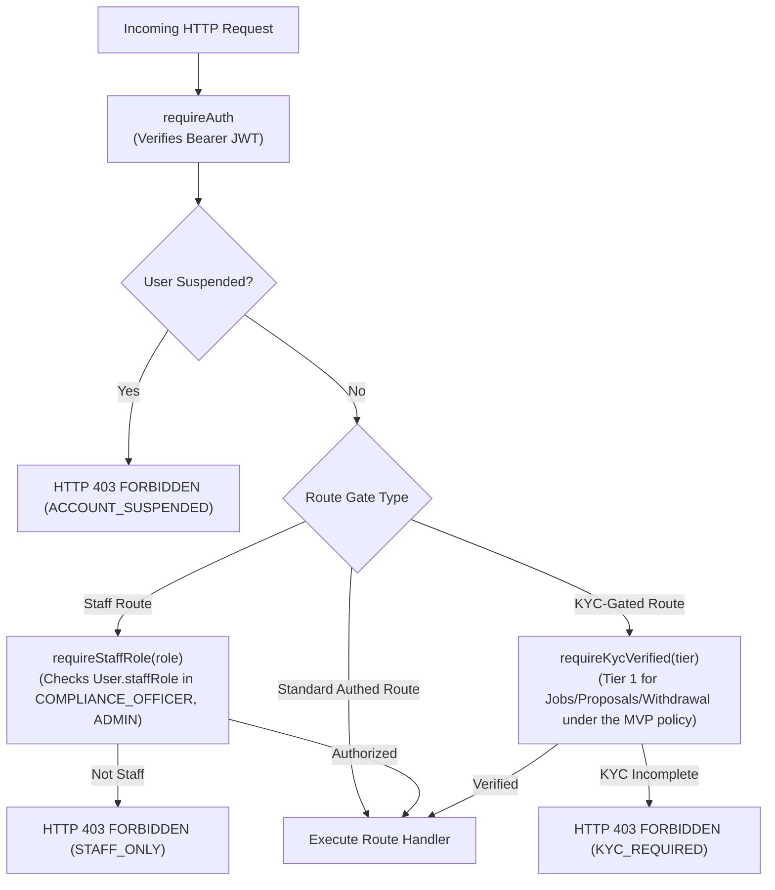

### 4.2 Audit Logging & Append-Only AML Guarantee

* **Implementation:** `apps/backend/src/lib/audit.ts` (`recordAuditEvent`).
* **Guarantee:** Application code only executes `prisma.auditLog.create()`.
* **Database-Level Enforcement:** Per `apps/backend/prisma/README.md`, PostgreSQL database roles in production environments must execute:
  ```sql
  REVOKE UPDATE, DELETE, TRUNCATE ON TABLE "AuditLog" FROM yekis_api_user;
  ```
  This guarantees that even a compromised backend process cannot alter or purge the 10-year AML audit trail.

#### Retention: every row carries its own expiry

`AuditLog.retentionUntil` is **NOT NULL** and is stamped at write time as
`createdAt + AUDIT_RETENTION_YEARS` (default **10 years**, `env.ts`). An audit
row without a defined expiry is exactly the ambiguity the retention
requirement exists to remove, so the column is required rather than optional.

The purge runs through the `SECURITY DEFINER` function
`purge_expired_audit_logs(batch_size)` (migration
`20261110120000_audit_log_retention`). The application role is granted
`EXECUTE` on the function and holds **no `DELETE` privilege on the table** —
so "the app cannot delete audit rows" survives the purge. The app can ask for
an expired row to be removed; it cannot remove a live one, and it cannot
alter the rule.

The function deletes a row only when **both** its stamp has expired **and** it
is at least ten years old. That second condition lives in SQL on purpose: a
misconfigured `AUDIT_RETENTION_YEARS` must not be able to shorten a statutory
retention obligation.

The `audit-purge` BullMQ worker runs the function daily at 05:00, in bounded
batches, and **audits itself** — every run that removes anything writes an
`AUDIT_LOG_PURGE` row saying how many rows went and when. The record of the
record's destruction survives the destruction.

#### What every row carries

`actorRole`, `action` (defaults to `eventType`), `previousState`, `newState`,
`amountMinor`, `requestId` (the pino-http request id), `ipAddress`, and
`retentionUntil`. Every financial, compliance and administrative transition
writes one.

### 4.3 Background Processing & Worker Registry

BullMQ manages **ten** dedicated Redis queues:

| Queue Name | Worker File | Schedule / Trigger | Action | Cancellation Rule |
|---|---|---|---|---|
| `auto-release` | `autoRelease.handler.ts` + `autoRelease.worker.ts` | Scheduled with a 24-hour (warn) and 7-day (release) delay upon milestone delivery submission | Warns client 24 h before the deadline; auto-releases escrow to the freelancer at day 7 | Job is marked stale & skipped if the milestone leaves `SUBMITTED_FOR_REVIEW` (e.g. accepted or disputed) or if the contract is still inside its cooling-off window |
| `gig-auto-release` | `gigAutoRelease.worker.ts` | Same pattern for gig orders | Auto-releases a gig escrow when the review window elapses | Cancelled when a revision is requested or a gig dispute is raised |
| `kyc-refresh` | `kycRefresh.worker.ts` | Cron `0 3 * * *` (Daily at 03:00 UTC) | Sweeps verified KYC records where `nextReviewDueAt <= now()` and sets `periodicReviewPending = true`, notifying the user | N/A (Recurring idempotent sweep) |
| `notifications` | `notification.worker.ts` | Event-triggered by domain modules (`escrow-funded`, `dispute-raised`, `security-breach`, etc.) | Persists the in-app record first, then pushes over the socket, and fans out to SMS (critical types), email and Telegram | N/A (Immediate execution) |
| `review-reveal` | `reviewReveal.worker.ts` | Recurring sweep / 14-day delay | Reveals blind **contract** reviews older than 14 days and recalculates Bayesian rating scores | Skipped if already revealed by mutual review submission. **Gig reviews are not covered** — `GigReview.revealedAt` is never written |
| `featured-refresh` | `featuredRefresh.worker.ts` | Recurring schedule | Recalculates candidate pools and updates featured carousel rankings | N/A (Recurring sweep) |
| `payment-reconcile` | `paymentReconcile.worker.ts` | Cron every 10 minutes | Polls the provider's status API for transactions stuck in `PENDING` past the stale window and replays them through the same idempotent webhook handler | Gives up after the configured window, leaving the transaction `PENDING` for manual review |
| `tms-scan` | `tmsScan.worker.ts` | Cron every 15 minutes | Runs the AML rule engine (structuring, round amounts, velocity) and sweeps STR filing SLAs | N/A (Recurring sweep) |
| `withholding-remittance` | `withholdingRemittance.worker.ts` | Cron `0 23 1 * *` (23:00 UTC on the 1st = 02:00 EAT on the 2nd) | Computes the prior month's ERA withholding from `PlatformFeeCredit` | N/A — the report is idempotent per `periodMonth`; **filing is a human step** |
| `audit-purge` | `auditPurge.worker.ts` | Cron `0 5 * * *` (Daily at 05:00 UTC) | Deletes audit rows past their retention stamp **and** past the hard ten-year floor, in bounded batches, and audits the purge itself | N/A (Recurring sweep) |

The worker body for `auto-release` lives in `autoRelease.handler.ts` so the
test suite can drive the release path without standing up a live BullMQ
consumer.

---

## 5. The End-to-End Trust Loop

The following sequence diagram traces the complete lifecycle of a job—from user registration and tiered KYC verification through proposal acceptance, dual contract signing, wallet-first escrow locking, delivery submission, client approval, fee/withholding deduction, and Tier 1 freelancer withdrawal (including the dispute branch).

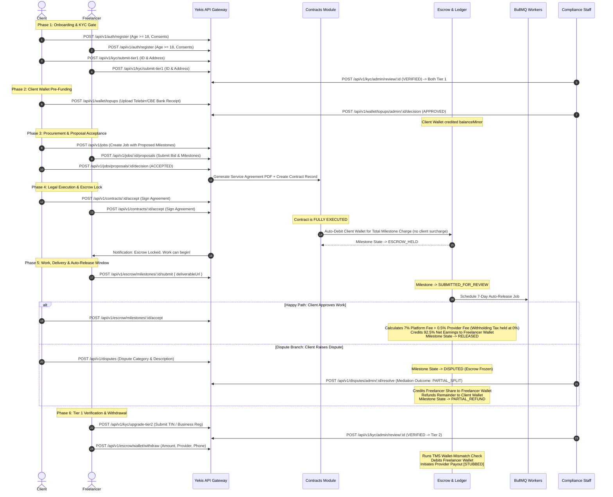

---

## 6. Master Relationship & Dependency Diagram

This directed graph illustrates the module-level import dependencies across `apps/backend/src/modules/`.

```mermaid
graph TD
    subgraph CoreLibs["Core Libraries (apps/backend/src/lib/)"]
        PrismaLib["prisma.ts"]
        AuditLib["audit.ts"]
        ObjectStoreLib["objectStore.ts"]
        RedisLib["redis.ts"]
        LoggerLib["logger.ts"]
    end

    subgraph QueuePkg["Queue & Workers (apps/backend/src/queue/)"]
        QueuesDef["queues.ts"]
        Workers["Queue Workers"]
    end

    subgraph Modules["Domain Modules (apps/backend/src/modules/)"]
        AuthM["auth/"]
        KycM["kyc/"]
        JobM["jobs/"]
        ContractM["contracts/"]
        EscrowM["escrow/"]
        TopUpM["topups/"]
        DisputeM["disputes/"]
        TmsM["tms/"]
        NotifM["notifications/"]
        ChatM["chat/"]
        ProfileM["profiles/"]
        SkillM["skills/"]
        ReviewM["reviews/"]
        FeatM["featured/"]
        PortM["portfolio/"]
        BotM["bot/"]
    end

    %% Core Lib Dependencies
    Modules --> PrismaLib
    Modules --> AuditLib
    Modules --> LoggerLib
    KycM --> ObjectStoreLib
    TopUpM --> ObjectStoreLib
    ChatM --> ObjectStoreLib
    ContractM --> ObjectStoreLib
    QueuesDef --> RedisLib
    Workers --> RedisLib

    %% Inter-Module Dependencies
    ContractM --> EscrowM
    EscrowM --> TmsM
    TopUpM --> TmsM
    DisputeM --> EscrowM
    JobM --> ContractM
    ReviewM --> ProfileM
    FeatM --> ProfileM
    NotifM --> BotM

    %% Queue Dependencies
    ContractM --> QueuesDef
    EscrowM --> QueuesDef
    DisputeM --> QueuesDef
    Workers --> EscrowM
    Workers --> NotifM
    Workers --> FeatM
    Workers --> ReviewM

    style CoreLibs fill:#f9f,stroke:#333,stroke-width:1px
    style QueuePkg fill:#bbf,stroke:#333,stroke-width:1px
```

### Analysis of Inter-Module Coupling
* **Circular Dependency Check:** The dependency graph is acyclic. `ContractM` imports fee calculation and types from `EscrowM`, but `EscrowM` relies only on `ContractM` service interfaces via loose linkage or direct checks without importing `contracts.routes.ts`.
* **Coupling Note:** `EscrowM` calls `tms.service.ts` directly for inline AML checks (`runPostFundingChecks`, `checkWalletMismatch`, `runPassThroughCheck`).

---

## 7. Known Inconsistencies, Stubs & Gaps

### 7.1 Duplicate Module Implementations

1. **Dispute Module Duplication:**
   * **Active Mounted Route:** `apps/backend/src/modules/disputes/dispute.routes.ts` & `dispute.service.ts` (Mounted in `app.ts` at `/api/v1/disputes`). Enforces authentication, Zod validation, staff RBAC, and milestone-level dispute resolution.
   * **Legacy Dead Code:** `apps/backend/src/modules/disputes/disputes.routes.ts` & `disputes.service.ts` (Plural naming). Contains unauthenticated contract-level dispute stubs. Should be deprecated and removed.
2. **Top-Up Module Duplication:**
   * **Active Mounted Route:** `apps/backend/src/modules/topups/topup.routes.ts` & `topup.service.ts` (Mounted in `app.ts` at `/api/v1/wallet/topups`). Uses `@marketplace/schemas` contracts (`SubmitTopUpInput`, `TopUpReviewDecisionInput`).
   * **Legacy Dead Code:** `apps/backend/src/modules/escrow/topup.routes.ts` & `escrow/topup.service.ts`. Contains an unmounted version with divergent payload field names (`amountEtb`, `senderName`, `senderReference`).

### 7.2 Integration Stubs Matrix

| Integration / External Dependency | Code Location | Current Implementation Status | Production Blocker / Pending Requirement |
|---|---|---|---|
| **Fayda National ID Verification** | `apps/backend/src/modules/kyc/fayda.client.ts` | `[STUBBED — pending NID API Approval]` Deterministic mock returning fake biometric IDs (`mock-biometric-<docNumber>`). | Formal application and production API contract approval with the Ethiopian National ID Program (NIDP). |
| **PEP / Sanctions Screening** | `apps/backend/src/modules/kyc/pep.client.ts` | `[STUBBED — pending Vendor Selection]` Local in-memory set matching `"test flagged person"`. | Procurement and integration of a commercial AML/PEP watchlist provider (e.g., ComplyAdvantage, World-Check). |
| **CBE Birr C2B Gateway** | `apps/backend/src/modules/escrow/providers/cbe.client.ts` | `[STUBBED — pending CBE API Publication]` Mock transaction ID generator returning `redirectUrl: null`. | Commercial agreement with Commercial Bank of Ethiopia (CBE) for API credentials or manual reconciliation protocol. |
| ~~**Chapa Payment Aggregator**~~ | — | **REMOVED.** Chapa was deleted from the approved payment architecture (PAY-002; migration `20260826090000_tms_rules_and_chapa_removal`). No adapter, no enum member, no webhook route. | Nothing — it is not coming back without a new product decision. |
| **Provider Payouts (B2C / Withdrawal)** | `apps/backend/src/modules/escrow/providers/telebirr.client.ts` | **Live.** `initiateDisbursement()` (line 449) is implemented and is what `withdrawFromWallet()` calls. A confirmed disbursement posts the balanced ledger journal in the same transaction as the payout confirmation; an immediate provider refusal rolls the wallet debit back. | Production Telebirr merchant credentials and a funded disbursement balance. CBE B2C remains unwired. |
| **SMSEthiopia Delivery** | `apps/backend/src/modules/notifications/sms.client.ts` | Live REST client; falls back to logger warning if `SMS_ETHIOPIA_API_KEY` is omitted. | Valid SMSEthiopia gateway balance and API key. |
| **OpenSearch** | `apps/backend/src/modules/search/searchIndex.service.ts` | Live but **unauthenticated**, with a Postgres fallback. The `yekis-jobs` index is written and never read; gig edits and job status changes are never re-indexed; there is no reindex path and no document deletion. | An authenticated cluster, an explicit index mapping, and a reindex/backfill job. |
| **ERCA / ERA automated remittance** | `apps/backend/src/modules/finance/finance.service.ts` | The report is **computed** monthly and a human files it; the ERA reference is recorded afterwards. | ERA offers no machine-readable API. The filing stays a human obligation. |

### 7.3 Where the Known Gaps Live

Each gap is documented **next to the code it belongs to**, so a reader who opens a module section finds its own limitations rather than a distant list:

| Gap | Documented in |
|---|---|
| Gig orders post no double-entry journal; no duplicate-order protection; the gig dispute settlement is not transactional; gig reviews are never revealed | §3.13 |
| `auditLedgerIntegrity()` cannot see a missing flow; the three definitions of "escrow held" disagree; gig money bypasses the ledger; the VAT alert fires at most once ever | §3.14 |
| CBE and M-Pesa throw; the `PaymentProvider` enum keeps inert `CHAPA`/`M_PESA` members | §3.15, and the note under §2.2 |
| Only `SUPER_ADMIN`/`ADMIN` can release or hold escrow; five console actions call endpoints that do not exist; the frontend/backend permission mismatches | §3.16, §8.8 |
| The retained-field list for erasure is not counsel-reviewed; object lock would block erasure deletes | §3.17, `docs/COMPLIANCE_BLOCKERS.md` #8 |
| Job search never uses OpenSearch; gig edits go stale in the index; no reindex path | §3.18 |
| The audit retention stamp and the purge that enforces it | §4.2 |
| Five ops console actions 404; the fallback matrix drifts from the server's; orphaned mock data | §8.8 |
| ~1,800 hardcoded JSX literals (1,127 in the 104 files that never import the i18n module); registration rejects `om`/`ti`; the bot collapses the language to am/en; no RTL | §8.9, §9.17 |
| No offline queue for socket events; the client ping is a no-op; guest sockets cannot connect | §8.10 |

---

## 10. Glossary

* **AACCSA:** Addis Ababa Chamber of Commerce and Sectoral Associations. The designated arbitration authority for Stage 4 legal dispute escalation.
* **Auto-Release Window:** A configurable 7-day period (`AUTO_RELEASE_WINDOW_DAYS = 7`) starting upon freelancer deliverable submission, after which escrowed funds automatically release to the freelancer if the client takes no action.
* **Bayesian Rating Score:** A weighted rating average that incorporates platform-wide prior means ($m = 4.5, C = 5$) to prevent new accounts with a single 5-star review from outranking seasoned freelancers.
* **Double-Blind Review:** A reputation mechanism where client and freelancer feedback remains hidden until both parties have submitted reviews or until 14 days elapse.
* **FIC:** Financial Intelligence Center (Ethiopia). The national regulatory agency receiving Suspicious Transaction Reports (STRs).
* **Hard-Block Middleware:** Express middleware (`apps/backend/src/middleware/hardBlock.ts`) that strictly halts request execution if a user has not attained the required KYC tier or if their account is suspended.
* **KycTier:** The three-level progressive compliance ladder:
  * `TIER_1`: Basic identity document and address. Enables job browsing, bidding, and contract signing.
  * `TIER_2`: Verified TIN certificate or Business Registration. Under the MVP policy Tier 1 already enables withdrawal; Tier 2 is the Phase 4 upgrade that reduces withholding from 30% to 3%.
  * `TIER_3`: Enhanced due diligence for Politically Exposed Persons (PEPs) or high-velocity/high-volume users.
* **Minor Units:** Persisting financial values as integers representing the smallest currency denomination (ETB cents, where $1.00\text{ ETB} = 100\text{ minor units}$).
* **RSA-PSS:** `SHA256withRSAandMGF1` cryptographic signing algorithm mandated by Telebirr's C2B merchant gateway for payment pre-orders and webhook payloads.
* **STR:** Suspicious Transaction Report. A mandatory AML filing submitted to the FIC by a Compliance Officer when a transaction flag is verified.
* **TMS:** Transaction Monitoring System. Automated heuristic rules detecting money laundering patterns (structuring, velocity, pass-through, and wallet mismatches).
* **UCID:** Unique Customer Identifier. A platform-wide persistent identifier assigned to each user upon registration.
* **Withholding Tax:** Statutory Ethiopian tax deducted from freelancer milestone earnings if gross milestone value $\ge \text{ETB 10,000}$ (3% for freelancers with verified TIN; 30% for freelancers without TIN).
* **WORM:** Write Once, Read Many. Storage compliance policy applied to KYC document buckets and audit log tables to prevent tampering.

---

## 8. Frontend Architecture

The frontend is a **React 18 + Vite** Single Page Application (SPA) bundled at `apps/frontend/`. It serves two completely different user experiences from a single codebase, determined at runtime by detecting the Telegram WebApp environment.

### 8.1 Entry Point & Runtime Branching (`main.tsx` → `App.tsx`)

```mermaid
flowchart TD
    Entry["main.tsx\n(createRoot, StrictMode, AppErrorBoundary)"]
    App["App.tsx\nRoot Component"]
    TMACheck{"window.Telegram\n.WebApp present?"}
    PayReturn{"pathname ==\n/payment/return?"}
    TMA["Telegram Mini App Shell\n(App.tsx JSX — mobile-first)"]
    WebApp["FullPlatformApp.tsx\n(Full browser SPA)"]
    PayReturnUI["PaymentReturn.tsx\n(Post-Telebirr redirect handler)"]

    Entry --> App
    App --> PayReturn
    PayReturn -- Yes --> PayReturnUI
    PayReturn -- No --> TMACheck
    TMACheck -- isTelegram=true --> TMA
    TMACheck -- isTelegram=false --> WebApp
```

**Key logic in `App.tsx`:**
1. All React hooks are declared unconditionally at the top (required by Rules of Hooks).
2. `useTelegramMiniApp()` is called first — it returns `{ isTelegram, initData, backButton, ... }`.
3. Two derived booleans (`isPaymentReturn`, `isNonTelegram`) determine which render path to take.
4. No hook is called conditionally; early returns only use values from already-called hooks.

---

### 8.2 Telegram Mini App Shell (`App.tsx`)

The TMA shell is a **mobile-first workspace** rendered inside the Telegram client. It is intentionally lightweight and sidebar-navigated.

#### Component Structure

```
App.tsx (root)
├── useTelegramMiniApp()          — Telegram WebApp SDK wrapper hook
├── Role Selection Screen          — First render if not authenticated
│   ├── Role picker (Client / Freelancer buttons)
│   └── Mobile fallback login form (phone + password)
└── Platform Shell (after auth)
    ├── <aside> Sidebar nav         — Desktop/tablet navigation
    ├── <main> Content pane
    │   ├── Header (topbar)
    │   └── Tab Content (conditional rendering by activeTab):
    │       ├── "home"     → Overview metrics + quick-action grid
    │       ├── "jobs"     → Open jobs list / post job form
    │       ├── "escrow"   → Milestone contract table
    │       ├── "wallet"   → Top-up form + recent top-ups list
    │       ├── "kyc"      → Fayda ID upload form + KYC status
    │       └── "disputes" → Case center (admin only)
    └── <nav> Mobile bottom navigation bar
```

#### Authentication Flow (TMA)

```mermaid
sequenceDiagram
    actor User
    participant TMA as App.tsx
    participant Hook as useTelegramMiniApp()
    participant API as api.loginWithTelegram()
    participant Backend as POST /api/v1/auth/telegram

    User->>TMA: Taps "I want to work" (FREELANCER role)
    TMA->>Hook: Reads telegram.initData
    alt initData present (inside Telegram)
        TMA->>API: loginWithTelegram(initData, role)
        API->>Backend: POST { initData, role }
        Backend-->>API: { accessToken, user }
        API-->>TMA: TelegramAuthResponse
        TMA->>TMA: api.setToken(accessToken), setTelegramAuthStatus("ready")
    else Not inside Telegram
        TMA->>TMA: setShowMobileLogin(true)
        User->>TMA: Enters phone + password
        TMA->>API: api.loginWithMobile({ phone, password })
        API-->>TMA: { accessToken }
        TMA->>TMA: api.setToken(accessToken), setTelegramAuthStatus("ready")
    end
```

#### State Managed in `App.tsx`

| State Variable | Type | Purpose |
|---|---|---|
| `telegramSession` | `TelegramAuthResponse \| null` | Full Telegram auth response after login |
| `telegramAuthStatus` | `"idle" \| "loading" \| "ready" \| "error"` | Authentication phase gate |
| `role` | `"CLIENT" \| "FREELANCER" \| "ADMIN"` | User's active platform role |
| `activeTab` | `Tab` | Which section is currently displayed |
| `walletBalance` | `number` | Wallet balance in ETB (derived from balanceMinor / 100) |
| `kycStatus` | `"NOT_SUBMITTED" \| "UNDER_REVIEW" \| "APPROVED"` | KYC verification state |
| `milestones` | `Milestone[]` | User's active milestone contracts |
| `jobs` | `Job[]` | Open marketplace jobs |
| `topUpRequests` | `TopUpRequest[]` | User's wallet top-up submissions |

---

### 8.3 Full Browser Platform (`FullPlatformApp.tsx`)

The `FullPlatformApp` is the **desktop/browser SPA** shown when a user visits the Yekis website outside Telegram. It has full routing, authentication forms, staff dashboards, and all marketing pages.

#### View & Route System

Since the app is a SPA (no React Router), navigation is controlled by the `view` state variable and `marketingPage` state. The component renders different content based on the current view:

```
FullPlatformApp.tsx
├── Marketing / Public Shell (showLanding=true OR unauthenticated)
│   ├── MarketingHeader.tsx       — AFRO-TECH-style fixed header, active navigation, theme/language/auth controls, 1024px drawer
│   ├── LandingPage.tsx           — Hero, categories, how-it-works, CTA
│   ├── FAQPage.tsx               — Frequently asked questions
│   ├── FeesPage.tsx              — Platform fee structure explanation
│   ├── LegalDocumentPage.tsx     — Shared legal-document header, table of contents, numbered sections
│   ├── PrivacyPage.tsx           — Complete Privacy Policy (version 1.1, 16 sections)
│   ├── TermsPage.tsx             — Complete Terms of Service (version 1.1, 22 sections)
│   ├── AboutPage.tsx             — Company background
│   ├── CaseStudiesPage.tsx       — Success stories
│   ├── ThankYouPage.tsx          — Post-registration / post-job confirmation
│   └── NotFoundPage.tsx          — 404 handler
│
├── Authentication Forms (not logged in, not on landing)
│   ├── Login form                — email + password → POST /api/v1/auth/login
│   ├── Register form             — email, phone, dob, role, password, consents
│   ├── Forgot password form      — POST /api/v1/auth/forgot-password
│   └── Reset password form       — POST /api/v1/auth/reset-password
│
└── Authenticated Platform Shell (user != null)
    ├── Sidebar navigation (role-aware nav items) — FROZEN, see below
    ├── Header (user avatar, notifications bell, logout)
    ├── NotificationCenter.tsx    — Dropdown notification feed
    ├── FeaturedCarousel.tsx      — Featured freelancer cards
    └── View Content (by view state):
        ├── "overview"        → Dashboard metrics, featured talent
        ├── "jobs"            → JobsWorkspace (post + browse)
        ├── "gigs"            → GigMarketplace (browse gigs)
        ├── "my-gigs"         → MyGigsWorkspace (a freelancer's own listings)
        ├── "contracts"       → ContractsWorkspace (sign, fund, milestones)
        ├── "escrow"          → EscrowWorkspace (milestone tracking)
        ├── "wallet"          → BrowserWallet (top-up, history, withdraw)
        ├── "verification"    → BrowserVerification (KYC doc upload)
        ├── "chat"            → SupportChat (customer support tickets)
        ├── "cases"           → DisputesWorkspace (raise/track disputes)
        ├── "settings"        → SettingsWorkspace (account, security, notifications)
        ├── "profile"         → ProfilePage (public view)
        └── "profile-edit"    → ProfileEditPage (edit bio, skills, portfolio)
```

#### The Sidebar Is Frozen (does not scroll with the body)

`.platform-shell.sh-shell` is a **grid** (`256px minmax(0, 1fr)`), so the
sidebar is a grid item and the grid would normally **stretch it to the height
of the row** — and the row is as tall as the main content. On a long page the
sidebar therefore became taller than the viewport and scrolled away with the
body, taking the navigation with it: by the time the user reached the bottom
of the page there was no way to change section.

The base rule (`apps/frontend/src/styles/shadcn-dashboard.css`) fixes it:

```css
.platform-shell.sh-shell .platform-sidebar {
  position: sticky;   /* pins it to the viewport while the grid area scrolls under */
  top: 0;
  align-self: start; /* stops the grid stretching it to the row height */
  height: 100vh;     /* exactly one viewport tall */
  overflow-y: auto;  /* scrolls its own contents if the nav is taller than the screen */
}
```

The `sh-variant-inset` and `sh-variant-floating` variants override `top` and
`height` (both more specific than the base rule), and at `≤ 768px` the sidebar
becomes a drawer with `position: fixed !important`. The layout properties live
in the un-themed base rule so the dark theme cannot diverge from them.

The **topbar** was already frozen the same way (`position: sticky; top: 0`),
and the **ops console** sidebar was already `position: fixed`
(`apps/frontend/src/styles/ops-console.css`). The browser-platform sidebar was
the only one that scrolled.

> Note: the Telegram Mini App (`App.tsx`) does **not** use this sidebar — it
> uses the horizontal browser-tab navigation (`platform-tab-bar`, also
> `position: sticky`). See §8.2.

#### Role-Based Navigation (FullPlatformApp)

| Role | Nav Items Shown |
|---|---|
| `CLIENT` | Overview, Post a Job, My Contracts, Wallet, Chat, Verification, Profile |
| `FREELANCER` | Overview, Find Work, My Work, Wallet, Chat, Verification, Profile |
| `ADMIN` / `MEDIATOR` | Overview, Escrow, Disputes, Wallet, Chat, Verification + Staff Dashboard link |

#### Staff Dashboard (`StaffDashboard.tsx`)

Accessible to users with `staffRole === "COMPLIANCE_OFFICER"` or `staffRole === "ADMIN"`. Provides:

| Tab | Component | Backend API |
|---|---|---|
| Top-Up Queue | `TopUpQueue.tsx` | `GET /api/v1/wallet/topups/admin/queue` |
| KYC Queue | `KycQueue.tsx` | `GET /api/v1/kyc/admin/queue` |
| Disputes Queue | `DisputeQueue.tsx` | `GET /api/v1/disputes/admin/queue` |
| Compliance Panel | `StaffCompliancePanel.tsx` | `GET /api/v1/tms/flags` |
| Profile Reports | `ProfileReportsQueue.tsx` | `GET /api/v1/profiles/reports/admin` |

---

### 8.4 API Client Layer (`apps/frontend/src/api/client.ts`)

All HTTP calls are centralized in a single `api` object exported from `client.ts`. It uses the native `fetch` API with a `Bearer` JWT token injected via `api.setToken(token)`.

#### Key Design Properties

- **Token Storage:** `api.setToken()` stores the token in a module-level variable (no `localStorage`) for the session lifetime.
- **Base URL:** Reads from `import.meta.env.VITE_API_BASE_URL` at build time (falls back to `http://localhost:3000`).
- **Error Handling:** Non-2xx responses throw `Error` with the JSON `message` field from the API.
- **FormData Support:** Methods like `createTopUpRequest`, `submitKycDocuments`, and `submitFreelancerFaydaSelfie` send `multipart/form-data` for file uploads.

#### Key API Methods

| Category | Method | Backend Endpoint |
|---|---|---|
| **Auth** | `loginWithTelegram(initData, role)` | `POST /api/v1/auth/telegram` |
| **Auth** | `loginWithMobile({ phone, password })` | `POST /api/v1/auth/login` |
| **Auth** | `register(payload)` | `POST /api/v1/auth/register` |
| **Auth** | `getMe()` | `GET /api/v1/auth/me` |
| **Wallet** | `getWallet()` | `GET /api/v1/escrow/wallet` |
| **Top-Up** | `createTopUpRequest(formData)` | `POST /api/v1/wallet/topups` |
| **Top-Up** | `getTopUpRequests()` | `GET /api/v1/wallet/topups` |
| **KYC** | `getKycStatus()` | `GET /api/v1/kyc/status` |
| **KYC** | `submitFreelancerFaydaSelfie(formData)` | `POST /api/v1/kyc/fayda-selfie` |
| **Jobs** | `getJobs({ status, category, page })` | `GET /api/v1/jobs` |
| **Jobs** | `createJob(payload)` | `POST /api/v1/jobs` |
| **Jobs** | `submitProposal(payload)` | `POST /api/v1/jobs/:id/proposals` |
| **Contracts** | `getContracts()` | `GET /api/v1/contracts` |
| **Contracts** | `acceptContract(id)` | `POST /api/v1/contracts/:id/accept` |
| **Escrow** | `getMilestones()` | `GET /api/v1/escrow/milestones` |
| **Escrow** | `fundMilestoneFromWallet(id)` | `POST /api/v1/escrow/fund-from-wallet` |
| **Escrow** | `acceptMilestone(id)` | `POST /api/v1/escrow/milestones/:id/accept` |
| **Disputes** | `getDisputes()` | `GET /api/v1/disputes` |
| **Disputes** | `raiseDispute(payload)` | `POST /api/v1/disputes` |
| **Notifications** | `getNotifications()` | `GET /api/v1/notifications` |
| **Profiles** | `getProfile(id)` | `GET /api/v1/profiles/:id` |
| **Reviews** | `submitReview(payload)` | `POST /api/v1/reviews` |

---

### 8.5 Telegram WebApp Hook (`useTelegramMiniApp.ts`)

Located at `apps/frontend/src/telegram/useTelegramMiniApp.ts`. Wraps the Telegram JavaScript SDK (`window.Telegram.WebApp`) with React hooks.

```typescript
// Returns:
{
  webApp: TelegramWebApp | null,  // raw Telegram WebApp object
  isReady: boolean,               // true after webApp.ready() called
  isTelegram: boolean,            // true only if initData is non-empty
  initData: string,               // raw Telegram initData string for backend verification
  unsafeUser: TelegramUser | null,// unverified user object from initDataUnsafe
  themeParams: ThemeParams,       // Telegram theme colors
  colorScheme: "dark" | "light",  // Telegram theme mode
  backButton: BackButton | null,  // Telegram native back button
}
```

**Platform detection:** `isTelegram = Boolean(webApp?.initData)`. If `initData` is empty (e.g., browser), the app renders `FullPlatformApp` instead of the TMA shell.

---

### 8.6 Payment Return Handler (`PaymentReturn.tsx`)

Handles the redirect URL after a Telebirr C2B external payment checkout completes. Detected by `window.location.pathname === "/payment/return"`. Reads query parameters from the URL to display success/failure to the user. This is part of the legacy external-provider payment flow (now superseded by wallet-first funding).

---

### 8.7 Frontend Build & Dev Configuration

| Property | Value |
|---|---|
| Framework | React 19 + Vite 8 (Rolldown) |
| Language | TypeScript (strict) |
| Linting | ESLint with `react-hooks/rules-of-hooks` and `react-refresh` |
| CSS | Vanilla CSS (`index.css` design system) + per-feature CSS files (`landing-v2.css`, `shadcn-dashboard.css`, `ops-console.css`, …) |
| Icons | `lucide-react` |
| Environment Variable | `VITE_API_BASE_URL` |
| Dev Server | `pnpm dev` → `http://127.0.0.1:3000` |
| Public Assets | `/public/` (SVG logo, payment provider images) |
| Internationalization | `i18n.ts` — four locales, 569 keys each |

> **The React version in this table was 18 in earlier revisions; the project
> now runs React 19** (`apps/frontend/package.json` pins `^19.3.0`).

---

### 8.8 The Operations Console (`apps/frontend/src/pages/ops/`)

* **Purpose:** The staff workspace — 23 pages covering support, mediation, identity review, moderation, finance, reconciliation and administration.
* **Entry point:** `FullPlatformApp.tsx:871-878` — if `user.staffRole` is set, the console **takes over the entire SPA shell**. There is no marketplace fallback for staff.

#### The shell

| Piece | Where | What it does |
|---|---|---|
| Nav | `opsNav.ts:42-132` | 23 items in **6 groups** — Overview; Cases (support, disputes, risk); Review Queues (KYC, profile reports, gigs, receipts); Financial (contracts, payments, payouts, escrow, reconciliation, tax, ledger, reports); Administration (users, staff, featured, bot, audit, monitoring); Account (profile) |
| Sidebar | `OpsConsole.tsx` | Collapsible column ≥ 861 px (state persisted in `localStorage["yekis-ops-nav"]`); overlay drawer below that; a mobile bottom nav carries the first four permitted items |
| Command Palette | `components/CommandPalette.tsx` | Ctrl/⌘+K. Indexes the permitted pages **plus** lazily-fetched records from contracts, users, disputes, KYC and payouts — each fetch only runs if the role can see that page, and each failure degrades to an empty section |
| Action Center | `components/actionCenter.tsx` | Turns live data into a prioritised directive list, severity **3 = critical / 2 = high / 1 = queue**: breached dispute SLAs, open critical risk flags, failed health checks, reconciliation mismatches, pending payouts, KYC awaiting review, open profile reports |
| Notification Bell | `components/NotificationBell.tsx` | Reads `GET /notifications` on mount and on every socket event; a row is **disabled** when the signed-in role cannot open its target page |
| Theme | `theme/ThemeContext.tsx` | `localStorage["yekis-theme"]`, else `prefers-color-scheme`; writes `data-theme` on `<html>` and syncs the Telegram WebApp header colours |

There is **no React Router** — `page` is a `useState<OpsPageId>` and `focusId` carries a deep-linked record id.

#### The frontend permission model

`opsPerms.ts` maps each of the 23 page ids to exactly **one** backend permission key. `useOpsPerms()` fetches the live matrix from `GET /api/v1/admin/permissions/matrix` and replaces the local map; if that fetch fails it falls back to a hard-coded matrix "so it degrades to something close to correct rather than to 'hide everything'". `SUPER_ADMIN` and `ADMIN` are handled by a wildcard.

`can()` is used in exactly **four** places: sidebar filtering, the deep-link fallback, the command palette, and the notification bell.

> **No ops page gates its action buttons by permission.** Every `disabled=` attribute is driven by an in-flight flag, by row state, or by empty-form state — never by the operator's role. The **backend** is the enforcement point: a `SUPPORT` operator who reaches a page they should not see still gets `403 PERMISSION_DENIED`. Hiding a nav item is a courtesy, not a control.

#### The API layer

`opsApi.ts` is an **adapter, not a second client**: every call goes through the shared `api` singleton, so the base URL, the Bearer token, the automatic refresh and the request-id handling are identical to the rest of the SPA. It owns the translation from wire shapes (`opsBackend.ts`) to the compact console model (`opsTypes.ts`).

There are two distinct fallback mechanisms:

- **`soft(promise, fallback)`** — swallows every error, including 403 and 404, and substitutes an empty or zeroed value. Used by the overview fan-out, the badge counters, the reports bundle and the ledger. A missing permission therefore renders as "no data", not as an error.
- **`opsListApi.*`** — deliberately does **not** fall back. The rejection propagates so the page renders an `ErrorBox`, because "a missing or shadowed route shows up as a failure instead of looking exactly like 'there is no data'".

`opsFallbackData.ts` (18.7 KB of mock constants) is **orphaned** — imported by nothing. The real empty state is zeroed data, never mocked rows.

#### Known gaps

- **Five console actions call endpoints that do not exist** and will 404 at runtime: `POST /admin/contracts/:id/intervene`, `POST /admin/payments/:id/action`, `POST /admin/escrows/:id/action`, `POST /admin/reconciliation/:id/resolve`, `POST /admin/ledger/journals/:id/action`. The Escrow page's Release/Hold/Unhold buttons work because they use dedicated methods instead of the generic action endpoint.
- `Reconciliation.tsx` calls the ledger-action endpoint with a **hard-coded fake journal id**.
- `Payouts.tsx` offers five settlement outcomes; the backend accepts only `CONFIRMED` and `FAILED`.
- **Frontend/backend permission mismatches**: `profiles.moderate` gates the Profile Reports nav item but is granted to nobody except `SUPER_ADMIN`/`ADMIN`, so compliance staff lose it once the live matrix loads; and several pages are gated by `requireStaffRole("COMPLIANCE_OFFICER", "ADMIN")`, which excludes the newer `COMPLIANCE_ADMIN` role even though the permission matrix grants it the relevant keys.

---

### 8.9 Multilingual Translation Framework

#### The frontend catalogue

`apps/frontend/src/i18n.ts` holds the four locales inline as TypeScript objects — there is no separate JSON or PO file.

| Property | Value |
|---|---|
| Languages | `en`, `am` (አማርኛ), `om` (Afaan Oromoo), `ti` (ትግርኛ) |
| Leaf keys per language | **569**, identical across all four (no missing, no extra) |
| Nested objects per language | 40 |
| Maximum depth | 3 (e.g. `workspace.jobs.status.SHORTLISTED`) |
| Top-level namespaces | `appName`, `tagline`, `nav`, `kyc`, `escrow`, `jobs`, `dispute`, `marketing`, `workspace` |

**There is no `t()` function.** `t` *is* the locale object, so usage is `t.nav.home`, `t.workspace.notifications.title` — 408 property-style usages and zero call-style usages across the frontend.

The exported API is `Language`, `LanguageInfo`, `SUPPORTED_LANGUAGES`, `translations`, `TranslationsType`, `isLanguage()`, `LanguageProvider` and `useI18n()`.

#### Choosing and persisting the language

1. Initial state reads `localStorage["yekis-language"]`; if that is not a supported language it falls back to `navigator.language` prefix matching, then to English.
2. `setLanguage()` writes the key, sets `document.documentElement.lang`, and fires `events.languageChanged()`.
3. **The server wins on login**: `FullPlatformApp.tsx` calls `setLanguage(me.languagePreference)` when the profile says it is a supported language.
4. The preference is stored server-side on `User.languagePreference` and changed in `SettingsWorkspace.tsx`.

#### The bot catalogue

`apps/backend/src/modules/bot/locales/{en,am,om,ti}.json` — **243 flat keys** each, an identical key set across the four. `getBotTranslation(locale, key, params)` falls back to English and then to the raw key, and substitutes `{param}` placeholders.

`en.ftl` (Fluent format, 326 lines) is **dead** — only the JSON files are loaded.

`Yekis_translations.csv` at the repository root is a manual parity ledger (219 rows, with real translations in all three non-English columns). No code reads it.

Bot users choose a language from a keyboard; the handler stores it on `ctx.session.language` **and** on `User.languagePreference`.

#### Known gaps

- **Hardcoded copy is still widespread.** 25 of 129 `.tsx` files import the i18n module; the other **104** never touch it. An exact AST count (TypeScript's own parser) finds **1,800 hardcoded JSX text nodes**, of which **1,127** are in files that never import the i18n module — concentrated in the ops console (which is English-only by design). There is **no lint rule** forbidding raw literals, and no test that checks locale parity. Reproduce the figure with `node scripts/measure-frontend-i18n.mjs`.
- **Registration only accepts two languages.** `RegisterInput.languagePreference` is `z.enum(["am", "en"])`, so registering with Oromiffa or Tigrigna selected returns `400 VALIDATION_ERROR`.
- **The bot's auth middleware collapses the session language to am/en**, so a bot user who picks `om` or `ti` is silently switched back to English on the next inbound message. The same collapse applies to Telegram sign-ups.
- **No RTL support.** The platform is left-to-right only: `document.documentElement.dir` is never set, there is no RTL locale, no `[dir="rtl"]` rule and no logical-property migration. Ethiopic text renders in the same Latin-first font stack.
- `LandingPage.tsx` (977 lines) is **dead code** — the app imports `LandingPageV2`.

---

### 8.10 Real-Time WebSocket Infrastructure

#### The server

`apps/backend/src/lib/socket.ts` attaches a `ws` server to the same `node:http` server on the path **`/api/v1/ws`**.

**Authentication happens at the handshake and is re-checked continuously.** The token travels in the **query string** (`?token=…`) — there is no `Authorization` header and no `Origin` check, so the token is exposed in access logs, proxy logs and browser history. The handshake verifies the JWT and then calls the **same** `checkSessionIsUsable()` helper that backs `requireAuth`, so the two front doors cannot drift. A 30-second heartbeat re-runs it and closes the socket with `4003` if the account was suspended, deleted, or had its `sessionVersion` bumped (a role change, a staff suspension).

| Close code | Meaning |
|---|---|
| `4001` | Missing token, or a token with no subject |
| `4003` | `UNKNOWN_USER`, `GUEST_CONTACT`, `SUSPENDED`, `SESSION_REVOKED`, or a bad/expired signature |

**Message envelope** (server → client): `{ "event": "<name>", "data": <any>, "timestamp": "<ISO 8601>" }`.

**Channels** — exactly three namespaces: `user:{userId}` (granted on connect), `staff:alerts` (granted to staff) and `conversation:{id}` (client-requested, and **authorised** — a participant or staff, with the authorisation cached per socket and failing **closed** on a database error).

**Client → server actions:** `subscribe`, `unsubscribe`, `typing`, `read`. The client's 25-second `{action:"ping"}` has **no server branch** and is silently discarded; the server's own protocol-level ping is what actually detects a dead socket.

**Broadcast API:** `sendToUser`, `broadcastToChannel`, `broadcastToStaff`, `broadcastToConversation`.

#### The client

`apps/frontend/src/api/socket.ts` — a singleton `RealtimeSocketManager`.

| Behaviour | Detail |
|---|---|
| Connect | `connect()` no-ops when already open/connecting. The URL is built from `VITE_API_BASE_URL` or `window.location`, with `wss:` for an `https:` API base |
| No-connect cases | No token, a token starting with `demo-`, or ≥ 10 reconnect attempts |
| Reconnect | `min(1000 × 1.5ⁿ, 15000)` — 1.5 s, 2.25 s, 3.375 s … capped at 15 s, **hard-stopping after 10 attempts** and then giving up silently |
| On open | Resends every stored subscription, then starts the 25 s ping interval |
| On close | Clears the ping interval; reconnects unless the close was deliberate |

**Events consumed by the frontend:** `chat:new_message`, `chat:message`, `chat:typing` (ChatWorkspace and the guest widget); `chat:new_conversation` (Support Desk); nine named `notify:*` events (FullPlatformApp); and two **wildcard** `notify:*` listeners that simply reload lists (NotificationCenter, the ops NotificationBell).

The server's `connected` welcome frame and its `chat:read` broadcast have **no consumer**.

#### How the socket push relates to the notification queue

**The socket push comes from the BullMQ notification worker, not from the service layer.** The chain is:

```
service layer → notificationQueue.add(name, …) → notification.worker.ts
              → persist the in-app Notification row FIRST
              → then sendToUser(userId, `notify:${name}`, …)
```

Persisting first is deliberate: a client that refreshes immediately after the socket event can always find the row. The push is wrapped in a try/catch, so a socket failure never fails the job.

The consequence is that the push is **asynchronous and delayed by queue latency**, and that **there is no offline queue** — `sendToUser` returns `false` when the user has no sockets and the return value is ignored, so a `notify:*` event emitted while the user is offline is **dropped**. Recovery is entirely by client polling (15 s for notifications, 60 s for the workspace snapshot, 2 s for chat, 1.5 s for the guest widget).

**Chat is the exception.** `chat.service.ts` emits `chat:message` / `chat:new_message` **synchronously in the request path** *and* enqueues a `new-message` notification job, so a chat message can arrive twice.

#### Known gaps

- **Guest-support sockets do not work.** Guest tokens are signed with a different secret, and the guest's `User` row is flagged `isGuestContact`, which the shared session check rejects. The guest widget therefore falls back to its 1.5-second poll. The guest-specific branches in the socket handler are unreachable dead code, and no test covers that path.
- **Only 9 of ~44 `notify:*` names are handled explicitly**; the rest only trigger the wildcard list reloads.
- **No `Origin` validation, no per-IP connection limit, no `maxPayload`.** The socket transport is also outside the HTTP rate limiter.
- **Authorisation caching is never invalidated.** A staff member demoted mid-session keeps read access to the conversations they were authorised for earlier in that socket's life.
- There is no presence model, no read-receipts channel, and no topic channels beyond the three listed.

---

## 9. Platform Section-by-Section Functional Reference

This section provides a plain-English description of every user-facing section of the Yekis platform — what it does, how it works technically, and which parts of the codebase power it.

---

### 9.1 Landing Page & Marketing Shell

**What it does:** Public-facing marketing site showcasing the platform's value proposition, pricing, FAQs, and the complete Privacy Policy and Terms of Service. Its shared header follows the AFRO-TECH public-site pattern while preserving Yekis navigation, authentication, language, and theme controls.

**How it works:**
- Served by `FullPlatformApp.tsx` when the user is unauthenticated and `showLanding = true`.
- `LandingPage.tsx` is a static React component with no API calls — it renders hardcoded marketing content.
- `MarketingHeader.tsx` renders a fixed opaque bar with a Space Grotesk wordmark, underline navigation, the current-page state, language and theme controls, and authentication actions. At 1024px and below, navigation and the secondary preferences move into a 290px right drawer.
- `PrivacyPage.tsx` and `TermsPage.tsx` define the complete version 1.1 legal content and delegate layout to `LegalDocumentPage.tsx`. The shared shell provides breadcrumbs, document metadata, a linked table of contents, numbered sections, and responsive layouts. The text is grounded in the implemented seven-day release and cooling-off windows, 7%/0% fee model, consent-aware analytics, data-subject export/erasure, and ten-year retention for the records law requires. External counsel approval remains outstanding.
- Includes a `CookieBanner.tsx` for GDPR-style consent and a `MobileCTA.tsx` encouraging mobile users to open the Telegram Mini App.
- Navigation to sub-pages (FAQ, Fees, etc.) changes `marketingPage` state without any URL routing.

**Files:** `MarketingHeader.tsx`, `LandingPage.tsx`, `FAQPage.tsx`, `FeesPage.tsx`, `LegalDocumentPage.tsx`, `PrivacyPage.tsx`, `TermsPage.tsx`, `AboutPage.tsx`, `CaseStudiesPage.tsx`, `CookieBanner.tsx`, `MobileCTA.tsx`

---

### 9.2 Authentication (Registration & Login)

**What it does:** Lets users create accounts (with mandatory age gate ≥ 18 and consent collection) and log in via email/password or Telegram.

**How it works:**

*Registration:*
1. User fills form: `firstName`, `lastName`, `email`, `phone`, `dateOfBirth`, `role`, `password`.
2. Frontend calls `api.register(payload)` → `POST /api/v1/auth/register`.
3. Backend validates `dateOfBirth` (must be ≥ 18 years), hashes password with Argon2, creates `User`, `Wallet`, `KycRecord`, and `ConsentRecord` records in one atomic Prisma transaction.
4. Returns `{ accessToken, refreshToken, user }`.

*Login:*
1. User enters `email` + `password` → `api.loginWithMobile()` → `POST /api/v1/auth/login`.
2. Backend verifies Argon2 hash, returns JWTs.

*Telegram Login (TMA):*
1. Telegram passes `initData` (HMAC-SHA256 signed) to the Mini App on open.
2. Frontend sends to `POST /api/v1/auth/telegram { initData, role }`.
3. Backend verifies HMAC using `BOT_TOKEN`, checks `auth_date` freshness (< 24h), upserts user by `telegramUserId`.

**Files:** `FullPlatformApp.tsx` (forms), `apps/backend/src/modules/auth/auth.routes.ts`, `auth.service.ts`, `telegram.service.ts`

---

### 9.3 KYC Verification

**What it does:** Progressive identity verification in three tiers that unlocks different platform capabilities.

**How it works:**

| Tier | Requirement | Unlocks |
|---|---|---|
| Tier 1 | Fayda National ID photo + selfie + personal details | Posting jobs, bidding on proposals, signing contracts |
| Tier 2 | TIN certificate or Business Registration | Reduces withholding from 30% to 3% (Phase 4). Withdrawals are already open at Tier 1 |
| Tier 3 | Enhanced due diligence (PEP / high volume) | Continued operations for flagged accounts |

*Document Upload Flow:*
1. User uploads ID photo/selfie via `BrowserVerification.tsx` → `api.submitFreelancerFaydaSelfie(formData)` → `POST /api/v1/kyc/fayda-selfie` (multipart).
2. Backend stores file in **encrypted MinIO/S3 WORM bucket** via `lib/objectStore.ts`, creates `KycDocument` record with storage path.
3. Backend calls Fayda API (stubbed) for biometric deduplication and PEP client for sanctions screening.
4. `KycRecord.status` moves to `UNDER_REVIEW`.

*Staff Review:*
1. Compliance Officer sees submission in `KycQueue.tsx` → `GET /api/v1/kyc/admin/queue`.
2. Staff opens encrypted document via temporary presigned URL → `GET /api/v1/kyc/admin/document-url/:docId`.
3. Staff makes decision → `POST /api/v1/kyc/admin/review/:id { decision: "VERIFIED" | "REJECTED" }`.
4. Backend writes immutable `KycReviewEvent`, updates `User.cachedKycTier`, sends notification.

*KYC Hard-Block:*  
`apps/backend/src/middleware/hardBlock.ts` (`requireKycVerified`) is applied as route middleware. Any request to a tier-gated route without sufficient KYC returns `HTTP 403 { error: "KYC_REQUIRED" }` before the route handler executes.

**Files:** `BrowserVerification.tsx`, `KycQueue.tsx`, `apps/backend/src/modules/kyc/`

---

### 9.4 Jobs & Proposals

**What it does:** The marketplace procurement layer — clients post jobs, freelancers bid with proposals, clients accept the best bid, atomically creating a contract.

**How it works:**

*Post a Job (Client):*
1. Client fills job brief: `title`, `category`, `description`, `budgetMin`, `budgetMax`, `deadline`, `proposedMilestones`.
2. `api.createJob(payload)` → `POST /api/v1/jobs`.
3. Job created with `status: "OPEN"`. Visible in public job listings.

*Browse & Bid (Freelancer):*
1. `api.getJobs({ status: "OPEN" })` → `GET /api/v1/jobs` with optional category/budget filters.
2. Freelancer writes `coverLetter`, sets `quotedAmountMinor`, `estimatedDays`, `milestoneBreakdown`.
3. `api.submitProposal(payload)` → `POST /api/v1/jobs/:id/proposals`.
4. Backend enforces: Freelancer ≠ Job Client (anti-self-bidding), Tier 1 KYC required, one proposal per job per freelancer.

*Counter-Offer (Client):*
1. Client can propose modified amounts/timelines → `POST /api/v1/jobs/proposals/:id/counter`.
2. Freelancer sees counter-offer and can accept or decline.

*Accept Proposal (Client → Contract Creation):*
1. Client clicks Accept → `POST /api/v1/jobs/proposals/:id/decision { decision: "ACCEPTED" }`.
2. Backend executes in a **Serializable isolation Prisma transaction**:
   - Winning proposal → `ACCEPTED`
   - All other proposals → `REJECTED`
   - Job → `IN_PROGRESS`
   - `contracts.service.ts:generateContractFromProposal()` is called → creates `Contract` + `Milestone` records + generates Service Agreement PDF.

**Anti-Circumvention (Direct Messages):**  
All in-thread messages pass through `circumvention.middleware.ts` which strips or blocks content matching phone numbers (Ethiopian/international formats), Telegram handles (`@username`), and external payment keywords (M-Pesa, bank account patterns).

**Files:** `WorkflowWorkspace.tsx` (JobsWorkspace), `apps/backend/src/modules/jobs/`

---

### 9.5 Contracts & Digital Signing

**What it does:** After a proposal is accepted, both parties must digitally sign the legally binding Service Agreement PDF before any money moves.

**How it works:**

1. Contract is created with `status: "ACTIVE"` and both `clientAcceptedAt = null`, `freelancerAcceptedAt = null`.
2. PDF service agreement is generated using `pdf-lib` from `serviceAgreement.template.ts`, stored in the encrypted object store, path saved in `Contract.documentStoragePath`.
3. Each party signs independently → `POST /api/v1/contracts/:id/accept`.
4. Backend records timestamp on `clientAcceptedAt` or `freelancerAcceptedAt`.
5. **When both have signed (fully executed):**
   - Backend checks if client wallet has sufficient balance for all milestone charges. The client pays **no deposit surcharge** (`PLATFORM_FEE_RATE_CLIENT = 0`); the flat 7% platform fee is deducted from the freelancer's release.
   - If sufficient: atomic transaction deducts wallet balance and sets all milestones to `ESCROW_HELD`.
   - If insufficient: notification queued asking client to top up.
6. Contract is now `FULLY_EXECUTED` and work can begin.

**Contract Completion:**  
`checkAndUpdateContractCompletion()` is called after each milestone release. When all milestones are in a terminal state (`RELEASED`, `REFUNDED`, `PARTIAL_REFUND`), contract transitions to `COMPLETED`.

**Files:** `WorkflowWorkspace.tsx` (ContractsWorkspace), `apps/backend/src/modules/contracts/`

---

### 9.6 Escrow & Milestone Management

**What it does:** The core financial safety mechanism. Client funds are held in escrow until freelancer delivers work and client approves. Provides automatic release if client doesn't respond within 7 days.

**How it works:**

*Escrow States (full lifecycle):*

```
PAYMENT_PENDING → ESCROW_HELD → SUBMITTED_FOR_REVIEW → RELEASED
                                       ↓
                                   DISPUTED → RELEASED / REFUNDED / PARTIAL_REFUND
```

*Funding (Wallet-First):*
1. Client clicks "Fund" on a milestone → `api.fundMilestoneFromWallet(milestoneId)` → `POST /api/v1/escrow/fund-from-wallet`.
2. Backend atomic transaction: `Wallet.balanceMinor -= clientTotalCharge`, `Milestone.escrowState = "ESCROW_HELD"`.
3. Notification sent to freelancer: work can begin.
4. TMS `runPostFundingChecks()` runs asynchronously (structuring check).

*Delivery Submission (Freelancer):*
1. Freelancer completes work, clicks Submit → `POST /api/v1/escrow/milestones/:id/submit`.
2. Milestone → `SUBMITTED_FOR_REVIEW`, `autoReleaseAt = now + 7 days`.
3. BullMQ schedules two jobs: `warn` (fires at day 4) and `release` (fires at day 5).

*Manual Client Approval:*
1. Client reviews delivery, clicks Release → `POST /api/v1/escrow/milestones/:id/accept`.
2. Fee calculation: 7% platform fee deducted (withholding tax held at 0% for MVP).
3. Net amount (92.5% — 7% platform fee + 0.5% provider fee) credited to `Freelancer.wallet.balanceMinor`.
4. Scheduled BullMQ release jobs cancelled.

*Auto-Release:*  
If client takes no action in 7 days, `autoRelease.worker.ts` calls `releaseMilestoneFunds()` automatically, crediting the freelancer's wallet.

**Financial Formula:**

| Party | Charge |
|---|---|
| Client pays | `Milestone Amount` (0% deposit surcharge) |
| Freelancer receives | `Milestone Amount − 7% platform fee − 0.5% provider fee` (92.5% net payout) |
| Platform retains | 7% general platform fee |

**Files:** `WorkflowWorkspace.tsx` (ContractsWorkspace milestones tab), `apps/backend/src/modules/escrow/`

---

### 9.7 Wallet & Manual Top-Up

**What it does:** The in-platform ETB ledger. Users deposit money by paying to a Yekis corporate bank account and uploading a receipt. Staff verify and credit the wallet. Clients use wallet balance to fund milestone escrow.

**How it works:**

*Top-Up Submission (Client):*
1. Client sends money to Yekis Telebirr or CBE bank account.
2. In-app: selects provider, enters `amountEtb`, `transactionReference`, uploads receipt image.
3. `api.createTopUpRequest(formData)` → `POST /api/v1/wallet/topups` (multipart).
4. Backend stores receipt in object store, creates `WalletTopUp { status: "PENDING_REVIEW" }`.
5. Notification sent to staff.

*Staff Review:*
1. Staff opens `TopUpQueue.tsx` → `GET /api/v1/wallet/topups/admin/queue`.
2. Staff views receipt image via presigned URL.
3. Clicks Approve → `POST /api/v1/wallet/topups/admin/:id/decision { decision: "APPROVED" }`.
4. Backend atomic transaction: `Wallet.balanceMinor += amountMinor`, `WalletTopUp.status = "APPROVED"`.
5. Audit event `TOPUP_APPROVED` written.

*Suspicious Top-Up Flagging:*
1. Staff can flag suspicious receipts → `POST /api/v1/wallet/topups/admin/:id/flag`.
2. Creates `TransactionFlag { type: "STAFF_FLAGGED" }` in the TMS system.
3. Top-up status set to `FLAGGED`, pending compliance review.

*Wallet Balance:*  
`GET /api/v1/escrow/wallet` returns `{ balanceMinor }` — displayed in ETB (divided by 100) on the wallet screen.

**Files:** `BrowserWallet.tsx`, `TopUpQueue.tsx`, `apps/backend/src/modules/topups/`, `apps/backend/src/modules/escrow/escrow.routes.ts`

---

### 9.8 Dispute Resolution

**What it does:** A four-stage escalation ladder for contested milestones. Freezes escrow until resolved. Supports negotiation, evidence submission, staff mediation, and formal arbitration.

**How it works:**

*Raising a Dispute:*
1. Either party clicks "Raise Dispute" → `POST /api/v1/disputes { contractId, milestoneId, category, description }`.
2. Backend validates the party is a contract signatory.
3. Atomic transaction: all funded milestones on the contract transition to `ESCROW_HELD → DISPUTED` (freeze), `Dispute { stage: "STAGE_1_NEGOTIATION" }` created.
4. 7-day direct negotiation window begins.

*Stage Progression:*

| Stage | Who Escalates | What Happens |
|---|---|---|
| `STAGE_1_NEGOTIATION` | Either party (after 7 days) | Moves to Stage 2; evidence window opens |
| `STAGE_2_EVIDENCE` | Either party | Each party can submit statements + file attachments |
| `STAGE_3_MEDIATION` | Either party | Staff compliance officer assigned, reviews evidence bundle |
| `STAGE_4_ARBITRATION` | Staff | Legal AACCSA arbitration initiated; external process |

*Resolution Outcomes:*
- `RELEASE_TO_FREELANCER`: 100% of escrowed milestone released to freelancer wallet (net fees).
- `REFUND_TO_CLIENT`: 100% of escrowed amount refunded to client wallet.
- `PARTIAL_SPLIT`: `freelancerShareMinor` to freelancer wallet; remainder to client wallet.

*Staff Dispute Queue:*  
`DisputeQueue.tsx` → `GET /api/v1/disputes/admin/queue` shows Stage 3 cases assigned to compliance staff with full evidence timeline.

**Files:** `DisputeQueue.tsx`, `EvidenceViewer.tsx`, `apps/backend/src/modules/disputes/`

---

### 9.9 Transaction Monitoring System (TMS / Compliance)

**What it does:** Automated AML heuristics that flag suspicious transaction patterns. All flags are non-blocking (except wallet mismatch which holds withdrawals). Staff investigate and file STRs with the FIC.

**How it works:**

*Automated Rules (triggered inline, non-blocking):*

```mermaid
flowchart LR
    Fund["Escrow Funding"] --> StructCheck["runStructuringCheck()\n≥3 payments just below\nETB 10,000 in 72h"]
    Release["Milestone Release"] --> VelCheck["runVelocityCheck()\n≥20 milestones\ncompleted in 48h"]
    Withdraw["Withdrawal Request"] --> PassCheck["runPassThroughCheck()\nWithdrawal ≥90% of\nrecent release in 24h"]
    Withdraw --> MismatchCheck["checkWalletMismatch()\nPayout phone ≠\nregistered phone"]

    StructCheck -->|Flag created| TmsDB[("TransactionFlag\nPENDING_REVIEW")]
    VelCheck -->|Flag created| TmsDB
    PassCheck -->|Flag created| TmsDB
    MismatchCheck -->|BLOCKS + Flag| TmsDB
```

*Wallet Mismatch (Blocking):*
- Only AML rule that actively blocks a user action.
- Returns `HTTP 202 { error: "HELD_FOR_REVIEW" }` instead of processing the withdrawal.
- Creates `TransactionFlag { type: "WALLET_MISMATCH" }`.

*Staff Compliance Panel:*
1. `StaffCompliancePanel.tsx` → `GET /api/v1/tms/flags?status=PENDING_REVIEW`.
2. Staff reviews each flag's `details` JSON and user context.
3. Options:
   - **File STR** → `POST /api/v1/tms/flags/:id/file-str { strReferenceNumber }` — records regulatory filing with FIC.
   - **Dismiss** → `POST /api/v1/tms/flags/:id/dismiss { notes }` — closes flag after investigation.

**Files:** `StaffCompliancePanel.tsx`, `apps/backend/src/modules/tms/`

---

### 9.10 Notifications

**What it does:** Multi-channel notification delivery for critical platform events. Dispatches in-app records, Telegram bot messages, and SMS for financial/legal events.

**How it works:**

1. Domain modules (Escrow, Disputes, KYC, Top-Up) call `notificationQueue.add("event-type", { userId, message })`.
2. `notification.worker.ts` processes the BullMQ job:
   - Always creates `Notification` DB record (for in-app bell icon).
   - For **critical event types** (`escrow-funded`, `escrow-released`, `dispute-raised`, `dispute-resolved`, `kyc-rejected`, `withdrawal-held`): additionally calls `sms.client.ts` (SMSEthiopia API) AND `telegram.client.ts` (bot push message).
3. User reads notifications via `NotificationCenter.tsx` → `GET /api/v1/notifications`.
4. Mark read: `POST /api/v1/notifications/:id/read` or `POST /api/v1/notifications/read-all`.

**Files:** `NotificationCenter.tsx`, `apps/backend/src/modules/notifications/`, `apps/backend/src/queue/notification.worker.ts`

---

### 9.11 Support Chat

**What it does:** In-app customer support ticketing system. Users open support conversations which are load-balanced to available staff agents.

**How it works:**

1. User clicks "Chat" → `SupportChat.tsx` → `POST /api/v1/chat/conversations { subject }`.
2. Backend creates `Conversation { status: "OPEN" }`, auto-assigns to a staff agent (load-balancing by least-open-conversations).
3. Messages sent via `POST /api/v1/chat/conversations/:id/messages { body }`.
4. All messages pass through `circumvention.middleware.ts` (same anti-circumvention filter as direct job messaging).
5. Staff views all open tickets via `GET /api/v1/chat/admin/conversations`.
6. Staff can close ticket → `PATCH /api/v1/chat/admin/conversations/:id/status { status: "CLOSED" }`.
7. Unauthenticated users (pre-login) can open guest conversations via `POST /api/v1/chat/guest/conversations`.

**Files:** `SupportChat.tsx`, `apps/backend/src/modules/chat/`

---

### 9.12 Profiles, Skills & Reviews

**What it does:** User discovery, reputation, and portfolio showcase. Freelancers build profiles; clients and freelancers leave double-blind mutual reviews after contract completion.

**How it works:**

*Profile:*
- `ProfilePage.tsx` renders public profile: avatar, bio, skills, portfolio items, completed jobs count, Bayesian rating.
- Visibility controlled by `User.profileVisibility` (`PUBLIC`, `PROPOSERS`, `PRIVATE`).
- `ProfileEditPage.tsx` → `PATCH /api/v1/profiles/me` — updates bio, skills, availability.
- `ProfileView` records are written each time a profile is viewed (analytics).

*Skills Taxonomy:*
- Skills are pre-seeded into the `Skill` table (Amharic + English names, categorized).
- `GET /api/v1/skills` returns the full taxonomy for selection UI.

*Double-Blind Reviews:*
1. After contract completion, both parties can submit reviews via `POST /api/v1/reviews { contractId, rating, comment }`.
2. Review created with `isBlind: true` — hidden from the target user.
3. Reveal triggers:
   - **Both parties submit**: `isBlind → false` immediately.
   - **14-day timeout**: `reviewReveal.worker.ts` reveals all blind reviews older than 14 days.
4. On reveal, Bayesian rating recalculated: $R = \frac{5 \times 4.5 + \sum \text{ratings}}{5 + n}$ (prior: $m=4.5, C=5$).
5. `User.ratingBayesianScore` and `User.ratingAverage` updated.

*Featured Talent Carousel:*
- `FeaturedCarousel.tsx` → `GET /api/v1/featured` returns a curated list of freelancers.
- `featuredRefresh.worker.ts` periodically recalculates the featured pool using algorithm:
  - Top-rated (Bayesian score)
  - Recently verified (new to the platform — cold-start boost)
  - Staff-pinned (manually curated by admin)
  - Category balancing (ensures diversity across skill categories)

*Profile Reports:*
- Users can report profiles via `POST /api/v1/profiles/:id/report { reason, details }`.
- `ProfileReportsQueue.tsx` shows reports to staff for moderation actions (hide / ban profile).

**Files:** `ProfilePage.tsx`, `ProfileEditPage.tsx`, `FeaturedCarousel.tsx`, `apps/backend/src/modules/profiles/`, `reviews/`, `skills/`, `featured/`, `portfolio/`

---

### 9.13 Telegram Bot

**What it does:** Official Yekis bot (`@YekisBot`) implemented with Grammy framework. Provides bot-native job browsing, wallet checks, and KYC guidance via interactive conversational wizards.

**How it works:**

1. Bot connects to Telegram Bot API via webhook or long-polling (configured by `BOT_WEBHOOK_URL` env var).
2. Grammy router handles commands: `/start`, `/wallet`, `/jobs`, `/kyc`, `/help`.
3. **Deep linking:** `/start ref_<jobId>` opens the bot directly to a specific job detail.
4. **Account linking:** If a Telegram user has an existing platform account with the same `telegramUserId`, the bot authenticates them automatically.
5. **Interactive scenes** (Grammy conversations): multi-step wizards for browsing jobs, submitting proposals, and checking KYC status — all driven by inline keyboard buttons.
6. **Notification delivery:** `notification.worker.ts` calls `telegram.client.ts` to push messages to `User.telegramChatId` for critical financial events.

**Files:** `apps/backend/src/modules/bot/`, `apps/backend/src/modules/notifications/telegram.client.ts`

---

### 9.14 Background Workers

All asynchronous processing runs via **BullMQ** queues backed by **Redis**. Workers are started in `server.ts` as side-effect imports and run in the same Node.js process as the API (recommended to split into separate process/container in production).

| Worker | File | What It Does |
|---|---|---|
| `autoRelease.handler.ts` / `autoRelease.worker.ts` | `queue/` | Listens on the `auto-release` queue. Fires a client warning notification 24 h before the deadline; auto-releases escrowed funds at day 7 if the client has not acted. Stale-checks the milestone state first, and skips the release while the contract is still inside its 7-day cooling-off window. |
| `gigAutoRelease.worker.ts` | `queue/` | The same pattern for gig orders, keyed on `gigOrderId`. |
| `kycRefresh.worker.ts` | `queue/` | Runs daily at 03:00 UTC (cron). Sweeps all `VERIFIED` KYC records where `nextReviewDueAt <= now()`, marks them `periodicReviewPending = true` and notifies the user that re-verification is due. |
| `notification.worker.ts` | `queue/` | Processes notification events from all domain modules. Persists the in-app `Notification` record **first**, then pushes over the socket, then fans out to Telegram and the SMSEthiopia API for critical event types. |
| `reviewReveal.worker.ts` | `queue/` | Recurring sweep. Sets `isBlind = false` on **contract** reviews older than 14 days. Recalculates Bayesian ratings for affected users. Gig reviews are not covered. |
| `featuredRefresh.worker.ts` | `queue/` | Recurring sweep. Recalculates featured freelancer carousel rankings using Bayesian score, verification recency, staff pins, and category balance algorithm. |
| `paymentReconcile.worker.ts` | `queue/` | Runs every 10 minutes. Polls the provider's status API for transactions stuck in `PENDING` and replays them through the same idempotent webhook handler. |
| `tmsScan.worker.ts` | `queue/` | Runs every 15 minutes. Executes the AML rule engine and sweeps STR filing SLAs, alerting staff when one is breached. |
| `withholdingRemittance.worker.ts` | `queue/` | Runs at 23:00 UTC on the 1st of each month. Computes the prior month's ERA withholding from `PlatformFeeCredit`. **It does not file anything** — a human submits it and records the ERA reference. |
| `auditPurge.worker.ts` | `queue/` | Runs daily at 05:00 UTC. Deletes audit rows past their retention stamp **and** past the hard ten-year floor, in bounded batches, and audits the purge itself. |

---

### 9.15 Gig Marketplace

**What it does:** A second route to market, shaped like a services catalogue rather than a job board. A freelancer publishes a gig with up to three priced packages; a client orders one, funds it into escrow, receives a deliverable, may request revisions within the gig's cap, and accepts.

**The flow, end to end:**

1. **Publish** — the freelancer creates a gig (`DRAFT`) with 1–3 packages. Only `FREELANCER` and `BOTH` roles may. The gig is indexed into OpenSearch.
2. **Moderate** — a staff member with `gigs.moderate` publishes or rejects it. **Publication is a staff decision**: search hard-codes `status: "ACTIVE"`, and a non-`ACTIVE` gig is a 404 for anyone but its owner and staff.
3. **Order** — a client picks a package. The gig must be `ACTIVE`, and the client cannot order their own gig.
4. **Fund** — the client's wallet is debited into escrow. The debit uses a conditional update with a `gte` guard, so the database arbitrates a concurrent double-funding.
5. **Deliver** — the freelancer submits; a 7-day auto-release timer starts.
6. **Revise** — the client may request a revision, which cancels the auto-release timer and increments `revisionsUsed` against the gig's `maxRevisions`.
7. **Accept** — the client's acceptance releases the escrow to the freelancer net, or the timer fires and it happens anyway.

**Files:** `GigMarketplace.tsx` (buyer), `GigSellerDashboard.tsx` (seller), `pages/ops/pages/GigModeration.tsx` (staff).

**What is different from the milestone flow**, and why it matters: a gig order reuses the escrow module's **fee engine** but **reimplements the escrow handling inline**. It does not call `placeEscrowHold()`, it does not call `releaseMilestoneFunds()`, it has no admin escrow hold, and — the significant one — **it posts no double-entry journal at all**. A gig order moves money and the ledger does not see it.

---

### 9.16 Operations Console

**What it does:** The staff workspace. Twenty-three pages, all reached from one shell that replaces the marketplace for anyone with a staff role.

**The shape of an operator's day** is the **Action Center** on the Overview page: a prioritised list built from live data — breached dispute SLAs first, then open critical risk flags, failed health checks, reconciliation mismatches, pending payouts, KYC awaiting review, and open profile reports.

**The six nav groups** map to the six things staff do: watch the whole platform (Overview); work cases (Support Desk, Dispute Mediation, Risk & Fraud); clear review queues (KYC, Profile Reports, Gig Moderation, Receipts); handle money (Contracts, Payments, Payouts, Escrow, Reconciliation, Tax Reports, Ledger, Reports); administer it (Users, Staff & Roles, Featured Talent, Telegram Bot, Audit Logs, System Health); and manage themselves (My Profile).

**Three things a staff member can do that carry money or law:**
- **Release escrow** (`escrow.release`, step-up auth) — forces a milestone out of review or dispute into `RELEASED`, with the platform earnings and the ledger journals posted in the same transaction.
- **Settle a payout** (`payouts.settle`, step-up auth) — records the provider's outcome. `CONFIRMED` posts the disbursement journal in the same transaction; `FAILED` re-credits the wallet in the same transaction.
- **Open a breach incident** (`incidents.manage`, step-up auth) — starts the PDPP response chain: session revocation, staff and user notification, the 72-hour ECA clock, and the prepared filing.

**What the console does not do:** it does not gate its own action buttons by permission. Every action is enforced by the backend's `requirePermission`, and the console hides only the navigation to it.

---

### 9.17 Multilingual & Localization Workflow

**What it does:** Serves the platform in four Ethiopian working languages — English (default), አማርኛ, Afaan Oromoo and ትግርኛ — in both the browser platform and the Telegram bot.

**How the language is chosen:** the browser reads `localStorage["yekis-language"]`, then `navigator.language`, then English. The choice is written back to `User.languagePreference` and re-applied on login, so the language follows the user between devices. The bot offers a language keyboard, stores the choice on the session *and* on the user, and renders push notifications in the user's own language.

**Two catalogues, not one.** The frontend holds 569 leaf keys in `i18n.ts`; the bot holds 243 flat keys in `modules/bot/locales/*.json`. The bot's keys are a different namespace from the frontend's.

**Where it falls short today:**
- Roughly **1,800 hardcoded JSX text literals** remain across the frontend — **1,127** of them in the 104 files that never import the i18n module, concentrated in the ops console, which is English-only by design. There is no lint rule and no parity test preventing more. `node scripts/measure-frontend-i18n.mjs` prints the current figure.
- **Registration accepts only `en` and `am`.** Choosing Oromiffa or Tigrigna and registering returns `400 VALIDATION_ERROR`.
- **The bot's language collapses to am/en** after every inbound message, so a bot user who selects `om` or `ti` is silently switched back to English.
- **No RTL support** — the platform is left-to-right only, and `dir` is never set.

---

### 9.18 Telebirr B2C Automated Disbursement & Ledger Rollback

**What it does:** Moves a freelancer's earned balance out to their phone number, and guarantees that the books and the money agree.

**The call.** `POST /api/v1/escrow/wallet/withdraw` requires, in order: a verified account (Tier 1 under the MVP policy), a fresh session (`requireFreshAuth(300)`), a verified phone, no active contract or open dispute for the paying party, a matching payout destination, and **an SMS approval code for this specific payout**. The code is verified inside the service immediately before the wallet is debited, and consumed when the payout completes — one code, one payout.

**The debit and the provider call.** The wallet debit, the audit event and the `PayoutTransaction` row are **one transaction**. The provider call is deliberately **outside** it: Telebirr is an external system that cannot join a database transaction, and calling it inside would hold a pooled connection open across a network round trip. What goes wrong if the process dies in between is bounded and recoverable: a `PROCESSING` payout with a provider reference exists, which is exactly the state the reconciliation sweep and staff settlement exist for.

**The three outcomes:**
- **Confirmed** — the payout is marked `CONFIRMED` and the disbursement journal is posted **in the same transaction**. Either both happen or the payout stays `PROCESSING`. The journal debits the user's liability account for the gross and credits the Telebirr settlement asset for the net.
- **Refused** — the wallet is re-credited and the payout marked `FAILED`, with the reason recorded. Nothing is left behind.
- **Pending** — the payout stays `PROCESSING` with the provider reference, awaiting the webhook or the reconciliation sweep.

**The rollback that matters.** An earlier version marked the payout `CONFIRMED` first and posted the journal afterwards, in a separate transaction with no error handling. A journal failure then propagated with the payout already `CONFIRMED` and the money already gone: the route 500'd, the user retried, and a **second** disbursement went out while the first had landed. Now either both happen or neither does — and no `CONFIRMED` payout exists without its journal.

**The fee.** The provider's cash-out fee is collected once, on the transaction gross, at **release** time — not at cash-out. The platform's overall take is therefore a single 7.5% (7% commission + 0.5% provider fee) rather than 7% here and a surprise deduction at cash-out.

**Still open:** CBE Birr B2C is not implemented (the CBE client throws), so the CBE settlement asset account exists but is never credited by a disbursement.

---
