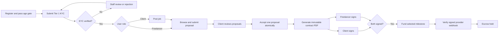
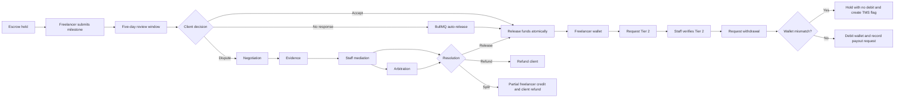

# Yekis Jobs Functional Walkthrough

Last validated: 2026-10-03

> **Chatwoot Support Bridge — Backend Integration Completed (2026-10-03):**
> - **What the 2026-10-02 pass actually delivered**: the widget embed only. No Chatwoot API client, no webhook receiver, no shared state with the internal chat store, and no configured tokens — so no message ever reached an agent inbox. This entry records the bridge that completes it.
> - **Division of Labour**: Chatwoot backs **support tickets**. Peer-to-peer marketplace chat (client ↔ freelancer) stays on the internal WebSocket engine, which is the only thing that can carry participant chat, typing indicators, read receipts and attachments.
> - **Chatwoot Application API Client (`apps/backend/src/modules/chat/chatwoot.client.ts`)**:
>   - `findContact` / `upsertContact` — resolve a contact by our user id used as the Chatwoot `identifier`, falling back to email.
>   - `createConversation` — seeds the mirrored conversation with its opening message (`source_id`, `inbox_id`, `contact_id`).
>   - `createMessage` — pushes an outbound reply.
>   - `toggleConversationStatus` — opens/resolves the remote conversation.
>   - Auth via the `api_access_token` header against `/api/v1/accounts/:id/...`, with a 10s timeout per request and typed errors. Network/timeout failures are wrapped so the bridge can degrade uniformly.
>   - `isOutgoingChatwootMessage` normalises `message_type`, which the API returns as an integer in JSON but documents as a string enum.
> - **Bridge Orchestration (`apps/backend/src/modules/chat/chatwoot.service.ts`)**:
>   - `linkConversationToChatwoot` — idempotently creates and records the remote IDs (`Conversation.chatwootConversationId`, `chatwootContactId`, `chatwootInboxId`), flipping `channel` to `CHATWOOT`. Audited as `SUPPORT_CONVERSATION_LINKED_CHATWOOT`.
>   - `pushOutboundMessage` / `pushOutboundStatus` — called from `chat.service.ts`, fire-and-forget. A Chatwoot outage is logged and can never fail or delay an internal chat write.
>   - `handleInboundMessage` / `handleInboundStatusChanged` / `handleInboundConversationCreated` — ingest agent replies, resolve/reopen state, and adopt Chatwoot-originated conversations whose contact carries a Yekis id.
>   - Only **agent-authored, non-private** messages are ingested; incoming messages are skipped because we already hold them, and private notes never surface to users. Inbound replies are broadcast over the WebSocket, so they appear live in an open chat window.
> - **Signature-Verified Webhook Receiver (`apps/backend/src/modules/chat/chatwoot.webhooks.ts`)**:
>   - `POST /api/v1/webhooks/chatwoot`, mounted ahead of `express.json()` because Chatwoot signs the exact received bytes — re-serializing parsed JSON would break verification.
>   - Verifies `X-Chatwoot-Signature` (`sha256=` + HMAC-SHA256 of `{timestamp}.{raw_body}`) using `crypto.timingSafeEqual`, rejects non-numeric or >5-minute-old timestamps as replays, and fails closed when no secret is configured. Separate 600 req/min limiter.
>   - Always 2xx for understood-but-ignored events (otherwise Chatwoot redelivers forever); 5xx on a processing failure so the message is retried.
> - **Persistence & Idempotency**: migration `20261003120000_chatwoot_support_bridge` adds `Conversation.channel`, `chatwootConversationId` (unique), `chatwootContactId`, `chatwootInboxId`; `ChatMessage.origin`, `ChatMessage.externalId` (unique). Additive only — existing conversations stay `INTERNAL` and are never mirrored. NULLs are distinct in Postgres, so unlimited internal conversations coexist while each Chatwoot id maps to exactly one thread. Inbound dedupes on `externalId` because Chatwoot retries until it gets a 2xx.
> - **New Endpoints**: `POST /api/v1/chat/support` (open a ticket, mirrored immediately so an agent sees it before the first message) and `GET /api/v1/chat/support/chatwoot-health` (staff-only status). `GET /api/v1/chat/support/chatwoot-identity` now also returns `configured` so a null hash is never mistaken for "verified".
> - **Configuration Is All-or-Nothing**: `CHATWOOT_BASE_URL` enables the bridge; the backend refuses to boot unless `CHATWOOT_API_ACCESS_TOKEN`, `CHATWOOT_ACCOUNT_ID`, `CHATWOOT_INBOX_ID`, `CHATWOOT_WEBHOOK_SECRET` and `CHATWOOT_INBOX_HMAC_KEY` are all set, because a half-configured bridge silently drops support replies. Unset entirely → fully inert. Blank env values are treated as absent so a `.env` copied from `.env.example` still boots.
> - **Security Fix — WebSocket IDOR**: `lib/socket.ts` granted client-requested subscriptions with no authorization check, so any authenticated user could subscribe to `conversation:<any-id>` and receive another user's messages, typing state and read receipts live. `subscribe`/`typing`/`read` are now authorized against conversation membership, only the `conversation:*` family is subscribable, private channels are never client-requestable, positive results are memoized per socket, and a DB error fails closed.
> - **Widget Fixes (`components/ChatwootWidget.tsx`)**: identity effect omitted `fetchedHash` from its deps (hash usually never sent → anti-impersonation silently off); it waited on a `chatwoot:ready` event nothing dispatches (replaced with a bounded poll for `window.$chatwoot`); global settings were spread after the computed values so a stale object could override the theme; the widget mounted on three shells and injected the SDK three times (now a module-level singleton). The fetched hash is keyed by user id. Non-component logic moved to `components/chatwoot/bridge.ts` so the module exports only a component (React Fast Refresh), with `vite-env.d.ts` typing the `VITE_CHATWOOT_*` vars.
> - **Dead Code Removed**: `SupportChat.tsx` / `SupportChat.css` — an orphaned 5-second-polling widget imported nowhere.
> - **Infrastructure**: `docker-compose.chatwoot.yml` no longer ships known default secrets (`SECRET_KEY_BASE=replace_with_hex_64_secret_key_base`, `chatwoot_secure_pass_123`); both are now `:?` required. Switched to `pgvector/pgvector:pg16` (Chatwoot v3.16 needs pgvector; the plain `postgres:14-alpine` image fails its migrations), dropped the obsolete `version` key, and added the `.env.chatwoot.example` its own header instructed you to copy. Confirmed `db:chatwoot_prepare` is the real, required migration step — the image entrypoint waits for Postgres but does **not** migrate.
> - **Tests**: `tests/chatwoot-bridge.test.ts` — 14 cases over signature verification and the identity HMAC, with expected signatures computed independently of the implementation. Migration DDL was executed against a scratch database to confirm it applies and that NULL `chatwootConversationId` rows coexist while a duplicate Chatwoot id is rejected.
>
> **Chatwoot Real-Time Customer Support Integration (2026-10-02 — widget only, superseded by the entry above):**
> - **Architecture & Selection**: Integrated Chatwoot as Yekis's official real-time customer support platform, preserving internal `ChatWorkspace` for freelancer-client contracts while giving clients/freelancers instant access to dedicated support agents.

> **Telegram & Google Social Authentication Overhaul (2026-10-02):**
> - **Facebook Removed & Replaced with Telegram**: Deprecated and purged Facebook SDK/auth from the sign-in/registration menu. Replaced with native Telegram social authentication featuring the official paper plane icon and signature `#24A1DE` styling.
> - **Dual Telegram Verification Support**: Updated `apps/backend/src/modules/auth/telegram.service.ts` to cryptographically verify both Telegram MiniApp `initData` (`HMAC("WebAppData", botToken)`) and Telegram Web Login Widget payloads (`SHA256(botToken)`).
> - **Google Icon Visibility Fix**: Eliminated the issue where Google Sign-In button was invisible due to empty placeholder divs and origin mismatch latency. Replaced with a permanent 36px circular button displaying the crisp 4-color Google "G" SVG icon, overlaid with Google GIS iframe and fallback prompt handler.
> - **Full Registration Support for Google & Telegram**: Enabled users to register with either Google or Telegram with role preservation (`CLIENT` vs `FREELANCER`) selected on the registration form.
> - **Interactive Telegram Login Modal**: Added a dedicated Telegram connection dialog with the official Login Widget and deep link to `@ye_kis_bot`.
>

> **Chatwoot Real-Time Customer Support Integration (2026-10-02):**
> - **Architecture & Selection**: Integrated Chatwoot as Yekis's official real-time customer support platform, preserving internal `ChatWorkspace` for freelancer-client contracts while giving clients/freelancers instant access to dedicated support agents.
> - **Frontend Widget Component (`components/ChatwootWidget.tsx`)**:
>   - Built a lightweight, non-blocking React component managing the Chatwoot JavaScript SDK lifecycle.
>   - Safe dynamic script injection with deduplication and clean teardown.
>   - Synchronizes authenticated user identity (`id`, `email`, `phone`, `role`, `kycStatus`, `walletBalance`, `platform`) with Chatwoot contacts.
>   - Auto-resets session on user logout to prevent cross-session chat bleed.
>   - Syncs color scheme dynamically (`setColorScheme('dark' | 'light')`) matching the user's active theme.
>   - Provides programmatic trigger utility `openChatwootSupport()` with fallback to email support if widget is unconfigured.
> - **Backend HMAC Identity Verification (`apps/backend/src/lib/chatwoot.ts`)**:
>   - Added `CHATWOOT_INBOX_HMAC_KEY` configuration to `apps/backend/src/config/env.ts` and `.env.example`.
>   - Generates HMAC-SHA256 signatures (`getChatwootIdentifierHash`) verifying user authenticity to prevent chat identity spoofing.
>   - Exposed `/api/v1/chat/support/chatwoot-identity` endpoint for secure client token retrieval.
> - **Touchpoints & Triggers**:
>   - Mounted `<ChatwootWidget />` in `FullPlatformApp.tsx` across landing, authentication, and platform workspace views.
>   - Enhanced "Contact Support" in `MarketingFooter.tsx` to launch Chatwoot seamlessly.
>   - Added "Chat with Support" button in user `Settings` panel.
> - **Deployment & Self-Hosting Stack**:
>   - Created `docker-compose.chatwoot.yml` with Chatwoot Web, Sidekiq worker, PostgreSQL, and Redis for self-hosting.
> - **Build Verification**: ⚠️ This claim was inaccurate — the frontend did not compile at this point. `AdminOpsPages.tsx` contained `gap: 22px` (not valid JavaScript), was missing 12 `lucide-react` imports, and `StaffDashboard.tsx` called `<AdminOverviewPage />` without its three required props. All three were fixed and `pnpm --filter frontend run build` now genuinely passes; see the 2026-10-03 entry.
>

> **Blobatar Deterministic Profile Avatars Integration (2026-10-02):**
> - **Dependency Installation**: Added `blobatar` (`^2.7.0`) and `@blobatar/react` (`^2.7.0`) to `apps/frontend`.
> - **`<YekisAvatar>` Component (`components/YekisAvatar.tsx`)**: Built a centralized, reusable avatar component:
>   - Deterministic seed based on `userId` (with fallback to `email` / `displayName` / `YekisUser`).
>   - Renders animated geometric Blobatars with subtle hover physics (`animate="hover"`).
>   - Seamless fallback: if user has a custom `avatarUrl`, it renders the custom image; falls back to Blobatar on load error or absence.
>   - Respects user accessibility preferences (`prefers-reduced-motion: reduce`).
> - **System Touchpoints Updated**:
>   - **`App.tsx`**: Upgraded platform sidebar role badge and topbar user menu profile avatar to use `YekisAvatar`.
>   - **`ProfilePage.tsx`**: Upgraded 96px hero avatar from single-letter fallback box to high-res animated Blobatar.
>   - **`ProfileEditPage.tsx`**: Added an interactive "Profile Avatar (Blobatar)" section with a live preview and a "Shuffle Blobatar" button allowing users to re-roll their character's facial traits, colors, and eyes.
>   - **`FeaturedCarousel.tsx`**: Replaced generic fallback initial squares for featured marketplace talent with lively Blobatars.
>   - **`StaffDashboard.tsx`**: Upgraded Ops Console user chip avatar in the bottom navigation.
>   - **`ChatWorkspace.tsx`**: Replaced static letter placeholders with distinct Blobatars for conversations and chat headers.
> - **Styling & Motion**:
>   - Imported `blobatar/motion.css` into `apps/frontend/src/index.css`.
>   - Added theme-invariant container rules (`.yk-avatar-wrap`, `.yk-blobatar`) conforming to AGENTS.md theme parity rules.
> - **Build Verification**: `pnpm -r build` passed completely with exit code 0 across all workspace packages.
>

> **Frontend Dependency Modernization & Stable Upgrades (2026-10-02):**
> - **`apps/frontend/package.json`** — Upgraded dependencies to their latest stable releases:
>   - **`react` & `react-dom`**: bumped to `^19.3.0` (with matching `@types/react` and `@types/react-dom` at `^19.3.0`).
>   - **`framer-motion`**: upgraded to `^14.0.0`.
>   - **`lucide-react`**: updated to `^1.50.0`.
>   - **`vite`**: upgraded to `^8.3.2` with `@vitejs/plugin-react` `^6.1.1`.
>   - **Tooling**: `@babel/core` `^8.0.6`, `@rolldown/plugin-babel` `^0.2.4`, `eslint` `^10.11.0`, `globals` `^17.13.0`, `typescript-eslint` `^8.71.0`, `typescript` `~7.0.2`.
> - **Build Verification**: `pnpm --filter frontend build` (`tsc -b && vite build`) and `pnpm --filter backend build` (`tsc -p tsconfig.json`) both completed with exit code 0.


> **"Ready to start?" CTA + Footer Redesign — Landing Page V2 bottom outro (2026-10-03):**
> - **`LandingPageV2.tsx`** — `FinalCTASection` and `FooterV2` rebuilt from the supplied HTML reference as one continuous bottom outro:
>   - **CTA — pointer-tracked spotlight panel** (`.v2-outro-cta`): full-bleed `340px` panel, `0 0 35px 35px` bottom corners, five-stop radial gradient. A lime spotlight (`::before`, `blur(24px)`) follows the cursor through the `--mouse-x` / `--mouse-y` custom properties, written directly to the DOM in a `pointermove` listener (no React re-render) and recentred on `pointerleave`. Behind it: a breathing ambient orb, two drifting colour blobs, an SVG-noise film, and two floating outline glyphs (`Shield`, `WalletCards`).
>   - **CTA content**: mono kicker with a left accent bar (replaces `.v2-eyebrow`), `text-wrap: balance` headline + sub-copy, a flat lime primary button with a hover sheen sweep, and a glass ghost button. Buttons live on new `.v2-outro-btn*` classes so the shared `.v2-btn` system used by the hero is untouched. Hover/press motion (`translateY(-3px)`, `:active scale(.98)`, shine sweep) is pure CSS, exactly as in the reference.
>   - **Footer — frosted card + giant word** (`.v2-footer-area`): rounded "lip" divider (`.v2-footer-divider`), left/right blurred glows, then a `blur(25px)` glass card with a `2.25fr / 1.65fr` top grid (brand column + three nav columns), a hairline rule, and a bottom row with copyright, the escrow trust note and legal links. Behind the card a masked, fade-out **"Yekis"** wordmark pops in on scroll. Brand lockup is a white rounded symbol tile with a lime sweep on hover; the social links are an icon row (each keeps `title` + `aria-label`) for **TikTok, Telegram, Instagram and Facebook** as inline brand SVGs.
>   - **Giant wordmark — visibility + pop**:
>     - The reference colour `#151b17` on the `#070907` panel measured **1.14:1contrast**, i.e. invisible. Now `#4e6553` (dark, **3.15:1**) / `#7d9464` (light, **3.09:1**), and the mask ramp was reshaped to `1 → .62 → .16 → 0` so the top of the glyphs lands solid rather than pre-faded.
>     - `v2-out-word-pop` (`1250ms cubic-bezier(.16,1,.3,1) both`) animates `translateY(104px) scale(.84)` → overshoot `translateY(-14px) scale(1.045)` → settle, with `transform-origin: 50% 100%` so it grows out of the floor. Verified live over CDP: scale `.84 → .89 → .98 → 1.02 → 1.045 → 1`, offset `104 → 75 → 22 → 0 → -14 → 0`.
>     - It gets its **own** `IntersectionObserver` (`threshold: .3`). The card is much taller than the wordmark, so sharing the card's observer (`threshold: .12`) fired the pop while the wordmark was still below the fold and the user never saw it.
>     - `.v2-footer-area` gained `padding-bottom: clamp(72px, 14vh, 180px)`. The wordmark's box used to end exactly at the document bottom, so even at max scroll only its top ~80px was on screen.
>     - A scroll-*scrubbed* variant (`--word-p` written by a rAF scroll loop) was prototyped and **rejected**: the document ends directly below the wordmark, so a scrub can never reach `1` and the word would sit permanently part-faded. The observer-triggered pop has no such dependency.
>   - **Sized up**: the reference's `1000px` card at `12.5px` type read too small next to the rest of the page, so the card is now `min(1320px, 100% - 12%)` with `64px 68px 56px` padding / `34px` radius; nav links `15px`, headings `14px`, brand `20px`, description `15px`, social icons `22px`, bottom row `12.5px`, wordmark `clamp(150px, 22vw, 320px)`. The CTA panel grows to `380px` min-height with `52px` buttons and a `clamp(32px, 4vw, 52px)` headline.
>   - **Motion is the reference's, not a second system**: CTA content plays the CSS `v2-out-content` keyframe; the footer card and wordmark are revealed by `IntersectionObserver`s flipping `.is-visible` (with an immediate-reveal fallback for reduced-motion / no-`IntersectionObserver`), matching the supplied script. No framer-motion primitives are used in this section.
> - **`landing-v2.css`** — New scoped `.yk-v2 .v2-outro-*` / `.v2-footer-*` rules:
>   - **New token family `--v2-out-*`** declared once per theme block (dark default + `:root[data-theme="light"]`). Light mode gets a paper treatment (`#dcecc0 → #ffffff` panel stops, olive `#5e7f16` accents, white glass card, `#7d9464` wordmark) with identical geometry — AGENTS.md theme-parity rule satisfied by construction. A single `--v2-out-flip` (`0` / `1`) drives the alpha of the two drifting colour blobs.
>   - Added `--v2-font-mono` (`DM Mono` → `JetBrains Mono`) so the kicker stops hard-coding a family.
>   - Six new keyframes: `v2-out-content`, `v2-out-ambient`, `v2-out-drift-a`, `v2-out-drift-b`, `v2-out-float`, `v2-out-word-pop`.
>   - Responsive at `1024px` / `850px` (footer card narrows, top grid collapses, floating glyphs hidden) and `600px` (CTA panel grows, buttons go full-width, footer nav → 2 columns, base row stacks, wordmark → `32vw`).
>   - Reduced-motion block now lands the footer card and wordmark in their final state (`animation: none !important` on the pop, since the `is-visible` selector outranks the base rule).
>   - Dead `.v2-cta-card`, `.v2-cta-inner`, `.v2-footer-grid`, `.v2-footer-brand*`, `.v2-footer-col*`, `.v2-footer-copy`, `.v2-footer-bottom`, `.v2-footer-lang` rules and five orphaned breakpoint entries removed.
> - **`LandingPageV2.tsx`** — the now-unused `Magnetic` and `Stagger` motion helpers and the `Send` / `Bot` / `Mail` icon imports were deleted (`noUnusedLocals` would fail the build otherwise). `Reveal` is still used by every other section.
> - **`MobileCTA.tsx`** — the sticky mobile bar's hide-on-footer observer targeted `.landing-footer`, which the V2 home page does not use, so `querySelector` returned `null` and the bar never hid. Selector is now `.v2-footer-area, .landing-footer`.
> - **Scope**: `MarketingFooter.tsx` (the legacy footer on non-home marketing pages) is unchanged — this redesign covers the home page only.
> - **Open item**: TikTok / Instagram / Facebook social links are `href="#"` placeholders — real profile URLs still need filling in.
> - **Pre-existing, unrelated**: `tsc -b` reports `TS6133` for `ChatwootWidget` and `openChatwootSupport` in `FullPlatformApp.tsx` — dead imports left by the in-progress Chatwoot integration, not touched by this work. It will fail `pnpm --filter frontend build` until they are either rendered or removed.
> - **Build verified**: `vite build` exits 0; `tsc -b` clean for every file this change touches. Verified visually in headless Chrome via CDP at 1440×1000 in both themes (footer settled + mid-pop frame + CTA panel).

> **"Floating Paths" Hero — Landing Page V2 hero replacement (2026-10-02):**
> - **`LandingPageV2.tsx`** — `HeroSection` rebuilt on the Floating Paths hero prototype (pure CSS + a tiny rAF parallax loop; no WebGL):
>   - Old hero removed: `Lightfall` WebGL background, grid/veil/cursor layers, `WaveTitle` per-character animation, hero sub-copy, scroll cue, and the `HERO_TITLE`/`GRADIENT_WORDS`/`DARK_COLORS`/`LIGHT_COLORS` constants (`Lightfall` itself stays in `components/Lightfall.tsx` for the v1 `LandingPage`).
>   - New `FloatingPaths` component renders two mirrored SVG layers of 36 sweeping cubic curves each. Every path drifts on a single seamless linear `dash-offset` loop (dash period equals `pathLength=1`), desynced with negative delays — continuous, unidirectional, no flicker. Theme-aware via `--v2-path-a`/`--v2-path-b` tokens.
>   - New `SpringTitle` component splits the headline "Find the right expertise." into per-letter spans (35 ms stagger) playing a bouncy `rotateX` spring entrance; ~2.2 s later a `.settled` class drops the animation so the hover transition owns the transform (all letters "pop" and glow violet). Two ambient glow orbs drift behind the field. A vanilla rAF loop lerps pointer position into opposite-direction parallax for the path layer and hero content.
>   - CTAs: "Get started" → `onStart("register")`; "Browse categories" → smooth-scrolls to `#categories` (instant under `prefers-reduced-motion`). Buttons reuse the shared `.v2-btn`/`.v2-btn-secondary` system.
>   - `useTheme` is no longer consumed by the hero (theming is pure CSS via `:root[data-theme]` tokens); the local theme toggle from the prototype is unnecessary because `MarketingHeader` already provides one.
> - **`landing-v2.css`** — hero block (old `v2-hero-*` badge/grid/veil/cursor/sub/trust/scroll-cue/float-card rules and now-unused `v2-ping`/`v2-rail` keyframes removed) replaced with scoped `.yk-v2 .v2-fp-*` rules + `v2-fp-flow`/`v2-fp-drift`/`v2-fp-letter`/`v2-fp-up` keyframes:
>   - **Theme-invariant base rules**: all layout/shape properties defined once (AGENTS.md parity rule); light/dark blocks only set the colour tokens `--v2-path-a`/`--v2-path-b`/`--v2-pop`/`--v2-pop-glow`/`--v2-glow-1`/`--v2-glow-2`.
>   - **Reduced motion**: letters render static (no pop), path drift and glows disabled, CTA entrance skipped.
>   - Big Shoulders Display / DM Mono were already imported in `index.css` for the scroll-stack deck — no new font fetch.
> - **Build verified**: `pnpm --filter frontend build` (tsc + vite) exits 0.
>
> **"Find the Right Expertise" — Pinned Scroll-Stack Deck (2026-10-02):**
> - **`LandingPageV2.tsx`** — Replaced the flat 3-column `CategoriesSection` grid (`CatCard` × 6) with a full-height **pinned scroll-stack deck** inspired by the provided HTML prototype.
>   - `CATEGORIES` constant removed; replaced by `DECK_CARDS` array containing per-card CSS class, two-line title, roles count, media tag, and Lucide icon reference.
>   - `CategoriesSection` now renders an 800-svh `<div class="stk-wrap">` with a `position:sticky` pin host. Six `<div class="stk-card stk-card--N">` elements stack inside a `stk-stage` perspective host.
>   - A vanilla-JS `requestAnimationFrame` loop (inside `useEffect`) drives the entrance beat, scroll-progress deck-deal animation, pointer-tilt stage rotation, scroll-inertia kick, and inner-column parallax — identical physics to the prototype, no extra npm packages.
>   - `IntersectionObserver` reveals the always-dark "Let's build." outro panel once it enters the viewport.
>   - `prefersReducedMotion` check collapses the deck to a static 2-column grid and skips the rAF loop entirely.
>   - Arrow-chip (`stk-chip`) on each card fires `onStart("register")`. "Get started" outro button fires `onStart("register")`; "Sign in" fires `onStart("login")`.
>   - Three TypeScript null-assertion fixes applied (`cur!`, `cue!`) for refs captured inside closures after the null guard.
> - **`landing-v2.css`** — Added `~430 lines` of `.yk-v2 .stk-*` scoped rules at the end of the file:
>   - **Theme-invariant base rules**: all layout/shape properties (position, size, flex, gap, padding, border-radius, border-width/style, font-family, font-size, line-height, animation-delay etc.) defined once, never repeated in theme blocks — AGENTS.md theme-parity compliance.
>   - **Dark theme (default)**: `.yk-v2 .stk-card` + `:root[data-theme="dark"] .yk-v2 .stk-card` — dark card backgrounds (#123f36 … #423610), `--stk-ac` / `--stk-glow` custom properties for per-card accent colour & glow.
>   - **Light theme**: `:root[data-theme="light"] .yk-v2 .stk-card--N` — pastel card backgrounds (#d6f0ea … #fef3c4), dark text (#0d1418), muted accent colours. Only `color`, `background`, `border-color`, `box-shadow` change — no layout overrides.
>   - **Responsive** (`max-width: 1000px`): cards switch to `flex-direction: column`, font-sizes clamp down.
>   - **`prefers-reduced-motion`** fallback: `stk-wrap` height → `auto`, `stk-pin` → `position: static`, `stk-stage` → `display: grid; grid-template-columns: repeat(2, 1fr)`, all animations disabled.
>   - Outro panel (`.stk-flat.stk-outro`) always renders with `background: #060807` regardless of theme — intentional design choice.
>   - Four new keyframes: `stk-pulse`, `stk-float`, `stk-ring`, `stk-drip` (all `stk-`-prefixed to avoid collision).
> - **`index.css`** — Extended the Google Fonts `@import` to include **Big Shoulders Display** (wght 700;800;900) and **DM Mono** (wght 400;500) — required by the deck card typography.
> - **Build verified**: `npm run build` exits 0 — zero TypeScript errors, zero Vite errors. Bundle: 843.93 kB JS / 237.99 kB CSS (gzip: 234.74 kB / 41.43 kB).


> **Ops Console Sidebar Redesign (2026-09-30):**
> - **`StaffDashboard.tsx`** — Full sidebar restructure to match the Yekis Ops Console HTML reference design.
>   - **Brand bar**: replaced the old logo `` + plain `<strong>` with a gradient indigo icon-logo (`brand-logo-icon`) + bold `Yekis` text + `OPS CONSOLE` small-caps tag.
>   - **Nav groups**: collapsed the previous 8 fragmented groups (CASES, VERIFICATION, FINANCE, OPERATIONS, MONITORING, USERS, ADMINISTRATION) into 4 canonical groups matching the ops console — **Overview**, **Financial**, **Review Queues**, **Operations**. Items reassigned: Contracts, Payments, Payouts, Escrow, Reconciliation, Ledger, Receipts → Financial; KYC Reviews, Dispute Mediation, Profile Reports, Support → Review Queues; Users, Staff & Roles, Reports, Risk Flags, Audit Logs, System Health → Operations.
>   - **Collapsibility removed**: nav groups are now static section labels (`sdb-nav-label`) — no chevron, no toggle state. Removed unused `expandedGroups` state and `toggleGroup` helper.
>   - **Nav item classes**: all nav buttons migrated from generic sidebar-nav button classes to scoped `sdb-nav-item` / `sdb-nav-icon` / `sdb-nav-text` classes. Active state changed from solid green fill to **indigo-tinted** background (`rgba(79,70,229,.08)` + `#4f46e5` text) matching the reference.
>   - **Badges**: replaced `nav-badge` pill (green bg) with `sdb-nav-badge` — bold amber text (`#b45309`) with no background, `margin-left: auto`, per AGENTS.md status design rules.
>   - **User footer chip**: moved user identity from a bordered card in the middle of the sidebar to a `sdb-footer` slot at the very bottom, containing a gradient indigo avatar (2-letter initials), name/email, and a `sdb-logout` button below it.
>   - **Icon size**: all nav icons downscaled from 18px to 16px with `opacity: 0.75` default (1.0 on hover/active).
>   - **Lucide imports updated**: added `BarChart2`, `Activity`, `BookOpen`, `AlertTriangle`, `CreditCard`, `Receipt`, `XCircle`; preserved `ChevronDown` (still used in topbar scope toggle).
> - **`AdminsPage.tsx`** — Replaced inline `background` style on the staff status cell with `className="status-pill success/error"` — bold text-first design, no background pill, compliant with AGENTS.md status indicator rule.
> - **`index.css`** — Replaced `.staff-shell` / `.staff-sidebar` / `.staff-identity` / `.sidebar-nav` block (lines 1064–1101) with new `sdb-*` rules:
>   - **Brand**: `.sdb-brand`, `.brand-logo-icon`, `.brand-name`, `.brand-ops-tag`
>   - **Nav**: `.sdb-nav`, `.sdb-nav-group`, `.sdb-nav-label`, `.sdb-nav-item`, `.sdb-nav-icon`, `.sdb-nav-text`, `.sdb-nav-badge`
>   - **Footer**: `.sdb-footer`, `.sdb-user-chip`, `.sdb-avatar`, `.sdb-user-info`, `.sdb-user-name`, `.sdb-user-email`, `.sdb-logout`
>   - **Theme rules**: dark mode overrides in `:root[data-theme="dark"]` blocks — only `color`, `background`, `border-color` changed; all layout/shape properties defined once in base rules (AGENTS.md theme-parity compliance).
>   - **Responsive**: 900px breakpoint collapses sidebar to 64px icon-only strip (labels/text hidden, items centered); 640px hides sidebar entirely — same breakpoints as before, class names updated.
>   - **Sidebar width**: changed from 260px to 252px to match reference.


> **Landing Page V2 — Pinned Escrow Board (2026-10-03):**
> - The "How your payment is protected" section is now a **pinned scroll board** instead of a four-column strip. The section is three bands: a static intro (eyebrow, headline, sub-copy, dispute link + the animated `EscrowVault`), a `480svh` pinned board, and a static footnote.
> - **Board contents:** four thumbtacked step cards pinned to a ruled sheet at four corners, three dashed connectors that draw between consecutive steps, and three pinned status notes in the free margins ("Balance locked", "Milestone 2 of 3 approved", "Auto‑release in 5 days" — the same three facts the vault illustration used to float around itself).
> - **Choreography:** `useScroll({ target, offset: ["start start", "end end"] })` → `useSpring` → `useMotionValueEvent`, all written to the DOM by one `paint(p, introT)` pass. Cards drop in with a back-out spring at `0 / .24 / .48 / .72`, connectors draw at `.16 / .40 / .64`, notes pop at `.30 / .56 / .80`, the ruled sheet parallaxes through `--esc-bgY`, and card 01 additionally drops on page load via a `0.95 s` `animate()` intro.
> - **Connector reveal:** each connector is revealed by sliding the dash window on its mask path. `pathLength` is intentionally avoided — Blink does not scale `stroke-dashoffset` by `pathLength`, and `vector-effect: non-scaling-stroke` resolves dash lengths in screen px, so the usual `pathLength="1"` recipe leaves the connectors permanently visible. Real lengths come from `getTotalLength()` and the mask band is sized in board units.
> - **Classes:** `esc-wrap` / `esc-pin` (sticky stage + ruled sheet + vignette) / `esc-card--1..4` / `esc-note--1..3` / `esc-wire*` / `esc-cue` / `esc-foot`; keyframes `esc-sway`, `esc-bob`, `esc-drip`.
> - **Theme parity:** all colours resolve from existing `--v2-*` tokens; the only theme-conditional rules are the per-step accents and thumbtack hues (`--esc-ac`, `--esc-pin-head`, `--esc-pin-dot`). Structure, positions, sizes and breakpoints are theme-invariant.
> - **Static fallbacks:** `≤900px` and `prefers-reduced-motion: reduce` both collapse the board to a stacked list (tilted via `--esc-rotm`, wires + cue removed) and JS paints the final state once — no scroll-jacking.
> - Removed the now-unused `.v2-steps-grid` / `.v2-step*` rules and their orphaned breakpoints from `landing-v2.css`.
>
> **Landing Page V2 — Animated Design Branch `design/landing-v2` (2026-09-29):**
> - **New branch `design/landing-v2`** created from `main` for a parallel landing page design. Zero changes to existing code on `main`.
> - **`LandingPageV2.tsx`** — Drop-in replacement (same props). All animations via Framer Motion. Scoped to `.yk-v2` CSS namespace. Sections: Hero, Marquee, Stats, Escrow + EscrowVault, Fees, Categories, Testimonials, Trust, FAQ, Final CTA.
> - **`landing-v2.css`** — Isolated design system. Theme-conditional blocks only change `color / background / border-color / box-shadow / opacity`. All layout/shape properties are un-themed (AGENTS.md theme-parity rule). All keyframes prefixed `v2-*`.
> - **Motion primitives:** `Reveal`, `Stagger`, `Magnetic`, `CountUp`, `WaveTitle`, `EscrowVault`, spring FAQ accordion, `AnimatePresence` testimonials, 3D tilt categories, animated fee bar, scroll progress bar, cursor gradient, scroll-parallax CTA, back-to-top.
> - **To preview:** `git checkout design/landing-v2` then `pnpm dev:frontend` → `http://localhost:5173`.
> - **To compare:** `git checkout main` then `pnpm dev:frontend`.
>

> **Multi-Rail Payments (CBE & Safaricom M-Pesa) + Manual Verification Fallback (2026-09-05):**
> - **CBE & Safaricom M-Pesa Integration**: Expanded payment options from Telebirr-only to a complete Ethiopian multi-rail infrastructure supporting **Telebirr**, **Commercial Bank of Ethiopia (CBE / CBE Birr)**, and **Safaricom M-Pesa (Ethiopia)** across Instant Checkout, Manual Bank Transfers, and Freelancer Withdrawals.
> - **Zero Dead-End Manual Verification Fallback**:
>   - When automated gateway APIs fail, time out, or experience downtime, clients are never stranded. The frontend renders an inline fallback card with a 1-click **"Switch to Manual Verification"** button that pre-fills the amount and payment rail for seamless direct transfer.
>   - For delayed or unconfirmed checkout requests (`CHECKOUT_PENDING`), clients can click **"Attach receipt for verification"** to submit their payment reference number and receipt image directly to the existing transaction via `POST /api/v1/wallet/topups/:topUpId/attach-receipt`. The server updates the top-up to `PENDING` manual review and notifies operations staff.
> - **Operations Staff Top-Up Queue (`TopUpQueue.tsx`)**: Upgraded the receipt review desk with color-coded provider badges (`Telebirr` in brand blue, `CBE Bank` in purple, `Safaricom M-Pesa` in emerald green) and destination account indicators (`0910 011 818`, `1000 223 344`, `0777 011 818 / Till 882199`) so staff can verify receipts quickly.
> - **Telegram Mini App & Browser Wallet Parity**: Unified the 3-way payment rail selection, 1-click account copy, fallback handling, and receipt upload modals across both `BrowserWallet.tsx` (Desktop Web) and `App.tsx` (Mobile / Telegram Mini App).
>
> **Chat Attachment Upload, Persistent Storage & Support Desk Rendering (2026-09-05):**
> - **Persistent Object Store Integration (`POST /api/v1/chat/upload` & `GET /api/v1/chat/attachments/:key(*)`)**: Chat attachments are uploaded to S3/MinIO bucket `marketplace-dev` (with local disk fallback under `uploads/chat-attachments/`), generating permanent streaming URLs (`/api/v1/chat/attachments/...`). Replaced ephemeral browser-memory `blob:` URLs that previously broke visibility across users and sessions.
> - **Support Desk Attachment Visibility (`StaffDashboard.tsx`)**: Support staff can view all client-attached files within support threads. Image attachments are displayed as inline thumbnails with zoom hover, and documents/archives feature styled badges with file icons, decoded filenames, and one-click download/open links (`ExternalLink`).
> - **Support Desk Reply Attachments**: Support agents can upload and attach files in their replies with live removal badges and progress spinners (`Loader2`).
> - **Client Workspace Bubble Enhancements (`ChatWorkspace.tsx`)**: Replaced raw links with containerized image previews and responsive download chips, auto-defaulting body text to `📎 <filename>` when files are sent without draft text.
>
> **Real-Time WebSocket Messenger & "Mini-Me" AI Negotiation Co-Pilot (2026-09-04):**
> - **Full Bidirectional WebSocket Engine (`/api/v1/ws`)**: Upgraded chat from 5-second polling to instant event-driven WebSockets. Handshakes authenticate JWT access tokens with ping/pong heartbeats and automatically route `chat:message`, typing states (`chat:typing`), read notifications (`chat:read`), and new-thread unread badges (`chat:new_message`).
> - **Direct Client ↔ Freelancer Messaging Channels**: Added `POST /api/v1/chat/direct` allowing direct 2-party contract negotiations with participant role badges, online presence indicators, and unread counters alongside support tickets.
> - **"Mini-Me" AI Co-Pilot Suite**:
>   - **Smart Reply Suggestions**: Real-time contextual response suggestions displayed as 1-tap interactive pills directly above the composer (`/assistant/suggest-replies`).
>   - **Thread Digest & Summarizer**: Analyzes negotiation history into structured deliverables, timeline, agreed budget in ETB, and recommended next steps (`/assistant/summarize`).
>   - **1-Click Deal Terms Extractor**: Synthesizes unstructured conversational agreement into escrow-ready milestone proposal cards with confidence scoring and direct contract creation links (`/assistant/extract-deal`).
> - **Real-time Anti-Circumvention Protection**: Client-side scanner actively parses drafts for off-platform contact leaks (Ethiopian mobile numbers `09...`, Telegram `@...`, off-platform emails, wire transfer requests) with an inline warning informing users of escrow safety benefits before sending.
> - **2-Column Responsive Workspace (`ChatWorkspace.tsx`)**: Built complete responsive messaging interface with thread search, category filtering (All/Direct/Support), document attachments, and mobile-friendly view toggling.
>
> **Statutory Cooling-Off Routing Fix, Build Health & Workspace Integration (2026-09-03):**
> - **Resolved Nested Route Registration in `contracts.routes.ts`**: Un-nested `POST /api/v1/contracts/:contractId/cancel-cooling-off` from inside the `catch` block of `/:contractId/accept`, properly registering the statutory 7-day cooling-off cancellation endpoint (ECA Proclamation No. 1205/2020) directly on `contractsRouter`.
> - **Purged Stale Compiled JavaScript in Backend `src`**: Removed committed transpiled `.js` files from `apps/backend/src/` (`config/env.js`, `lib/logger.js`, `lib/redis.js`, `modules/escrow/providers/*`) that were shadowing TypeScript source files and causing missing environment variables (e.g. `TMS_ROUND_AMOUNT_WINDOW_DAYS`). Added ignore rules to `.gitignore` to protect against future shadowing.
> - **Strict TypeScript Type Safety in Audit and Telegram Bot**: Upgraded `recordAuditEvent` metadata to use `Prisma.InputJsonValue` with `Prisma.JsonNull` fallback, and aligned `BotSession.staffRole` to the full `StaffRole` enum from `@prisma/client` (`SUPPORT`, `COMPLIANCE_OFFICER`, `ADMIN`).
> - **Workflow Workspace Cooling-Off UI**: Added `cancelContractCoolingOff` API client method and client-facing cooling-off cancellation controls in `WorkflowWorkspace.tsx` (`ContractsWorkspace`), displaying statutory cancellation eligibility before milestone funding with confirmation dialogues and cancelled status badges.
> - **Automated Test Coverage**: Added dedicated `cooling-off.test.ts` test suite confirming client statutory cancellation, party authorization guards (403), post-funding rejection, and audit log persistence. All 7 test suites (34 tests) passing.

> **Operations Workspace Polish & Database Synchronization Fix (2026-09-03):**
> - **Resolved 500 `INTERNAL_ERROR` Bug in Operations Dashboard**: Synchronized PostgreSQL database schema with Prisma (`WalletTopUp.providerTransactionId`, `receiptImagePath`, and related ledger/checkout fields) via `prisma db push`, ensuring `/api/v1/wallet/topups` and `/api/v1/wallet/topups/queue` succeed with 200 OK.
> - **Cleaned Dispute Icon in Sidebar & Metric Cards**: Replaced raw textual `(!)` badge symbol with the standard `Scale` (from `lucide-react`) icon in both the Operations sidebar navigation and the Overview metric cards for a consistent, premium aesthetic.
> - **Operations Workspace Header & Sidebar Polish**:
>   - Realigned the topbar title and action bar, separating the `[ All Queues | My Queue ]` scope toggle into the right-hand action controls alongside the theme switcher and refresh button.
>   - Added real-time queue count badges to sidebar navigation items (Support, Receipts, Identity, Disputes).
>   - Upgraded the bottom "Sign out" button with a dedicated `LogOut` icon, clean padding, and subtle red hover state.
>   - Refined metric card layout with dedicated rounded icon wrappers (`.staff-metric-icon-wrap`) and clean typography.
>   - Confined the `StaffCompliancePanel` (AML Review Queue) to the Overview tab rather than sticking it beneath every sub-queue tab.
> - **Strict TypeScript Type Safety**: Fixed `StaffRole` type mismatch in `chat.service.ts` to ensure clean compilation across backend and frontend.

> **Telegram Bot Token Validation & Startup Resilience (2026-08-28):**
> - **Pre-Flight Bot Token Verification**: Added pre-flight check in `bot.service.ts` using `bot.api.getMe()` to test credentials against Telegram API before attempting to set commands or start polling.
> - **Graceful Failure Handling**: If `TELEGRAM_BOT_TOKEN` is invalid, expired, or rejected (401 Unauthorized), the backend logs an informative warning and skips bot initialization without throwing unhandled promise rejections or crashing the dev server.
> - **Polling Error Catching**: Added `.catch()` handler to `bot.start()` to catch background polling disconnections cleanly.

> **Backend Run & TypeScript Type Safety Update (2026-08-28):**
> - Resolved runtime missing dependency `axios` required for eSignet OIDC KYC verification.
> - Aligned Prisma schema with `ROUND_AMOUNTS` and `strDeadlineAt` and regenerated Prisma client.
> - Resolved all strict TypeScript errors across KYC, Escrow, TMS, and Bot Scene modules.

> **Telegram Mini App Startup, Clean Typography & Registration Workflow Update (2026-08-22):**
> - **Immediate Mini App Loading**: Added inline Telegram WebApp initialization script in `index.html` executing `Telegram.WebApp.ready()` and `Telegram.WebApp.expand()` immediately to bypass Telegram iframe loading stalls. Configured `allowedHosts: true` and `ngrok-skip-browser-warning` in `vite.config.ts`.
> - **Emoji-Free Professional UI**: Removed all decorative emojis from Telegram Bot commands, keyboards, greetings, and Mini App UI buttons (clean professional text).
> - **Comprehensive Registration & Onboarding Guide**: Unified registration flow supporting 1-tap Telegram WebApp authentication, Ethiopian mobile phone + password/PIN sign-up, and 1-click Google sign-in with automatic workspace provisioning.
> **Universal Theme Toggle & Footer Alignment Update (2026-08-22):**
> - **Platform-Wide Theme Toggle**: Embedded the light/dark mode theme switcher into every platform page and surface (Marketing Header, Subpages, Sign-in/Register Auth screen, Logged-in Workspace Topbar, Staff Dashboard, and Mini App).
> - **Unified Footer & Escrow Badge Alignment**: Extracted reusable `MarketingFooter.tsx` across all marketing and legal subpages. Fixed flex conflicts in `index.css` and `marketing.css` so that `"© 2026 Yekis. All rights reserved."` and `"Payments secured by Yekis Escrow"` align on a clean full-width bottom bar.
> **Platform Auth, Transactional Email & Mini App Security Update (2026-08-22):**
> - **Google (Gmail) & Social Authentication**: Implemented 1-click Google Sign-In (`/api/v1/auth/google`) with automatic user provisioning and workspace resolution. Added persistent session caching on visit (`/api/v1/auth/me` auto-resume), eliminating repetitive account registration prompts.
> - **Transactional Email Notification System**: Built modular transactional email service (`email.service.ts`) with responsive HTML templates for password resets, order invoices/receipts with ETB breakdowns on milestone funding, and platform movement alerts (milestone delivery, escrow releases, dispute updates, KYC verifications).
> - **Telegram Mini App Dual Security**: Implemented dual-tab authentication supporting seamless 1-tap Telegram WebApp HMAC verification and secure Ethiopian mobile phone + PIN/password login with clear security indicators.
> **Telegram Mini App & Environment Architecture Update (2026-08-22):** Enhanced backend environment variable resolution (`env.ts`) to automatically detect `.env` from multiple locations (`apps/backend/.env`, root `.env`, and working directory). Added automated schema sanitization for `TELEGRAM_BOT_TOKEN` to handle quotes, whitespace, and empty strings. Added dedicated unit test suite (`telegram-auth.test.ts`) covering Telegram WebApp HMAC-SHA256 hash verification, freshness checks, and user upserts.
> **Theme, Brand & UX Update (2026-08-22):** Complete light and dark mode design system refactor. Resolved contrast issues across light mode surfaces (fees comparison tables, step indicators, card borders, headings, chat attachments). Standardized brand emerald primary color (`#16a34a` light / `#22c55e` dark) and slate text contrast (`#0f172a` light / `#f8fafc` dark). Removed destructive global SVG color overrides and low-opacity background boxes around icons. Eliminated AI-slop / developer jargon from landing copy in favor of clear, human-readable marketplace terms.
> **Architecture & Type Safety update (2026-08-21):** Full database schema migration synchronization (`20260821215600_add_profile_reviews_chat_platform_models`) completed with clean seeding and zero TypeScript compilation errors across `apps/backend` and `apps/frontend`. All backend test suites and frontend builds validated with passing status.
> **Design spacing update (2026-08-21):** Fully unified Yekis landing and marketing page space utilization to match AFRO-TECH's full-bleed layout. Implemented 6% horizontal gutters across the fixed horizontal navigation bar, left-aligned hero section, content containers (`.marketing-container`), and footer. Configured responsive fluid gutters (6% desktop -> 5% tablet -> 4% mobile) with clean component layouts.
> **Payment flow update (2026-08-15):** Escrow is now funded directly from the client's in-platform wallet. The old external-provider (Telebirr/CBE direct) Fund button has been replaced with a "Fund from wallet" button. When both parties sign a contract, the platform automatically debits the client wallet and locks funds in escrow. See [`docs/FLOW.md`](docs/FLOW.md) for the full canonical payment lifecycle.

This document is the fastest way to understand the product as a whole. It translates the supplied Ethiopian Freelance Marketplace linkage map and journey images into the workflow currently exposed by the frontend and API.

## Actors

| Actor | Main capabilities |
|---|---|
| Client | Verify identity, post jobs, review proposals, sign contracts, fund milestones, accept work, raise disputes |
| Freelancer | Verify identity, browse jobs, bid, sign contracts, submit milestones, raise disputes, withdraw earnings |
| Compliance Officer | Review KYC and top-ups, mediate disputes, review TMS flags, record STR filings |
| Admin | Same operational access as compliance staff, with room for broader administration |
| Workers | Send notifications, warn before auto-release, release eligible escrow, flag periodic KYC reviews |

## Journey Part 1: Registration to Funded Contract



Important controls:

- Registration captures age, role, language, and purpose-specific consent.
- Tier 1 must be `VERIFIED` before posting a job, bidding, or funding.
- Users cannot bid on their own jobs, and one freelancer can submit only one proposal per job.
- Proposal acceptance runs in a serializable transaction so only one proposal wins under concurrent requests.
- The generated PDF is stored in MinIO/S3-compatible object storage and exposed to contract parties through a temporary signed URL.
- Funding requires the `contractId` and a milestone that actually belongs to that contract.
- Only one pending funding transaction can exist for a milestone.
- Webhooks use the raw request body, provider-specific HMAC verification, and idempotent state transitions.
- A structuring TMS check runs when funds enter escrow.

## Journey Part 2: Delivery to Payout



Important controls:

- Submitting work schedules a 24-hour warning and final release job (unless the contract is still within its 7-day cooling-off window, which takes precedence).
- Explicit acceptance cancels delayed release jobs.
- Client can cancel the contract during the 7-day cooling-off window if no escrow is funded or work started yet.
- Release and refund paths use guarded database updates to prevent duplicate wallet credits.
- Fees and withholding are calculated on the server. Platform fees are credited to the `PlatformOperatingAccount` and monitored against the VAT alert threshold.
- Disputes are attached to individual milestones, so a multi-milestone contract can have separate cases.
- Disputes can be mutually withdrawn if both parties propose the same outcome and split.
- Submitting dispute evidence automatically compiles a JSON bundle containing contract terms and the direct message log.
- Partial-split amounts cannot exceed the milestone value, and guarantee contract completion once applied.
- Tier 2 is required for withdrawal.
- A payout identifier that does not match the verified phone is held for review with HTTP `202`; no wallet debit occurs.
- Telebirr B2C automated disbursement initiates payout to the freelancer's mobile wallet (deducting a standard 0.5% cash-out fee). Successful transfers atomically post balanced double-entry general ledger entries (`LedgerJournal` / `LedgerEntry`), while immediate provider refusals automatically roll back the wallet debit.

## Frontend Surfaces

| Surface | What is wired |
|---|---|
| Overview dashboard | Role greeting + hero CTA, featured talent / recommended jobs, expandable stat cards (wallet breakdown from top-ups, open-jobs by category, active-milestones by escrow state with ETB-secured total and a due-month bar chart), recent-activity feed with type/due-date filters and sort controls, inline milestone drill-down, live refresh status (realtime `notify:*` socket events + 60s visibility-gated poll) |
| Authentication | Email registration/login and Telegram Mini App authentication |
| Verification | Tier 1 document upload/status and Tier 2 request |
| Jobs workspace | Search, post, view own jobs, bid, review/decide proposals, withdraw proposals |
| Contracts workspace | List party contracts, open signed PDF URL, sign, fund, submit, accept |
| Disputes workspace | List, raise, inspect, escalate, add evidence, request arbitration |
| Wallet | Balance, manual top-up, top-up history, Tier 2 withdrawal |
| Notifications | List unread/all notifications and mark read |
| Support chat | Guest or authenticated conversations and messages |
| Staff dashboard | KYC/top-up queues, dispute resolution, TMS filing and dismissal |

## Featured Talent and Moderation

Staff have additional controls over user presence:
- **Featured Talent Carousel**: Admins can pin exceptional, fully-verified freelancers to the homepage carousel for increased visibility. This history is tracked via a featured log.
- **Profile Reports**: Users can flag inappropriate profiles. Staff review these reports in a dedicated queue and can take moderation actions, such as clearing offensive content or suspending the user.

## Backend State Machines

Milestone escrow:

```text
PAYMENT_PENDING -> ESCROW_HELD -> SUBMITTED_FOR_REVIEW
SUBMITTED_FOR_REVIEW -> RELEASED
SUBMITTED_FOR_REVIEW -> DISPUTED
DISPUTED -> RELEASED | REFUNDED | PARTIAL_REFUND
```

Dispute:

```text
STAGE_1_NEGOTIATION -> STAGE_2_EVIDENCE -> STAGE_3_MEDIATION
STAGE_3_MEDIATION -> RESOLVED
STAGE_3_MEDIATION -> STAGE_4_ARBITRATION -> RESOLVED
```

KYC:

```text
PENDING -> UNDER_REVIEW -> VERIFIED | REJECTED
TIER_1 VERIFIED -> Tier 2 request -> UNDER_REVIEW -> TIER_2 VERIFIED | REJECTED
```

A periodic review sets `periodicReviewPending` without revoking a previously verified user's active access.

## Verified Local Scenarios

The following were run end to end against Docker-backed PostgreSQL, Redis, and MinIO:

- Register/login, Tier 1 verification, job creation, proposal submission, proposal acceptance, PDF generation, both signatures, funding initiation, signed webhook, delivery, acceptance, and wallet release.
- Tier 2 request and staff review followed by wallet withdrawal.
- Dispute negotiation, evidence, mediation, and partial-split resolution.
- Wallet mismatch returning a review hold without debiting funds, followed by staff TMS dismissal.
- Backend TypeScript build, frontend production build, and frontend-to-API linkage tests.

## Production Boundaries

| Boundary | Current implementation | Needed for production |
|---|---|---|
| Fayda | Deterministic development mock | Approved API access, credentials, payload mapping, error/retry policy |
| PEP/sanctions | Stubbed no-match behavior | Licensed/approved data source and review policy |
| Telebirr/CBE collection | Shared adapters and signed webhook flow | Real sandbox credentials, verified request/response mappings, reconciliation |
| Payout | Local wallet debit and audit only | Provider disbursement API, pending/failed/reversal states, reconciliation |
| SMS/Telegram | Worker and clients exist; credentials/account linking control delivery | Production credentials, templates, opt-out and delivery monitoring |
| STR filing | Staff records external filing reference | Human regulatory process; no FIC API is assumed |
| Data residency | Local deployment design | Ethiopian production hosting, backups, retention, access review |
| Object immutability | Object-store paths and WORM design | Production bucket versioning/object lock and retention policy |

## Source Of Truth

- Route behavior: `apps/backend/src/app.ts` and each module's `*.routes.ts`/service.
- Request and response shapes: `packages/schemas` plus route-local Zod schemas.
- Persistent state: `apps/backend/prisma/schema.prisma` and migrations.
- User-facing linkage: `apps/frontend/src/api/client.ts` and workspace components.
- Change history: `CHANGELOG.md`.
- Playbooks: `docs/NGROK_PLAYBOOK.md` (e.g. for testing webhooks and Telegram Mini App integration).

When implementation changes, update this walkthrough if the user journey, state machines, roles, or production boundaries change.

## Staff Live Chat Inbox Journey (added 2026-08-07)

1. A staff account (`staffRole = COMPLIANCE_OFFICER | ADMIN`) logs in via the normal login form.
2. `FullPlatformApp` detects `user.staffRole` and immediately renders `StaffDashboard`.
3. On load, all four queues are fetched in parallel: support conversations, KYC queue, top-up queue, dispute queue.
4. Auto-polling fires every 8 seconds — new user messages surface without a manual refresh.
5. Unread conversations show a lime dot in the conversation list and a red badge count on the metric card.
6. Staff select a conversation → messages load, thread is marked read, auto-scroll puts staff at the latest message.
7. Staff type a reply and press Enter or Send → message delivered, list refreshes silently.
8. Staff press **Close** → `PATCH /api/v1/chat/admin/conversations/:id/status` sets status to `CLOSED`; reply box locks.
9. Closed conversations remain visible under the **All** filter and can be **Reopened** at any time.
10. See `ADMIN_ACCESS.md` for instructions on creating a staff account.

## Evidence Viewer (added 2026-08-08)

1. The backend implements full integration for the "Evidence Viewer".
2. Contains secure streaming of user KYC identity evidence and receipt image uploads from the internal Object Store to authenticated staff.
3. Added the `WalletTopUp` and `KycReviewEvent` models to accurately log and securely verify top-up requests and compliance audits.
4. Top-ups can now be reviewed manually, unlocking real funds into the wallet upon `APPROVED` status.

## KycQueue Redesign

1. The KYC identity review interface is now a two-pane layout, embedding the `EvidenceViewer` inline.
2. Compliance officers can now review resubmissions alongside full historical logs, automated Fayda/PEP checks, and visually cross-check the submitted Full Name and Document Number.
3. Automated SLA timers and granular rejection reasons (e.g., "Request clearer photo") improve staff efficiency.

## TopUpQueue Redesign (added 2026-08-09)

1. The receipt approval interface (`TopUpQueue`) is now a two-pane side-by-side layout, embedding the `EvidenceViewer` inline.
2. Staff can visually cross-check the user-submitted amount and reference number directly against the receipt image.
3. The expected destination platform account is explicitly shown to ensure funds are verified against the correct company account.
4. User top-up history (prior approvals and rejections) is shown inline to provide context on trusted vs. risky transactions.
5. Suspicious transactions (e.g. forged receipts) can now be explicitly "Flagged," routing them to the TransactionFlag/TMS compliance queue instead of just being silently rejected.
6. Approval actions include a strict confirmation modal before irrevocably crediting a user's wallet.

## Staff Dashboard Redesign (added 2026-08-09)

1. **Clickable Metric Cards & SLAs**: The top metric cards for Support, Receipts, Identity, and Disputes are now clickable, jumping directly to their respective queues. SLA aging timers (e.g., "< 1h", "24h") are displayed on each card, turning amber or red if queues become stagnant.
2. **Queue Scoping**: A "My Queue" vs "All Queues" filter has been added. As items are currently unassigned globally in the backend schema, the "My Queue" toggle behaves as a UI mock to showcase personal views pending future backend assignment logic.

## DisputeQueue Redesign (added 2026-08-09)

1. The DisputeQueue interface is now a two-pane layout, providing full inline context for mediators.
2. Mediators can view the original contract scope alongside the submitted deliverable (with inline viewer for URL-based deliveries).
3. Added \deliverableUrl\ to the \Milestone\ schema to track and present the submitted work during disputes.
4. Stage 2 Evidence statements from both client and freelancer are rendered inline as a chat flow.
5. Resolving a dispute provides a live, calculated preview of exact ETB amounts allocated to the freelancer and refunded to the client, factoring in the platform fee (5%) and estimated withholding tax.


## StaffCompliancePanel Redesign (added 2026-08-09)

1. Redesigned the TMS AML queue to feature dedicated visual blocks for STRUCTURING, VELOCITY, PASS_THROUGH, and WALLET_MISMATCH flags.
2. Compliance actions now strictly enforce a 10-character minimum for review notes, and demand a valid FIC reference number when filing an STR.
3. Replaced generic timestamp details with a critical 24-hour SLA countdown, aggressively flagging breached filing deadlines.
4. Integrated a new 'User Compliance History' sidebar, directly fetching past flags, current KYC Tier, and Wallet balance for holistic risk assessment during manual reviews.


## Updates
- 2026-08-10: Fixed Telegram bot webhook deletion issues in development mode, added a 'Open Yekis Jobs' persistent Web App Menu Button, and updated welcome translations to guide users to the app.

- 2026-08-10: Fixed malformed translation JSON causing 'errors_generic' bug in Telegram bot, and added Wallet tab to frontend Mini App navigation.

- 2026-08-10: Configured Telegram bot API properties (setMyCommands, setMyDescription, setMyShortDescription) and redesigned the /help command to provide an excellent 'BotFather-style' onboarding UX.

- 2026-08-10: Fixed root cause of 'errors_generic' bug — session initial function was incorrectly calling createRedisSessionStorage().read() asynchronously; replaced with synchronous createInitialSessionData(). Fixed ESLint errors: no-explicit-any in client.ts (added PaginatedResponse<T> generic type) and react-hooks/purity in StaffDashboard.tsx (pre-computed Date.now()). Added HTTPS guard on setChatMenuButton to skip Web App button in local dev.

- 2026-08-10: Fixed cascading TypeScript errors caused by the PaginatedResponse generic type change. Reverted component-specific endpoint return types back to 'any' to satisfy rigid prop expectations in KycQueue, TopUpQueue, and StaffCompliancePanel.

- 2026-08-10: Completely rewrote the Telegram Bot's i18n translation middleware. The @grammyjs/i18n plugin strictly required Fluent (.ftl) files and was crashing/ignoring the existing JSON locales. I built a custom middleware that synchronously loads the JSON locales, injects ctx.t correctly, and safely falls back without throwing TypeError: t is not a function.

- 2026-08-10: Stripped all emojis from bot language JSON files (en.json, am.json). Replaced the text 'Y' logo in the Mini App's welcome and crash screens with the official Yekis SVG logo.

- 2026-08-12: Merged Profile Feature Phase 1 fixes. Added cached KYC tier/status, lifetime net earnings, and gross spend to the `User` schema. Upgraded the contract lifecycle to rely on a synchronous `ContractStatus` determined by all milestones reaching a terminal state.
- 2026-08-21: Implemented end-to-end multi-user integration test suite (`simulated-negotiations-and-disputes.test.ts`) validating complete marketplace lifecycles: competitive proposals, contract generation, wallet-first escrow funding, milestone delivery, and all dispute resolution paths (mutual settlement, evidence & staff mediation queue claiming, and AACCSA arbitration awards).


## Fayda eSignet & Spec Alignment Update

- **eSignet Integration**: Fully replaced the generic Fayda KYC with a spec-compliant eSignet OIDC/PAR flow utilizing JWS signature validation.
- **Compliance Auto-Hold**: Integrated TMS with the wallet to freeze withdrawals when high-risk AML flags are created.
- **Circumvention Counters**: Automatically suspends users who attempt to share contact info 3 times.
- **VAT Tracking**: Enabled VAT computation (15%) on platform margins.
- **Deliverable & Evidence Hashing**: Implemented SHA-256 cryptographic hashing on uploaded job deliverables and dispute evidence bundles.
- **Marketing Footer Alignment**: Refactored the 5-column grid layout, standardized 38px column title baselines with the brand logo, eliminated asymmetric brand column padding, normalized button/link vertical heights with flex alignment, and restored the bottom border divider.
- **Telegram Mini App Stability & Top-Up**: Routed Telebirr checkout through `Telegram.WebApp.openLink` to eliminate `ERR_UNKNOWN_URL_SCHEME` crashes, auto-settled sandbox mock top-ups, and restored MinIO container and `marketplace-dev` bucket to resolve universal `INTERNAL_ERROR` 500s across uploads and reads.
- **Mini App Space Management & Telebirr Dialog**: Removed the 3 onboarding badges per user feedback, gave the Mini App home screen generous header (38px) and footer (52px) breathing space, placed contents freely with comfortable 20px touch-friendly role cards and 48px icons, standardized the Telebirr commodity title to `Yekis Escrow - Top-up ETB {amount}`, and added an in-app Telebirr modal with instant sandbox simulation to bypass Ethio Telecom sandbox MSISDN limitations.
- **Desktop Auth Screen 100vh Fit & Redesigned Consents**:
  - Replaced the 4 sprawling vertical checkboxes with a compact single-line agreement and an expandable `Options ▾` disclosure for optional telemetry/marketing preferences, reducing vertical height by >110px.
  - Made Terms of Service & Privacy Policy clickable and expandable via in-page overlay modals, preventing page reload or lost input fields.
  - Removed top-right logo badge in auth card header per user request, keeping a distraction-free clean typography header.
  - Fixed login screen alignment collision: moved "Forgot your password?" up into the Password label row, eliminated negative margins on submit, and centered social login buttons without overlap.
  - Placed Phone and Date of Birth into a side-by-side 2-column grid and locked the desktop layout to `height: 100vh; overflow: hidden;` so users never need to scroll down/up to log in or register.

- **Cross-Section UI & Alignment Polish (Client, Freelancer, Wallet & Verification)**:
  - **Freelancer Workspace & Opportunities**: Added live search filtering for open briefs by title or keyword; replaced raw JSON milestones with styled milestone breakdown cards showing title, due date, and ETB amounts; added direct "Apply" button on job cards; added clean status badge indicators on freelancer proposals with responsive "Withdraw" actions.
  - **Client Workspace & Job Postings**: Enhanced client's published job cards to show full budget range (ETB min – max), category, deadline, and proposal count pill; styled incoming proposal rows with flex distribution, badged proposal statuses (Accepted, Rejected, Submitted), and non-overlapping action buttons (Shortlist, Accept, Reject).
  - **Client Job Brief Form**: Expanded the "Title" field to span 2 columns in the 3-column `form-grid`, eliminating the awkward blank grid slot next to Category; aligned the "Publish job" button with proper top margin and auto-width.
  - **Wallet Layout & Top-Up**: Initialized `showTopUp` to open automatically for Clients; updated `.payment-account` to horizontal flex alignment (`display: flex; align-items: center; gap: 16px;`) so Telebirr and CBE logos sit beside account details instead of awkward vertical stacking; transitioned `.browser-topup-fields` to 2-column grid with mobile single-column fallback; refined Instant Checkout into a centered, balanced container.
  - **Verification & KYC**: Set verification form and Tier 2 forms to balanced 2-column grids with full-width file dropzones, eliminating empty grid gaps.
  - **Landing Page Marketplace Roles**: Balanced "For clients" and "For freelancers" cards with `flex-direction: column; justify-content: space-between;` and bottom-pinned CTA buttons.
  - **Settings**: Added proper spacing and auto-width to the Sign Out button.
  - **Profile Edit Page Alignment Redesign**:
    - Replaced the unstyled `PublicProposersPrivate` inline text block with a 3-card responsive grid selector showing title and clear descriptions for Public, Clients Only, and Private visibility.
    - Fixed the displaced "Available for Work" checkbox by replacing it with a styled card featuring a modern iOS-style toggle slider on the right.
    - Formatted Additional Skills tags into interactive toggle pills with hover effects, active emerald styling (`var(--color-primary)`), and clean wrapping.
    - Organized the form into clean sections (Personal Details, Skills & Expertise, Preferences) divided by subtle borders.
    - Set the First Name and Last Name inputs into a balanced 2-column grid (`form-row-2col`).
- **Operations Workspace (Staff Dashboard) Layout Fix**:
  - Eliminated the broken side-by-side flex container (`.staff-dashboard-top-section`) that previously crammed `StaffCompliancePanel` into a 25% column alongside the 4 metric cards, causing search and filter dropdowns to clip and creating a window-wide horizontal scrollbar.
  - Converted the Overview page to a vertical stack (`.staff-overview-layout`):
    - **Top Row**: 4 metric cards (`.staff-metrics`) now span the full available width in an executive 4-column grid (`repeat(4, 1fr)`).
    - **Bottom Section**: `StaffCompliancePanel` (Transaction Monitoring & AML Queue) now occupies full width, giving `QueueControls` (search, status, flag type, refresh, pagination) ample room to display without clipping.
  - Implemented responsive two-pane grid styling for `.dispute-queue-container` (`360px minmax(0, 1fr)` on desktop, single column on smaller viewports) and styled `.staff-queue-card` and `.staff-queue-list`.
  - Added `overflow-x: hidden;` to `.staff-shell` and `.staff-main` to permanently prevent horizontal overflow.
- **Auth Screen Professional Visual Treatment**: Redesigned the left-panel auth visual with a professional, indicator-rich layout:
  - **3 Key Metrics Row**: Contracts signed (2,400+), escrow volume (ETB 12M+), payout success rate (98%) — separated by vertical dividers, staggered fade-in on load.
  - **Live Activity Feed**: 3 activity items (milestone delivered, contract signed, escrow funded) with colored status dots, descriptions, and relative timestamps — slide in sequentially.
  - **Trust Badges**: "Escrow protected", "KYC verified", "Telebirr & CBE" with inline SVG icons — anchored to the bottom right.
  - Background: subtle dot grid texture and a soft brand-green radial gradient glow. All elements use a single `authFadeUp` keyframe (one-shot, no looping).
- **Proper Google Login Button**: Restored the Google, Apple, and Facebook social sign-in buttons to a compact, single-row layout of small circular icons (`type: "icon"`, `shape: "circle"`) to save vertical space and maintain a clean login form aesthetic.
- **Chat System Fix & Role-Based Redesign**:
  - **Layout & Horizontal Clipping Fix**:
    - Resolved the horizontal clipping bug where `scrollIntoView()` scrolled the parent workspace container horizontally by ~180px, cutting off the left half of the sidebar (hiding "Messages", avatars, search box, and filter tabs).
    - Switched to container-scoped vertical scrolling (`messagesContainerRef.current.scrollTop = messagesContainerRef.current.scrollHeight`), ensuring only the messages feed scrolls vertically without displacing parent elements.
    - Added `min-width: 0`, `overflow-x: hidden`, and adjusted grid columns (`290px minmax(0, 1fr)`) across `.chat-workspace`, `.chat-sidebar`, and `.chat-window`.
    - Removed the redundant `"Workspace Messages"` top toolbar header to give the chat workspace full vertical viewport height.
  - **Role-Aware Chat Experience (Client vs Freelancer)**:
    - Wired `role={platformRole as "CLIENT" | "FREELANCER"}` into `<ChatWorkspace>`.
    - Added role-specific sidebar subtitles ("Your project discussions" for Clients vs "Client conversations & proposals" for Freelancers).
    - Added role-tailored empty states for threads and no-active-chat screen.
    - Updated New Chat Modal: Clients see "Freelancer Email or User ID" with project brief placeholders, while Freelancers see "Client Email or User ID" with proposal placeholders.
    - Applied distinct color-coded badges to conversation threads: Blue for `CLIENT`, Emerald for `FREELANCER`, Purple for `SUPPORT`.
  - **Context-Aware Mini-Me AI Co-Pilot & Smart Replies**:
    - Overhauled backend `generateSmartReplies` in `chat.service.ts`:
      - For Support tickets: Suggests support-focused questions (wallet/payout help, contract queries, identity verification) for users, and staff greetings/escalation responses for staff. Completely eliminated out-of-place freelancer responses ("How can I help with your project?") when users contact Support.
      - For Direct conversations: Role-tailored replies for Clients (asking availability, requesting scope review, approving milestones) versus Freelancers (sharing availability, proposing timeline, confirming deliverables).
    - Contextualized composer placeholder: Shows "Describe your question or issue..." for Support vs milestone-specific prompts for direct negotiation.
    - Hid the "Extract Deal" button on official Support conversations (deal extraction is strictly scoped to client ↔ freelancer contract negotiation).
- **Admin Dashboard Accessibility, Authentication, and Support Chat Delivery**:
  - **Sidebar Scroll Accessibility**:
    - Fixed the inaccessible sidebar items when accordion groups (CASES, FINANCE, OPERATIONS, USERS, ADMINISTRATION) are expanded.
    - Updated `.staff-sidebar` with strict viewport containment (`overflow: hidden; max-height: 100vh; box-sizing: border-box`).
    - Configured `.staff-sidebar .sidebar-nav` with `flex: 1 1 0; min-height: 0; overflow-y: auto; overflow-x: hidden;` and slim custom scrollbars, allowing the navigation links to scroll independently while keeping the brand header and user profile fixed at top.
    - Added `flex-shrink: 0; margin-top: auto;` to `.sidebar-logout` so the "Sign out" button stays neatly accessible at the bottom of the sidebar.
  - **Admin Dashboard "Unauthenticated" & Login Rate Limit Lockouts**:
    - Identified that `adminRouter` in `admin.routes.ts` lacked `requireAuth` middleware, leaving `req.user` undefined and causing all admin endpoints (`/api/v1/admin/dashboard/summary`, `/api/v1/admin/audit-logs`, etc.) to reject with `401 {"error": "Unauthenticated"}`.
    - Mounted `adminRouter.use(requireAuth)` at the router level so `req.user` is reliably populated before permission checks execute.
    - Diagnosed the login `UNKNOWN_ERROR` as an HTTP 429 Too Many Requests response caused by background dashboard polling exceeding the legacy 300-request/15-minute limit.
    - Increased generic `/api` rate limiting in `app.ts` to 2,000 requests per 15-minute window in production (and 10,000 in development), configured structured JSON rate limit error payloads (`{ error: "TOO_MANY_REQUESTS", message: "..." }`), and added graceful 429 handling with non-JSON fallback in `client.ts`.
  - **Landing Page Floating Support Chat ("Need Help") Delivery**:
    - Resolved the issue where inquiries sent from the floating chat widget on the landing page failed to reach the support desk.
    - In `chat.service.ts`, expanded `pickAvailableStaff()` to select from all operational staff roles (`SUPPORT`, `ADMIN`, `SUPER_ADMIN`, `OPERATIONS_ADMIN`, `COMPLIANCE_OFFICER`).
    - Added the assigned staff member directly to conversation participants upon guest ticket creation, and wired `notifyStaffOfEvent` so in-app notifications and alerts are dispatched to all staff in real time.
    - Updated `getConversationAccess()` and `chat.routes.ts` so all staff roles can view, claim, and reply to open support tickets without being blocked by 403 Forbidden errors.
    - In `LandingPage.tsx`, updated the floating chat widget to persist `guestConversationId` in component state, enabling continuous conversation and follow-up messaging even after initial email submission.
