# Yekis — UX, Product & Robustness Audit (CLIENT + FREELANCER journeys)

**Type:** read-only product / UX / robustness audit. **No code, schema or config was changed.**
**Date:** 2026-10-07 · **Repo state:** `3175676` ("fix(roles): make BOTH a working dual-role account end to end")
**App state:** backend (`apps/backend`, port 4000) and frontend dev server (port 5173) were run locally; Postgres 5433 / Redis 6379 via docker-compose. Journeys were walked with live HTTP calls using throwaway accounts. Screenshots: `docs/hardening/screens/`.

**Answer to the four "unknown" business rules** (found in code, not guessed — see §H for what still needs a human decision):

| Rule | Value found | Evidence |
|---|---|---|
| Platform fee % | **5 % from the freelancer + 5 % from the client** (both sides, double-sided take rate). Below ETB 10,000 gross there is no withholding, so a ETB 2,000 gig costs the client ETB 2,100 and pays the freelancer ETB 1,900 (10,000 platform revenue = 4.76 % effective of client spend). | `apps/backend/src/config/env.ts:227-228`; verified live |
| Withdrawal limits | **No limits exist.** No minimum, maximum, daily cap or cooldown. `WithdrawInput` only requires `amountMinor > 0`. | `packages/schemas/src/index.ts:222-227`; `apps/backend/src/modules/escrow/escrow.service.ts:706-949` |
| KYC tier rules | **TIER_1** required to post a job, submit a proposal, create/edit a gig, and create/fund a gig order. **TIER_2** required to withdraw. Tier rules are *documented only on 2 routes*; contract funding routes (which don't exist) have no KYC gate. | `apps/backend/src/modules/jobs/jobs.routes.ts:77,219`; `apps/backend/src/modules/gigs/gig.routes.ts:127,153,252,276`; `apps/backend/src/modules/escrow/escrow.routes.ts:115` |
| Dispute SLA | **No SLA is enforced and none is displayed.** `negotiationDeadlineAt` (+7 d) and `mediationDeadlineAt` are written but only *read* to gate a manual button. There is no queue/worker that auto-advances a stage, so a dispute can sit in `STAGE_1_NEGOTIATION` forever. | `apps/backend/src/modules/disputes/dispute.service.ts:88,148-149,206,372`; no dispute worker in `apps/backend/src/queue/` |

---

## A. Executive summary

Yekis has a serious amount of good engineering hiding under a product that does not work end to end. The escrow/release money paths are genuinely well built *at the service layer* — atomic release claims, double-entry ledger postings, VAT thresholds, TMS hooks, an atomic conditional wallet decrement on withdrawal. Someone thought hard about money correctness. The problem is that **most of that code is unreachable from the product**, and the parts a user actually touches are thin.

**What is good**
- Money primitives are integer minor units end-to-end; I audited ~40 display sites and found **zero** missing `/100` and zero double-division bugs. The gig math is correct: I funded a real gig order and the freelancer was credited exactly `gross − 5 %` (no withholding below the threshold), the client charged exactly `gross + 5 %`.
- Genuine atomicity where it matters most: `releaseMilestoneFunds` uses a conditional `updateMany` claim so manual accept vs auto-release vs dispute resolution can never double-pay (`escrow.service.ts:636-647`); webhook settlement has the same pattern (`:318-350`); withdrawal uses `updateMany … balanceMinor: { gte }` so the wallet can never go negative (`:791-794`).
- Server-side object authorization is present and correct on the money objects I traced (contract party checks, proposal ownership, gig visibility incl. DRAFT/REJECTED hiding, chat attachment authorization).
- Cold-start trust content exists: fee page, KYC tiers, cooling-off copy citing the statute, badges, profile completeness.

**What is risky (the short version)**
1. **Unauthenticated full account takeover.** `POST /api/v1/chat/guest` upserts on attacker-supplied email and mints a token that `requireAuth` accepts platform-wide. **I reproduced this live against the admin account.**
2. **The entire contract money flow has no HTTP routes.** Fund, submit work, accept/release, list milestones — all 404. A client cannot pay, a freelancer cannot deliver. The services work; nothing exposes them.
3. **Telegram/Google signups are auto-`VERIFIED` KYC with no document submitted**, defeating every `requireKycVerified` gate.
4. **Dispute resolution can double-pay or double-refund.** A `RESOLVED` dispute can be re-escalated to arbitration and resolved again; `PARTIAL_SPLIT` via the arbitration route can pay *nobody*.
5. **Two wallet debit paths are read-then-write** and can overdraw under concurrency.
6. **The anti-circumvention middleware is mounted on zero routes** — off-platform contact sharing is unenforced on proposals, chat, gigs and disputes.
7. **Amharic support is effectively 0 %.** The frontend i18n file is dead code; there is no language switch; the bot shows raw locale keys for 78 missing strings; 24 business events notify nobody.
8. **Nothing is rate-limited** on job posting, proposals, gig creation, gig funding, chat, disputes or reviews.
9. **No frontend tests, no E2E.** The one "linkage" test stubs `fetch`, which is exactly why five dead frontend endpoints went unnoticed.

### Top 10 priorities

| # | Do this | Why (finding) |
|---|---|---|
| 1 | Reject guest-support tokens in `requireAuth` (`typ` check) and stop upserting on unverified email | F-01, P0, live-proven takeover |
| 2 | Wire the 5 missing escrow routes, or remove the 5 dead frontend calls — do not ship either half | F-03, P0 |
| 3 | Remove auto-`VERIFIED` from federated signup; require real Tier 1 | F-02, P0 |
| 4 | Make dispute resolution single-shot; validate `freelancerShareMinor` on the arbitration route; require a legal escrow state before any refund | F-04/05/09, P0 |
| 5 | Convert both wallet debits to conditional `updateMany` + post ledger entries for partial splits | F-06/07, P0 |
| 6 | Mount the circumvention middleware on every UGC write route | F-08, P0 |
| 7 | Confirmation dialog + amount/fee preview + receipt for release, fund, withdraw, buy gig, top-up | F-10, P0 |
| 8 | Notify both parties on every money movement (release, refund, split, withdrawal failure, KYC decision, gig moderation, top-up flagged) | F-11, P1 |
| 9 | Wire `i18n.ts` up, add a language switch + a `languagePreference` endpoint, fix the 78 missing bot keys, format ETB with 2 decimals in EAT | F-12/13, P1 |
| 10 | Add Playwright E2E over the real API contract, plus a test that fails when the frontend calls a route the backend does not expose | F-14, P1 |

---

## B. Journey tables

Legend for **States**: schema states / transitions actually enforced in code. "✗ no route" means the service function exists and is correct but is not exposed over HTTP.

### B.1 CLIENT — job-based journey

| # | Step | Route / component | API | States | Guards | Issues |
|---|---|---|---|---|---|---|
| 1 | Sign up | web: `FullPlatformApp.tsx:993-1646`; mini app: `App.tsx:891-1354` | `POST /auth/register` | — | none | Returns **`{id, ucid}` only, no tokens** (`auth.routes.ts:92`) → immediate re-login. No language choice persisted beyond a hardcoded `"en"` (`FullPlatformApp.tsx:633`). Role `BOTH` offered in a 3-item control inside a 2-column CSS grid (`index.css:823`) → wraps at 390 px. |
| 2 | Onboarding | none | — | — | — | **No onboarding checklist.** Nothing tells a new user what to do next. |
| 3 | KYC | `verification` view → `BrowserVerification.tsx` | `GET /kyc/status`, `POST /kyc/documents`, `POST /kyc/upgrade-tier2` | PENDING → UNDER_REVIEW → VERIFIED/REJECTED | `requireAuth` | Live: `POST /jobs` before KYC → `403 KYC_NOT_VERIFIED` "This action requires a verified account." — **no link, no "what to bring", no next step.** Tier 1 needs *staff* review whenever the Fayda call is not affirmative (`kyc.service.ts:166-180`), so most users wait on a human. **No notification on VERIFIED or REJECTED** (F-11). Rejection reason is never shown in the UI. |
| 4 | Post a job | `jobs` view → form `FullPlatformApp.tsx:2293-2367` | `POST /jobs` | OPEN | `requireAuth` + `requireKycVerified("TIER_1")` (`jobs.routes.ts:77`) | Works live. **No drafts, no edit route at all** (`PATCH /jobs/:id` does not exist), no duplicate-job detection, no posting fee, **no rate limit**. Category renders as `WEB APP DEVELOPMENT` in some places (`WorkflowWorkspace.tsx:187`) and "Web app development" in others (`FullPlatformApp.tsx:145-152`). |
| 5 | Edit / cancel | cancel button in list | `POST /jobs/:id/cancel` | OPEN → CANCELLED | ownership | Cancel works; **bidders are never notified** (`jobs.service.ts:107-134` has no notification import). Freelancers keep a live-looking `SUBMITTED` proposal on a dead job forever. |
| 6 | Receive proposals | `JobsWorkspace` hiring panel `WorkflowWorkspace.tsx:176-266` | `GET /jobs/:id/proposals` | — | owner | Statuses render as `SUBMITTED` / `SHORTLISTED` / `ACCEPTED` / `REJECTED` (`:210`, de-underscored raw). No compare view, no bulk action, no screening-question display even though `Job.screeningQuestions` exists. |
| 7 | Accept proposal | `WorkflowWorkspace.tsx:237-249` | `POST /jobs/proposals/:id/decision` | SUBMITTED/SHORTLISTED → ACCEPTED; **all others silently → REJECTED** (`proposals.service.ts:182-189`) | owner + `Serializable` claim (`:159-193`) | Auto-creates a binding contract + signs a PDF **with no confirmation and no statement of that consequence**. Losers are never notified. Accept is well-guarded against double-accept. |
| 8 | Contract created | `ContractsWorkspace` `WorkflowWorkspace.tsx:556-712` | `GET /contracts` | ACTIVE | party only | Contract PDF throws on any non-WinAnsi character in the job title/description (emoji, curly quotes) — this happens **after** the proposal is already ACCEPTED, permanently wedging the job (F-16). PDF prints the **job id** in the field labelled "Contract ID" (`contracts.service.ts:54`). `cancellableUntil` is **always null** → the cooling-off button always 409s (F-15). |
| 9 | Fund via wallet | `WorkflowWorkspace.tsx:774-788` | `POST /escrow/fund-from-wallet` | — | — | **404. Route does not exist.** No fee shown, no balance check, no confirm. |
| 10 | Fund via gateway | `WorkflowWorkspace.tsx:774-788` | `POST /escrow/fund` | — | — | **404. Route does not exist.** |
| 11 | See milestones | `WorkflowWorkspace.tsx:760-790` | `GET /escrow/milestones` | — | — | **404** → the request throws, `milestones` stays `[]`, and the user is shown the empty state **"No milestones yet"** even though their contract has two. Misleading empty state. |
| 12 | Chat | `ChatWorkspace.tsx` | `GET/POST /chat/conversations…` | OPEN/CLOSED | participant | Best-implemented screen: empty state has a CTA (`:504-526`), guest support token scoping works. But **no circumvention filtering**, **no read receipts visible to the user**, and every message fans out to in-app + email + Telegram (`:530`) with no preference gate. |
| 13 | Milestone review | row action `WorkflowWorkspace.tsx:806-833` | `POST /escrow/milestones/:id/submit` (F) / client reviews the delivery | SUBMITTED_FOR_REVIEW | — | **Submit route 404.** The review UI shows only `deliverableUrl` text; the freelancer's `submitMilestone` takes no file at all from the frontend (`client.ts:1258-1262`), so `deliverableUrl` is always undefined and there is **no artifact** to review. |
| 14 | Request revision | — | — | — | — | **Feature absent.** No revision concept for milestones at all (`escrow.service.ts` has none). The client's only alternatives are "release the money" or "open a dispute". |
| 15 | Approve + release | `WorkflowWorkspace.tsx:821-833` | `POST /escrow/milestones/:id/accept` | SUBMITTED_FOR_REVIEW → RELEASED | party | **404.** Even if wired: **no confirmation dialog, no amount/fee preview, no receipt**, and the freelancer gets **no notification** when the client releases (F-10, F-11). The mini app at least has a `confirm()` (`App.tsx:777`) — the primary web app is worse than the Mini App on the most destructive action. |
| 16 | Cancel + refund | `WorkflowWorkspace.tsx:713-733` | `POST /contracts/:id/cancel-cooling-off` | ACTIVE → CANCELLED | party + window | The **only** real confirm dialog in the app, citing ECA Proclamation 1205/2020 (`:717,720-723`) — and it **always fails** because `cancellableUntil` is never written (F-15). No refund path exists outside a dispute resolution. |
| 17 | Dispute | `WorkflowWorkspace.tsx:834-891` | `POST /disputes`, `/escalate`, `/evidence`, `/arbitration`, `/withdraw` | STAGE_1→2→3→4 / RESOLVED | party | Works end to end. Category and stage render as raw enums (`STAGE 1 NEGOTIATION`). **No deadline is ever shown** (`:978-984` shows negotiation end only), no SLA, no auto-advance worker, stage changes notify nobody. Arbitration escalation is fire-and-forget with no confirm. |
| 18 | Review | (no client-side entry found) | `POST /reviews/contracts/:id/review` | blind → revealed | contract party + `isEligible` | Eligibility is correctly enforced server-side (`review.service.ts:30-36`). But **no review prompt exists in the UI** and nothing notifies either party that reviews are available. A second review from the *other* author → unhandled P2002 → HTTP 500 (`review.service.ts:38-48`). |

### B.2 CLIENT — gig journey

| # | Step | Route / component | API | States | Guards | Issues |
|---|---|---|---|---|---|---|
| 1 | Search gigs | `gigs` view → `GigMarketplace.tsx` | `GET /gigs/search` | ACTIVE only | none (public) | Works live and is unauthenticated. Filters exist server-side (price range, query) but the UI exposes only a category dropdown — **no search box, no price filter, no sort, no pagination controls** despite `GigSearchQuery` supporting all of them (`packages/schemas/src/index.ts:394-402`). |
| 2 | Order | `GigMarketplace.tsx:61-77` | `POST /gigs/orders` | PENDING_PAYMENT | `requireKycVerified("TIER_1")` | `totalChargeMinor` is returned **only after** funding (`:69`). The pre-order card shows price/days/revisions but **not the amount that will be charged including the 5 % client fee**. |
| 3 | Fund | same handler | `POST /gigs/orders/:id/fund` | PENDING_PAYMENT → ESCROW_HELD | `requireKycVerified("TIER_1")` | **The only working money path in the product.** `createGigOrder` + `fund` are chained in one handler with no confirm and no idempotency key; the debit is read-then-write (`gig.service.ts:422,428-441`) → overdraw race (F-07). **No rate limit on a wallet-debiting endpoint.** |
| 4 | Track order | — | `GET /gigs/orders/:id` | — | party | **No list endpoint for buyer or seller** (`GET /gigs/orders` → 404 live). A buyer has no "my orders" screen at all; gig notifications deep-link to the **browse** page (`notificationTargets.ts:94-97`). |
| 5 | Accept delivery | — | `POST /gigs/orders/:id/accept` | SUBMITTED_FOR_REVIEW → COMPLETED | client only | Works live. Same no-confirm/no-receipt problem. |
| 6 | Request revision | — | `POST /gigs/orders/:id/revision` | → REQUESTED | client only | Works live and increments `revisionsUsed` correctly. No cap enforcement visible in the UI when `maxRevisions` is exhausted. |
| 7 | Dispute | — | `POST /gigs/orders/:id/dispute` | → DISPUTED | client only | **No staff alert is sent for gig disputes** (`gigDispute.service.ts:110`) → they never appear in the mediation queue bell. |
| 8 | Review | — | `POST /gigs/orders/:id/review` | blind → revealed | client only | Created with `isBlind: true` and **never revealed**: `reviewReveal.worker.ts` queries `prisma.review`, never `prisma.gigReview`, so the review is permanently invisible (F-18). `Gig.ratingAverage` is never written but is the public sort key (`gig.service.ts:175`). |

### B.3 FREELANCER journey

| # | Step | Route / component | API | States | Guards | Issues |
|---|---|---|---|---|---|---|
| 1 | Sign up | as B.1 | `POST /auth/register` | — | none | Telegram users get an **instant VERIFIED KYC** (F-02). |
| 2 | Profile / portfolio / skills | `profile`, `profile-edit` views → `ProfileEditPage.tsx` | `GET/PATCH /users/me/profile`, `GET /skills` | — | `requireAuth` | Profile edit is safe (explicit field-by-field write, `profile.service.ts:183-198`). **Portfolio is broken end to end**: the frontend calls `/api/v1/portfolios…` (plural) and the router mounts `/api/v1/portfolio/me…` — every portfolio call 404s. `PATCH /portfolio/me/:itemId` passes raw `req.body` into Prisma including `userId` (F-17). No portfolio UI exists at all in the frontend. |
| 3 | KYC | `BrowserVerification.tsx` | as B.1 | as B.1 | `requireAuth` | As B.1. Tier 2 is where withholding drops 30 % → 3 % (`env.ts:211-212`) — **this is never surfaced to the user anywhere**. |
| 4 | Find jobs | `JobsWorkspace` open-job list `WorkflowWorkspace.tsx:340-370` | `GET /jobs` | OPEN | none | Category renders raw. **No search, no filters, no saved jobs, no alerts for new matching jobs.** |
| 5 | Submit proposal | `WorkflowWorkspace.tsx:470-541` | `POST /jobs/:id/proposals` | SUBMITTED | `requireKycVerified("TIER_1")` | Duplicate proposals are blocked by DB unique (`:405`) but by **P2002 → 500**, not a friendly 409. No templates, no cover-letter help, **no rate limit** → unlimited proposal spam. Self-bid correctly blocked (`proposals.service.ts:39-40`). |
| 6 | Withdraw proposal | `WorkflowWorkspace.tsx:306-318` | `POST /jobs/proposals/:id/withdraw` | → WITHDRAWN | owner | Works; **client is never told**. |
| 7 | Accept contract | `WorkflowWorkspace.tsx:697-712` | `POST /contracts/:id/accept` | ACTIVE | party | Signature grid shown, but **no "read the PDF first" gate** and the document link is a separate action. |
| 8 | Submit work | `WorkflowWorkspace.tsx:806-818` | `POST /escrow/milestones/:id/submit` | ESCROW_HELD → SUBMITTED_FOR_REVIEW | party | **404.** Also **no file/URL input in the UI** and the client wrapper sends only `{milestoneId}` (`client.ts:1258-1262`), so even when wired the reviewer receives no artifact. Mini App gates this on `escrowState === "FUNDED"`, which **is not a valid enum value** → the button can never render (`App.tsx:2354`). |
| 9 | Auto-release | `queue/autoRelease.worker.ts` | — | SUBMITTED_FOR_REVIEW → RELEASED after `AUTO_RELEASE_WINDOW_DAYS` | — | Worker + 24 h warning exist and are well built, but **unreachable in practice** because no milestone can reach `SUBMITTED_FOR_REVIEW` over HTTP. `.env` sets 5 days, code default is 7, the service agreement says 7 — **three different numbers**. |
| 10 | Get paid | wallet view | `GET /escrow/wallet` | — | party | Balance + pending shown correctly. **No transaction history**, no fee breakdown, no per-milestone earnings statement. |
| 11 | Withdraw | `BrowserWallet.tsx:182-234` | `POST /escrow/wallet/withdraw` | — | `requireKycVerified("TIER_2")` + `requireFreshAuth(300)` | Live: `403 KYC_TIER_INSUFFICIENT "This action requires TIER_2, current tier is TIER_1."` — **no path to Tier 2 offered, no explanation of why 30 % withholding is the alternative**. Fire-and-forget, no confirm, no fee preview (0.5 % is computed server-side and hardcoded at `escrow.service.ts:811`). **No withdrawal history anywhere.** Active-contract blocking applies to `role === "CLIENT"` only (`:715`) → a `BOTH` user bypasses it entirely (F-22). |
| 12 | Create / manage gigs | `my-gigs` view → `GigSellerDashboard.tsx` | `POST /gigs`, `PATCH /gigs/:id`, `POST /gigs/:id/status` | DRAFT→ACTIVE→PAUSED/REJECTED/ARCHIVED | owner for edits; staff for publish | **The only status enum in the entire app with real human copy** (`:125-151`) — a good pattern to extend everywhere. Problems: seller **cannot self-publish** (staff-only, by design) but **is never notified when approved or rejected** (F-19); the rejection reason is written to the audit log only and never shown; **pause/archive buttons have no in-flight guard**; **no seller order list**; no earnings view. |
| 13 | Gig dispute | — | `POST /gigs/orders/:id/dispute`, `/evidence`, `/resolve` | DISPUTED → RESOLVED | party / staff | No staff alert; no SLA. |

### B.4 BOTH / shared

| Step | Evidence | Issue |
|---|---|---|
| Dual-role (BOTH) | `capabilitiesFor()` `FullPlatformApp.tsx:110-116`; the Mini App **coerces BOTH → FREELANCER** for chat (`FullPlatformApp.tsx:2412`) | The browser app shows both sets of surfaces; the Mini App silently picks one. Withdrawal blocking is role-string based, so `BOTH` is treated as a freelancer (F-22). |
| Mini App role switch | `App.tsx:563-568` | `handleSwitchRole` flips the displayed role and writes it to `localStorage` **with no server call** — the UI can claim a role the server does not have. Cosmetic but misleading. |
| Telegram link / Mini App | `TelegramAuthPage.tsx`, `/auth/telegram` | **Live screenshot: `/auth/telegram` at 390 px renders the marketing header + footer + cookie banner with no visible sign-in form**, so a bot-issued code has nowhere to be pasted (F-25). |
| Support chat | `LandingSupportChat.tsx` → `POST /chat/guest` | This is the vector for F-01. |
| Notifications | `NotificationCenter.tsx` | 36 event types exist; the client subscribes to **9** socket events; no polling for the rest; **no preferences UI and no preferences endpoint**; 6 emit sites nest `metadata` so deep links lose their focus id (F-23). |
| Settings | inline JSX `FullPlatformApp.tsx:2481-2515` | **Not a settings page.** No language, no notification preferences, no saved payment methods, no security/session view, no data export/delete. Not even in the nav (footer button only). |
| Language switching | none | **No switch exists.** Two decorative "EN / አማ" labels, one of them a button with no handler (`MarketingFooter.tsx:110`). `i18n.ts` is imported by nothing. `languagePreference` can only be set at registration (`profile.validation.ts:4-21` has no such field; there is no endpoint). |
| Empty / loading / error | — | The browser shell has **no global loading or error surface**; a failed initial load lands on the marketing page silently (`FullPlatformApp.tsx:429-443`). Errors are rendered with a **green check icon** (`WorkflowWorkspace.tsx:281-286,637-642`). |
| Routing | `useState` union, no router library | No URLs for app screens → no deep links, no back button, no refresh persistence, and an unknown URL silently renders the landing page. |

---

## C. State machines

Legend: `-->` legal and enforced · `-.->` legal in schema but **not enforced in code** · `==>` **illegal / should not be possible but is** · `❌` state with no exit · `⚠️` reachable only through a dead path.

### C.1 Job
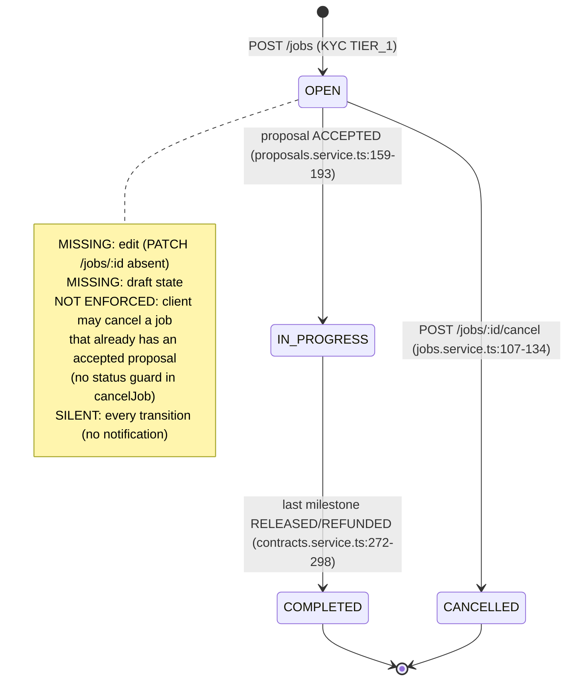

### C.2 Proposal
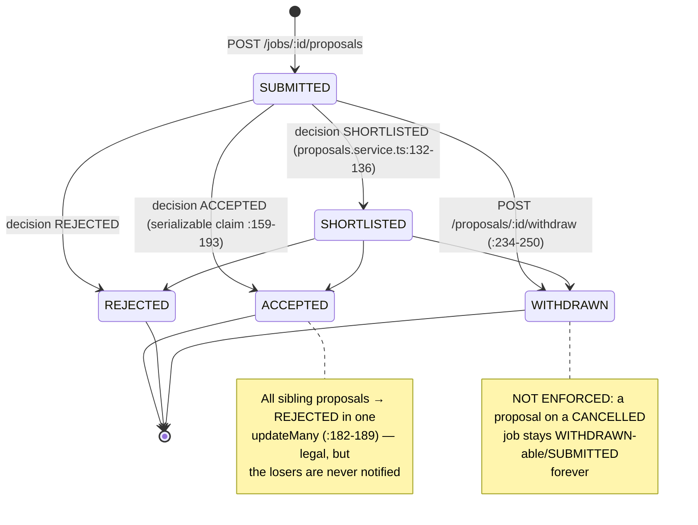

### C.3 Contract
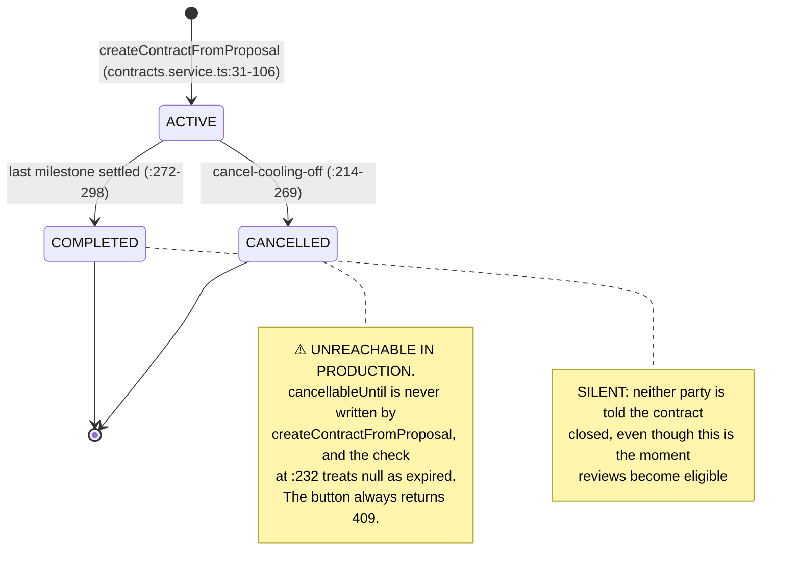

### C.4 Milestone / Escrow
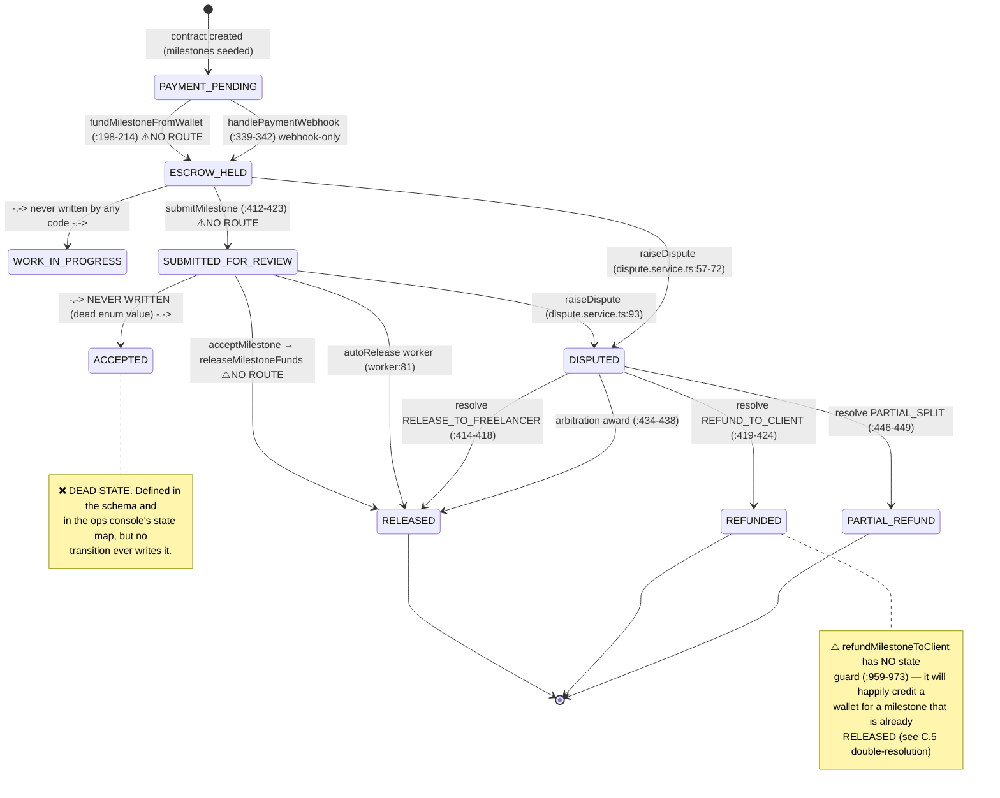

### C.5 Dispute
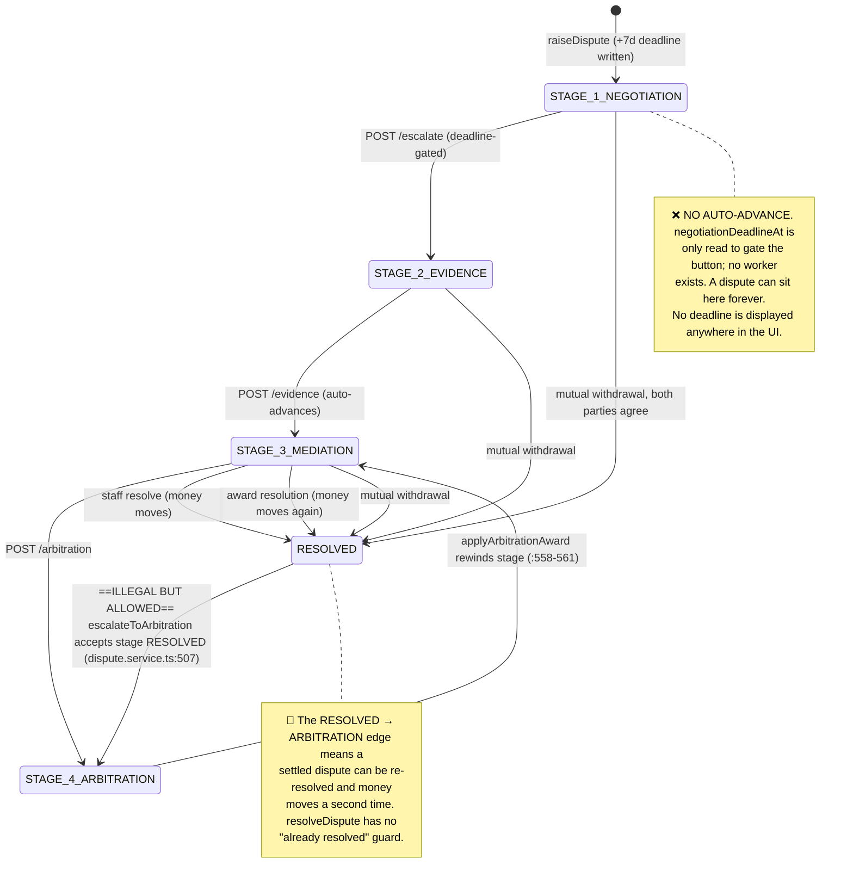

### C.6 Wallet top-up
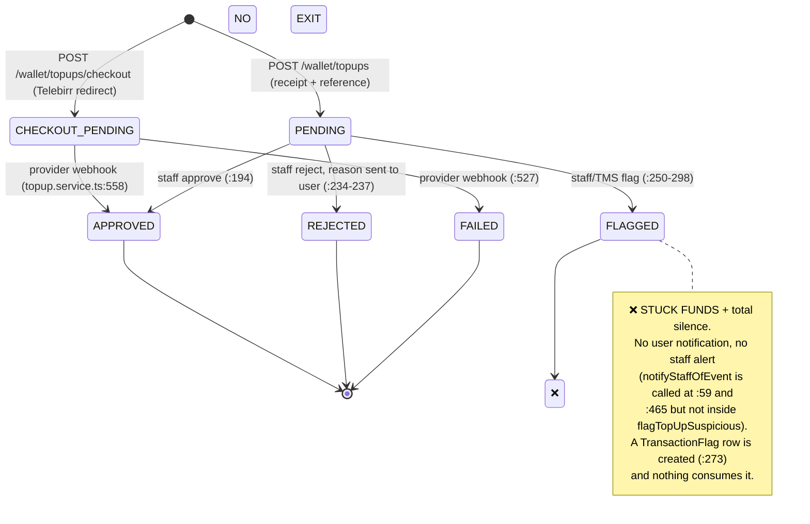

### C.7 Payout / withdrawal
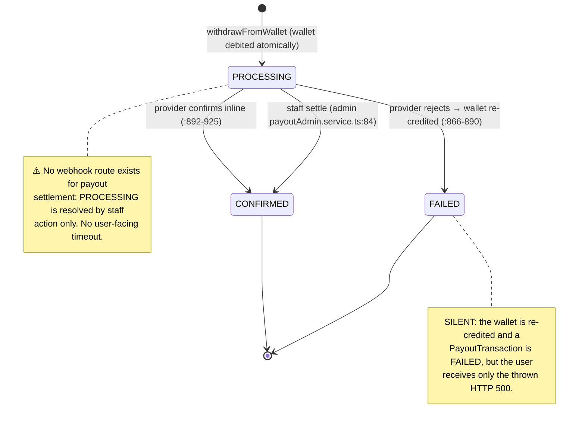

### C.8 Gig
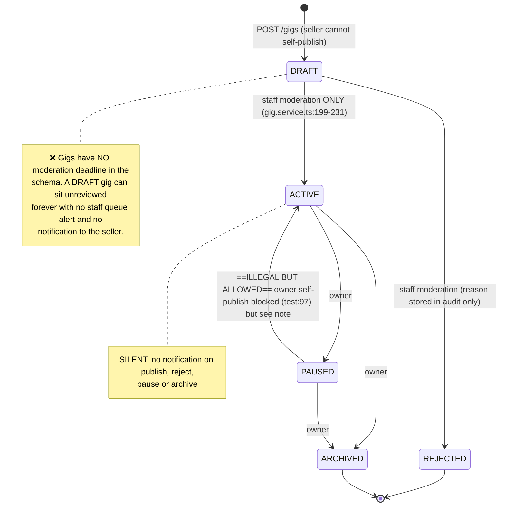

### C.9 Gig order
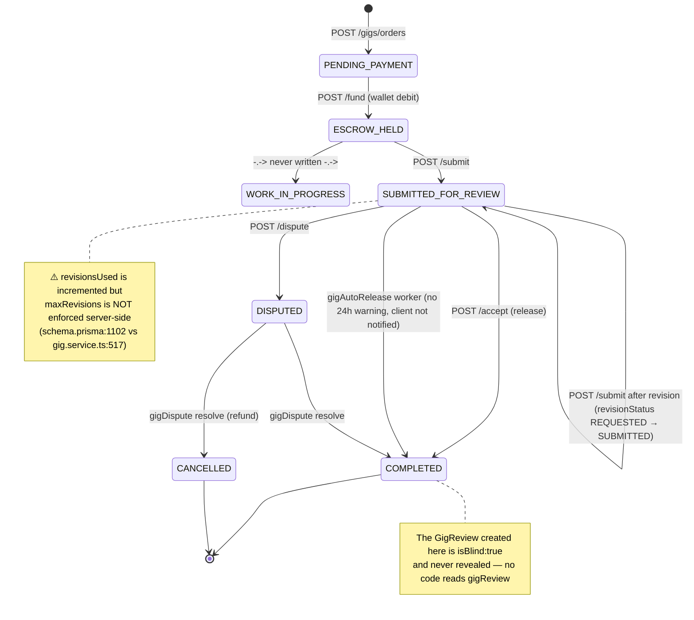

### C.10 Review (contract)
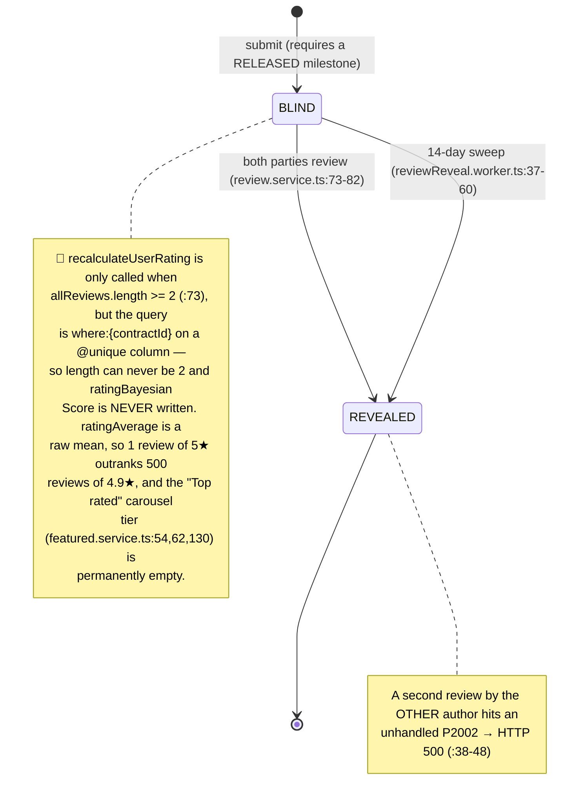

### C.11 KYC
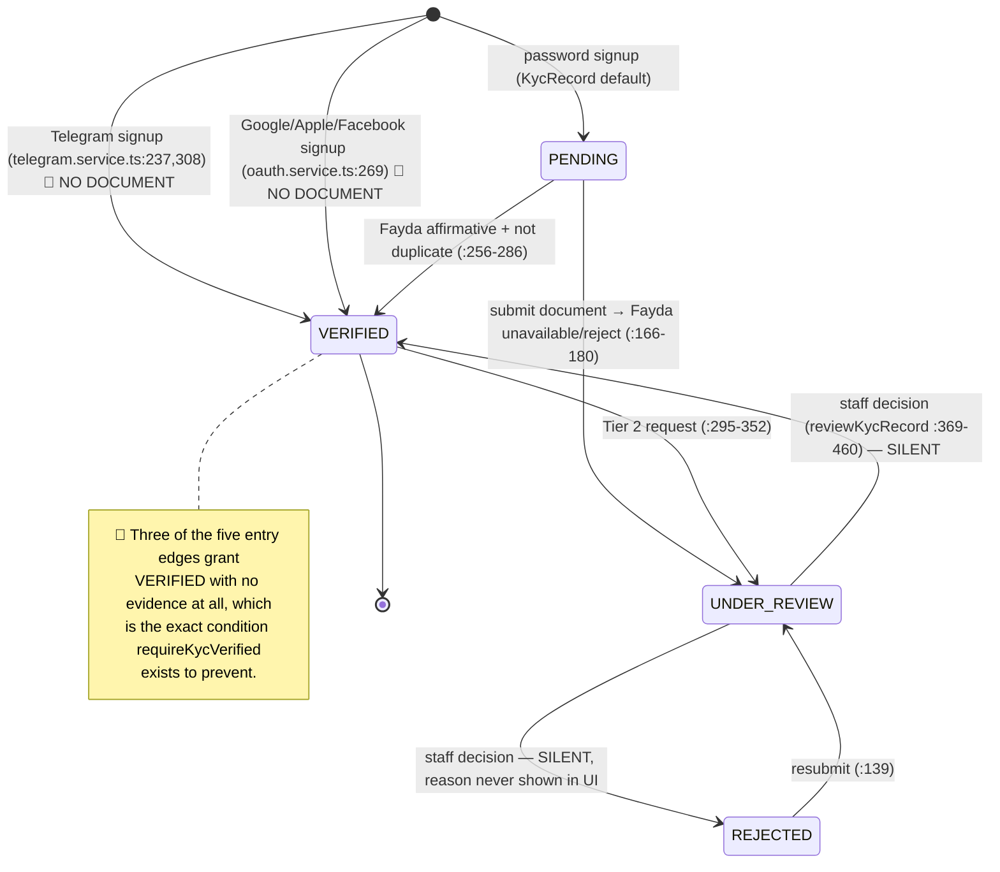

---

## D. Findings

Severity: **P0** money or security · **P1** broken or confusing flow · **P2** polish.

### F-01 · P0 · Unauthenticated account takeover via the guest-support token
**Evidence:** `apps/backend/src/modules/chat/chat.service.ts:38-50` (`upsert({ where: { email }, update: {} })`), `apps/backend/src/modules/chat/chat.routes.ts:118-123` (returns `accessToken`), `apps/backend/src/modules/chat/guestSupportToken.ts:24,47-55` (signed with `JWT_ACCESS_SECRET`, HS256, 12 h), `apps/backend/src/middleware/auth.ts:118-168` (`requireAuth` verifies with the same secret and never inspects `typ`).
**Trigger:** calling the guest intake endpoint with a victim's email address used to return a working session token for that account, which `requireAuth` then accepted platform-wide. The full request/response sequence is deliberately not reproduced here; the regression test asserts the behaviour and fails if it returns.
**Regression test:** `apps/backend/tests/guest-token-isolation.test.ts` — asserts the guest token is rejected by `/auth/me`, that the intake response is indistinguishable for a new and an existing address (no account enumeration), and that the creator is a synthetic `guest+<hex>@guest.invalid` identity rather than the victim's account.
**Impact:** any person who knows a victim's email gets a full session as that user — post jobs, submit and **accept** proposals, buy and fund gigs, read every contract and message. Staff *write* routes survive because `requireStaffRole` reads the (absent) claim, but all user data and all user-level money actions do not.
**Fix:** in `requireAuth` reject `isGuestSupportToken(payload)`; in `createGuestConversation` never upsert on an existing email — create a standalone `GuestContact` row and never mint a token whose `sub` is a real `User.id`.
**Effort:** S (two guards).

### F-02 · P0 · Every federated signup starts life `KYC VERIFIED` with no document
**Evidence:** `apps/backend/src/modules/auth/telegram.service.ts:237`, `:308`; `apps/backend/src/modules/auth/oauth.service.ts:269` — all `kyc: { create: { tier: "TIER_1", status: "VERIFIED" } }`.
**Trigger:** sign up with a Telegram account (or Google/Apple/Facebook), then `POST /jobs`, `POST /gigs`, `POST /gigs/orders`.
**Impact:** every `requireKycVerified` gate (`jobs.routes.ts:77,219`; `gig.routes.ts:127,153,252,276`) is satisfied by an empty record. Tier 2 is still required to withdraw, but the entire identity/AML premise for hiring and selling is bypassed by the cheapest sign-up path — which is also the path most first-time mobile users take.
**Fix:** federated signup creates `status: "PENDING"` and runs the same Fayda/queue flow as password signup.
**Effort:** S.

### F-03 · P0 · The whole contract money flow has no HTTP routes
**Evidence:** `apps/backend/src/modules/escrow/escrow.routes.ts` is 137 lines and registers exactly two routes — `GET /wallet` (`:30`) and `POST /wallet/withdraw` (`:111`). It imports `fundMilestone`, `fundMilestoneFromWallet`, `submitMilestone`, `acceptMilestone` (`:10-13`) and uses none of them. The frontend calls five endpoints that do not exist: `apps/frontend/src/api/client.ts:1241` (`GET /escrow/milestones`), `:1245` (`POST /escrow/fund`), `:1252` (`POST /escrow/fund-from-wallet`), `:1259` (`POST /escrow/milestones/:id/submit`), `:1265` (`POST /escrow/milestones/:id/accept`). Confirmed absent from the committed inventory `docs/hardening/route-baseline.json`.
**Trigger (live):** all five returned `404 {"error":"NOT_FOUND"}` after a real job → proposal → accept → both-signatures contract with two milestones.
**Impact:** **P0, product-blocking.** A client cannot fund escrow, a freelancer cannot submit work, a client cannot release payment. Neither the bidding journey nor its notification chain is reachable. The service functions are correct and well tested — they are simply not exposed. The consequence is also a lie in the UI: `GET /escrow/milestones` throws, the array stays empty, and the user is told "No milestones yet" about a contract that has two.
**Fix:** add the five routes with `requireAuth` + party checks + `FundEscrowInput` (the schema already exists and is unused: `packages/schemas/src/index.ts:182-187`), or delete the five frontend calls and the three UI actions. Ship one or the other, never both halves.
**Effort:** M.

### F-04 · P0 · A dispute can be resolved twice, moving money twice
**Evidence:** `apps/backend/src/modules/disputes/dispute.service.ts:507` — `escalateToArbitration` accepts `stage === "RESOLVED"`; `:552-561` — `applyArbitrationAward` rewinds the stage to `STAGE_3_MEDIATION`; `:384-497` — `resolveDispute` has **no** guard on `resolutionOutcome`/`resolvedAt` and moves money at `:414`, `:420`, `:434`, `:441`.
**Trigger:** raise → staff resolves `REFUND_TO_CLIENT` (client wallet credited, milestone `REFUNDED`) → either party calls `POST /disputes/:id/arbitration` → staff applies an award with the same outcome → `refundMilestoneToClient` runs again (`apps/backend/src/modules/escrow/escrow.service.ts:959-973`, which itself has **no escrow-state guard**) → the client is credited a second time.
**Fix:** reject transitions out of `RESOLVED`; add `if (dispute.stage === "RESOLVED" || dispute.resolvedAt) throw` at the top of `resolveDispute`; make `refundMilestoneToClient` conditional on `escrowState ∈ {DISPUTED, SUBMITTED_FOR_REVIEW, ESCROW_HELD}` via `updateMany`.
**Effort:** S.

### F-05 · P0 · Arbitration `PARTIAL_SPLIT` without a share pays nobody — the escrow money vanishes
**Evidence:** `apps/backend/src/modules/disputes/dispute.routes.ts:254-263` defines `ArbitrationAwardInput` with `freelancerShareMinor: ...optional()` and **no** `.refine`, unlike the shared schema which requires it (`packages/schemas/src/index.ts:333-335`). In `apps/backend/src/modules/disputes/dispute.service.ts:426-449`: `freelancerShare = undefined!`; `undefined > amount` is false; `clientShare = amount - undefined` is `NaN`; `NaN > 0` is false; `freelancerShare > 0` is false → neither party is paid, and the milestone is set to `PARTIAL_REFUND` anyway (`:446-449`).
**Trigger:** staff `POST /disputes/:id/arbitration-award {"awardReferenceNumber":"AACCSA-1","outcome":"PARTIAL_SPLIT","recommendation":"split the difference"}`.
**Fix:** reuse `MediatorResolutionInput`'s refine in `ArbitrationAwardInput`; add a service-side assertion `if (!Number.isInteger(freelancerShare)) throw`.
**Effort:** S.

### F-06 · P0 · Wallet funding can double-charge (state and balance checked outside the transaction)
**Evidence:** `apps/backend/src/modules/escrow/escrow.service.ts:158-196` reads the milestone and the wallet and compares balance **outside** any transaction, then `:198-214` opens a transaction whose `wallet.update` (`:199-202`) is an unconditional `decrement` and whose `milestone.update` (`:203-206`) is an unconditional state write.
**Trigger:** two concurrent `POST /escrow/fund-from-wallet` for the same milestone (double-tap, two tabs, retry). Both pass the `PAYMENT_PENDING` check, both decrement → the client is charged twice and the ledger double-posts.
**Contrast:** the same file gets this right for withdrawals (`:791-794`) and for releases (`:636-647`).
**Fix:** move the read + state check inside the transaction and make the debit conditional (`updateMany … balanceMinor: { gte }`) plus a state-conditional milestone claim; treat `count === 0` as a 409.
**Effort:** M.

### F-07 · P0 · Gig order funding can overdraw the wallet
**Evidence:** `apps/backend/src/modules/gigs/gig.service.ts:422` `if (!wallet || wallet.balanceMinor < fees.clientTotalChargeMinor)` then `:428-441` an unconditional `decrement`. Unbounded: `POST /gigs/orders/:orderId/fund` has **no rate limiter** (`apps/backend/src/modules/gigs/gig.routes.ts:273-290`).
**Trigger:** N concurrent fund calls (or simply repeating the request) can drive the balance negative.
**Fix:** conditional `updateMany` decrement inside a transaction, exactly as `escrow.service.ts:791-794`; add a per-user rate limit on this route.
**Effort:** S.

### F-08 · P0 · The anti-circumvention middleware is mounted on zero routes
**Evidence:** `apps/backend/src/middleware/circumvention.middleware.ts:157` defines `antiCircumventionMiddleware`; a repo-wide search finds it imported **only by its own unit test** (`apps/backend/tests/circumvention.middleware.test.ts:6,82,105`). Only the helper `sanitizeContactInfo` (`:114`) is used, and only in three places: `profiles/profile.service.ts:159` (bio), `reviews/review.service.ts:45,156` (comment, response).
**Not covered:** proposal cover letters, job titles/descriptions, gig titles/descriptions/tags/FAQ, all chat and support messages, dispute descriptions, dispute evidence, gig revision notes, portfolio URLs.
**Trigger:** any user posts a phone number in a cover letter; escrow protection is voided off-platform and nothing detects it. `User.circumventionAlertCount` (`schema.prisma:202`) has no writer and no reader, so there is no escalation ladder.
**Fix:** apply the middleware to every UGC write route; write the alert count; surface attempts in the staff queue.
**Effort:** M.

### F-09 · P0 · Releasing payment has no confirmation, no fee preview, no receipt, no notification
**Evidence:** `apps/frontend/src/WorkflowWorkspace.tsx:821-833` fires `api.acceptMilestone` (`:826`) directly from a row button — no confirm, no dialog. `apps/frontend/src/modules/../modules/escrow/escrow.service.ts:460-494` credits the freelancer's wallet inside `releaseMilestoneFunds` (`:649-652`) and then only writes an audit event (`:486-491`) — **no notification at all**. The Mini App by contrast has a `confirm()` (`apps/frontend/src/App.tsx:777-782`).
**Trigger:** one tap on the milestone row releases the money. The freelancer's wallet grows silently; the client gets no receipt; there is no fee/tax breakdown anywhere (the fee model exists at `apps/backend/src/modules/escrow/fees.ts:21-53` and is never surfaced).
**Related, same principle:** withdraw (`BrowserWallet.tsx:182-234`), fund (`WorkflowWorkspace.tsx:774-788`), buy gig (`GigMarketplace.tsx:61-77`), escalate to arbitration (`WorkflowWorkspace.tsx:1041-1052`), accept proposal which auto-signs a contract (`WorkflowWorkspace.tsx:237-249`) — all fire-and-forget.
**Fix:** a shared confirm dialog that shows gross, platform fee, withholding, net and the resulting balances; a persistent receipt row with the ledger journal id; notify the payee.
**Effort:** M.

### F-10 · P0 · `PARTIAL_SPLIT` credits a wallet with no ledger entry and no fee accrual
**Evidence:** `apps/backend/src/modules/disputes/dispute.service.ts:440-445` — a bare `prisma.wallet.update({ increment: clientShare })`. No `recordDisputeRefundLedger`, no `recordPlatformEarnings`, no audit event, no notification. Compare the full-refund path `escrow.service.ts:959-973`, which at least posts a ledger.
**Impact:** money appears in a user wallet with no traceable source; platform fee revenue and VAT-threshold accounting under-report; the "traceable in a ledger" principle fails exactly where a dispute was split.
**Fix:** route the client share through `refundMilestoneToClient`-style ledger posting and accrue the platform fee.
**Effort:** S.

### F-11 · P1 · Twenty-four business events change state and notify nobody
**Evidence (representative):**
- Milestone accepted → freelancer credited silently: `escrow.service.ts:477-491`.
- Refund to client: `escrow.service.ts:954-980` — wallet increment, ledger, contract completion, **no notification, no audit**.
- Contract completed: `contracts.service.ts:272-298` — audit only; this is when reviews unlock.
- **KYC VERIFIED / REJECTED**: `kyc.service.ts:369-460` flips status, writes a review event and an audit — and sends nothing. The `notifyStaffOfEvent` calls live at `:139,189,240,351,685`, none inside `reviewKycRecord`. The unreachable `kyc-verified` email title (`notifications/notification.service.ts:46`) shows this was planned and never wired.
- **Top-up FLAGGED**: `topup.service.ts:250-298` sets `FLAGGED` and creates a `TransactionFlag` (`:273`) — the function's own `notifyStaffOfEvent` calls are at `:59` and `:465`, not here. A user whose money is frozen for suspected fraud is told nothing, and the TMS bell does not ring.
- Gig moderation publish/reject: `gig.service.ts:199-231` — seller waits blind, rejection reason goes only to the audit log.
- Gig auto-release: `queue/gigAutoRelease.worker.ts:91-92` notifies the **freelancer only**; the client whose money left without approval is never told, and gigs get no 24 h warning (`gig.service.ts:491-498` schedules only `"release"`, vs `escrow.service.ts:425,433` which schedules both).
- Withdrawal failure / held for review: `escrow.service.ts:866-890`, `:730-754` — the user only sees a thrown HTTP 500 or a 202 with no follow-up.
- Jobs/proposals/contracts: posted, cancelled, shortlisted, auto-rejected, withdrawn, created, first-signed, cancelled — all silent.
- Reviews: submitted, revealed (both paths), responded, disputed — all silent.
**Fix:** a single `emitMoneyMoved`/`emitDecision` helper called from every state change that writes an in-app row + Telegram + email, with the amount and outcome in the text (today every resolution message is literally `"Your dispute has been resolved."` — `dispute.service.ts:483,488`).
**Effort:** L.

### F-12 · P1 · Amharic support is effectively zero and there is no language switch
**Evidence:** `apps/frontend/src/i18n.ts:5` exports a complete 113-key en/am dictionary that **no file imports**. ~730 lines of hardcoded English across the frontend (e.g. `WorkflowWorkspace.tsx:618`, `BrowserWallet.tsx:190,204,209`, `NotificationCenter.tsx:101`). The only "EN / አማ" control in the footer is a `<button>` with no handler (`MarketingFooter.tsx:110`). `languagePreference` is returned by `/auth/me` (`auth.routes.ts:572`) but **cannot be changed**: the profile schema has no such field (`profiles/profile.validation.ts:4-21`) and no endpoint exists. In the bot, `/language` sets the Redis session only (`bot/handlers/callbacks.ts:115-125`) while the Settings path does persist (`:344-352`) — so the behaviour depends on how the user got there.
**Bot:** `bot/middleware/i18n.middleware.ts:30` falls back to returning the raw key, and **78 referenced keys are missing** from both locale files across **92 call sites** — users see strings like `jobs_budget_under_10k`. Outbound push notifications use an **identity** `t` function (`bot/handlers/notifications.ts:62`), so every push body is a literal key name. `am.json` is missing 3 keys present in `en.json` (`:51 contract_list_prompt`, `:153`, `:154`).
**Fix:** adopt `i18n.ts` as the single dictionary with a `t()` hook; add `PATCH /me/preferences {languagePreference}` and a header switcher; fill the 78 bot keys; fix `bot/handlers/notifications.ts:62`.
**Effort:** L.

### F-13 · P1 · ETB formatting drops cents and there is no timezone handling
**Evidence:** the two primary formatters use zero decimals — `apps/frontend/src/WorkflowWorkspace.tsx:40` and `apps/frontend/src/FullPlatformApp.tsx:207` (`ETB ${(minor/100).toLocaleString()}`), as does the entire ops console (`apps/frontend/src/pages/ops/opsApi.ts:1153`). Only 7 formatters force 2 decimals (`GigMarketplace.tsx:18`, `GigSellerDashboard.tsx:67`, `opsApi.ts:1154`, `opsExport.ts:40`, `bot/handlers/commands.ts:281`, `topup.service.ts:529,560`, `email.service.ts:198`). A withdrawal of ETB 1,250.75 displays as **"ETB 1,251"** in the ops console and the wallet. Emails hardcode `en-US` (`email.service.ts:198,205`). **No `timeZone` is passed to any `Intl`/`toLocale*` call anywhere in the repo** — every timestamp renders in the browser's local zone; `Africa/Addis_Ababa` appears only in comments (`queue/withholdingRemittance.worker.ts:11,103`). Raw de-underscored enums reach the user at `FullPlatformApp.tsx:2024,2159,2185`, `WorkflowWorkspace.tsx:767`, `App.tsx:2339`, `BrowserVerification.tsx:175`, and `item.provider` prints as `CBE_BIRR` (`BrowserWallet.tsx:815`).
**Fix:** one `formatEtb(minor)` using `Intl.NumberFormat("am-ET", { style:"currency", currency:"ETB" })` and one `formatDate` pinned to `Africa/Addis_Ababa`; a status-label dictionary for all nine enums.
**Effort:** M.

### F-14 · P1 · No frontend tests, no E2E, and the linkage test cannot catch a dead route
**Evidence:** `apps/frontend/package.json:6-11` has no `test` script. 27 backend test files, 248 `it()` blocks, zero of them execute a browser or compare the frontend to the backend. `apps/backend/tests/api-linkage.test.ts:12-19` stubs `global.fetch` and asserts only the URL the frontend *emits* — so it still "passes" for `/api/v1/escrow/fund` and `/api/v1/portfolios`, both of which do not exist. `apps/backend/tests/simulated-negotiations-and-disputes.test.ts:266,327,413,499` call `fundMilestoneFromWallet` **directly**, which is why F-03 was invisible. Only **two** assertions in the whole repo check a wallet balance, and the release one is `toBeGreaterThan` (`:291`), so crediting ETB 0.01 instead of the correct net would still pass. `cooling-off.test.ts` creates contracts by hand with `cancellableUntil` set (`:86,131,174,208`), which is why the never-written field in F-15 was invisible. `route-audit.test.ts:247` asserts `expect(Array.isArray(differences)).toBe(true)` — vacuously true for any array.
**Fix:** see §G.
**Effort:** L.

### F-15 · P1 · The statutory cooling-off cancellation can never be used
**Evidence:** `apps/backend/src/modules/contracts/contracts.service.ts:31-106` `createContractFromProposal` **never writes `cancellableUntil`**; a repo-wide search shows only reads (`contracts.service.ts:232`, `queue/autoRelease.worker.ts:56-57`, `admin/usersContracts.service.ts:160,227`). The check at `:232` is `if (!contract.cancellableUntil || contract.cancellableUntil <= new Date())` → always throws. Live: the contract created in my walkthrough came back with `cancellableUntil` empty. `COOLING_OFF_HOURS` (`apps/backend/src/config/env.ts:184`, default **24**) is defined and referenced **nowhere**.
**Three different cooling-off numbers ship simultaneously:** 24 h (env default), 7 days (`schema.prisma:425-431` comment), and the user-facing "7-day statutory cooling-off right (ECA Proclamation No. 1205/2020)" (`WorkflowWorkspace.tsx:717,720-723`).
**Impact:** the product's one properly-designed confirmation dialog always ends in a 409. It also means the auto-release guard at `autoRelease.worker.ts:54-60`, which exists to protect the cooling-off right, is protecting a right that cannot be exercised.
**Fix:** set `cancellableUntil: new Date(Date.now() + COOLING_OFF_HOURS*3600*1000)` in `createContractFromProposal` (and set the env default to 168 h to match the copy).
**Effort:** S.

### F-16 · P1 · A special character in a job title permanently wedges the contract
**Evidence:** `apps/backend/src/modules/contracts/serviceAgreement.template.ts:39` uses `StandardFonts.Helvetica` (WinAnsi), which throws on emoji, CJK, Ethiopic and some curly quotes. `:130-131` draws `jobTitle` and `jobDescription` **raw**, with no escaping and no length cap. `generateServiceAgreementPdf` is awaited at `apps/backend/src/modules/contracts/contracts.service.ts:53-66`, inside `createContractFromProposal`, which is called from `apps/backend/src/modules/jobs/proposals.service.ts:218` — **after** the accept transaction has already committed the proposal to `ACCEPTED` and the job to `IN_PROGRESS` (`:159-193`).
**Trigger:** post a job titled `🚀 Rocket site`, get a proposal accepted → the request 500s, no contract exists, and because the accept path guards on `status: "OPEN"` the job can never be accepted again. Escrow money would be stuck if funding existed (F-03).
**Fix:** normalise text to WinAnsi before drawing (or embed a Unicode font), and generate the PDF **before** the accept transaction or in a retryable outbox.
**Effort:** M.

### F-17 · P1 · Mass assignment on portfolio items
**Evidence:** `apps/backend/src/modules/portfolio/portfolio.routes.ts:39-57` passes **raw `req.body`** (no zod) to `updatePortfolioItem`, which hands the whole object to Prisma at `apps/backend/src/modules/portfolio/portfolio.service.ts:40-43`. The ownership check at `:38` protects the *item*, not the *fields*.
**Trigger:** `PATCH /api/v1/portfolio/me/:itemId {"userId":"<any user id>"}` transfers the item to another account; `{"id":"..."}` rewrites the primary key. (`POST /portfolio/me`, `portfolio.service.ts:21-27`, is narrower but still lets `displayOrder`/`createdAt` be set.)
**Fix:** add a zod schema for both verbs and rebuild the update object field-by-field, as `profiles/profile.service.ts:183-198` correctly does.
**Effort:** S.

### F-18 · P1 · Gig reviews and the Bayesian rating control are both dead
**Evidence:** `createGigReview` sets `isBlind: true` (`apps/backend/src/modules/gigs/gig.service.ts:653`) and nothing ever reveals it — `queue/reviewReveal.worker.ts` queries `prisma.review`, never `prisma.gigReview`, and `gigReview` has no reader anywhere. `Gig.ratingAverage` is never written, yet public search sorts on it (`gig.service.ts:175`) — a constant sort key. For contract reviews, `recalculateUserRating` is called only when `allReviews.length >= 2` (`reviews/review.service.ts:73`), but the query filters `where: { contractId }` on a `@unique` column (`schema.prisma:794`) so the count can never be 2; `ratingBayesianScore` is therefore written **only** at `review.service.ts:112`, which is unreachable. The live path (`queue/reviewReveal.worker.ts:47-58`) sets `ratingAverage` to a raw mean. `featured.service.ts:54,62,130` filter and sort by `ratingBayesianScore`, which defaults to 0 — so the "Top rated" carousel tier is permanently empty. The schema comment at `schema.prisma:228` ("Bayesian average, not raw mean") is false.
**Impact:** one 5★ review outranks 500 reviews at 4.9★; the review system cannot be gamed because it is not functioning.
**Fix:** run the recalculation unconditionally (or from the reveal worker), write `ratingBayesianScore` there, add a `gigReview` branch to the reveal worker and write `Gig.ratingAverage`/`ratingCount`.
**Effort:** M.

### F-19 · P1 · Nothing is rate-limited where spam or money is at stake
**Evidence:** `apps/backend/src/lib/rateLimit.ts:47,72` exports `consumeRateLimit`/`rateLimit` that **no route file imports** (dead code). Live limiters exist only for auth and chat intake (`auth.routes.ts:50-81`, `chat.routes.ts:44-65`). `apps/backend/src/modules/jobs/jobs.routes.ts` imports no limiter: `POST /jobs` (`:74-99`), `POST /jobs/:id/proposals` (`:216-244`), `POST /jobs/:id/proposals/upload` (`:182-214`). `apps/backend/src/modules/gigs/gig.routes.ts`: `POST /gigs` (`:124-148`), `POST /gigs/orders` (`:249-271`), **`POST /gigs/orders/:id/fund`** (`:273-290`), `POST /gigs/orders/:id/accept` (`:340-356`), `/review` (`:358-380`), `/dispute` (`:417-449`). Also unlimited: chat send (`chat.routes.ts:188-213`), dispute raise (`dispute.routes.ts:101-119`), reviews (`review.routes.ts:22-45`), KYC submit.
**Impact:** fake-job flooding, proposal spam, gig-order spam that reaches a wallet debit, review spam. Only the global 2000/15 min ceiling (`app.ts:71-83`) applies, and it is per IP.
**Fix:** reuse the existing limiter factory on every create/money route, keyed on user id rather than IP.
**Effort:** S.

### F-20 · P1 · Silent state changes that strand users in dead ends
**Evidence:** the notifications matrix in F-11 plus: no dispute deadline is displayed (`WorkflowWorkspace.tsx:978-984` shows only the negotiation end, and only in Stage 1) although `negotiationDeadlineAt`/`mediationDeadlineAt` are written (`dispute.service.ts:88,206`); no worker advances a stage, so the deadlines are decorative. Cancelling a job notifies nobody (`jobs.service.ts:107-134`) and leaves every bidder with a live-looking proposal. Registration returns no session (`auth.routes.ts:92`), so a first-time user must log in again immediately. `POST /jobs` before KYC returns `KYC_NOT_VERIFIED` with no link or next step (live-verified). Tier 2 rejection (`escrow.routes.ts` via `requireKycVerified("TIER_2")`) returns "This action requires TIER_2, current tier is TIER_1." with no explanation of what Tier 2 requires or that it is the difference between 30 % and 3 % withholding (live-verified).
**Fix:** every empty/blocked state needs a next action; put the required next step in the error payload and render it.
**Effort:** M.

### F-21 · P1 · Frontend calls eight endpoints the backend does not expose
**Evidence** (frontend → backend):
| Frontend call | Backend reality |
|---|---|
| `client.ts:1356,1361,1366,1369` `/api/v1/portfolios…` | router mounts `/api/v1/portfolio` with `/users/:userId/portfolio`, `/me`, `/me/:itemId` (`portfolio.routes.ts:15,26,39,59`) — **plural path never existed** |
| `client.ts:1119` `/api/v1/kyc/freelancer-fayda-selfie` | not found |
| `client.ts:1523,1526,1529` `/api/v1/admin/escrows/:id/release|hold|unhold` | only `GET /api/v1/admin/escrows` exists |
| `client.ts:1450,1453` `/api/v1/admin/gigs…` | not found (gig moderation lives at `/api/v1/gigs/:gigId/moderation`) |
| `client.ts:1442` `/api/v1/admin/staff/:userId/status` | only `/role` exists (`admin.routes.ts`) |
| `client.ts:1241-1265` the five escrow routes | see F-03 |
Plus `POST /api/v1/wallet/topups/checkout/:topUpId/simulate-success` exists in the committed baseline (`route-baseline.json`) — a dev simulate endpoint that must be proven unreachable in production.
**Fix:** generate the frontend client and the route baseline from one source of truth and fail CI on drift.
**Effort:** M.

### F-22 · P1 · `BOTH` users bypass the active-contract withdrawal block
**Evidence:** `apps/backend/src/modules/escrow/escrow.service.ts:715` — the whole block that refuses withdrawals while milestones are in flight (`:716-734`) or a dispute is open (`:736-747`) is inside `if (user.role === "CLIENT")`.
**Trigger:** register as `BOTH`, accept a contract, fund it (once F-03 is fixed), then withdraw the unspent balance while the contract is live — or withdraw mid-dispute.
**Fix:** drop the role check, or gate on "has any contract as either party".
**Effort:** S.

### F-23 · P1 · Notification deep links lose their target, and the bell is stale
**Evidence:** `apps/backend/src/queue/notification.worker.ts:22` destructures `{ userId, message, ...metadata }`, but six emit sites pass a **nested** `metadata` key instead of spreading — `proposals.service.ts:63,145,203`, `contracts.service.ts:170,178`, `chat.service.ts:530` — so the stored JSON is `{type, metadata:{jobId…}}` while `apps/frontend/src/api/notificationTargets.ts:156-167` reads top-level keys. `focusId` is always `undefined`. (Staff alerts do it correctly: `lib/staffAlerts.ts:39-43`.) The client subscribes to **9 of 36** socket events (`NotificationCenter.tsx:39-48`); the ops bell has no socket subscription and no polling (`pages/ops/components/NotificationBell.tsx:36-52`), so a `kyc-pending-review` or `tms-flag-raised` alert is invisible until a manual reload. `dispute-mutual-withdrawal-confirmed` is a target with no emitter (`notificationTargets.ts:90`). The socket push happens **before** the DB insert (`queue/notification.worker.ts:32` vs `notification.service.ts:84`), so the refetch can miss the row.
**Fix:** spread metadata at every call site; subscribe to all types; poll for staff; insert before pushing.
**Effort:** S.

### F-24 · P1 · Notification preferences are stored, never read, and have no endpoint
**Evidence:** `User.notificationSettings Json?` (`schema.prisma:285`) is read in exactly one place — `apps/backend/src/modules/bot/handlers/notifications.ts:44-57` — and that file's `sendNotification` has no live caller, so the read is dead. It is never written to the DB: the bot writes `ctx.session.notificationSettings` (Redis) at `bot/handlers/callbacks.ts:389` and `bot/utils/sessionStorage.ts:23`. There is **no preferences route** — `apps/backend/src/modules/notifications/notification.routes.ts` has only list, mark-read and read-all. The live pipeline `processNotification` (`notification.service.ts:69-132`) consults nothing but `CRITICAL_NOTIFICATION_TYPES` (`:93`). A user who disables disputes in the bot still receives every dispute by in-app, email, Telegram and SMS. Every chat message also generates an in-app row + an **email** + a Telegram DM (`chat.service.ts:530`) — unbundled and unbounded.
**Fix:** add `GET/PATCH /me/notifications`, honour it in `processNotification`, and stop emailing routine chat messages.
**Effort:** M.

### F-25 · P1 · The Telegram web sign-in deep link renders no form
**Evidence:** `apps/frontend/src/pages/TelegramAuthPage.tsx` is the component the bot's `tg_code` flow points at (`bot/utils/deepLink.ts`, `FullPlatformApp.tsx:457-459,981-991`). Live screenshot `docs/hardening/screens/mobile-telegram-auth-390.png`: at 390 px the URL `/auth/telegram` renders the marketing header, the footer (Platform/Company/Legal/Social) and the cookie banner, with **no visible sign-in form** between them. The same screenshot shows the footer overflow clipping "Telegram Channe…" at the right edge, the header and footer logos overlapping, and a clipped floating control bottom-left.
**Fix:** render the auth card above the marketing footer for `telegram_auth`, and verify at 390 px.
**Effort:** S.

### F-26 · P1 · Mobile layout defects at 390 px
**Evidence + screenshots:** `docs/hardening/screens/mobile-landing-390.png` (clipping, see below), `mobile-telegram-auth-390.png`, against `desktop-landing-1280.png` which renders correctly.
- **Hero headline is clipped, not scrollable.** `FIND THE RIGHT EXPERTISE.` renders as "FIND THE RIGHT EXPERT" cut at the viewport edge. Cause: `white-space: nowrap` on hero words (`apps/frontend/src/landing-v2.css:405`) with `overflow-x: clip` on the root (`:167`). A longer Amharic headline would be worse.
- **Cookie banner is clipped** and its "Accept all" button is cut off; the body text truncates mid-sentence. It is also the first thing a new mobile visitor sees, over the hero.
- **Bottom nav horizontally scrolls with no affordance.** `apps/frontend/src/index.css:1562-1563` sets `overflow-x:auto` with `min-width:66px` per item, but a `BOTH` user has up to 10 nav items (`FullPlatformApp.tsx:861-891`) ≈ 660 px inside a 390 px bar.
- **Inline grid styles override the responsive CSS.** `index.css:953` collapses `.payment-grid`, `.form-grid` and `.table-row` to one column below 640 px, but `BrowserWallet.tsx:435,615` (payment rails), `BrowserVerification.tsx:111,187` (name/DOB), `FullPlatformApp.tsx:1134` (phone/DOB), `App.tsx:2435` (payment grid, no class at all) set `gridTemplateColumns` inline and win.
- **Segmented role control is 3 items in a 2-column grid** (`index.css:823` vs `FullPlatformApp.tsx:1091-1112`).
- **Pinch-zoom is disabled** — `apps/frontend/index.html:9` sets `maximum-scale=1.0, user-scalable=no` (WCAG 1.4.4).
- Verification badges are icon-only with no accessible name (`ProfilePage.tsx:149-156`).
**Fix:** remove the nowrap/clip on the hero, make the cookie banner full-width and stack its actions, drop the inline grid styles, and re-measure at 390 px on a real device.
**Effort:** M.

### F-27 · P1 · Errors are shown with a success icon and the app has no global error surface
**Evidence:** `apps/frontend/src/WorkflowWorkspace.tsx:281-286` and `:637-642` render every message with a hard-coded `<Check size={16}/>` — including validation failures and 4xx errors. `DisputesWorkspace` does the same (`:947-952`); `BrowserVerification.tsx:154-158` always shows a check. There is no global toast, no error boundary message and no 401 handling: a failed initial load clears the token and lands on the marketing page with no explanation (`FullPlatformApp.tsx:429-443`).
**Fix:** a typed message model (`{ tone, text }`), an error boundary, and a global "session expired" path.
**Effort:** M.

### F-28 · P2 · Duplicate-submit protection is React state only
**Evidence:** no `Idempotency-Key` header anywhere in `apps/frontend/src/api/client.ts` and no idempotency check on any route; `LedgerJournal.idempotencyKey` exists (`schema.prisma:1222`) but replay is never tested (`apps/backend/tests/ledger.service.test.ts` passes the key and never replays it). In-flight `disabled` flags are widespread and mostly correct (`WorkflowWorkspace.tsx:565`, `BrowserWallet.tsx:37`, `GigMarketplace.tsx:34`), but **GigSellerDashboard pause/archive have no flag at all** (`:628-642`). The one genuinely safe duplicate is proposal acceptance (`proposals.service.ts:159-193`, serializable claim) and the telegram login code (`tests/telegram-bot-auth.test.ts:135-148`).
**Fix:** send an `Idempotency-Key` on every money POST and record it; add the missing busy flags.
**Effort:** M.

### F-29 · P2 · File uploads accept any type and trust the declared MIME
**Evidence:** five multer configs, all `memoryStorage()` with **no `fileFilter`**: `chat.routes.ts:67-70` (15 MB), `kyc.routes.ts:31-34` (8 MB), `topup.routes.ts:31-34` (8 MB), `jobs.routes.ts:177-180` (8 MB). `objectStore.ts:70,94,112,173,213` stores `params.contentType` verbatim, and every caller passes the client-declared `req.file.mimetype` (`chat.routes.ts:230`, `kyc.routes.ts:119`, `topup.routes.ts:91,143`, `jobs.routes.ts:205`). `limits.files`/`parts` are never set, so N concurrent 15 MB uploads are N×15 MB of heap. KYC/topup/proposal keys are user-derived (`objectStore.ts:63,88,106`); the dispute evidence bundle key is `Date.now()` (`:165`) — predictable. Downloads **are** properly authorized (`chat.routes.ts:259-283` with `nosniff`; `kyc.routes.ts:226-227` permission-gated presigned URLs), and `apps/backend/uploads` is **not** statically served (no `express.static` in `app.ts`). Note `getProposalAttachmentUrl` (`objectStore.ts:118-124`) mints an unauthenticated 1-hour presigned URL for any key and **has no callers** — it will be an IDOR the moment someone wires it.
**Fix:** add a `fileFilter` allowlist, sniff magic bytes, cap `parts`, randomise the evidence key, and add authorization to the proposal-attachment URL helper before exposing it.
**Effort:** M.

### F-30 · P2 · Unauthenticated review endpoint leaks internal identifiers
**Evidence:** `apps/backend/src/modules/reviews/review.routes.ts:47-59` has **no `requireAuth`** and returns `getReviewsForUser`, which spreads the whole `Review` row and adds only `authorName` (`reviews/review.service.ts:139`) — so `authorId`, `contractId`, `isDisputed`, `disputeReason` and `disputedByStaffId` (`schema.prisma:773-795`) are public. `limit` comes from the query with no cap (`review.routes.ts:50-51`), so `?limit=100000` is a cheap resource-exhaustion vector.
**Fix:** whitelist the returned fields, cap `limit`, and require auth or restrict to revealed reviews.
**Effort:** S.

### F-31 · P2 · Compliance hold can never be applied
**Evidence:** `User.isComplianceHeld` (`schema.prisma:199`) is read at `escrow.service.ts:750` (the only enforcement point) but the **only writer** is `liftComplianceHold` (`apps/backend/src/modules/tms/tms.service.ts:655-678`), which sets it to `false` (`:663`). Nothing sets it to `true`, and `tms.routes.ts:108-113` exposes only `lift-hold`.
**Impact:** the AML withdrawal freeze advertised by the code cannot engage. Related: `FILING an STR` sets `suspendAccount` optionally (`packages/schemas/src/index.ts:252-259`) but `admin.routes.ts:332-335` on user suspension does **not** bump `sessionVersion` (only the staff routes at `:553,593` do), so ordinary user suspension relies solely on the per-request DB read in `requireAuth` (`auth.ts:139-146`) — which works, but `optionalAuth` routes do not check it (`auth.ts:294-315`), so a suspended user still reads full profiles via `profile.routes.ts:31` and can still read unpublished gigs with a suspended staff token (`gig.routes.ts:108` → `gig.service.ts:270`).
**Fix:** add `POST /tms/users/:userId/hold`, and check `isSuspended` in `optionalAuth`.
**Effort:** S.

### F-32 · P2 · Refresh tokens have no reuse detection
**Evidence:** `apps/backend/src/modules/auth/auth.service.ts:264-320` mints a brand-new `sid` and refresh token on every refresh with nothing recording consumption, so a stolen refresh token replays for its own 30-day lifetime (`:168`) in parallel with the legitimate holder. The bounding controls are good and should be kept: suspension is re-checked (`:296-299`), `sessionVersion` is checked (`:301-303`), absolute session age is 12 h staff / 7 d user (`:305-311`), and `auth_time`/`amr` are carried through so refresh cannot launder a weak factor (`:313-318`).
**Fix:** persist the `sid` and single-use it.
**Effort:** M.

### F-33 · P2 · Miscellaneous product debt
- **No route-level pagination or sorting on the gig marketplace** despite `GigSearchQuery` supporting price range, page and pageSize (`packages/schemas/src/index.ts:394-402`); the UI exposes only a category dropdown.
- **Dead code**: `apps/frontend/src/LandingPage.tsx` (977 lines, imported by nobody — `FullPlatformApp.tsx:13` imports `LandingPageV2`), the `thank-you-*` and `404` marketing pages (`FullPlatformApp.tsx:948-971`, no caller ever sets them), `apps/backend/src/modules/bot/locales/en.ftl` (326 lines, referenced only by a negative assertion in `tests/pre-phase1-audit.test.ts:220`), `apps/backend/src/lib/rateLimit.ts`, `middleware/requireKycVerified.ts` (a duplicate of `hardBlock.ts:16`).
- **`AUTO_RELEASE_WINDOW_DAYS` disagrees with itself**: `apps/backend/.env:…` sets 5, `config/env.ts:214` defaults to 7, `serviceAgreement.template.ts` clause 2.2(b) says seven calendar days.
- **Withdrawal fee 0.5 % is hardcoded** (`escrow.service.ts:811`) while the platform fee is configurable.
- **`en.ftl`, `Yekis_translations.csv`** (219 rows, **zero** Amharic values) are unreferenced artefacts.
- **Hero content is animation-gated**: at 1280 px the desktop capture shows the headline but no sub-headline or CTA, suggesting the `framer-motion`/OGL entrance never resolved under headless capture. Not proven broken on a device, but on a slow connection the hero CTA may be invisible — verify on a real handset.
- Socket reconnect has no jitter (`apps/frontend/src/api/socket.ts:140-141`), so every tab reconnects in lockstep after a restart.

---

## E. Missing features a professional marketplace should have

| Feature | Status | Evidence / note | Value | Effort |
|---|---|---|---|---|
| Job drafts (save & resume posting) | **Absent** | No draft state in `JobStatus` (`schema.prisma:103-108`), no save endpoint | High — mobile users abandon long forms | M |
| Edit a posted job | **Absent** | No `PATCH /jobs/:id` in `route-baseline.json` | High | S |
| Saved jobs & saved searches | **Absent** | No `SavedJob`/`SearchAlert` model | High for freelancers on mobile | M |
| Invite-to-job / invite freelancers to bid | **Absent** | No model | Medium | M |
| Proposal & milestone templates | **Absent** | Free-text only (`schemas/index.ts:167`, `:136-141`) | Medium | S |
| Onboarding checklist / "what to do next" | **Absent** | KYC gate returns a bare 403 (live) | **High** — directly fixes first-time-user dead ends | S |
| Profile completeness nudges | **Partial** | Backend computes `profileCompleteness` and exposes it (`profile.service.ts`), surfaced on the profile page; **no nudges, no gating, no checklist** | High | S |
| Status timeline on contracts | **Absent** | No timeline component; stages shown as raw enums (`WorkflowWorkspace.tsx:767,969`) | **High** — the single biggest clarity gap | M |
| Fee + receipt breakdown before and after payment | **Absent** | `fees.ts:21-53` computes it; nothing renders it | **High** | M |
| Receipts / invoices downloadable by the user | **Partial** | An invoice email is sent on wallet funding (`escrow.service.ts:248`) but is unreachable (F-03), is English-only, and there is **no** receipt screen or document hash (`schema.prisma:422`) | High | M |
| Withdrawal / payout history | **Absent** | `PayoutTransaction` exists (`schema.prisma:1259-1280`) but there is **no user-facing route** — only `/admin/payouts`. `BrowserWallet` shows top-ups only (`:797-886`). | **High** — trust | M |
| Gig order list (buyer and seller) | **Absent** | `GET /gigs/orders` → 404 (live) | **High** | M |
| Dispute SLA display + automatic stage advance | **Absent** | Deadlines written, never displayed or enforced (F-11, C.5) | **High** | M |
| Review reminders / review prompts | **Absent** | No prompt in any UI; no notification (F-11) | High | S |
| Notification preferences | **Absent** | Column + dead read, no endpoint (F-24) | High | M |
| Empty states with a next action | **Partial** | Chat and My-Gigs are good (`ChatWorkspace.tsx:504-526`, `GigSellerDashboard.tsx:534-544`); contracts/disputes/milestones/wallet are weak or misleading (F-03, F-20) | High | S |
| Search filters (price, sort, pagination) on jobs | **Absent** | `JobSearchQuery` supports category/status/page only (`schemas/index.ts:157-163`); no price filter | Medium | M |
| Search filters on gigs | **Partial** | Server supports `q`, `min/maxPriceMinor`, `page`, `pageSize` (`:394-402`); UI exposes category only | High | S |
| Support access from every screen | **Partial** | A floating help affordance and `/chat/guest` exist; no in-app "contact support" inside a contract or dispute | Medium | S |
| Language switching (UI + server-persisted) | **Absent** | F-12 | **High** for the stated audience | M |
| Settings page (language, notifications, security, payment methods, data export) | **Absent** | `FullPlatformApp.tsx:2481-2515` is a stub with no nav entry | High | M |
| Idempotent money endpoints | **Absent** | F-28 | **High** | M |
| Rate limits on create/money routes | **Absent** | F-19 | High | S |
| Dispute timeline / evidence vault UI | **Partial** | Evidence can be submitted; the compiled bundle (`evidenceBundlePath`) has no user-facing view | Medium | M |
| Milestone revision loop for contracts | **Absent** | Gigs only (`gig.service.ts:517`) | **High** — removes the choice between "pay" and "dispute" | L |
| Saved payout methods with cooling-off | **Absent** | `WithdrawInput.payoutAccountIdentifier` is free-form (`schemas/index.ts:222-227`, with a TODO acknowledging it) | Medium (AML) | M |
| E2E / frontend tests | **Absent** | F-14 | **High** | L |

---

## F. Localization audit

**Headline: the web app and Telegram Mini App are 0 % localized. `apps/frontend/src/i18n.ts` is imported by no file.**

### F.1 Dictionary

`apps/frontend/src/i18n.ts` holds 113 English keys and 113 Amharic keys, perfectly parallel (0 missing either way, 0 untranslated pairs). **0 of the 113 are ever rendered.** There is no `t()` function, no provider, no hook, and no `lang === "am"` branch anywhere in the frontend. `Language` appears only in an analytics event that is never called (`analytics.ts:174-175`).

### F.2 Hardcoded English

Roughly **730 lines** of hardcoded user-visible English: ~454 in the twelve main screens (`App.tsx` 94, `FullPlatformApp.tsx` 99, `BrowserWallet.tsx` 48, `LandingPageV2.tsx` 56, `GigSellerDashboard.tsx` 44, `ChatWorkspace.tsx` 35, `WorkflowWorkspace.tsx` 26, `ProfileEditPage.tsx` 18, `ProfilePage.tsx` 13, `BrowserVerification.tsx` 13, `GigMarketplace.tsx` 6) and ~276 across `pages/**`. Highest-risk examples (money and errors):

| Location | String |
|---|---|
| `BrowserWallet.tsx:190,204,209` | "Enter a withdrawal amount and your payout phone…" / "Withdrawal held for compliance review. Your balance was not debited." / "You cannot withdraw while you have active contracts…" |
| `BrowserWallet.tsx:129` | "Please fill in the amount, reference number, and attach a receipt." |
| `WorkflowWorkspace.tsx:618,720-723` | "Describe the issue in at least 20 characters." / the cooling-off confirm citing ECA 1205/2020 |
| `FullPlatformApp.tsx:695` | "Enter valid budgets; maximum must be greater than or equal to minimum." |
| `NotificationCenter.tsx:116-117` | renders `item.type.replaceAll("-", " ")` (raw enum) and the backend English message verbatim |
| backend `escrow.routes.ts:81,97,102` | `message: err.message` is returned to the client verbatim and rendered by the frontend |

### F.3 Language switching

None in the web app. The bot has `/language` (`bot/handlers/commands.ts:251-256`, keyboard `keyboards/language.ts:5-6`) but it writes only the Redis session (`bot/handlers/callbacks.ts:115-125`); the Settings path does persist to the DB (`:344-352`) and then shows the literal string `settings_language_updated` because that key is missing from both locale files (`:354`). No persistence endpoint exists for the web app (F-12).

### F.4 Numbers, dates, currency

- **Minor units are handled correctly everywhere.** I checked ~40 display sites plus the CSV export and the backend formatters: **no missing `/100`, no double division.** Well done.
- **Decimals are dropped in ~30 places.** Only 7 formatters force two decimals (see F-13). ETB 1,250.75 renders as "ETB 1,251".
- **No timezone handling exists anywhere.** No `Intl.DateTimeFormat` call in the codebase; `toLocaleDateString()` is used without options in ~20 places (`WorkflowWorkspace.tsx:41`, `FullPlatformApp.tsx:213`, `ChatWorkspace.tsx:577`, `App.tsx:1512`), and the ops console hardcodes `en-GB` (`opsApi.ts:1163-1175`). `Africa/Addis_Ababa` exists only in comments. Dates therefore render in the reader's device timezone, which for a 9,000 km-away user is meaningless.
- The ops console and CSV export are `en-GB`; the bot switches on `am` → `am-ET` (`bot/formatters/index.ts:7-10`) but without a `timeZone`, so it renders in the **server's** zone.
- Email is English-only and hardcodes `en-US` (`email.service.ts:198,205`); the three email templates (`sendPasswordResetEmail:139`, `sendInvoiceReceiptEmail:197`, `sendPlatformMovementEmail:308`) have no Amharic variant. SMTP is optional with no production guard (`config/env.ts:195-198`), and when unset `sendEmail` returns `{ success: true }` (`email.service.ts:120-133`) — delivery and non-delivery are indistinguishable. `sentEmailsLog` grows unbounded (`:96`).
- One genuine i18n bug: the bot parses budgets with `/(?:ETB|birr)/` (`chat/chat.service.ts:760,812`) so **Amharic "ብር" is never recognised**, and `ChatWorkspace.tsx:949-950` renders the raw regex-capture string as `ETB ${…}`.

### F.5 Bot locales

`en.json` 153 keys, `am.json` 150. Missing in Amharic: `contract_list_prompt` (`en.json:51`, used at `bot/handlers/commands.ts:320`), `login_blocked_title`, `login_code_title` (both unused). Five pairs have identical values, two of them wrong-way-round (`language_set` in `am.json:5` is English; `language_set_am` lives in `en.json:6`). Several values carry stray leading/trailing spaces that Telegram renders (`am.json:12 "menu_wallet": "ቀሪ"` — "Rest" instead of "Wallet"; `am.json:130 "back": "፡ ተመለስ"` renders as ": Back").

The dominant defect is F-12: **78 referenced keys are absent from both files** and `i18n.middleware.ts:30` falls back to the key, so 92 call sites render raw identifiers. `Yekis_translations.csv` (219 rows) has **zero** Amharic values.

---

## G. Test coverage map

### G.1 What exists

27 test files, 248 `it()` blocks, all in `apps/backend/tests/`. **No frontend tests** (`apps/frontend/package.json:6-11` has no `test` script), **no Playwright/Cypress/Jest/Vitest browser config anywhere in the repo**, no e2e directory. `.github/workflows/` runs `pnpm -r test`.

| Granularity | Files | `it()` |
|---|---|---|
| Pure unit | 10 (`admin-rbac`, `bot-deeplinks`, `chat-routes`, `circumvention.middleware`, `config-fail-closed`, `dual-role`, `guest-support-token`, `ledger.service`, `log-redaction`, `pre-phase1-audit`) | 108 |
| Real-Postgres service-level | 8 (`attachment-authorization`, `auth-identity`, `cooling-off`, `gig-moderation`, `gig-public-visibility`, `simulated-negotiations-and-disputes`, `telegram-auth`, `telegram-bot-auth`) | 82 |
| Static grep / introspection | 3 (`pre-phase1-audit`, `route-inventory`, `route-audit.generate`) | 43 |
| Supertest vs the real app (status classes only) | 1 (`route-audit`) | 7 |
| Frontend-only with `fetch` stubbed | 1 (`api-linkage`) | 4 |

### G.2 Coverage by journey

**Covered:** password login and duplicate identity (`auth-identity.test.ts:71-177`); Telegram signature schemes, provisioning-without-account-creation and link/unlink (`telegram-auth.test.ts:129-512`); the bot→web login code including a concurrent-redemption race and enumeration-safe errors (`telegram-bot-auth.test.ts:88-250`); gig moderation and gig public visibility including DRAFT/REJECTED/ARCHIVED hiding (`gig-moderation.test.ts`, `gig-public-visibility.test.ts`); chat attachment authorization (`attachment-authorization.test.ts:95-145`); cooling-off *service* logic (`cooling-off.test.ts:82-235`, against hand-built contracts); the bot signing/never-provisioning guarantees (`bot-updates.test.ts`); log redaction; ledger balance invariants; production config fail-closed.

**Absent or dangerously thin (all money paths):**

| Journey step | Status | Note |
|---|---|---|
| Fund escrow via **HTTP** | **Absent** | Route does not exist (F-03). The test calls the service directly (`simulated…:266,327,413,499`) |
| Fund via gateway / payment webhook | **Absent** | No webhook test; `unauthenticatedByDesign.ts:46-48` cites a `tests/webhook-auth.test.ts` that does not exist |
| Submit milestone work / accept-release **over HTTP** | **Absent** | Services tested, routes absent |
| **Auto-release worker** | **Absent** | `queue/autoRelease.worker.ts` and `gigAutoRelease.worker.ts` have no test |
| Double-payout race (`MilestoneReleaseClaimLostError`) | **Absent** | `escrow.service.ts:636-647` untested — the historically significant race |
| **Release amount correctness** | **Weak** | Only `toBeGreaterThan(initial)` (`simulated…:291`) — would pass if it credited 1 minor unit |
| **Partial-split arithmetic** | **Weak** | `PARTIAL_SPLIT` and `PARTIAL_REFUND` asserted (`:370,373`) but **no wallet delta at all** |
| Fee / withholding arithmetic | **Absent** | No test file for `fees.ts` |
| Withdrawal (all paths incl. the 0.5 % fee and rollback) | **Absent** | |
| Top-up approve / reject / flag / checkout / webhook | **Absent** | |
| Payout settle / failure | **Absent** | |
| Gig create / order / fund / submit / revision / accept / review | **Absent** | Only moderation and visibility are tested |
| **Gig dispute (all 3 functions)** | **Absent** | |
| Review create / reveal / response / dispute | **Absent** | |
| KYC submit / Tier 2 / staff verify / staff reject | **Absent** | |
| Notifications (any) | **Absent** | Queue only `vi.mock`ed |
| Chat send / list | **Absent** | Only attachment auth |
| Cross-user access to jobs / contracts / wallets / milestones / disputes | **Absent** | 5 of 12 cross-user questions covered, and 4 of those are gigs/chat/contracts. **Every money and KYC entity has zero** |
| XSS in user text | **Absent** | Zero matches for `xss`/`<script>`/`innerHTML` in the test tree |
| File upload type/size | **Absent** | Limits exist, nothing verifies them |
| Rate limiting per route | **Absent** | |
| JWT refresh rotation / reuse | **Absent** | |

**Two tests actively hide bugs:**
- `api-linkage.test.ts` stubs `fetch`, so it validates the URL the frontend *emits* and can never see that the backend does not serve it.
- `cooling-off.test.ts` constructs contracts directly with `cancellableUntil` populated, so the production path that never sets it is untested.

**One test looks stale:** `route-inventory.test.ts:172-181` asserts the committed `docs/hardening/route-baseline.json` equals the live inventory, but `admin.routes.ts:62,101,131,153,176` define routes absent from the baseline — that assertion appears to be failing today.

### G.3 Proposed Playwright list (critical journeys, in priority order)

Add `playwright.config.ts` with a `webServer` that boots the API + Vite against the docker Postgres/Redis, and seed fixtures via the API (not the DB) so the tests exercise real guards.

**Tier 0 — money and security (must block a release)**
1. **Contract contract-route smoke** — for each endpoint the frontend calls, assert the backend answers with 2xx/4xx and **never 404**. This single test would have caught F-03 and F-21.
2. **Guest-token escalation** — `POST /chat/guest` with an existing user's email, then assert the returned token is rejected (401) by `GET /auth/me`. Blocks F-01.
3. **Federated signup is not verified** — register via the Telegram path, assert `GET /kyc/status` is `PENDING`, assert `POST /jobs` → 403.
4. **Full escrow happy path over HTTP** — post job → propose → accept → both signatures → `POST /escrow/fund-from-wallet` → assert wallet debited by exactly `gross + clientFee` and milestone `ESCROW_HELD` → submit work → accept → assert freelancer wallet **equals** `gross − freelancerFee − withholding` exactly (no `toBeGreaterThan`) → assert a notification row exists for the freelancer.
5. **Double-tap funding** — fire two `fund-from-wallet` requests concurrently; assert exactly one succeeds and the client is charged once.
6. **Release race** — accept and auto-release concurrently; assert the freelancer is credited exactly once.
7. **Dispute money conservation** — for each outcome (release / refund / partial split × mediation / arbitration), assert `freelancerDelta + clientDelta + platformFee + withholding === gross`, and that the ledger balances.
8. **Double-resolve is refused** — resolve, then attempt arbitration + award; assert 409 and no second money movement.
9. **Withdrawal rules** — Tier 1 → 403 with a helpful message; Tier 2 → succeeds; `BOTH` user with an active contract → refused; concurrent withdrawals never overdraw.

**Tier 1 — the journeys themselves**
10. First-time client: register → KYC → post a job → **every screen has a visible next action** (no dead end) → KYC pending copy links to verification.
11. Client receives and compares proposals; accepting shows a confirmation that states a contract will be created.
12. Client funds escrow with an amount + fee preview, and receives a receipt with a ledger reference.
13. Freelancer: find work → submit → withdraw a proposal → accept contract → submit work with an artifact → see the payment land, with a notification.
14. Revision loop on a contract milestone (once F-03's revision feature exists) and on a gig order.
15. Client cancels under cooling-off and is refunded; the 7-day rule is visible before committing.
16. Dispute: raise → evidence → escalate → resolve → **both parties see the outcome and their amount**.
17. Gig: search → order → fund → deliver → request revision → resubmit → accept → review appears publicly on the profile.
18. Gig seller: create → submit for review → **receives a notification when approved or rejected** → sees incoming orders (needs F-03's order list).
19. Notifications: every event in the matrix produces an in-app row; clicking it deep-links to the right record with a working `focusId`; preferences actually suppress delivery.
20. Language: switch to Amharic, assert the nav, the status labels and one error message render in Amharic; assert ETB shows 2 decimals and dates are in EAT.

**Tier 2 — robustness and mobile**
21. Abuse: 11 rapid `POST /jobs` and `POST /gigs/orders/:id/fund` → 429.
22. XSS: `<script>`, `` and `"><b>` in a job title, cover letter, chat message and gig description render as text everywhere (web + bot).
23. Circumvention: a phone number in a cover letter and in a chat message is blocked server-side.
24. Upload: a 20 MB file and a `.html` file are rejected.
25. Responsive: at 390 px assert `document.documentElement.scrollWidth <= 390` on marketing, auth, overview, contracts, wallet, gigs, chat, disputes and settings — this catches the hero clipping, the bottom-nav overflow and the inline-grid overrides (F-26).
26. Accessibility: no `user-scalable=no`; every icon-only trust badge has an accessible name; errors are not styled as success.
27. Offline/slow: throttle to 3G and confirm every screen reaches a usable state and money actions show a pending state rather than silently failing.
28. Session: a mid-session 401 lands on a re-auth prompt, not the marketing page; a suspended user is refused everywhere including `optionalAuth` routes.

---

## H. Open business-rule questions for you

Each with my recommended default.

1. **Is a double-sided platform fee intended?** Code charges **5 % from the freelancer *and* 5 % from the client** (`config/env.ts:227-228`). Verified live: client paid 2,100 ETB for a 2,000 ETB gig; freelancer received 1,900 ETB; platform kept 200 ETB (9.5 % of client spend).
   **Recommended default:** keep both rates but *disclose both separately* on a fee breakdown before payment, and state clearly that the client fee is a payment-processing cost, not a second commission. Nothing else is fair to charge twice.
2. **Withdrawal limits.** There are **none** today (no min, max, daily cap, or cooldown).
   **Recommended default:** minimum ETB 50 (below the 0.5 % fee a withdrawal is irrational), maximum ETB 100,000/day and ETB 300,000/month, both configurable by env, with the limit shown before the user confirms. Rationale: AML structuring thresholds and the fact that fees are flat.
3. **Should federated (Telegram/Google/Apple/Facebook) signups bypass Tier 1?** Today they are created `VERIFIED` with no document (`telegram.service.ts:237,308`; `oauth.service.ts:269`), so they can post jobs, bid, create and fund gigs immediately.
   **Recommended default:** **no.** Federated signup should create a `PENDING` KYC record and run the same Fayda flow, with posting/buying allowed only at `VERIFIED`. This is the AML requirement; there is no commercial reason to exempt the highest-volume sign-up channel. If you must let them browse and draft, gate only on `POST /jobs`, `POST /gigs` and gig funding, not on reading.
4. **Withholding cliff.** Below ETB 10,000 gross there is **no** withholding; at or above it, 30 % without a TIN / 3 % with one (`env.ts:210-212`, `fees.ts:38-41`). So a freelancer earning ETB 9,999 gross nets ETB 9,499, and ETB 10,000 nets ETB 6,500 — **earning ETB 0.01 more costs ETB 2,999.99.** Nothing in the UI mentions it.
   **Recommended default:** keep the statutory threshold but (a) show the gross/fee/tax/net breakdown before both parties commit, (b) warn a freelancer explicitly when a milestone is within ETB 500 of the threshold, and (c) apply withholding **per payment, cumulatively within a calendar year** rather than per milestone, so the cliff happens once per year rather than once per payment.
5. **Dispute SLA.** No SLA is enforced or displayed, and no worker advances a stage.
   **Recommended default:** Stage 1 negotiation 7 days (already written), Stage 2 evidence 5 days, Stage 3 mediation **3 business days** with an automatic staff assignment, Stage 4 arbitration handed to AACCSA with a reference number. Auto-advance on deadline expiry, notify both parties at every stage change, and publish these deadlines on the contract screen **before** the client funds. Display "mediator response due in X days" as the headline, not "STAGE 3 MEDIATION".
6. **Cooling-off period — which number is contractual?** The code has three: 24 h (`env.ts:184`, unused), 7 days (`schema.prisma:425-431` comment) and the user-facing "7-day statutory cooling-off right" (`WorkflowWorkspace.tsx:717,720-723`). The field is never populated, so the right cannot be exercised at all.
   **Recommended default:** **7 days** from contract creation, matching the copy and the Proclamation, set as `cancellableUntil` in `createContractFromProposal`, and blocked from the moment the first milestone enters `ESCROW_HELD` (which the code already checks at `cooling-off.test.ts:204`). Delete the unused `COOLING_OFF_HOURS` or wire it and set it to 168.
7. **Auto-release window.** Three disagreeing values: `.env` = **5** days, `env.ts:214` default = **7**, service agreement clause 2.2(b) = **seven** calendar days.
   **Recommended default:** **7 days**, remove the `.env` override, and — critically — surface the deadline on the contract screen and send the client a 24-hour warning (the warning job exists for milestones but not for gigs).
8. **Revision rounds on contract milestones.** Gigs have `revisionsIncluded`/`maxRevisions`; milestones have **no** revision concept at all, so a client's only options on poor work are "release the money" or "open a dispute".
   **Recommended default:** add `revisionRequestedAt`, `revisionsUsed`, `maxRevisions` (default 2) to `Milestone`, with the same states as the gig flow, and make requesting a revision **not** stop the auto-release clock only if the client is explicit that they want more time. This is the single highest-value addition to the bidding journey.
9. **Gig moderation SLA.** Gigs have no moderation deadline; a `DRAFT` gig can sit unreviewed indefinitely and the seller is never told.
   **Recommended default:** 48 hours, auto-publish if no staff action **only** for low-risk gigs, otherwise queue with a visible "under review since" timestamp and a notification on decision. Publish the turnaround time on the seller dashboard *before* the seller writes the gig.
10. **Platform liability for escrow funds.** `schema.prisma:943-945` records that a physically separate NBE-licensed escrow account is a **Tier 3 blocker**; today client funds land in the platform's ordinary Telebirr/CBE account.
    **Recommended default:** before any real money, either open the separate account or stop marketing the escrow as protected, and change the UI copy accordingly. Right now `BrowserWallet` tells users "Escrow Protection Active" (`email.service.ts:286`) while the protection is not in place — that is a misrepresentation, not just a missing feature.